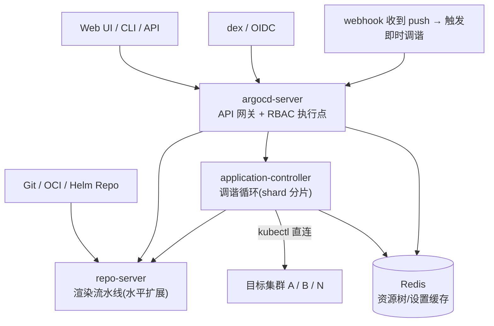
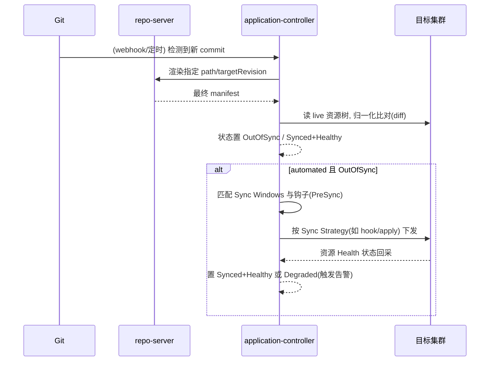

> 《GitOps》系列第 1 篇。Argo CD 是当前 Kubernetes GitOps 的事实标准之一：它把"Git 仓库是期望状态的唯一来源"这句话变成一台每三分钟转一圈的**调谐机器**。本篇讲清楚这台机器的四个齿轮——Application 调谐循环、repo-server 渲染流水线、AppProject 多租户边界、ApplicationSet 规模化生成——以及 3.x 时代（mTLS、提交签名校验、渐进式同步）把 GitOps 从"能用"推向"生产级"的关键变化。发布策略层的下一篇是姊妹篇《Argo Rollouts 基础应用实践》（GitOps 只负责"到版本"，渐进式交付负责"怎么到"），竞品视角可对照《Flux CD 基础应用实践》；平台化交付思想与《LLM 应用工程化专题体系总目录》L4 的 CI/CD 专题直接衔接。
>
> 口径说明：版本锚定 Argo CD **v3.x**（3.0 为架构基线，3.1 引入 OCI 源支持，3.2 于 2025-11 稳定发布，3.3/3.5 增加 PreDelete 钩子、OIDC 后台刷新、内部 mTLS 与 Git 提交签名校验；2.14 已于 2025-11-04 EOL）。核心概念（Application/Sync/Health/AppSet）自 2.x 起 API 稳定。性能数字为社区经验量级，非某集群实测。

---

# 第 0 章：全景链路

```text
 开发者 ──git push──▶ ┌──── Git 仓库(期望状态) ────┐ ◀── CI 更新镜像 tag (manifest 提交)
                      │  apps/web/overlays/prod/…  │
                      └──────────┬───────────────┘
                                 │ watch + pull (webhook 触发增量)
                     ┌───────────▼────────── Argo CD 控制面 ───────────┐
                     │ argocd-server(API/UI)  dex(RBAC 认证)  webhook  │
                     │ repo-server: 拉取→helm/kustomize 渲染→manifest  │
                     │ application-controller: 调谐 diff → Sync 下发    │
                     │              │ Redis(缓存)  Application CR       │
                     └──────────────┼──────────────────────────────────┘
                              直接写入(库内凭证=声明式 ServiceAccount)
                                      ▼
                        目标集群(prod/staging/dev) 真实资源 + Health 评估
                        漂移(drift) ──selfHeal──▶ 自动纠回 Git 描述的形态
```

一句话主线：**Argo CD = "拉取 Git → 渲染 manifest → 与集群 diff → 按策略同步 → 持续健康评估"的闭环控制器；它的产品力不在"能部署"，而在把部署历史、状态差异、权限边界全部变成可审计的 Kubernetes 对象。**

---

# 第 1 章：基础概念——GitOps 与 Argo CD 的定位

## 1.1 是什么

Argo CD 是 CNCF 毕业项目，一个运行在集群里的 **声明式 GitOps 持续交付工具**：以 `Application` CRD 声明"哪个源（Git/Helm/OCI/Ksonnet）的哪个路径，部署到哪个集群的哪个命名空间"，控制器负责让现实无限逼近 Git 里描述的理想。

两种形态的取舍：

| 形态 | 同步方式 | 适用 |
|------|---------|------|
| **Pull**（Argo CD 主流） | Argo CD 主动读 Git、写集群 | Git 凭证不出集群、多集群中心管控 |
| Push（如 Jenkins 推 kubectl） | CI 凭证进集群 | 存量流水线, 不属于 GitOps 主张 |

## 1.2 GitOps 四原则与 Argo CD 的对应

1. **声明式**：一切皆 manifest（helm/kustomize/plain YAML 都渲染成最终清单比对）；
2. **版本化不可变**：Git 历史即部署审计日志，回滚 = `git revert` 或 UI 选历史 revision；
3. **自动拉取**：application-controller 周期调谐（默认 180s）+ webhook 秒级感知；
4. **持续纠偏**：`selfHeal` 把人为 `kubectl` 手改打回 Git 描述态——这也是与"手动运维"文化最激烈的一次碰撞（见第 5 章陷阱）。

## 1.3 核心词汇表（先立骨架）

| 对象 | 职责一句话 |
|------|-----------|
| Application | 一个"源→目标"的部署单元，diff/sync/health 的载体 |
| AppProject | 租户边界：哪些源、哪些目标集群、哪些角色可用 |
| ApplicationSet | 工厂：用生成器按模板批量产出 Application |
| Sync Policy | automated + prune + selfHeal 三个开关组合出行为语义 |
| Health | 资源就绪判定（内置工作负载/CRD 自定义健康脚本） |
| Operation/Hook | PreSync/Sync/PostSync 钩子承载迁移、jobs 等编排步骤 |

---

# 第 2 章：核心架构与组件职责



| 组件 | 职责 | 扩展与故障要点 |
|------|------|--------------|
| argocd-server | API/UI、认证后 RBAC 落地、写 Application | 无状态多副本；v3.5 起内部组件间可强制 mTLS |
| repo-server | 拉源、helm template/kustomize build、gRPC 吐 manifest | CPU 密集, 按负载 HPA; 大 monorepo 渲染是首要瓶颈 |
| application-controller | watch 集群资源树、diff、执行 sync、health 评估 | 按 `--shard` 对 Application 分片; 监控 `argocd_app_reconcile` 耗时 |
| dex | SSO 连接器（OIDC→本地角色） | 3.3 起 OIDC token 后台自动刷新, 消除"干活中被踢出" |
| Redis | 缓存资源树与设置 | HA 版用 Redis 主从; 全失效后重建风暴要预期 |
| argocd-applicationset-controller | AppSet 生成器引擎 | 与 controller 同 Deployment 家族, 可独立伸缩 |

**信任模型是 Argo CD 最容易讲错的一点**：它用"存储在集群里的声明式凭证（`argocd-secret` / cluster Secret，内含各集群 ServiceAccount token）"直写目标集群，不依赖 kubeconfig 登录动作——因此**GitOps 平台的权限审计要看 SA 与 AppProject，而不是看谁敲了 kubectl**。

---

# 第 3 章：工作原理——调谐循环与一次 Sync 的旅程

## 3.1 双循环模型

- **调谐循环（reconcile，常态）**：watch Git 变化与集群变化 → 更新"期望 vs 实际"的状态与 diff 结果，**不自动改现实**；
- **同步循环（sync，动作）**：手动/UI/CLI 触发，或 `automated: true` 时由调谐发现 OutOfSync 自动执行。



diff 归一化是关键工程细节：Argo CD 对 live 与 desired 做 normalize（默认值补全、已知噪声字段忽略），再配合 `ignoreDifferences`（按 JSON Path/GVK 忽略 CRD 内部字段、operator 回填的 status 等）压掉假 OutOfSync——**ignoreDifferences 用得克制与否，直接决定平台可信度**。

## 3.2 Sync Wave 与 Hook：把"一批资源的先后"讲清楚

- **Wave**（`argocd.argoproj.io/sync-wave: "-1"`）：同一 Application 内按整数分批下发，常用于"先建 operator/CRD，再建 CR"；
- **Hook**（`argocd.argoproj.io/sync-hook: PreSync|Sync|PostSync`）：在相位执行 Job/工作负载后即退出，适合 DB 迁移、冒烟测试；
- 跨 Application 依赖用 `depends-on` Sync Wave 注解（App 级排序），3.3 起删除路径也有 PreDelete hook 防止"先删 Service 后删 Pod"级联故障。

## 3.3 ApplicationSet：从 N 份手工 YAML 到生成器

```yaml
apiVersion: argoproj.io/v1alpha1
kind: ApplicationSet
metadata: {name: teams, namespace: argocd}
spec:
  goTemplate: true
  generators:
    - git:                       # 目录即应用: monorepo 每团队一子目录
        repoURL: https://git.example.com/platform
        revision: main
        path: "apps/*/team"
        pathParamsEnabled: true
  template:
    metadata: {name: '{{.path.basename}}-{{.cluster.name}}'}
    spec:
      project: teams
      source: {repoURL: ..., targetRevision: main, path: '{{.path.path}}'}
      destination: {name: '{{.cluster.name}}', namespace: 'app-{{.path.basename}}'}
      syncPolicy: {automated: {prune: true, selfHeal: true}}
```

- 常用生成器：`list`（集群/环境清单）、`clusters`（按 label 选集群）、`git` dirs/files、`matrix` 组合、`pull-request`（预览环境，PR 关闭即删）、`template` 嵌套；
- **3.2 的 Progressive Sync**：AppSet 产出的大量 Application 可按命名空间/标签分批滚动同步，控制变更爆炸半径——AppSet 大规模使用后这是必备阀门。

---

# 第 4 章：多集群接入与生产部署形态

## 4.1 集群注册：声明式优先

```bash
argocd cluster add --name prod-cn-east --in-cluster=false --service-account argocd-application-controller KUBECONTEXT=prod
# 生产建议直接声明 cluster Secret(argocd namespace, label argocd.argoproj.io/secret-type=cluster-...)
```

Secret 里的 `config` 字段就是集群连接信息 + bearer token；命名规范（name/server）与 `--dest-server` 匹配。多集群下目标写 `server: https://k8s.example:6443` 或 `name: prod-cn-east` 二选一，**混用会造成 AppProject destinations 校验歧义**。

## 4.2 部署模式选型

| 模式 | 描述 | 适用 |
|------|------|------|
| 单实例管多集群 | 一个 argocd 管 N 个目标集群 | 团队<20, 集群<10, 最简单 |
| App-of-Apps | 一个 root App 管理其余 App 清单 | 把 App 定义也纳入 Git 自举 |
| HA 安装 | 官方 argocd-ha install, server/controller/repo 多副本 + Redis 主从 | 生产标配 |
| 集群分裂/联邦 | 每大区一套 Argo CD + Karmada 等控制面（参《Karmada》篇） | 超大规模/合规分区 |

## 4.3 参数与容量速查

| 参数 | 默认/建议 | 说明 |
|------|----------|------|
| `timeout.reconciliation` | 180s / 60-300s | 全量调谐周期; webhook 已覆盖增量, 不必激进调小 |
| `--shard`（controller） | 自动 / 按 App 数规划 | Application 分片数, 单分片上限≈数百至千级 App |
| repo-server 副本 | 1 / HPA(渲染 QPS 驱动) | helm/kustomize 渲染 CPU 密集 |
| `argocd_redis` | 单实例 / HA 必配 | 缓存失效风暴的缓冲 |
| `kustomize.buildOptions` / `--helm-enable-mpi` | 按源类型 | 渲染能力开关 |
| API Key / OIDC | rbac 配置 `policy.csv` | AppProject + RBAC 双闸门, 平台审计看这两层 |
| `sourceIntegrity.required`（3.5+） | 关 / 核心应用开 | Git commit 签名验证, 供应链防线 |

---

# 5 章：应用场景、反模式与故障排查

## 5.1 适合 / 不适合

- **适合**：多集群应用配置交付、平台团队做自助交付底座（UI 即门户）、需要"谁在何时把集群改成了什么"的完整审计、Helm/Kustomize 混源。
- **不适合**：把业务数据写进 Git（仓库膨胀）、以 Argo CD 当 Secret 管理系统（配合 External Secrets/Vault，只同步引用）、需要复杂多步骤发布编排（交给 Argo Workflows/Rollouts，不要让 sync-wave 承担流水线职责）。

## 5.2 高频反模式

| 反模式 | 后果 | 纠正 |
|--------|------|------|
| selfHeal 开着, 运维仍手工 kubectl 改线上 | 人为补丁被反复打回, "幽灵回滚" | 变更一律走 Git; 紧急手改同步补 PR |
| 用 `kubectl delete` 删 App 而 ignoreWebhook 缺位 | finalizer 卡住/级联删生产资源 | UI/CLI 删除 + prune 谨慎; 开 PreDelete hook |
| ignoreDifferences 无脑通配大段 | 真漂移被掩耳盗铃 | 仅对 operator 回填字段精确到 JSON Path |
| AppSet 一次生成数千 App 无 Progressive Sync | controller/repo-server 雪崩 | 分批 + 限并发(AppSet 并发控制) |
| CI 直接 push 到 Git 又用同一 SA 当 Git 身份 | 审计失去"人"的维度 | 机器人账号 + 提交签名(3.5 source integrity) |

## 5.3 典型故障定位路径

```mermaid
flowchart TD
    S["应用一直 OutOfSync / Sync 失败"] --> A{"diff 是真差异吗?"}
    A -->|假差异(默认值/status)| C1["ignoreDifferences 精确屏蔽"]
    A -->|真差异| B{"repo-server 渲染报错?"}
    B -->|helm/kustomize 错误| C2["argocd-server 日志→ 手动进 repo-server pod 复现渲染"]
    B -->|渲染正常| D{"目标集群写入了吗?"}
    D -->|Unknown/Error| C3["检查 cluster Secret 凭证/网络, controller 日志中该 App shard"]
    D -->|已下发但 Degraded| C4["Resource Events + health 评估; CRD 补自定义 health.lua"]
    D -->|反复同步| C5["查 webhook 风暴/operator 互写: 两方都在改同一字段"]
```

排障第一现场永远是 `argocd-cm`/RBAC 之外的东西：**Application 资源事件（Events）、controller 日志按 shard grep、`argocd app get --show-operations`**；配合内置指标 `argocd_app_info`、`argocd_app_reconcile`、`argocd_repo_server_*` 可接入 Prometheus 告警（与站内《Ceph 监控日志指标告警》同一套方法论）。

---

# 附录

## A. 实操速查

```bash
argocd app create web --repo https://git.example.com/platform --path apps/web \
  --dest-server https://k8s-prod:6443 --dest-namespace web --project default
argocd app sync web --prune
argocd app diff web                      # 看真实差异
argocd app set web --sync-policy automated --self-heal --auto-prune
argocd app history web                   # 部署历史(回滚依据)
argocd admin application generate-manifests   # 本地离线渲染排错
```

## B. 术语速查

| 术语 | 一句话 |
|------|--------|
| 调谐(reconcile) | 对比期望与实际并更新状态, 不必然改动现实 |
| prune | Git 已删资源时允许同步删除集群资源 |
| selfHeal | 集群漂移自动纠回 Git 描述态 |
| Sync Wave / Hook | App 内分批顺序 / 相位一次性动作 |
| AppProject | 源、目标、RBAC、Sync Windows 的租户边界 |
| ApplicationSet | 以生成器批量生产 Application 的工厂 CRD |
| Progressive Sync | AppSet 产物的分批滚动同步(3.2+) |
| source integrity | 同步前校验 Git commit 签名有效性(3.5+) |

## C. 参考资料

1. [Argo CD 官方文档](https://argo-cd.readthedocs.io/) — 架构、同步策略、AppSet、3.x 升级指南。✅ 已核实
2. [Argo CD 3.2 发布与 2.14 EOL（2025-11）](https://blog.argoproj.io/) — 版本演进口径。✅ 已核实
3. InfoQ《Argo CD 3.5 推出内部 mTLS 与源码完整性校验》(2026-07) — mTLS/Git 签名验证/Helm4/AppSet UI。✅ 已核实
4. CVE-2025-23216（Argo CD <2.13.4 信息泄露）— 密钥泄漏进错误消息的教训：勿把秘密放 Git 明文。✅ 已核实
5. 姊妹篇：《【ArgoRollout】基础应用实践》《【FluxCD】基础应用实践》《【Karmada】基础应用实践》。✅ 站内

## D. 变更记录

| 日期 | 版本 | 变更内容 |
|------|------|---------|
| 2026-10-29 | v1.0 | 首版：GitOps 四原则对应、四组件架构与信任模型、双循环调谐与 Sync 时序、Wave/Hook、ApplicationSet 与渐进式同步、多集群接入与容量参数、反模式与故障树，含全景链路与多处 Mermaid 图 |
