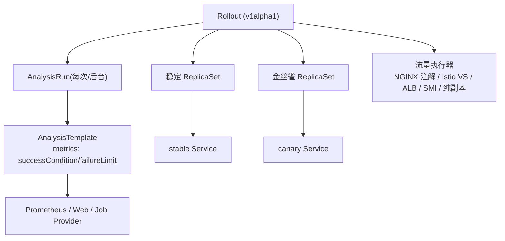
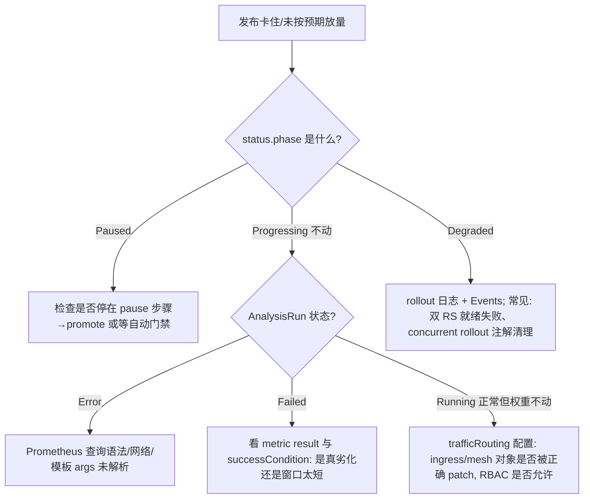

> 《GitOps》系列第 2 篇。姊妹篇《Argo CD 基础应用实践》解决"期望状态如何到达集群"，本篇解决另一半问题：**到达的过程中如何控制爆炸半径**。Argo Rollouts 用一个 `Rollout` CRD 替换 Deployment，把"5% → 观察 → 25% → 指标门禁 → 100%"写成声明式状态机：流量权重由 Ingress/服务网格执行，推进或回滚由 Prometheus 等指标证据决定。读完你应该能设计一套"指标驱动的发布门禁"，并理解它与 GitOps 引擎共处时的边界条款（selfHeal 与 promote 的所有权之争）。服务网格视角可回看《Knative》系列的网关/流量分配，指标门禁思想与站内《基于指标的自动摘流保护》同源。
>
> 口径说明：版本锚定 Argo Rollouts **v1.x 稳定线（Rollout/AnalysisTemplate API 为 v1alpha1 但核心能力已生产可用）**；流量切分覆盖 NGINX Ingress 注解、Istio VirtualService、ALB、SMI 及"无流量代理"的纯副本数模式；分析源以 Prometheus 为主。金丝雀统计有效性的流量下限是经验约束，非固定阈值。

---

# 第 0 章：全景链路

```text
 git push(新镜像 tag 写入 Rollout) ──▶ Argo CD 同步 Rollout 对象
                                          │
                 ┌────────────────────────▼─────────────┐
                 │        rollout-controller            │
                 │  状态机: Stable → CanaryProgressing   │
                 │  ├─ canary steps: setWeight/pause/    │
                 │  │   analysis/setCanaryScale          │
                 │  ├─ 生成 ReplicaSet(稳定/金丝雀)       │
                 │  └─ 失败→自动回滚(abort)→稳定版本兜底  │
                 └───┬──────────────┬──────────────┬─────┘
              改 Service  selector/  改 VirtualService/  创建
              (nginx 权重注解)      ( Istio 流量比例)   AnalysisRun ──▶ 查询 Prometheus
                  ▼                    ▼                    │  successCondition
            stable Pod ◀── 流量 ──▶ canary Pod ◀── 指标证据 ── 失败→abort→promote 冻结
                  ▲                                          成功→进入下一 step
                  └──────────── 100% 后稳定版接管, 旧 RS 缩容 ┘
```

一句话主线：**Rollout = "ReplicaSet 双版本 + 可编程流量状态机 + 指标裁判"；它把发布从"一次性豪赌"变成"一串带证据的小赌注"。**

---

# 第 1 章：为什么需要渐进式交付

## 1.1 Deployment 的天花板

原生 RollingUpdate 只有两个旋钮（maxSurge/maxUnavailable），缺陷在生产暴露得很直白：新版本 Bug 会随滚动进度**不可逆地感染**剩余容量；无法停在 30% 观察一夜；"回滚"要重推旧镜像再等一次滚动；发布决策完全靠人盯 Grafana。

| 发布模式 | 流量粒度 | 指标自动门禁 | 回滚速度 | 适用 |
|----------|---------|-------------|---------|------|
| RollingUpdate | 无（逐个替换） | 无 | 分钟级(重滚) | 无状态默认服务 |
| 蓝绿 | 0/100 | 可人工 | 秒级(切 Service) | 核心系统、需瞬时切换 |
| 金丝雀 | 5/25/50/100 | **Rollouts 原生** | 秒级(权重归零) | 有足够流量的在线服务 |
| 特性开关 | 按用户/租户 | 应用层 | 即时 | 低流量服务(金丝雀无统计意义时) |

一个常被忽略的判据：**5% 切片若一天都收不到几百个请求，指标门禁就没有统计意义**——低流量服务应选蓝绿或特性开关，而不是硬套金丝雀。

## 1.2 Rollouts 与 GitOps 的分工

Argo CD 负责把 `Rollout` 对象**送达**；Rollouts controller 负责**送达之后怎么放量**。Git 里只声明"目标版本 + 发布策略"，放量进度是运行时状态——这正是后文所有权冲突的根源。

---

# 第 2 章：核心架构与对象模型



| 对象 | 职责 | 生命周期 |
|------|------|---------|
| Rollout | 替代 Deployment 的工作负载+发布状态机 | 长期存在, spec 变更触发新发布 |
| AnalysisTemplate | 可复用的指标裁判模板（含 args） | 模板, 多次实例化 |
| AnalysisRun | 一次具体测量（interval/count 循环查询） | 发布中创建, Completed 后 GC |
| Experiment | 短时双版本对照实验（如新架构影子跑） | ttl 到期自动清理 |

## 2.1 金丝雀：steps 是状态机的节拍器

```yaml
apiVersion: argoproj.io/v1alpha1
kind: Rollout
metadata: {name: web}
spec:
  replicas: 20
  selector: {matchLabels: {app: web}}
  template: {spec: {containers: [{name: app, image: web:v2}]}}
  strategy:
    canary:
      stableService: web-stable
      canaryService: web-canary
      trafficRouting:                      # 真实流量比例(而非副本比例)
        nginx: {stableIngress: web-ing, canaryIngress: web-canary-ing, additionalHeaders: [demo]}
      canaryAnalysis:                      # 每个 step 后的指标裁判
        interval: 1m
        analysisCount: 3
        maxWeight: 50
        stepWeight: 10
        metrics:
          - name: success-rate
            successCondition: result[0] >= 0.95
            failureLimit: 0
        warnings:                          # 警告不直接杀发布, 累计才失败
          - name: p99-rt
            successCondition: result[0] <= 500
      steps:
        - setWeight: 5
        - pause: {}                        # 手动确认点: kubectl argo rollouts promote web
        - setWeight: 25
        - pause: {duration: 10m}
        - analysis: {templates: [{templateName: http-ok}]}
        - setWeight: 100
```

要点拆三层：**副本比例**（setCanaryScale）与**流量比例**（trafficRouting）解耦——没有网格时用"副本 10%/90% 近似流量"是危险近似（同 Pod 数≠同负载），有能力就做 header 路由或 mesh 权重；`pause: {}` 是人工门禁点，`promote/abort` 是它的两条出路；`canaryAnalysis` 老写法仍有效，新集群建议统一用 `analysis` 模板引用以便复用与版本化。

## 2.2 AnalysisTemplate：裁判的写法边界

```yaml
apiVersion: argoproj.io/v1alpha1
kind: AnalysisTemplate
metadata: {name: success-rate}
spec:
  args: [{name: app}]
  metrics:
    - name: success-rate
      interval: 1m
      count: 5
      successCondition: result[0] >= 0.95
      failureLimit: 1                      # 允许 1 次毛刺
      provider:
        prometheus:
          address: http://prometheus.monitoring:9090
          query: |
            sum(rate(http_requests_total{app="{{args.app}}",code!~"5.."}[2m]))
            / sum(rate(http_requests_total{app="{{args.app}}"}[2m]))
```

设计判据：**查询窗口 ≥ 2 个 scrape interval，successCondition 对 `result[0]` 做空值防御（Prometheus 返回空数组会被判失败）**；高危指标 `failureLimit: 0`，观察性指标放 `warnings`。provider 还有 Web（任意 HTTP+JSONPath）、Job/Pod（把"跑集成测试"当指标）——**把验收写成可执行断言，而不是人肉截图**是 Analysis 的工程本质。

## 2.3 蓝绿：preview 即预发，active 即生产

`blueGreen: {activeService, previewService, autoPromotionEnabled: false}` 下，新版本先跑在 preview Service，人工验证后 `promote` 原子切 active；`scaleDownDelaySeconds` 控制旧版本存活时长（秒级回滚窗口 + 连接优雅排空）；`abortScaleDownDelaySeconds` 决定回滚后金丝雀 Pod 留尸取证的时间。

---

# 第 3 章：与 Argo CD 共处——所有权边界与生产参数

## 3.1 三个必踩的坑（提前交学费）

| 坑 | 机制 | 解法 |
|----|------|------|
| selfHeal 覆盖 promote/abort | 运维用 CLI 改 Rollout 运行时状态, Argo CD 视为漂移打回 | 发布期对该 App 关 selfHeal 或 `argocd.argoproj.io/sync-options: Skip=...`；把 promote 决策也纳入 Git 驱动(改 spec) |
| Argo CD 把"分析失败的金丝雀"报健康 | Deployment 级 health 只看 RS 就绪 | 给 Rollout 配自定义 health.lua（读 `status.phase`），使 Degraded 能拦住同步 |
| Flagger/Rollouts 与 Argo CD 抢 Deployment | 第三方改 pod template 被当漂移 | 统一 `ignoreDifferences` 或用 Rollouts 自身机制, 不混用两个放量控制器 |

## 3.2 关键参数速查

| 参数 | 默认/建议 | 说明 |
|------|----------|------|
| `spec.strategy.canary.abortScaleDownDelaySeconds` | 0(立即) / 300-1800s | 回滚后留金丝雀 Pod 取证 |
| `analysis.startingStep` | 0 | 后台持续分析从第几步开始 |
| `metrics[i].failureLimit` | 0 / 核心 1, 观察 2-3 | 容忍毛刺次数 |
| `maxSurge/maxUnavailable`(Rollout 顶层) | 25%/25% | 非发布期的常规滚动行为 |
| controller `--threads` | 2 / 按 App 数扩 | 并发 reconcile |
| `rollouts-spec` 注解 `argoproj.io/disable-auto-promotion` | — | 长期停在最后一步不自动 100% |

## 3.3 发布闭环运维操作

```bash
kubectl argo rollouts get rollout web --watch     # 终端状态机视图
kubectl argo rollouts promote web                  # 过人工门禁
kubectl argo rollouts abort web                    # 立即回滚(切回稳定 RS)
kubectl argo rollouts retry web                    # 修复后重试
kubectl argo rollouts undo web                     # 回退模板修订
```

---

# 第 4 章：进阶形态——A/B、Experiment 与持续验证

- **Header-based A/B**：`trafficRouting` 的 `additionalHeaders: [demo]` 把带特定头的请求钉在金丝雀，配合网关/前端灰度标，实现"内部员工先吃狗粮"的定向发布；SMI/Istio 可按 weight + header 组合路由。
- **Experiment**：`stableSet`/`templateSets` + `duration` + `analysers`，给"新架构影子对照 30 分钟"这类一次性验证提供带 TTL 的沙盒，结果写入 AnalysisRun 指标。
- **发布即评测**：把 Rollouts 指标门禁与《LLM 应用工程化》4.5 评测思想同构——Prompt/模型变更的灰度也用"延迟/错误率/答案质量抽样"做自动推进依据；Rollouts 管 Deployment 维度，LLM 灰度可复用同一套"权重+裁判+止损"骨架。

---

# 第 5 章：应用场景、局限与故障排查

## 5.1 适合 / 不适合

**适合**：有可观测证据链（Prometheus/日志可用）的在线服务、多环境统一发布 SOP、需要发布审计与自动止损的核心链路。
**不适合**：无指标可用或流量过低的长尾服务（门禁无统计意义）、强有状态且 Pod 身份不可复制的负载（蓝绿双跑代价极高，考虑 OpenKruise 原地升级路线）、用 Rollouts 做多集群编排（它不管跨集群）。

## 5.2 已知局限（如实记录）

- API 仍标 `v1alpha1`：核心行为稳定但升级偶有字段迁移（如 canaryAnalysis→analysis 风格统一），**版本钉死 + 变更日志逐读**是稳妥姿势；
- 流量比例依赖外部执行器质量：NGINX 注解模式只支持"两个 ingress + 权重"的粗粒度，精确到 1% 需 mesh/ALB/Gateway API 插件（v1.4+ Gateway API 支持）；
- 无内建"部署策略跨环境编排"（每集群各管各的，与 K8s Job/CronJob 类比：它是工作负载层工具, 不是流水线引擎）。

## 5.3 故障定位树



---

# 附录

## A. 选型对照（含生态竞品）

| 维度 | Argo Rollouts | Flagger | 原生 Deployment+人工 |
|------|--------------|---------|--------------------|
| 工作负载模型 | Rollout CRD 替换 Deployment | 保留 Deployment 叠加 Canary CR | — |
| 策略 | 金丝雀/蓝绿/金丝雀+A/B | 金丝雀/蓝绿/A-B/Metrics 分析模板 | 滚动 |
| 流量生态 | NGINX/Istio/ALB/SMI/Gateway/Traefik | Istio/Linkerd/NGINX/Contour/Gloo(偏 mesh) | 无 |
| 与 Argo CD | 原生集成(同族) | 需 ignoreDifferences 调停 | 天然兼容 |
| 分析裁判 | AnalysisTemplate(多 provider) | 内建 metricName 模板 | 人肉 |
| 适合 | Argo 栈、要细粒度状态机控制 | Flux 栈/重度 mesh | 低风险长尾服务 |

## B. 术语速查

| 术语 | 一句话 |
|------|--------|
| Progressive Delivery | 渐进式交付: 发布分阶段且每阶段有证据门禁 |
| setWeight / setCanaryScale | 流量百分比 / 金丝雀副本数(两者解耦) |
| stable/canary Service | 指向两个 ReplicaSet 组的入口 Service |
| AnalysisRun/Template | 一次指标测量 / 可复用测量模板 |
| failureLimit | 允许失败次数, 超了 abort |
| promote/abort | 人工推进 / 立即回退到稳定版 |
| Experiment | 带 TTL 的双版本对照沙盒 |
| preview Service | 蓝绿模式下指向新版本的验证入口 |

## C. 参考资料

1. [Argo Rollouts 官方文档](https://argoproj.github.io/rollouts/) — Rollout/Analysis/Experiment、流量路由矩阵。✅ 已核实
2. [渐进式交付与发布门禁选型决策（2026-09）](https://cndevops.com/devops-progressive-delivery-gating-20260921-13/) — Rollouts/Flagger/Spinnaker 对比与"流量统计意义"判据。✅ 已核实
3. 腾讯云开发者社区《渐进式交付：Argo Rollouts 金丝雀与蓝绿发布》— Argo CD selfHeal 覆盖 promote 的实战坑。✅ 已核实
4. InfoQ/各社区对 AnalysisTemplate+Prometheus 的持续分析用法。✅ 已核实
5. 姊妹篇：《【ArgoCD】基础应用实践》《【FluxCD】基础应用实践》。✅ 站内

## D. 变更记录

| 日期 | 版本 | 变更内容 |
|------|------|---------|
| 2026-10-29 | v1.0 | 首版：渐进式交付判据与模式对比、Rollout 对象模型、金丝雀 steps/流量与副本解耦/AnalysisTemplate 裁判写法、蓝绿 preview/active、与 Argo CD 的三处所有权冲突、参数速查、A/B 与 Experiment、故障树，含全景链路与多处 Mermaid 图 |
