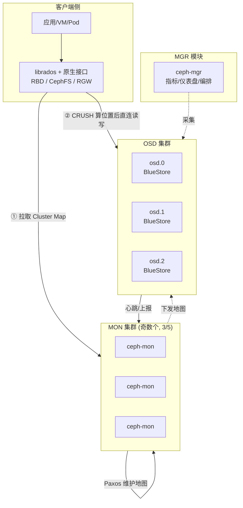
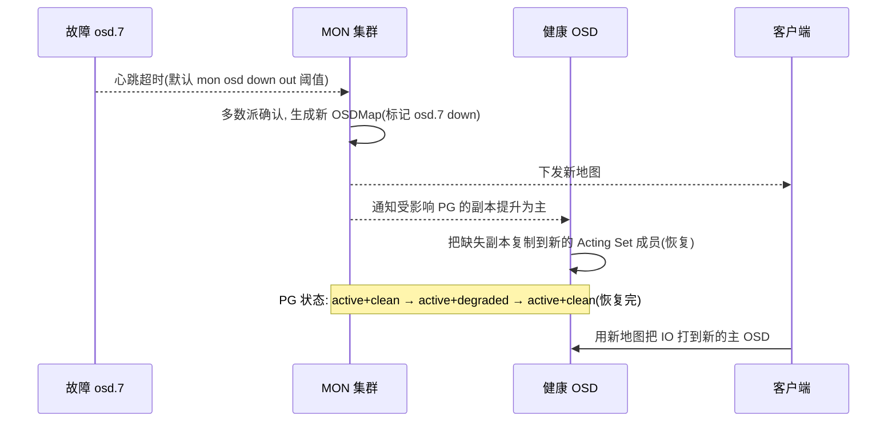
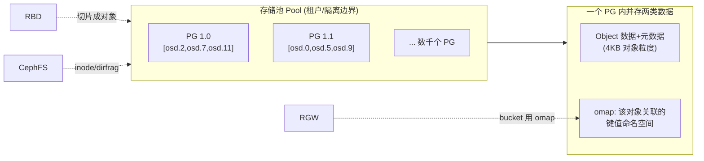

> 这是《Ceph 分布式存储》系列第 1 篇，也是整个系列的**地基**。后续五篇分别展开：部署实践（第 2 篇）、块存储 RBD（第 3 篇）、文件存储 CephFS（第 4 篇）、对象存储 RGW（第 5 篇）、监控日志告警（第 6 篇）。本篇只回答一个问题：**Ceph 凭什么用同一套底层同时支撑块、文件、对象三种存储**。想理解后面任何一种存储类型，都要先理解这里的 RADOS 与 CRUSH。
>
> 口径说明：全文版本锚定 Ceph **Squid v19.2.x**（现行稳定/LTS 线，Reef 18.2.x 为其前代 LTS，Tentacle 20.x 为新一代特性线，涉及处显式标注），部署工具统一为官方推荐的 **cephadm**（容器化）。架构图用 Mermaid 绘制，可在本站与 GitHub 源码视图直接渲染。Ceph 由 Sage Weil 于 2003 年发起，2012 年成立 Inktank，2014 年并入 Red Hat，采用 LGPL 开源。

---

# 第 1 章：引言 - Ceph 到底在回答什么问题

## 1.1 一句话定义

> **Ceph 是一个把"数据分布、副本复制、故障自愈"这三件事下沉到统一存储内核（RADOS），从而让块、文件、对象三种存储共享同一个可扩展底座的软件定义分布式存储系统。**

传统上，块存储（SAN）、文件存储（NAS）、对象存储（S3）是三套完全独立的系统，各买各的、各运维各的。Ceph 的核心洞见是：**这三种存储本质上都是"把字节按某种规则切成对象、分布到一堆磁盘上"**，区别只在"给用户暴露什么接口"。于是它把共性的那一半（分布 + 复制 + 恢复）做成一个内核 RADOS，把个性的那一半（接口语义）做成三个网关。

## 1.2 Ceph 要回答的三份账

| 问题域 | 具体追问 | 对应能力 |
|--------|---------|---------|
| **数据放哪** | 一个对象该落在哪几台机器的哪块盘上，且加/减机器时尽量少搬数据 | CRUSH 算法 + PG 归置组 |
| **数据可靠吗** | 磁盘/节点挂了，数据会不会丢、能不能自动补齐 | 多副本 / 纠删码 + OSD 心跳自愈 |
| **接口怎么变** | 同一份对象存储，如何分别伪装成块设备、POSIX 目录、S3 Bucket | RBD / CephFS / RGW 三大原生接口 |

> **关键认知**：读懂 Ceph 的顺序永远是 **先 RADOS、后三大接口**。RBD、CephFS、RGW 都不自己管数据分布，它们把数据统统切成 RADOS 对象扔进存储池（Pool），再各自维护"接口语义 ↔ 对象"的映射。第 3/4/5 篇讲的本质就是这个映射怎么建。

## 1.3 全景：一次写穿过 Ceph 的那张网

```text
        客户端 (VM / Pod / SDK / S3 API)
             │
             ↓
   ┌─────────────────────────┐
   │  原生接口层 (Native API)  │  ← RBD / CephFS(MDS) / RGW
   └──────────┬──────────────┘
              │  把"块/文件/对象"翻译成一组 RADOS 对象写
              ↓
   ┌─────────────────────────┐
   │  LIBRADOS (客户端库)      │  ← 缓存 CRUSH Map，自己算对象去哪
   └──────────┬──────────────┘
              │  直接对目标 OSD 读写，不经过中心节点
              ↓
   ┌─────────────────────────┐
   │  RADOS 内核              │
   │  MON(集群地图) + OSD(数据) │  ← CRUSH 分布 / 副本复制 / PG 自愈
   └──────────┬──────────────┘
              ↓
        裸盘 (BlueStore 直接管理)
```

注意那条最关键的箭头：**librados 客户端自己算 CRUSH、直连 OSD**，中间没有一个"中心数据节点"转发。这是 Ceph 能线性扩展、没有单点吞吐瓶颈的根因。

---

# 第 2 章：基础架构 - RADOS 的三大角色

## 2.1 架构总览



## 2.2 核心组件职责

| 组件 | 全称 | 职责 | 挂了会怎样 |
|------|------|------|-----------|
| **MON** | ceph-mon | 用 Paxos 维护**集群地图**（MonMap/OSDMap/CRUSH Map/PGMap/MDSMap），是集群的"权威真相源"；不碰数据本身 | 多数派存活即可；客户端仍能读缓存地图继续 IO |
| **OSD** | ceph-osd | 每块盘一个 OSD，真正**存数据、做副本复制、执行 CRUSH 摆放、故障自愈** | 该盘 PG 降级，触发复制/恢复，数据不丢（有副本） |
| **MGR** | ceph-mgr | 集群的"仪表盘与遥控器"：收集 Prometheus 指标、跑 Web 仪表盘、承载各种模块（含部署编排、balancer） | 不影响数据 IO，只影响监控/管理 |
| **MDS** | ceph-mds | 仅 CephFS 需要：管理**目录树元数据**（POSIX 层级 ↔ RADOS 对象） | 只影响 CephFS 挂载，块/对象不受影响 |
| **RGW** | ceph-rgw | 对象网关，提供 S3 / Swift 兼容 REST API，底下用 RADOS 存 | 只影响对象接口 |

> MON / OSD / MGR 是**每个 Ceph 集群都必须有**的三件套；MDS、RGW 是按需启用的"接口型"守护进程。第 2 篇部署时会看到：`cephadm bootstrap` 先起 MON+MGR+一个 OSD，再按需加 MDS/RGW。

## 2.3 为什么 MON 必须是奇数个

MON 靠 **Paxos 共识**维护地图，需要**多数派（quorum）**存活才能写入新地图。3 个容忍挂 1 个、5 个容忍挂 2 个。偶数（如 4）相较 3 并不提升容错（4 个也仅容忍挂 1 个仍能多数派是 3… 实际容忍 1），却徒增共识开销，故惯例取 3 或 5。客户端短时间仍能用**缓存的旧地图**继续 IO，只有地图需要更新时才强依赖 quorum。

---

# 第 3 章：工作原理 - 数据到底怎么放、怎么自愈

## 3.1 从对象到磁盘的四步映射

Ceph 把一个用户对象定位到物理盘，靠一条纯计算的链路，**任何客户端都能独立算出来**（这正是去中心化的精髓）：

```text
对象名 OID  --(a) 哈希-->  PG 号  --(b) CRUSH-->  存放该 PG 的一组 OSD
   "rbd_data.xxx/head/0"        pool大小取模        按副本数选出 osd.2,osd.7,osd.11
```

1. **(a) 对象 → PG**：`PG = hash(object) mod num_pg`。对象不直接映射到盘，而是先归到**归置组 PG（Placement Group）**这个中间层。
2. **为什么要有 PG**：如果每个对象独立算位置，集群再平衡时粒度太细、地图太大。PG 把海量对象**捆成有限个桶**（典型几千个），让"数据分布"这件事的计算量和地图规模可控。
3. **(b) PG → OSD（CRUSH）**：CRUSH 拿 **CRUSH Map**（描述"机房→机架→主机→OSD"的层级树 + 权重 + 失败域规则），对每个 PG 跑一遍伪随机一致性映射，选出一串 OSD 作为它的 **Acting Set**（第一为主 OSD，其余为副本）。
4. **主 OSD 写、副本确认**：写请求发给主 OSD，主 OSD 并行复制给 Acting Set 里的副本 OSD，多数写成功后回 ACK。

## 3.2 CRUSH 的两大绝活

CRUSH（**C**alibrated **R**andom **U**nderpl**C**ed **H**ashing，一致性哈希的演进版）之所以是 Ceph 的心脏，在于它同时满足了两个天然矛盾的目标：

| 目标 | CRUSH 怎么做到 | 带来的价值 |
|------|---------------|-----------|
| **无中心计算** | 算法是确定性的：给定对象名 + 地图，谁算都得到同一个 OSD 集合 | 客户端直连 OSD，无需元数据服务器中转，吞吐可线性扩展 |
| **增删节点少搬数据** | 一致性哈希 + 权重，让扩容只移动 `1/N` 量级的 PG | 加一台 OSD 不会引发全集群数据大搬迁 |
| **失败域感知** | 层级树把 OSD 归到 host/rack/row/room/datacenter，规则可要求副本跨故障域 | 整机架断电也不丢数据，副本天然打散 |

> **设计哲学对比**：传统"中心元数据 + 一致性哈希环"（如早期分布式方案）在超大规模下元数据服务器成瓶颈；CRUSH 用"把算法摊到每个客户端 + 用 PG 收粒度"绕开了这个瓶颈。这是理解 Ceph 扩展性的关键。

## 3.3 故障自愈的完整流程



关键点：**故障检测靠 OSD↔MON 心跳**，**数据重建靠副本 OSD 之间直接复制**（不经过 MON，MON 只改地图）。整条自愈路径里没有"人工重新平衡"，这就是 Ceph 自称 self-healing 的底气。

## 3.4 BlueStore：OSD 如何直接管裸盘

现代 Ceph（Nautilus 起默认）用 **BlueStore** 取代旧的 FileStore。FileStore 把对象写到一个完整文件系统（XFS）上，有"日志写两次（journal + 数据）"和元数据开销；BlueStore **直接管理裸块设备**，用自研的 RocksDB 存元数据、把对象数据以 extent 直接写盘，避免了双重写入与文件系统层的写放大。

- **性能**：省掉 journal 二次写，写路径更短，IOPS/吞吐显著提升，尤其 NVMe。
- **校验**：每个对象数据块带 CRC，读时校验，静默数据损坏（bit rot）可检测并可从副本修复。
- **压缩**：支持 per-pool 透明压缩（Snappy/LZ4/Zstd/Deflate）。

---

# 第 4 章：结构设计 - 存储池、PG 与三种命名空间

## 4.1 模块划分与关键抽象



## 4.2 三个必须记住的抽象

| 抽象 | 是什么 | 为什么重要 |
|------|--------|-----------|
| **Pool（存储池）** | 一组 PG 的集合，是副本数/CRUSH 规则/压缩/租户隔离的配置单元 | 三种接口都"往某个 pool 里放对象"；pool 是运维调度和隔离的抓手 |
| **PG（归置组）** | 对象到 OSD 的中间映射桶，`num_pg` 决定分布粒度 | PG 数量规划不当会导致再平衡不均（经验法则：每 OSD 约 100 PG） |
| **Object + omap** | RADOS 对象有数据、属性（xattr）、以及 **omap 键值命名空间** | omap 是 RGW 存 bucket 索引、CephFS 存文件布局的关键机制——不是简单 blob |

## 4.3 CRUSH Map 的层级结构

CRUSH Map 用一张"失败域树"描述硬件拓扑，规则（rule）决定"一个 PG 的副本必须怎么跨越这些层级"：

```text
root (bucket)
 └── datacenter: dc1
      └── rack: rack-a
           └── host: node-1
                ├── osd.0  (weight = 容量/1TB)
                └── osd.1
```

一条典型规则 `replicated_rule`：`chooseleaf-firstn num_rep=3` → 含义是"在 3 个**不同的叶子域（默认 host）**各放一个副本"，从而保证一台物理机挂了不丢数据。

---

# 第 5 章：应用场景与选型

## 5.1 Ceph 适合什么

| 场景 | 为什么选 Ceph | 对应接口 |
|------|--------------|---------|
| OpenStack / 私有云统一后端 | 一套集群同时供 Cinder 卷、Glance 镜像、Swift 对象 | RBD + RGW |
| Kubernetes 持久化存储 | CSI（RBD 块 / CephFS 文件 / RGW 对象）全覆盖 | 三者皆可 |
| 需要 POSIX 语义的共享文件系统 | 多客户端同时读写同一目录树 | CephFS |
| 海量非结构化数据、S3 生态 | 兼容 S3 API、EB 级扩展 | RGW |

## 5.2 不适合什么（先泼冷水）

- **极致低延迟的单一热数据**：Ceph 为通用性和自愈付出了延迟代价，纯 NVMe 单机本地盘或专用高性能 KV 更快。
- **运维人力不足的中小团队**：Ceph 组件多、调优面广，"能跑起来"和"跑得稳、能归因故障"差距很大（这也是本系列要弥合的）。
- **强一致事务型数据库后端**：块语义可以给，但数据库自己的复制/一致性机制通常更合适。

## 5.3 与同类方案对比

| 维度 | Ceph | MinIO | 云厂商块存储(EBS) |
|------|------|-------|------------------|
| 覆盖存储类型 | 块+文件+对象 一体 | 主要对象(S3) | 仅块 |
| 元数据瓶颈 | CRUSH 去中心，无中心元数据单点 | 早期有,新版改善 | 托管,对用户透明 |
| 硬件要求 | 需规划网络/盘,运维重 | 轻,易起 | 零运维 |
| 私有化可控性 | 高(全开源自建) | 高 | 低(绑定云) |
| POSIX 文件语义 | CephFS 提供 | 无 | 需自配 |

---

# 第 6 章：性能特性与关键参数

## 6.1 性能影响因素

1. **网络**：Ceph 是"网络型"存储，客户端直连 OSD、OSD 间恢复复制都吃带宽。**Public 网与 Cluster 网分离**是基本盘（第 2 篇细讲）。
2. **盘型与 WAL**：BlueStore 直接写盘，OSD 所在盘的 IOPS/延迟决定单 OSD 上限；SSD/NVMe 显著优于 HDD。
3. **副本数与写放大**：`size=3` 意味着一份写变成 3 份落盘；纠删码用更低存储开销换更高 CPU 与写延迟。
4. **PG 数量与均衡**：PG 太少分布不均、太多地图臃肿。
5. **客户端 CRUSH 缓存命中率**：地图频繁变动会引发客户端重新计算与 IO 抖动。

## 6.2 关键参数速查

| 参数 | 默认/经验值 | 说明 | 调优场景 |
|------|-----------|------|---------|
| `osd_pool_default_size` | 3 | 副本数 | 降为 2 省空间但可用性下降；纠删码另配 |
| `osd_pool_default_min_size` | 2 | 低于此副本数 PG 拒绝写(降级读仍可) | 决定"还能不能写"的生死线 |
| `osd_pool_default_pg_num` | 32(新版可自动) | pool 的 PG 数 | 按"每 OSD ~100 PG"估，或用自动均衡 |
| `mon_osd_down_out_interval` | 600s | OSD 判定 down→out 的时间 | 太小误判、太大自愈慢 |
| `osd_scrub_*` | 每日深扫/每周深清 | 数据一致性巡检 | 影响后台 IO 抖动 |
| `bluestore` 压缩 | 关闭(按 pool) | 透明压缩算法 | 换 CPU 省容量 |

## 6.3 副本 vs 纠删码

- **多副本（replicated）**：写 3 份，读任一，恢复快，写放大高，容量效率 1/3。适合块/文件等延迟敏感、随机写多的负载。
- **纠删码（EC, erasure coding）**：`k 数据块 + m 校验块`，容忍挂 m 个，容量效率 `k/(k+m)` 远高于副本，但**写放大与重建 CPU 开销大、不适合随机小写**。适合冷数据、大对象、归档（RGW 冷池常用）。

---

# 第 7 章：局限缺陷与解决方案

| 问题 | 表现 | 根因 | 规避/解决 |
|------|------|------|----------|
| 小文件/小对象开销 | 大量 4KB 随机小写性能差 | 副本 + 网络 + PG 计算的固有成本 | 用 RBD 客户端侧聚合、或专用元数据引擎；冷数据走 EC |
| CephFS 元数据扩展 | 目录树超大时 MDS 压力上升 | 元数据集中由 MDS 分片管理 | 多 active MDS 分片、合理规划目录 |
| 恢复风暴 | 一块大盘挂,回填引发 IO 抖动 | 恢复流量抢占前台 IO | `osd_recovery_max_active`、`recovery_sleep` 限速 + balancer 错峰 |
| 运维复杂/上手陡 | "起来了但调不好" | 组件多、参数面广、故障归因难 | 用 cephadm 收敛部署、第 6 篇建监控告警、灰度调参 |
| 网络是隐藏主角 | 跨 AZ/高延迟网络下抖动明显 | 直连 OSD + 副本同步强依赖网络 | Public/Cluster 分网、万兆起步、避免跨地域写 |

---

# 附录

## A. 术语速查

| 术语 | 一句话 |
|------|--------|
| RADOS | 可靠自主分布式对象存储，Ceph 的底层内核 |
| CRUSH | 去中心的一致性映射算法，算"对象→PG→OSD"，且增删节点少搬数据 |
| PG | 归置组，对象到 OSD 之间的中间映射桶，控制分布粒度 |
| Pool | 存储池，一组 PG + 副本/规则/压缩/隔离的配置单元 |
| OSD | 每块盘一个进程，真正存数据、做副本、自愈 |
| MON | 用 Paxos 维护集群地图的"权威真相源"，奇数个 |
| MGR | 指标/仪表盘/编排模块 |
| MDS | CephFS 目录树元数据服务器（按需） |
| RGW | 对象网关，S3/Swift REST 接口（按需） |
| BlueStore | OSD 直接管理裸盘的引擎，带 CRC 校验与透明压缩 |
| omap | 对象关联的键值命名空间，RGW bucket 索引/CephFS 布局依赖它 |
| Act Set / Target Set | 当前实际存放某 PG 的 OSD / 期望存放的 OSD |

## B. 参考资料（关键事实来源）

1. [Ceph Docs · Releases](https://docs.ceph.com/en/squid/releases/) — Squid 19.2.x 现行稳定/LTS；版本命名 x.y.z 规则。✅ 已核实
2. [Ceph Docs · Architecture](https://docs.ceph.com/en/squid/architecture/) — RADOS/CRUSH/PG/OSD/MON 数据流。✅ 已核实
3. [Ceph Docs · CRUSH](https://docs.ceph.com/en/squid/rados/operations/crush-map/) — 失败域、规则、层级树。✅ 已核实
4. [Ceph Docs · BlueStore](https://docs.ceph.com/en/squid/storage/blkstore/) — 裸盘直管、RocksDB 元数据、CRC、压缩。✅ 已核实
5. [Ceph Docs · Pool Params](https://docs.ceph.com/en/squid/rados/operations/pools/) — size/min_size/pg_num 语义。✅ 已核实

## C. 变更记录

| 日期 | 版本 | 变更内容 |
|------|------|---------|
| 2026-10-29 | v1.0 | 首版：Ceph 系列奠基篇，RADOS/CRUSH/三大角色/BlueStore/Pool-PG 九维全解，含组件拓扑、自愈时序、模块依赖三张 Mermaid 图 |
