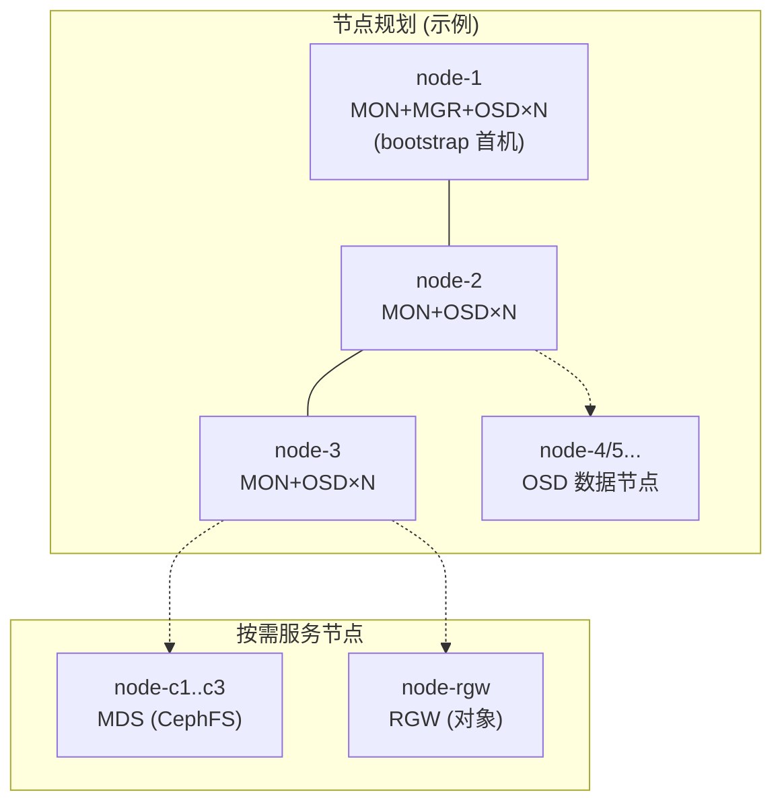
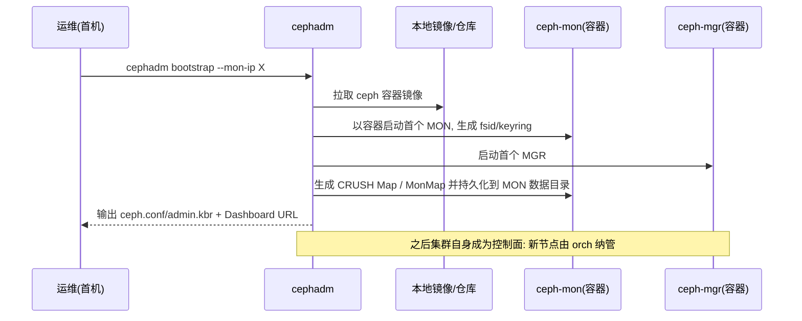
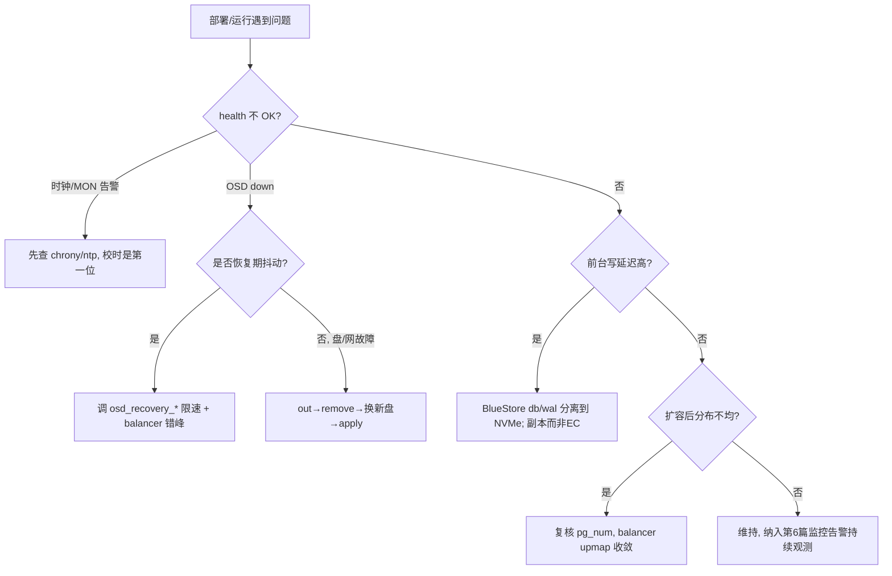

> 《Ceph 分布式存储》系列第 2 篇。第 1 篇《基础概念与核心架构》讲清了 RADOS/CRUSH 这套内核"为什么能跑"，本篇讲"怎么把它真跑起来、跑稳"。以官方推荐、容器化的 **cephadm** 为主线，覆盖 Bootstrap、主机纳管、OSD 编排、网络分离、扩缩容与升级的完整实操链路。部署完的集群如何被三种存储使用，见第 3/4/5 篇；部署完怎么监控，见第 6 篇。
>
> 口径说明：版本锚定 **Ceph Squid v19.2.x**，部署工具 **cephadm**（自 Nautilus 起的官方标准，取代已淡出的 ceph-deploy/ansible 手写 playbook），容器引擎默认 **Podman**（Docker 亦可）。文中命令均为可复制实操片段，但**不伪造任何真实集群的 `ceph -s` 输出**。

---

# 第 1 章：为什么用 cephadm

## 1.1 一句话定位

> **cephadm 是 Ceph 官方"集群编排器"：它不装 RPM 到宿主机，而是把每个 Ceph 守护进程跑在容器里，用宿主机的 cephadm 工具 + 集群自身作为控制面，统一负责部署、扩缩、升级、配置下发。**

## 1.2 它解决了旧部署方式的什么痛

| 旧方式 | 痛点 | cephadm 的解法 |
|--------|------|---------------|
| ceph-deploy | 靠 ssh 逐机执行、版本一致性差、已停止维护 | 声明式，集群自己管理自己的守护进程 |
| 手写 Ansible role | 上手陡、维护成本高、各版本模板漂移 | 官方内置，`ceph orch` 统一编排 |
| 裸机 RPM 部署 | 依赖地狱、升级回滚难、跨版本污染 | 容器化，镜像即版本，升级=换镜像 |

## 1.3 部署要回答的三份账

| 问题域 | 追问 | 对应动作 |
|--------|------|---------|
| **起得来吗** | 第一个 MON/MGR/OSD 怎么冷启动 | `cephadm bootstrap` |
| **铺得开吗** | 怎么把其它机器纳进来、往盘上铺 OSD | `orch host add` + `orch daemon`/自动 OSD |
| **改得动吗** | 后续加节点、换盘、升级、调配置怎么不中断 | `orch` 声明式 + `ceph versions`/滚动升级 |

---

# 第 2 章：前置规划（决定成败的地基）

## 2.1 节点与角色规划

一个最小可用生产集群：



要点：
- **MON 奇数个**（3 或 5），分散在不同物理机/机架（对齐第 1 篇 quorum 结论）。
- **MGR 一主一备**（`cephadm` 默认再拉一个 standby）。
- **OSD** 是数量主体，一块盘一个 OSD。
- **MDS/RGW** 是接口型守护进程，按需独立节点，别和数据盘抢 IO。

## 2.2 硬性前置检查清单

| 项 | 要求 | 检查命令 |
|----|------|---------|
| 时钟同步 | 全节点 NTP/chrony，**MON 对时钟极敏感** | `chronyc tracking` |
| CPU 架构 | 首机决定集群架构，异构需 `--allow-unsupported-arch` | `uname -m` |
| 内核版本 | 支持容器；避免过老 | `uname -r` |
| 容器引擎 | 首机需 podman 或 docker | `systemctl status podman.socket` |
| 网络连通 | 首机能 ssh/拉镜像到其余节点 | 安全组/防火墙放行 |
| 裸盘 | OSD 用**空盘**（无分区/文件系统），会被清空 | `cephadm inventory` |

> **最容易踩的坑就是时钟**：MON 用 Paxos，节点间时间漂移会导致仲裁异常、甚至集群不可用。部署前务必先校时。

## 2.3 网络分离（性能与自愈的隐形主角）

Ceph 强烈建议两张网：
- **Cluster 网**：OSD 之间的**副本复制与恢复**流量，恢复风暴全在这张网，要万兆以上、尽量独立。
- **Public 网**：客户端 ↔ MON/OSD、以及管理流量。

只有一张网也能跑，但**恢复期会抢占前台客户端 IO** 造成抖动。cephadm 通过 `--cluster-network` / `--public-network`（CIDR 表示）声明。

---

# 第 3 章：Bootstrap - 冷启动第一个集群

## 3.1 首机引导

```bash
# 1) 拿到 cephadm 工具（从官方仓库，指定发行版）
curl --silent --remote-name --location \
  https://github.com/ceph/ceph/raw/squid/src/cephadm/cephadm
chmod +x cephadm

# 2) 引导集群：--mon-ip 是首机对客户端可达的地址
./cephadm add-repo --release squid
./cephadm install ceph-common cephadm
cephadm bootstrap --mon-ip 192.168.1.11

# 常用附加项
#   --initial-public-network 192.168.1.0/24
#   --cluster-network 10.10.0.0/16
#   --skip-monitoring-stack          # 先不装 Prometheus/Grafana 栈(见第6篇)
#   --ssh-private-key/--skip-ssh     # 纳管其它节点用的密钥
```

`bootstrap` 一条命令做了很多事：生成 MON/MGR、建 admin keyring、把公钥分发出去、启动本地镜像仓库、默认拉起 monitoring stack（新版），并打印 Dashboard URL（`https://<ip>:8443`）。

## 3.2 引导后立刻验证

```bash
ceph -s                 # 健康状态, 期望 health: HEALTH_OK (或仅有 benign 告警)
ceph orch ls            # 看守护进程编排: mon/mgr/osd 都在
ceph versions           # 集群版本一致性
ceph config dump        # 当前生效配置
cat /etc/ceph/ceph.conf # cephadm 生成的最小配置
```

> 期望看到的是一张"正在成形"的地图：初始 1 MON + 1 MGR + 0 OSD。此时**还没有可写数据的 OSD**，下一步纳管主机并铺 OSD。

## 3.3 关键工作原理：bootstrap 背后发生了什么



---

# 第 4 章：主机纳管与 OSD 编排

## 4.1 纳管其它节点

```bash
# 首机能免密 ssh 到目标机后:
ceph orch host add node-2 192.168.1.12
ceph orch host add node-3 192.168.1.13
ceph orch host ls            # 查看已纳管主机及其 labels

# 用 label 给主机分组, 便于把守护进程调度到指定节点
ceph orch host label add node-4 rgw
```

cephadm 通过在目标机放置 cephadm、注册 systemd timer 来"自我续管"，之后所有守护进程由集群声明式管理，**不再手动 ssh 逐机操作**。

## 4.2 铺 OSD 的两种方式

**方式 A：全自动（新盘即 OSD，适合标准化机柜）**

```bash
ceph orch apply osd --all-available-devices
```

**方式 B：声明式指定盘（生产推荐，可控）**

```bash
# 按设备路径 / 按主机 / 按槽位声明
ceph orch daemon add osd node-2:/dev/sdb
# 或写一个 YAML 用 apply, 支持 data/db/wal 分离(NVMe 给 BlueStore db/wal)
cat > osds.yml <<'EOF'
service_type: osd
service_id: default_drivegroup
placement:
  hosts: [node-2, node-3]
spec:
  data_devices:
    size: 1TB:            # 只把 >=1TB 的空盘做 OSD
  db_devices:
    model: INTEL NVME     # SSD 做 BlueStore RocksDB 分离
EOF
ceph orch apply -i osds.yml
```

```bash
ceph osd tree        # 查看 CRUSH 层级: host → osd
ceph orch ps --daemon-type osd
ceph osd stat        # OSD 数量、总容量
```

## 4.3 加接口守护进程

```bash
# CephFS 元数据(第4篇详述)
ceph orch apply mds cephfs --placement="3 label:mds"
# RGW 对象网关(第5篇详述)
ceph orch apply rgw myorg --placement="2 label:rgw" --port=8080
```

---

# 第 5 章：配置管理、扩缩容与升级

## 5.1 声明式配置：改一处，全集群同步

```bash
# 查看某守护进程的可调项
ceph config help | head
# 设置(示例): 副本生死线、恢复限速
ceph config set global osd_pool_default_size 3
ceph config set global osd_pool_default_min_size 2
ceph config set global osd_recovery_max_active 5
ceph config get osd.0 bluestore_compression_algorithm
```

配置存在 MON（集群地图的一部分），cephadm 会把它下发进每个守护进程容器的 `ceph.conf` 并触发必要的滚动重启——**这就是"配置即集群状态"，避免了逐机配置文件漂移**。

## 5.2 扩容 / 缩容

- **加 OSD**：接新盘 → `orch apply osd`（自动或声明）。CRUSH 自动把约 `1/N` 的 PG 迁到新 OSD，无需人工再平衡；用 **balancer** 平滑分布：
  ```bash
  ceph balancer on
  ceph balancer mode upmap
  ceph balancer eval
  ```
- **下 OSD/主机**：
  ```bash
  ceph osd out osd.<id>          # 先把它的数据搬走(触发恢复)
  ceph orch daemon stop osd.<id>
  ceph orch daemon remove osd.<id>
  ceph osd crush remove osd.<id>; ceph auth rm osd.<id>
  ceph osd purge osd.<id> --yes-i-really-mean-it   # 一步到位也可
  ```
  **顺序很关键**：先 `out` 让副本迁走，再停/删，否则可能短期降级。

## 5.3 滚动升级

```bash
ceph orch upgrade start --image quay.io/ceph/ceph:v19.2.x   # 声明目标镜像
ceph status                       # 观察 "upgrading" 进度
ceph versions                     # 各守护进程版本, 全部到位即完成
```

cephadm 按守护进程逐个"换镜像重启"，MON 保持 quorum、OSD 逐个滚动保证数据可用，**天然做到不中断升级**。升级前务必确认健康 OK、副本 ≥ min_size。

## 5.4 调优决策树



---

# 第 6 章：应用场景与性能特性

## 6.1 三种典型部署形态

| 形态 | 节点数 | 适用 | 注意 |
|------|--------|------|------|
| 超融合(HCI) | 3+，计算与存储混部 | OpenStack/K8s 一体化 | OSD 与 VM 抢资源，需 cgroup 隔离 |
| 全闪专用存储 | 3+，NVMe 全闪 | 高性能块/元数据密集 | 网络务必万兆+分离，DB/WAL 可省 |
| 混合容量分层 | 热 SSD + 冷 HDD/EC | 大容量对象/归档 | 用不同 pool + CRUSH 规则分层 |

## 6.2 性能特性与影响因素

- **首机架构锁定**：混架构需显式允许，否则可能运行异常。
- **恢复带宽**：OSD down→out→回填这段时间，Cluster 网和 OSD CPU 是瓶颈；限速恢复会拉长降级窗口，需权衡。
- **BlueStore 内存**：`osd_memory_target`（cgroup 限制）过小会频繁刷 RocksDB cache，增大延迟；全闪集群常调到 4~8GB/OSD。
- **容器开销**：cephadm 容器化开销很小（同内核、无 hypervisor），但 cgroup 内存/CPU 限额要规划。

---

# 第 7 章：局限缺陷与解决方案

| 问题 | 影响 | 规避/解决 |
|------|------|----------|
| 时钟漂移引发 MON 仲裁异常 | 集群不可写甚至不可用 | chrony/ntp 强制校时 + 告警监控 timeoffset |
| cephadm 首次上手门槛 | "bootstrap 成功但不会编排" | 从 `ceph orch ls/ps` 熟悉声明式模型，小步灰度 |
| 恢复风暴抖动前台 | 业务延迟毛刺 | `osd_recovery_max_active`/sleep 限速、错峰、Cluster 独立网 |
| drivegroup 误清盘 | 有数据的盘被格式化成 OSD | 上 OSD 前 `cephadm inventory` 确认是空盘；生产用声明式精确指定 |
| 升级中途版本不一致 | 老新守护进程混跑期风险 | 升级前 health OK、副本充足，不跳大版本，逐个盯 `ceph versions` |
| 监控栈依赖未起 | 出问题"看不见" | 别 `--skip-monitoring-stack` 后又不补外部采集（第 6 篇） |

---

# 附录

## A. 部署流程速记（可当 Checklist）

```text
校时/放行网络 → cephadm add-repo+install
→ cephadm bootstrap --mon-ip X [--public/--cluster-network]
→ ceph orch host add 各节点
→ ceph orch apply osd (自动或 drivegroup YAML)
→ ceph osd tree 核对 CRUSH → ceph balancer on(upmap)
→ 按需 apply mds / rgw
→ ceph config set ... 调参 → 接入 monitoring(第6篇)
→ 升级: ceph orch upgrade start --image ...
```

## B. 术语速记

| 术语 | 一句话 |
|------|--------|
| cephadm | 容器化的官方集群编排器，集群自管守护进程 |
| bootstrap | 在首机冷启动第一个 MON/MGR 的动作 |
| orch (orchestrator) | `ceph orch` 声明式管理主机/守护进程/OSD |
| drivegroup | 用设备匹配规则批量声明 OSD 的 YAML 规格 |
| host label | 给主机打的分组标签，供 placement 调度 |
| Cluster/Public 网 | 恢复复制网 / 客户端与管理网 |
| balancer(upmap) | 后台把 PG 分布抹平、避免热点的模块 |

## C. 参考资料

1. [Ceph Docs · cephadm](https://docs.ceph.com/en/squid/cephadm/) — bootstrap/host add/orch/upgrade。✅ 已核实
2. [Ceph Docs · cephadm network](https://docs.ceph.com/en/squid/cephadm/) — public/cluster 网分离。✅ 已核实
3. [Ceph Docs · OSD drivegroup](https://docs.ceph.com/en/squid/cephadm/drivegroups/) — 声明式 OSD。✅ 已核实
4. [Ceph Docs · Upgrade](https://docs.ceph.com/en/squid/cephadm/) — `orch upgrade start`。✅ 已核实

## D. 变更记录

| 日期 | 版本 | 变更内容 |
|------|------|---------|
| 2026-10-29 | v1.0 | 首版：cephadm 部署实操全链路（前置/bootstrap/纳管/OSD/配置/扩缩/升级），含部署拓扑、bootstrap 时序、调优决策树三张 Mermaid 图 |
