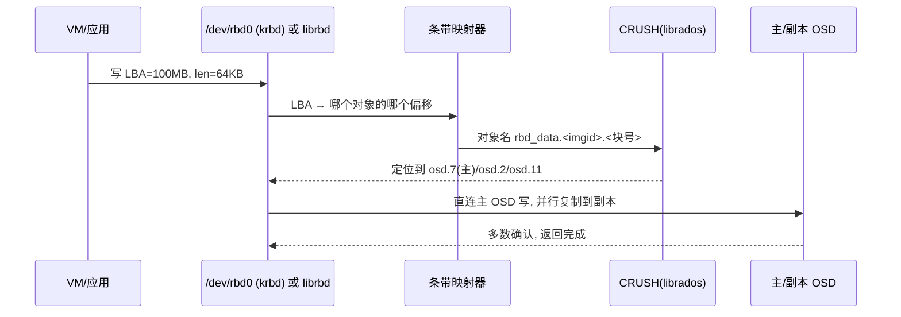
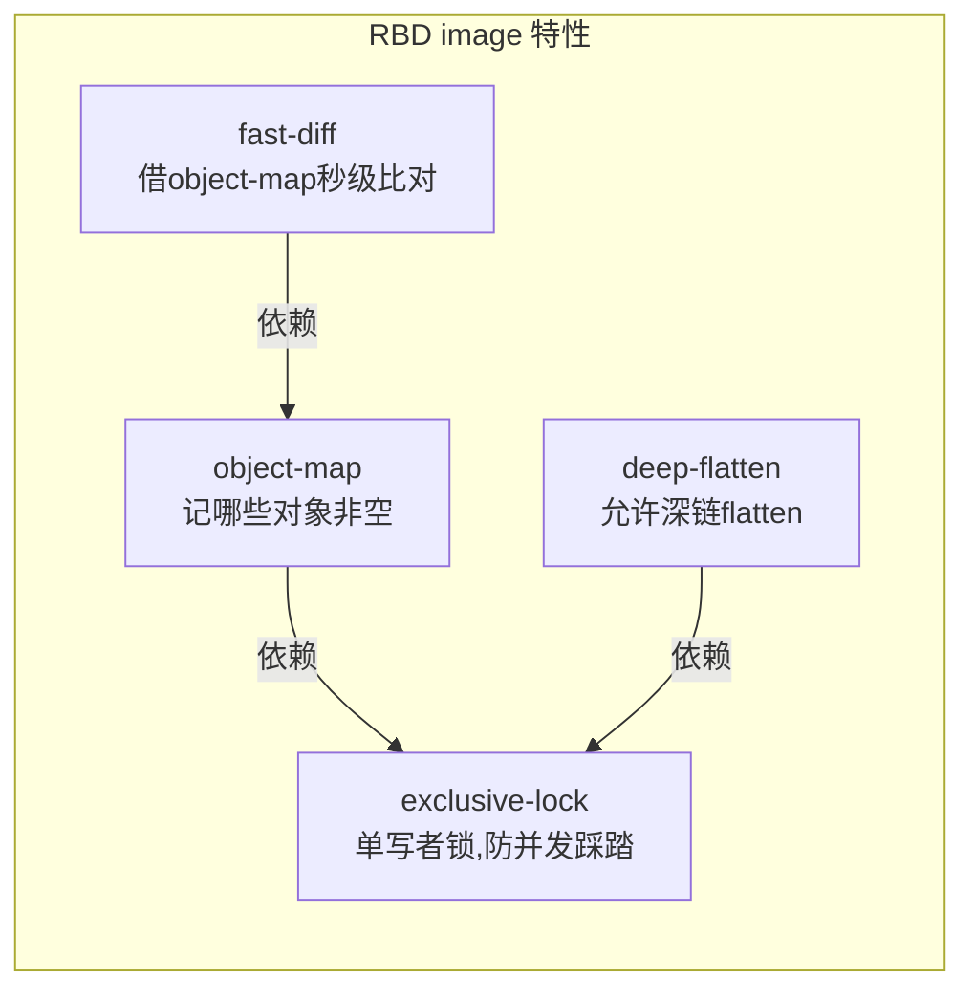
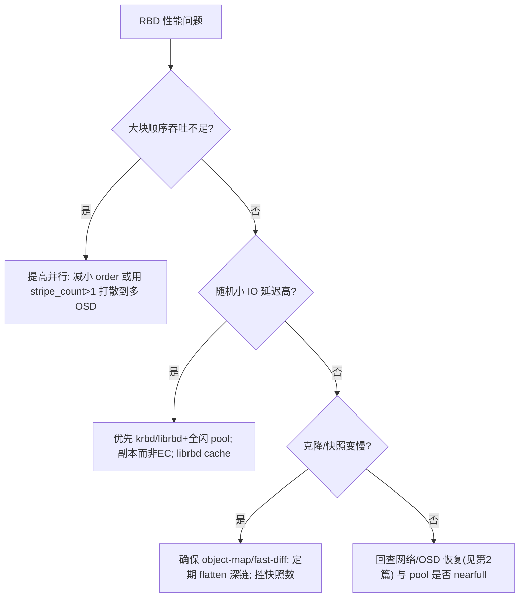

> 《Ceph 分布式存储》系列第 3 篇。第 1 篇讲了 RADOS 只认"对象"，本篇讲**块存储 RBD（RADOS Block Device）如何把一块虚拟磁盘切成对象塞进 pool，又如何还原成 Linux 看得见的一个 `/dev/rbdX`**。它是 OpenStack Cinder 卷和 K8s RBD CSI 背后的主力。理解 RBD 的"条带映射 + 两种客户端 + 快照克隆"，再看第 4 篇 CephFS、第 5 篇 RGW 会举一反三——三者是同一套 RADOS 之上的不同映射游戏。
>
> 口径说明：版本锚定 **Ceph Squid v19.2.x**，特性名（exclusive-lock/object-map/fast-diff/deep-flatten）以 v2 格式 image feature 为准，条带对象大小默认 `4 MiB`。命令均为可实操片段，不伪造 `fio` 实测输出。

---

# 第 1 章：基础概念 - RBD 是什么

## 1.1 一句话定义

> **RBD 把一块连续地址空间的虚拟磁盘，按固定条带切成一堆 RADOS 对象存进 pool；客户端（内核 krbd 或用户态 librbd）把上层的块读写翻译成对这些对象的定位与读写，从而得到一个"分布式、可快照、可克隆、无单点"的块设备。**

和传统 LUN 相比，RBD 没有中央卷管理器：一块 100GB 的云盘，其实是一串对象散落在整个集群的 OSD 上，谁访问谁用 CRUSH 直连对应 OSD。

## 1.2 RBD 解决的痛点

| 传统块存储 | RBD 的做法 |
|-----------|-----------|
| 卷在单一存储控制器，扩展有上限 | 卷=对象集合，天然跨全集群条带，随 OSD 数线性扩展 |
| 快照靠 LUN 级重定向，粒度粗、易掉性能 | image-level 快照基于引用计数，多快照不显著拖累写 |
| 克隆要整卷拷贝 | 克隆(Copy-on-Write)秒级、几乎零空间占用起步 |
| 多路径/故障切换复杂 | 客户端直连多副本 OSD，主 OSD 挂了自动切 |

## 1.3 三份账

| 问题域 | 追问 | RBD 的答案 |
|--------|------|-----------|
| **怎么切** | 一块盘如何变成对象 | 条带化：`object_size` × `stripe_count/unit` |
| **谁来译** | 块 IO 如何落到 RADOS | krbd(内核) 或 librbd(用户态/QEMU) |
| **怎么变脸** | 快照/克隆/精简置备 | RBD 元数据 + RADOS 对象引用计数 |

---

# 第 2 章：工作原理 - 从"磁盘"到"对象"的条带映射

## 2.1 条带化模型（RBD 的心脏）

一个 RBD image 由两个维度切分：**对象大小（order）** 与 **条带布局**。

```text
image 逻辑偏移 (LBA)
   │
   ├─ 条带单元 stripe_unit (默认=object_size)
   ├─ 条带宽度 stripe_count (默认=1)
   └─ 对象大小 object_size = 2^order (默认 order=22 → 4 MiB)

当 stripe_count>1 时, 一个对象的连续数据在 image 里并不相邻,
而是按 stripe_unit 在多个对象间轮转铺开 —— 用于把热点打散到多 OSD。
```

- **stripe_count = 1（默认）**：纯粹按顺序切大块对象，简单直接。
- **stripe_count > 1**：把数据以小条带（如 4KB unit）交错分布到多个对象，使单条大 IO 命中更多 OSD，提升并发、缓解热点——代价是映射更复杂。

## 2.2 一次块写的完整路径



关键点：**块设备语义在客户端就被翻译成了"对象读写"**，RADOS 层根本不知道自己在服务"块设备"，它只看到一个个 `rbd_data.*` 对象。这就是"块/文件/对象统一于 RADOS"的具体体现。

## 2.3 元数据对象

每个 image 除了数据对象，还在 pool 里放若干**元数据对象**：`rbd_header.<id>`（容量/条带/快照列表）、`rbd_id.<name>`、`rbd_directory`（pool 内 image 名索引）、`rbd_children`（克隆父子关系）。克隆、快照的实现都靠这几个头对象做引用计数。

---

# 第 3 章：两种客户端 - krbd vs librbd

| 维度 | **krbd（内核 RBD）** | **librbd（用户态）** |
|------|---------------------|---------------------|
| 形态 | Linux 内核模块，暴露 `/dev/rbdN` | 库，被 QEMU/应用直接链接 |
| 典型用户 | 裸机制作为本地盘挂载、iSCSI 网关 | 虚拟机(QEMU/KVM)、原生集成应用 |
| 功能支持 | 只支持 **feature 子集**（老内核不支持某些 v2 feature） | 支持全部 feature |
| 快照/克隆 | 支持基础能力 | 支持全部（含克隆、深合并） |
| 性能调优 | 受内核块层约束 | 用户态更灵活（可 AIO/线程模型） |
| 挂载体验 | `rbd map` 后像普通盘, 可直接 mkfs | 无需内核, QEMU 里当 virtio-blk |

```bash
# krbd: 把 image 映射成本地盘
rbd map data-pool/vm-disk-1
lsblk; mkfs.ext4 /dev/rbd0; mount /dev/rbd0 /mnt/vm
rbd unmap /dev/rbd0

# librbd via QEMU: 虚拟机直接把它当磁盘
vim /etc/ceph/ceph.client.virtkeyring.keyring
qemu-img info "rbd://..." 2>/dev/null   # 或 libvirt 里配 rbd 池
```

> **为什么分两种**：内核态图省事、给"想要一块普通盘"的场景（裸机、iSCSI/FC 网关）；用户态图能力强、给虚拟化与原生应用，能吃到 RBD 全部特性。生产里 OpenStack 用 librbd(QEMU)，K8s CSI 两者皆可（默认 krbd 挂载、可切 rbd-nbd）。

---

# 第 4 章：结构设计 - image 特性与快照克隆

## 4.1 image feature（v2 格式）



| feature | 作用 | 依赖 | 代价 |
|---------|------|------|------|
| `exclusive-lock` | 同一 image 同时只允许一个写者（可加 `lock add` 协调），防止多客户端写坏 | — | 需要锁管理，多写场景要配集群锁 |
| `object-map` | 记录 image 里哪些对象已被写过（非空位图） | exclusive-lock | 每次写更新位图，略有开销 |
| `fast-diff` | 依赖 object-map 做**秒级**差异比较（增量备份/克隆） | object-map | — |
| `deep-flatten` | 支持多层克隆链的 flatten | exclusive-lock | — |
| `layering` | 支持"克隆/分层"（parent 只读基底） | — | 克隆必备 |

> **老内核坑**：krbd 若内核版本不支持某 feature（如早期不支持 `object-map/fast-diff`），带这些特性的 image **无法被内核映射**。对策：建 image 时按需裁剪 features，或用较新内核 / librbd。

## 4.2 快照与克隆

```bash
# 快照: 基于引用计数, 几乎不占额外空间(未改动的对象共享)
rbd snap create data-pool/vm-disk-1@nightly
rbd snap ls  data-pool/vm-disk-1
rbd snap rollback data-pool/vm-disk-1@nightly

# 克隆: 从快照派生一个可写的新 image(CoW), 秒级完成
rbd clone data-pool/vm-disk-1@nightly data-pool/golden-copy
# 想让克隆脱离父快照独立存在: flatten
rbd flatten data-pool/golden-copy
```

- **快照机制**：image 数据对象名带快照命名空间；未修改块与父快照共享，改了的写新对象。删快照靠引用计数回收真正不再被引用的对象。
- **克隆机制**：克隆是"指向父快照的分层 image"，写时复制；`flatten` 才把父数据真正拷进克隆。**容器/K8s 大量小盘场景**用"模板快照 + 秒级克隆"极省时间与空间。

## 4.3 精简置备（thin provisioning）

RBD 默认精简置备：`rbd create --size 100G` 只是逻辑上限，实际占用随写入增长，可用容量看 `rbd du`。注意与 pool 真实容量配合，避免超分导致写不下（`health: HEALTH_WARN: pool full/nearfull`）。

---

# 第 5 章：应用场景与生态集成

| 场景 | 怎么接 RBD | 说明 |
|------|-----------|------|
| OpenStack 云盘(Cinder) | Cinder volume backend = RBD，QEMU/librbd | 虚拟机根盘/数据盘主力 |
| OpenStack 镜像(Glance)/Cinder 备份 | 直接用 RBD 存 | RBD 快照可对接备份编排 |
| Kubernetes 持久卷 | **RBD CSI**（ceph-csi）动态供应 PVC | 块类 StorageClass，`map` 成设备挂载进 Pod |
| 虚拟机裸机挂载 | krbd `rbd map` | 想要"一块本地盘"的裸机场景 |
| iSCSI / FC 对外 | `ceph orch` rbd-target(iSCSI 网关) | 给不支持 RBD 的 legacy 主机提供 LUN |
| 跨站点高可用 | **RBD Mirror**（见 5.2） | 块级异步复制容灾 |

## 5.1 RBD-Mirror（块级容灾）

在两个 Ceph 集群间做 image 的**异步复制**（journal 或基于 `rbd image-watch`/非 journal 模式），实现跨站点 RPO 秒级的块级容灾。主集群故障时把镜像提升为 secondary→primary，虚拟机在备站点用复制过来的卷重新拉起。

```bash
rbd mirror pool enable data-pool image-level
rbd mirror image enable data-pool/vm-disk-1
rbd mirror image status data-pool/vm-disk-1
```

## 5.2 与本地 LVM/云盘对比

| 维度 | Ceph RBD | 本地 LVM | 公有云 EBS |
|------|----------|---------|-----------|
| 跨机扩展 | 随集群线性扩 | 单机上限 | 托管自动 |
| 快照/克隆 | CoW 秒级 | 快照较笨重 | 有(计费) |
| 多写者 | exclusive-lock 约束 | 集群 LVM 复杂 | 单挂载为主 |
| 私有可控 | 全自王建 | — | 云绑定 |
| 小 IO 延迟 | 网络代价 | 本地最低 | 中 |

---

# 第 6 章：性能参数与调优

## 6.1 关键参数速查

| 参数 | 默认/建议 | 说明 | 影响 |
|------|----------|------|------|
| `--order`（对象大小幂） | 22（4 MiB） | 单对象上限；建 image 时定, 不可改 | 大=少对象/少地图压力, 小=并行度高 |
| `stripe_unit` / `stripe_count` | =object_size / 1 | 打散热点用较小 unit + 多 count | 提升大 IO 并发 |
| `image format` | 2 | v2 才有 feature/快照增强 | v1 已淘汰 |
| `features` | layering,exclusive-lock,object-map,fast-diff | 按客户端支持裁剪 | 老内核 map 兼容性 |
| `osd_op_threads`/librbd 并发 | — | 用户态队列深度 | 影响 IOPS |
| cache（librbd） | writeback 可选 | 客户端写缓存 | 虚拟化密集小写优化 |

## 6.2 调优决策树



---

# 第 7 章：局限缺陷与解决方案

| 问题 | 表现 | 根因 | 规避 |
|------|------|------|------|
| 多写者踩踏 | 同一 image 被两客户端写致损坏 | 块语义无内建并发仲裁 | 启用 `exclusive-lock` 并用锁协调, 或严格单挂载 |
| 老内核 feature 不兼容 | image 无法 `rbd map` | krbd 不支持部分 v2 feature | 裁剪 features / 升级内核 / 用 librbd |
| 快照过多拖累 | 删快照慢、空间回收滞后 | 引用计数需遍历 | 控制快照数量, 定时清理, 用 fast-diff |
| 深克隆链性能衰减 | 多层克隆读放大 | 每层可能回溯源 | 适时 `flatten`, 规划层级 |
| 精简超分写爆 | pool nearfull 拒写 | thin 上限>真实容量 | 容量告警(第6篇)+预留+配额 |
| 小 IO 网络税 | 延迟高于本地盘 | 分布式副本+网络固有 | 全闪 pool、副本、librbd cache、就近 |

---

# 附录

## A. RBD 操作速查

```bash
rbd create  data-pool/vm1 --size 100G --image-feature layering,object-map
rbd du      data-pool/vm1              # 真实占用
rbd info    data-pool/vm1              # 条带/features/parent
rbd snap create data-pool/vm1@v1
rbd clone   data-pool/vm1@v1 data-pool/vm2
rbd map     data-pool/vm1              # krbd 映射成本地盘
rbd bench-write / rbd bench            # 客户端侧简易压测(非生产结论)
```

## B. 术语速查

| 术语 | 一句话 |
|------|--------|
| image | 一块 RBD 虚拟磁盘 |
| order | 对象大小的 2 的幂, 默认 22=4MiB |
| stripe_unit/count | 条带单元/宽度, 决定数据如何在对象间交错 |
| krbd / librbd | 内核态 / 用户态 RBD 客户端 |
| layering | 支持克隆/分层的 feature |
| exclusive-lock | 单写者锁 |
| object-map / fast-diff | 非空对象位图 / 秒级差异 |
| flatten | 让克隆脱离父快照独立 |
| thin provisioning | 精简置备, 用多少占多少 |
| RBD Mirror | 跨集群块级异步复制容灾 |

## C. 参考资料

1. [Ceph Docs · RBD](https://docs.ceph.com/en/squid/rbd/) — 条带、快照、克隆、feature。✅ 已核实
2. [Ceph Docs · RBD image features](https://docs.ceph.com/en/squid/rbd/rbd-config-ref/) — exclusive-lock/object-map/fast-diff。✅ 已核实
3. [Ceph Docs · RBD Mirror](https://docs.ceph.com/en/squid/rbd-mirroring/) — 块级容灾。✅ 已核实
4. [Ceph CSI](https://github.com/ceph/ceph-csi) — RBD 动态供应。✅ 已核实

## D. 变更记录

| 日期 | 版本 | 变更内容 |
|------|------|---------|
| 2026-10-29 | v1.0 | 首版：RBD 条带映射、krbd/librbd 双客户端、快照克隆、image feature、RBD-Mirror 九维全解，含写路径、特性依赖、调优三张 Mermaid 图 |
