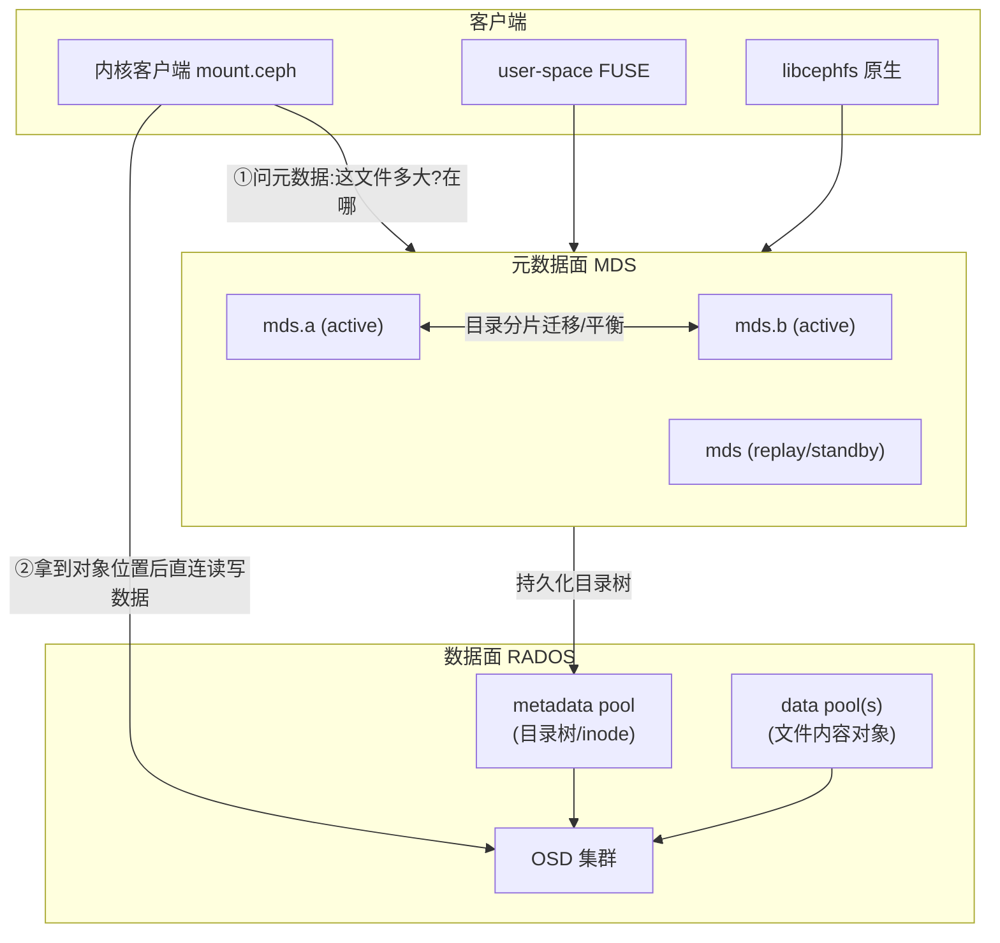
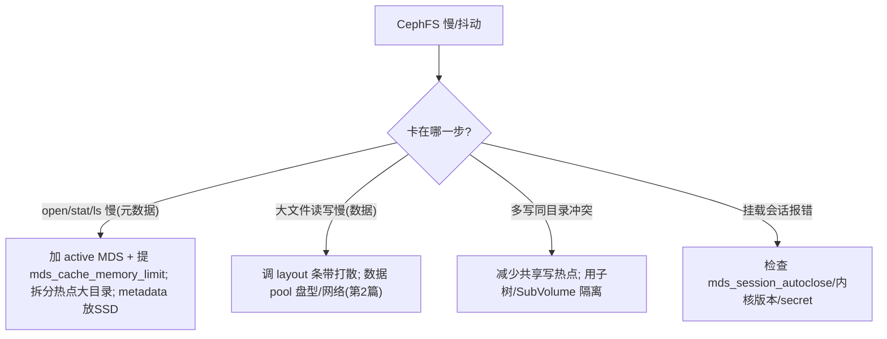

> 《Ceph 分布式存储》系列第 4 篇。第 3 篇 RBD 给你"一块盘"，本篇 CephFS 给你"一个能被多台机器同时挂载、完全 POSIX 语义的共享目录树"。它的难点不在数据（数据仍走第 1 篇的 RADOS 直连），而在**"目录树元数据怎么管"**——这就是 MDS 的全部使命。读完你会懂 CephFS 为什么能做多客户端读写一致、为什么"海量小文件"是它的软肋、以及 K8s 里 CephFS CSI 怎么靠 SubVolume 动态发盘。块/文件/对象三兄弟里，CephFS 是"最需要元数据引擎"的那一个。
>
> 口径说明：版本锚定 **Ceph Squid v19.2.x**；文件系统布局版本以 `cephfs data pool + layout` 为准，目录分片用 dirfrag 机制。命令行以 `ceph fs` / `ceph fs subvolume` 与内核挂载 + `mount.ceph` / FUSE 为主，不伪造压测输出。

---

# 第 1 章：基础概念 - CephFS 是什么

## 1.1 一句话定义

> **CephFS 是在 RADOS 之上提供完整 POSIX 语义的分布式文件系统：数据由客户端直连 OSD 读写，目录树与文件属性等元数据由一组无状态可水平扩展的 MDS（元数据服务器）管理，从而实现多客户端并发挂载下的统一命名空间与读写一致。**

与 RBD 的根本差别：RBD 是"裸块设备"，上面文件系统由本地自己管；CephFS 是"共享网络文件系统"，命名空间和目录结构是集群级、大家看到的同一棵树的。

## 1.2 它解决的痛点（NAS 场景）

| 传统 NAS / 本地 FS | CephFS |
|-------------------|--------|
| 元数据服务器单点 | MDS 可多 active 分片，且可故障切换 |
| 容量受单控头限制 | 数据面随 OSD 线性扩，元数据随 MDS 扩 |
| 多机共享但一致性弱 | POSIX close-to-open 一致性 + 文件锁 |
| 块/文件/对象各一套 | 与 RBD/RGW 共享同一 RADOS 底座 |

## 1.3 三份账

| 问题域 | 追问 | CephFS 答案 |
|--------|------|-------------|
| **目录树谁管** | inode/目录项/属性 | MDS 集群, 元数据存 RADOS |
| **文件数据放哪** | 大文件的字节 | 客户端按 layout 直切对象写 OSD(同 RBD 思路) |
| **多客户端怎么一致** | 同读同写 | MDS 锁(capability) + close-to-open 语义 |

---

# 第 2 章：基础架构 - 数据面与元数据面分离

## 2.1 架构总览



**核心思想**：把"找文件、列目录、查权限"这种**元数据操作**交给 MDS；把"读写文件内容"这种**数据操作**让客户端**绕过 MDS 直接打 OSD**。MDS 因此只承担它擅长的轻量小 IO，不被大流量数据压垮。

## 2.2 核心组件职责

| 组件 | 职责 | 关键点 |
|------|------|--------|
| **MDS** | 管理目录树、inode、目录项、文件锁 capability | 无状态(元数据落 RADOS)，可多 active 横向扩、可故障切换 |
| **mds load balancer** | 在多 MDS 间迁移目录分片，平衡元数据负载 | `ceph fs balance` / 自动 |
| **metadata pool** | 存目录树/inode/日志 | 建议放 SSD, 元数据小 IO 密集 |
| **data pool(s)** | 存文件内容条带对象 | 可按目录设不同 data pool(冷热分层) |
| **Client** | 缓存元数据 + 持 capability, 直连 OSD 读写数据 | capability 失效触发回 MDS |

---

# 第 3 章：工作原理

## 3.1 一次 open + read 的路径

```mermaid
sequenceDiagram
    participant C as 客户端
    participant M as MDS
    participant R as RADOS/OSD
    C->>M: open("/a/b/f.txt")
    M->>M: 逐级解析目录项→定位 inode
    M-->>C: 返回 inode 元数据 + 授予 capability(缓存权/读写锁)
    C->>M: 需要文件条带布局(layout)
    M-->>C: 返回 stripe_unit/count/object_size + data pool
    C->>R: 据 layout 用 CRUSH 直连对应 OSD 读文件对象
    R-->>C: 返回数据(不经 MDS)
    Note over C,M: 后续读命中客户端元数据缓存, 不再问 MDS; 冲突时 MDS 回收 capability
```

关键设计：**capability（caps）**。MDS 把某 inode 的"读缓存/写锁"权限授予客户端并缓存，客户端在授权范围内自处理元数据请求（省往返）；当别的客户端要冲突权限时，MDS 发 revoke 收回。**这是 CephFS 兼顾共享与性能的核心机制**，也是它比"每次都问中心服务器"的旧 NFS 方案更扩展的原因。

## 3.2 目录分片（dirfrag）与多 MDS

单目录可能有海量目录项（百万文件）。CephFS 把**大目录切成分片（dirfrag）**，不同分片可由不同 active MDS 持有。这样：
- 单目录不再是"MDS 处理的原子单元"，热点大目录能被打散到多 MDS。
- MDS 数增加 → 可管理的分片增多 → 元数据吞吐近线性扩。

## 3.3 文件数据的条带（与 RBD 同源）

大文件内容同样按 layout（`stripe_unit` × `stripe_count`，object_size 默认 4MiB）切成 RADOS 对象，命名形如 `<ino>_<s>_<o>`。客户端拿到 layout 后自行算对象、直连 OSD，机制与第 3 篇 RBD 条带映射一致——**这就是"块和文件共用一套对象切法"的落点**。

---

# 第 4 章：结构设计 - 客户端形态与 SubVolume

## 4.1 三种客户端形态

| 形态 | 载体 | 适用 | 特点 |
|------|------|------|------|
| 内核客户端 | `mount -t ceph` / `mount.ceph` | Linux 生产挂载、K8s | 性能最好，POSIX 完整，随内核演进 |
| FUSE | `ceph-fuse` | 非 Linux/无内核模块/需要用户态灵活 | 易用跨平台，性能略低于内核 |
| libcephfs | C/C++/Java/Python 库 | 应用原生集成(如 Spark/Hadoop connector) | 免挂载，直接调 API |

```bash
# 内核挂载(Kernel 5.x+ 推荐 monitor 直连)
mount -t ceph 192.168.1.11:6789:/ /mnt/cephfs -o name=admin,secret=<secret>
# 或新版 ceph 客户端
mount -t ceph 192.168.1.11:/ /mnt/cephfs -o name=admin
```

## 4.2 SubVolume / SubVolume Group（多租户与 CSI 的抓手）

传统 CephFS 挂载的是**整棵根树**，多租户难隔离。CephFS 引入三层结构：

```text
CephFS filesystem (ceph fs)
 └── Volume (ceph fs volume)
      └── Group (subvolume group)   ← 一个项目组/命名空间
           └── SubVolume            ← 可独立挂到某子目录、可设配额/快照
```

```bash
ceph fs subvolume create cephfs sv-app1 --size 10G --pool data-ec
ceph fs subvolume info cephfs sv-app1        # 得到它的挂载路径 /volumes/...
ceph fs subvolume snapshot create cephfs sv-app1 snap1
```

- **SubVolume 有独立配额（quota）和快照**，可只把该子目录挂给客户端（挂到 `/mnt/x` 就是这棵子树）。
- **K8s CephFS CSI 动态供应**正是给每个 PVC 建一个 SubVolume，实现"每卷可配额、可快照、可回收"。

## 4.3 配额与目录布局

| 能力 | 机制 | 用途 |
|------|------|------|
| 配额 quota | 目录级 max_bytes/max_files，基于 inode 递归统计 | 多租户容量治理 |
| 布局 layout | 按目录改 stripe 参数 / 指定 data pool | 冷热分层、性能调优 |
| 快照 | 类文件系统的目录树快照（依赖 RADOS snap） | 时间点恢复、备份 |

---

# 第 5 章：应用场景与选型

| 场景 | 为什么用 CephFS | 客户端 |
|------|----------------|--------|
| 多节点共享读写同一批文件 | 唯一提供完整 POSIX 的 Ceph 接口 | 内核/FUSE |
| HPC / AI 训练数据集 | 大吞吐 + 共享命名空间 + 可分层 layout | 内核/libcephfs |
| K8s RWX（多 Pod 同挂） | CephFS CSI 给 ReadWriteMany | 内核 CSI |
| 内容管理/共享主页 | 目录权限 + 配额 + 快照 | FUSE/内核 |

**不适用**：超低延迟元数据密集（海量 `stat`/小文件 rename）——MDS 会成为瓶颈，这类负载更适合本地 FS 或对象存储的扁平命名空间。

---

# 第 6 章：性能特性与关键参数

## 6.1 性能决定因素

1. **元数据密集度**：目录层级越深、小文件越多、rename/`stat` 越频繁 → MDS 压力越大。
2. **MDS 数量与内存**：MDS 把热元数据缓存在内存，`mds_cache_memory_limit` 不够会频繁回收 caps、抖动。
3. **metadata pool 盘型**：元数据放 SSD 收益极大。
4. **客户端 caps 缓存命中率**：命中则省往返，共享写冲突会触发 revoke 降速。
5. **网络**：数据面直连 OSD，同 RBD 受网络影响。

## 6.2 关键参数速查

| 参数 | 默认/建议 | 说明 |
|------|----------|------|
| `mds_max_clients` | 视规模 | 最大并发客户端数 |
| `mds_cache_size`/`mds_cache_memory_limit` | 版本默认 | MDS 内存缓存 inode 上限, 太小 thrash |
| `mds_session_autoclose` | 300s | 卡死会话自动关闭 |
| `cephfs dirfrags` 分裂阈值 | 内置 | 大目录分片, 影响均衡粒度 |
| data pool 分层 | — | 冷目录指向 EC pool, 热目录指向副本 SSD pool |

## 6.3 调优决策树



---

# 第 7 章：局限缺陷与解决方案

| 问题 | 表现 | 根因 | 规避 |
|------|------|------|------|
| 海量小文件元数据瓶颈 | 大量 `stat`/`create` 时 MDS 饱和 | 元数据集中由 MDS 处理 | 多 active MDS + dirfrag + 加大 MDS cache; 或改对象存储扁平命名 |
| MDS 内存不足 thrash | 频繁 caps 回收, 延迟毛刺 | 缓存放不下热 inode 集 | 提升 cache 限额、加 MDS、冷数据分卷 |
| 共享写一致性代价 | 同文件多写者吞吐下降 | close-to-open + 锁 revoke | 应用层避免共享热写, 分片到不同子树 |
| 内核模块/版本依赖 | 老内核 caps/特性受限 | 内核客户端随版本演进 | 升级内核或退 FUSE |
| 配额基于遍历 | 大目录设配额慢 | 递归统计 inode | 用 SubVolume 级配额、预建结构 |
| 快照拖累 | 大量快照使空间回收滞后 | RADOS snap 引用 | 控快照数、定期清理(与 RBD 同理) |

---

# 附录

## A. CephFS 运维速查

```bash
ceph fs ls                         # 文件系统列表
ceph fs status cephfs              # MDS 状态(active/replay)与客户端数
ceph mds stat
ceph fs set cephfs max_mds 3       # 允许多 active MDS(需 ≥1 standby-replay)
ceph tell mds.a cache status
ceph fs subvolume create cephfs sv1 --size 5G
```

## B. 术语速查

| 术语 | 一句话 |
|------|--------|
| MDS | CephFS 元数据服务器, 无状态可多 active |
| inode / dentry | 文件本体元数据 / 目录项(名字→inode) |
| capability(caps) | MDS 授予客户端的缓存/读写权限, 减少往返 |
| dirfrag | 大目录的分片, 让多 MDS 分担热点目录 |
| layout | 文件条带参数与 data pool 归属 |
| Volume/Group/SubVolume | CephFS 三层多租户结构, 配额/快照/C SI 抓手 |
| close-to-open | CephFS 提供的一致性语义 |
| mount.ceph / ceph-fuse / libcephfs | 内核/FUSE/库 三种客户端 |

## C. 参考资料

1. [Ceph Docs · CephFS](https://docs.ceph.com/en/squid/cephfs/) — 架构、MDS、客户端。✅ 已核实
2. [Ceph Docs · CephFS quotas/subvolume](https://docs.ceph.com/en/squid/cephfs/dirquotas/) — 配额与 SubVolume。✅ 已核实
3. [Ceph Docs · MDS cache](https://docs.ceph.com/en/squid/cephfs/mds-config-ref/) — mds_cache_* 参数。✅ 已核实
4. [Ceph CSI · CephFS](https://github.com/ceph/ceph-csi) — SubVolume 动态供应。✅ 已核实

## D. 变更记录

| 日期 | 版本 | 变更内容 |
|------|------|---------|
| 2026-10-29 | v1.0 | 首版：CephFS 数据/元数据面分离、MDS caps 与 dirfrag、三种客户端、SubVolume 多租户、配额分层九维全解，含架构、读写路径、调优三张 Mermaid 图 |
