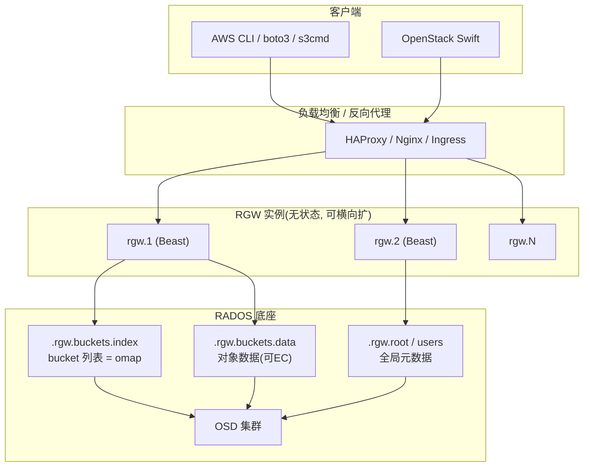
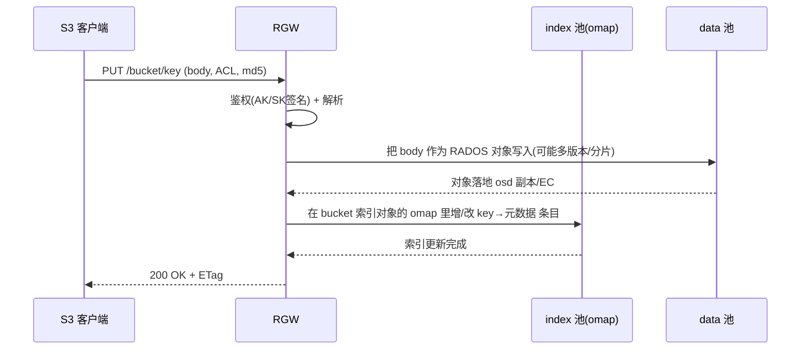
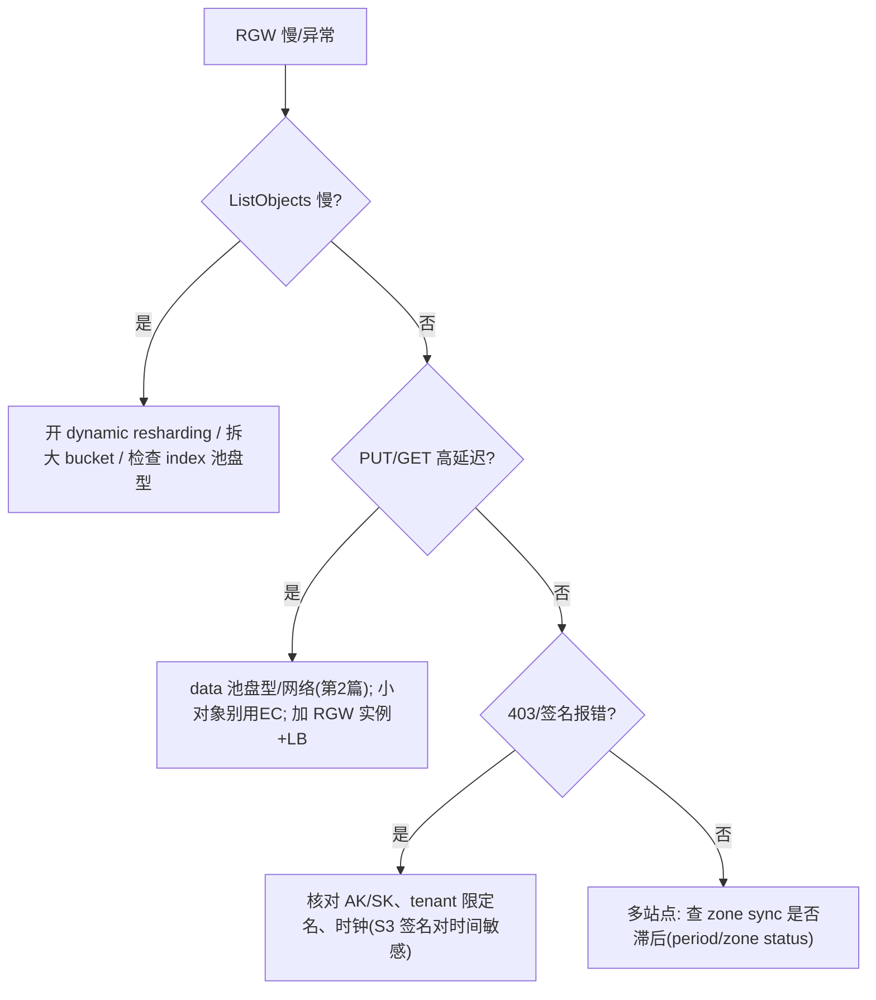

> 《Ceph 分布式存储》系列第 5 篇。第 3 篇 RBD 给"盘"、第 4 篇 CephFS 给"共享目录"，本篇 RGW 给"**云原生时代最通用的接口——S3**"。RGW（RADOS Gateway）是架在 RADOS 之上的 HTTP 对象网关，把扁平的 bucket/key 命名空间翻译成第 1 篇讲的"对象 + omap 键值索引"。它也是三种接口里唯一自带**多站点（Multi-Site）跨地域复制**能力的。理解"RGW 如何把 bucket 元数据放进 omap、如何用多实例 + 负载均衡横向扩、如何做 zone/zonegroup 容灾"，这篇就通了。
>
> 口径说明：版本锚定 **Ceph Squid v19.2.x**，前端默认 **Beast**（内置 HTTP，替代老 civetweb），多站点用 `realm/zonegroup/zone` 模型。含 S3 兼容 API、Swift/SLO&TEMPURL 兼容。命令为实操片段，不伪造实测数据。

---

# 第 1 章：基础概念 - RGW 是什么

## 1.1 一句话定义

> **RGW 是一个无状态的 REST 对象网关：对上兼容 S3 / OpenStack Swift API，对下把每个对象存成 RADOS 对象、把 bucket 索引/元数据存成 RADOS 对象的 omap 键值空间，从而用同一套 Ceph 集群对外提供可扩展的、多租户的对象存储。**

它本身不"存"东西，存还是 RADOS 干的；RGW 负责**协议翻译 + 命名空间 + 权限 + 索引**。所以可以起 N 个 RGW 实例做水平扩展和负载均衡。

## 1.2 解决的痛点

| 场景需求 | RGW 的回应 |
|----------|-----------|
| 要 S3 兼容但不被云厂商锁定 | 自建、API 兼容现有 S3 SDK/工具 |
| 海量非结构化数据、扁平命名 | key 命名空间 + 无限 bucket 对象 |
| 多租户隔离 | user/tenant + bucket policy + ACL |
| 跨地域容灾 | Multi-Site zone 间异步复制 |
| 与已有 Ceph 复用 | 直接吃同一批 OSD/pool, 无需另购 |

## 1.3 三份账

| 问题域 | 追问 | RGW 答案 |
|--------|------|---------|
| **怎么寻址** | bucket/key → 存哪 | 翻译为 RADOS 对象 + omap 索引 |
| **怎么扩** | 单网关扛不住 | 无状态多实例 + LB |
| **怎么容灾** | 跨站点 | realm/zonegroup/zone 异步复制 |

---

# 第 2 章：基础架构 - 网关与 RADOS 的分工

## 2.1 架构总览



## 2.2 核心组件职责

| 组件 | 职责 | 关键点 |
|------|------|--------|
| **RGW 进程** | HTTP 请求处理、鉴权、API 语义、转成 RADOS 操作 | 无状态，多实例对等 |
| **Beast 前端** | 内置 high-perf HTTP server（现代默认） | 也可接 Nginx/负载均衡 |
| **bucket 索引** | 每个 bucket 一个 RADOS 对象, 其**对象清单存在 omap** 里 | 大 bucket 索引对象是扩展/热点关键 |
| **.rgw.buckets.data pool** | 存对象实际数据 | 可指向 EC/冷池 |
| **users/zone config** | 全局用户、zone 配置元数据 | 存于专用 pool |

## 2.3 RGW 的三类池

- **index pool**（`.rgw.meta`/`index`）：bucket 的**列举索引**（S3 ListObjects 靠它）。
- **data pool**（`.rgw.buckets.data`）：对象字节。
- **root/meta pool**（`.rgw.root`）：用户、zone、全局配置。

> 把 data pool 单独指向纠删码或分层池，是 RGW 做"低成本大容量"的标准姿势。

---

# 第 3 章：工作原理 - 一次 PUT 与一次 LIST

## 3.1 上传对象（PUT）



要点：**数据进 data 池、清单进 index 池的 omap**。omap 是"每个 RADOS 对象都能挂一个键值表"的能力（第 1 篇提过），bucket 的 key 列表正是靠它实现快速列举。

## 3.2 大对象：Multipart Upload

大文件用 S3 Multipart：分片并行上传 → RGW 把每片存成 RADOS 对象 → Complete 时合并元数据。分片上传天然契合对象存储 + 断点续传，也避免单请求过大。

## 3.3 版本、生命周期、加密

| 能力 | 机制 |
|------|------|
| Object Versioning | 每版本一个 RADOS 对象, bucket 状态位控开关 |
| Lifecycle | 规则(过期/转储/中止未完成分片)由 RGW 后台周期任务执行, 可转冷/删 |
| 服务端加密 | SSE-C/SSE-KMS/SSE-S3, 密钥托管 |
| 静态页/跨域 | bucket 策略与 CORS 配置 |

---

# 第 4 章：结构设计 - 多租户与 Multi-Site

## 4.1 用户与租户模型

```bash
# S3 tenancy: 一个系统用户下可有多个租户的实体用户
radosgw-admin user create --uid=app1 --display-name="App One" --tenant=teamA
radosgw-admin bucket create --bucket=b1 --uid=app1
aws --endpoint-url http://rgw:8080 s3 ls s3://teamA:b1   # 租户限定名
```

- **tenant**（租户）提供命名空间隔离，`teamA:b1` 让不同租户可有同名 bucket。
- **bucket policy / ACL / 系统权限**三层做访问控制；可对接 LDAP/Keystone 认证。

## 4.2 Multi-Site 层级（容灾与就近访问）

```text
Realm
 └── Zonegroup
      ├── Zone A (主站点, 一组 RGW + 本地 RADOS)
      ├── Zone B (异地容灾)
      └── Zone C (就近读写)
```

- **zone**：一套完整 RGW+RADOS，独立站点。
- **zonegroup**：同 realm 内 zone 的复制组，做 zone 间数据/元数据异步复制。
- 用途：跨地域容灾、就近接入、读写分离。

```bash
radosgw-admin zone create --rgw-zone=B --endpoints=http://rgw-b:8080
radosgw-admin zonegroup modify ... / period update --commit   # 提交配置周期
```

## 4.3 无状态横向扩展

因为对象都在 RADOS、索引在 omap，RGW 进程不持本地状态，**加 RGW 实例 + 前端负载均衡即可线性扩 HTTP 并发**，实例间用 RADOS 保证一致。这是它和"有状态主从元数据服务器"对象方案的关键差异。

---

# 第 5 章：应用场景与选型

| 场景 | 为什么用 RGW |
|------|-------------|
| 私有化替代 S3、避免厂商锁定 | API 兼容、数据在自己手里 |
| 已有 Ceph 想加对象层 | 复用 OSD, 零额外硬件栈 |
| 备份/归档/日志湖 | data pool 走 EC 极省成本 |
| 应用直接读写图片/音视频 | 扁平 key + 版本 + 生命周期 |

**与其他对比**：

| 维度 | Ceph RGW | MinIO | 公有云 S3 |
|------|----------|-------|-----------|
| 与块/文件统一底座 | ✅ 同 Ceph | ❌ 独立 | — |
| Multi-Site 复制 | zone/zonegroup | 站点复制 | 原生跨区 |
| 运维复杂度 | 中(随 Ceph) | 低 | 零 |
| 生态兼容 | S3+Swift | S3 | S3 |

---

# 第 6 章：性能特性与关键参数

## 6.1 性能瓶颈点

1. **大 bucket 的 index 对象**：单 bucket 对象极多时，其 omap 索引对象变大、成为热点与列举瓶颈。对策：开 **Dynamic Resharding**（`rgw bucket index` 分片自动再平衡），或拆 bucket。
2. **RGW 实例并发**：受 `rgw threads max / num civetweb` 类前端线程与 CPU 限制。
3. **鉴权与元数据往返**：每请求做签名校验 + 访问 index/data 池，网络与 OSD 延迟叠加。
4. **data pool 是否 EC**：EC 省空间但写延迟高、不适合小对象随机写。

## 6.2 关键参数速查

| 参数 | 说明 | 调优 |
|------|------|------|
| `rgw enable ops log` + 前端日志 | 请求级审计/排障 | 配合第 6 篇可观测 |
| `rgw dynamic resharding` | bucket 索引自动分片再平衡 | 大 bucket 必开 |
| `rgw num rados handles` | RGW↔RADOS 连接句柄数 | 高并发调大 |
| `rgw max ops concurrent` | 并发 RADOS 操作上限 | 受网络/OSD 承载 |
| multipart `min part size` | 分片最小尺寸 | 平衡大对象上传 |
| LC 周期 `rgw lifecycle_*` | 生命周期扫描频率 | 影响后台负载 |

## 6.3 调优决策树



---

# 第 7 章：局限缺陷与解决方案

| 问题 | 表现 | 根因 | 规避 |
|------|------|------|------|
| 大 bucket 索引热点 | 列举/写入抖动、索引对象过大 | 单 bucket index 承载所有 key | 动态 resharding / 拆 bucket |
| 强一致性语义 | 与云 S3 最终一致预期不同 | RGW 走 RADOS 强一致 | 一般更优；跨站点异步复制有延迟需知悉 |
| Multi-Site 配置复杂 | realm/zone/period 易配错致不同步 | 层级多、需 period commit | 严格按流程、用 `zone status` 核对 |
| S3 签名对时钟敏感 | 时钟漂移致大量 403 | 签名有效期校验 | 全节点 NTP(呼应第 2 篇) |
| EC 小对象写放大 | 海量小文件写延迟高 | EC 编码/条带成本 | 小对象放副本池, 冷大对象才 EC |
| 元数据往返开销 | 高并发下 RGW 成为 CPU 瓶颈 | 每请求鉴权+访问多池 | 加实例+LB、调 rados handles |

---

# 附录

## A. RGW 速查

```bash
radosgw-admin user create --uid=u1 --display-name="U1" --access-key=... --secret=...
radosgw-admin bucket list / bucket stats --bucket=b1
radosgw-admin zonegroup get / zone get / period get --rgw-realm=...
rgw-orphan-list 2>/dev/null   # 排查孤儿对象(版本随发行)
# 用 s3cmd / aws cli 验证
aws --endpoint-url http://rgw:8080 s3 mb s3://b1
```

## B. 术语速查

| 术语 | 一句话 |
|------|--------|
| RGW | 兼容 S3/Swift 的无状态对象网关 |
| Bucket | 对象容器, 其清单存于 index 池对象的 omap |
| omap | RADOS 对象的键值命名空间, RGW 拿它做索引/元数据 |
| tenant | 租户命名空间隔离(`team:bucket`) |
| Realm/Zonegroup/Zone | Multi-Site 三层, zone=站点, 做跨站复制 |
| period | 多站点配置版本, 改完需 `period update --commit` |
| Dynamic Resharding | bucket 索引自动分片再平衡 |
| Beast | RGW 现代内置高性能 HTTP 前端 |
| SSE | 服务端加密(S3/SSE-C/KMS) |

## C. 参考资料

1. [Ceph Docs · RGW](https://docs.ceph.com/en/squid/radosgw/) — 架构、前端、用户。✅ 已核实
2. [Ceph Docs · Multi-Site](https://docs.ceph.com/en/squid/radosgw/multisite/) — realm/zonegroup/zone/period。✅ 已核实
3. [Ceph Docs · Bucket Index Resharding](https://docs.ceph.com/en/squid/radosgw/resharding/) — 动态再分片。✅ 已核实
4. [Ceph Docs · Swift API](https://docs.ceph.com/en/squid/radosgw/swift/) — Swift/SLO 兼容。✅ 已核实

## D. 变更记录

| 日期 | 版本 | 变更内容 |
|------|------|---------|
| 2026-10-29 | v1.0 | 首版：RGW S3/Swift 网关、omap 索引、三池分工、多租户、Multi-Site 容灾、动态 resharding 九维全解，含架构、PUT 路径、调优三张 Mermaid 图 |
