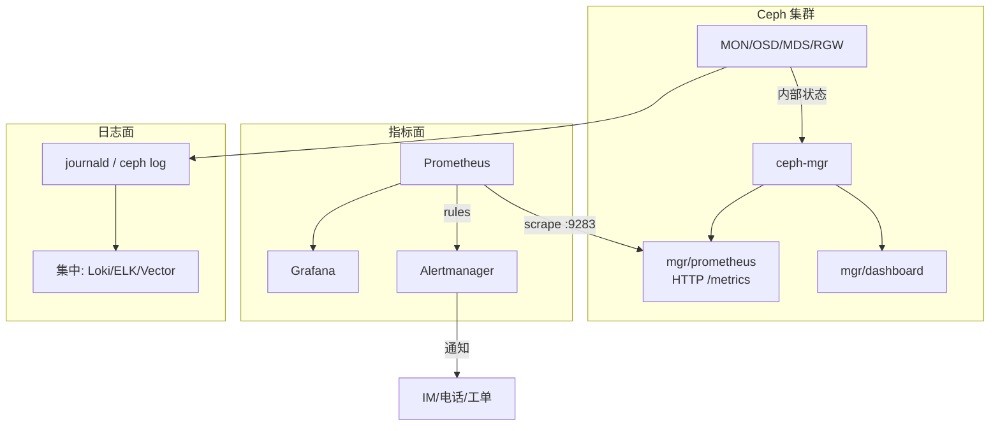

> 《Ceph 分布式存储》系列第 6 篇（收官）。前五篇把集群建起来、把块/文件/对象用起来；本篇解决"**跑起来之后，怎么知道它健康、出事能不能第一时间发现并归因**"。Ceph 自带 `ceph-mgr` 的 **prometheus 模块**原生暴露指标，配合 Prometheus + Grafana + Alertmanager 构成指标面，日志面则靠各守护进程日志集中化。这套正是《SRE 能力建设》里"可观测性三支柱（Metrics/Logging/Alerting）"在一个真实系统上的落地。
>
> 口径说明：版本锚定 **Ceph Squid v19.2.x**，指标以 `ceph-mgr prometheus` 模块暴露的 `ceph_*` series 为准；cephadm 现代默认随 `--skip-monitoring-stack`（不加则自动部署 node_exporter/prometheus/grafana/alert_manager 栈）。文中 PromQL 为可直接用的示例表达式，具体 metric 名以集群实际 `/metrics` 抓取为准。

---

# 第 1 章：基础概念 - 为什么 Ceph 特别需要可观测

## 1.1 一句话定义

> **Ceph 的可观测 = 把"集群健康(health)、PG/OSD 状态、池容量、延迟"这些分散在每个守护进程里的内部状态，集中成可量化、可告警、可回溯的指标与日志——因为一个自愈系统最容易出的问题恰恰是"它在默默自愈，但自愈很慢/卡住，而没人知道"。**

传统单机存储"挂了很明显"；Ceph 会自愈，`HEALTH_WARN` 可能只代表"正在恢复"而非"坏了"，这种**灰度状态**必须靠指标趋势和告警来判读，否则故障被自愈的表象掩盖。

## 1.2 要回答的三份账

| 问题域 | 追问 | 对应能力 |
|--------|------|---------|
| **看得见吗** | 集群当前 health、容量、延迟如何 | mgr/prometheus + Grafana 大盘 |
| **叫得醒吗** | 降级/将满/时钟漂移能否第一时间通知 | Alertmanager 规则 + 分级 |
| **查得清吗** | 事后能定位是哪个 OSD/哪条请求 | 守护进程日志集中化 + ops log |

## 1.3 Ceph 健康语义速记

| 状态 | 含义 | 是否告警 |
|------|------|---------|
| `HEALTH_OK` | 一切正常 | 否 |
| `HEALTH_WARN` | 非致命异常（将满/恢复中/时钟轻微偏移） | **要**（趋势告警） |
| `HEALTH_ERR` | 有 PG 不可用/OSD down 超阈值等，影响数据可用 | **强告警** |

---

# 第 2 章：基础架构 - 指标面与日志面

## 2.1 可观测架构总览



## 2.2 核心组件职责

| 组件 | 职责 | 关键点 |
|------|------|--------|
| **mgr/prometheus** | 每个 MON/OSD/MDS/RGW 都经本机 mgr 代理暴露 `/metrics`（默认端口 9283） | 抓取目标发现是重点 |
| **Prometheus** | 周期拉取指标、存储、PromQL 查询与告警规则计算 | TSDB |
| **Alertmanager** | 告警去重/分组/静默/路由到通知渠道 | 分级、抑制 |
| **Grafana** | 大盘可视化，社区有 Ceph 官方 dashboard 模板 | 三支柱里 Metrics 的"看" |
| **mgr/dashboard** | Ceph 自带轻量 UI，快速看 health/OSD/池 | 应急排障入口 |
| **日志集中(Loki/ELK)** | 汇聚各守护进程日志做检索与关联 | 事后归因 |

---

# 第 3 章：工作原理 - 指标怎么来、告警怎么触发

## 3.1 启用与抓取

```bash
# 确认 prometheus 模块在
ceph mgr module enable prometheus
ceph mgr services            # 看到 prometheus 端点 (通常 http://<node>:9283/)
# cephadm 现代部署若未 skip-monitoring-stack, 会自动起栈并用服务发现抓取
```

Prometheus scrape 配置要点：抓 **每一个** MON/OSD/MGR 主机的 mgr prometheus 端口（9283），因为各守护进程的指标是从"本机 mgr"代理出来的。用文件/SD 或 Consul 做服务发现。

```yaml
# scrape_configs 片段示意
- job_name: ceph
  static_configs:
    - targets: ['node-1:9283','node-2:9283','node-3:9283']
```

## 3.2 关键指标族

| 类别 | 代表指标 | 用途 |
|------|---------|------|
| 集群健康 | `ceph_health_status`（0=OK,1=WARN,2=ERR） | 总闸告警 |
| OSD | `ceph_osd_metadata`、`ceph_osd_stat`、per-osd up/in | OSD down/out 检测 |
| PG | `ceph_pg_*`（各状态计数：active/clean/degraded/inactive/unclean/peering） | **降级/卡住定位核心** |
| 池容量 | `ceph_pool_max_avail`、`ceph_pool_rd/wr`、`ceph_pool_bytes_used` | 将满/性能 |
| 磁盘 | `ceph_disk_occupation`、node_exporter 磁盘/SMART | 坏盘预判 |
| RGW | ops log 指标 / `ceph-rgw` 相关 series | 对象请求错误率 |
| 主机级 | node_exporter CPU/内存/IO/网络/时钟偏移 | 底层资源与 NTP |

## 3.3 告警规则（可直接落地的示例）

```yaml
# prometheus rules 片段
- alert: CephHealthErr
  expr: ceph_health_status == 2
  for: 2m
  labels: {severity: critical}
  annotations: {summary: "Ceph 集群 HEALTH_ERR, 数据可用性受影响"}
- alert: CephHealthWarnTrending
  expr: ceph_health_status == 1
  for: 15m
  labels: {severity: warning}
  annotations: {summary: "Ceph 持续 HEALTH_WARN 超 15 分钟"}
- alert: CephPGDegraded
  expr: sum(ceph_pg_degraded + ceph_pg_inconsistent) > 0
  for: 10m
  labels: {severity: warning}
  annotations: {summary: "存在降级/不一致 PG, 关注恢复速度"}
- alert: CephPGInactive
  expr: sum(ceph_pg_inactive) > 0
  for: 3m
  labels: {severity: critical}
  annotations: {summary: "有 PG inactive, 可能无法读写"}
- alert: CephPoolNearFull
  expr: (ceph_pool_max_avail / ceph_pool_kb) < 0.1
  for: 5m
  labels: {severity: critical}
  annotations: {summary: "池剩余容量 < 10%, 将触发 nearfull→可能拒写"}
- alert: CephOSDDown
  expr: changes(ceph_osd_up[5m]) != 0
  labels: {severity: warning}
  annotations: {summary: "OSD 状态在 5 分钟内翻转, 疑似抖动/坏盘"}
- alert: NodeClockSkew
  expr: abs(node_timex_offset_seconds) > 0.05
  for: 2m
  labels: {severity: critical}
  annotations: {summary: "节点时钟偏移过大, 会危及 MON quorum(见部署篇)"}
```

> 呼应系列：`CephPoolNearFull` 对应第 3/5 篇的"精简超分写爆"，`NodeClockSkew` 对应第 2 篇"时钟是部署第一坑"——告警规则把系列里散落的风险点固化成常驻守护。

## 3.4 告警分级与降噪

- **分级**：critical（ERR/PG inactive/池将满/时钟）→ 电话/即时；warning（WARN 趋势/degraded/OSD 翻转）→ IM。
- **分组 & 抑制**：按 cluster/az 分组；OSD down 触发时抑制同主机的派生告警，避免风暴。
- **静默**：计划内维护/升级（第 2 篇 `orch upgrade`）前用 Alertmanager silence。

---

# 第 4 章：日志面 - 结构与集中化

## 4.1 Ceph 日志来源与结构

| 来源 | 位置 | 说明 |
|------|------|------|
| 守护进程日志 | systemd journald（cephadm 容器）/ `/var/log/ceph/` | cephadm 下多为容器 stdout→journald |
| 审计/RGW ops log | RGW bucket/ops log | 对象请求级排障 |
| `ceph log last` | mgr 缓存的最近集群日志 | 快速取近期事件 |

```bash
ceph log last 100                 # 最近集群级日志
ceph daemon osd.7 log dump        # 单守护进程深入
journalctl -u ceph@"$(cephadm ls|..)"  # 容器化守护进程日志(cephadm)
```

## 4.2 集中化方案

- **Loki**：轻量、Promtail/Alloy 采集、LogQL 查询，与 Grafana 同栈。
- **ELK/OpenSearch**：重检索、结构化字段、告警联动。
- 关键：给日志打上 **cluster / daemon type / osd id / reqid** 标签，让"指标发现异常→日志下钻定位"闭环。

## 4.3 Trace（可选高阶）

RGW/Mgr 可对接分布式追踪，把一次 S3 请求在"网关→RADOS→OSD"的耗时拆开，用于复杂延迟归因。

---

# 第 5 章：应用场景与实操大盘

| 目标 | 做法 |
|------|------|
| 全局健康总览 | `ceph_health_status` + PG 状态堆叠 + 池容量水位 一张 Grafana 行 |
| OSD 级排障 | per-OSD IOPS/延迟/commit，关联 SMART/温度预判坏盘 |
| 恢复进度 | `ceph_pg_*` 趋势 + mgr 恢复速率指标，看 degraded 是否在收敛 |
| 容量规划 | 池 used/max_avail 增速 + 预测到期告警 |
| 对象 SLA | RGW ops 错误率/延迟 P99 |

推荐导入 **Ceph 官方 Grafana dashboard**（mgr dashboard 或社区模板），再按业务加自定义面板。

---

# 第 6 章：性能特性与参数

## 6.1 采集开销控制

| 项 | 建议 | 原因 |
|----|------|------|
| scrape_interval | 30s(常规)/10s(关键) | 过密增加 mgr 与网络负载 |
| 指标基数 | 慎开逐对象/逐 bucket 高基数标签 | Ceph series 多, 基数爆炸压垮 TSDB |
| 日志级别 | 常规 info, 排障临时 debug | debug 日志量大, 常态开吃 IO |
| mgr 模块裁剪 | 只留需要模块 | 减少 mgr 负担 |

## 6.2 关键阈值参考（示例，按业务校准）

| 指标 | 预警 | 严重 |
|------|------|------|
| 池剩余容量 | <15% | <10%（nearfull 默认 90% 用满即 WARN） |
| PG degraded 持续 | >5min | >30min 不收敛 |
| OSD 读写延迟 P99 | 相对基线翻倍 | 持续超 SLA |
| 时钟偏移 | >0.05s | >0.1s（危及 quorum） |
| `ceph_health_status` | =1 持续 | =2 即报 |

---

# 第 7 章：局限缺陷与解决方案

| 问题 | 表现 | 根因 | 规避 |
|------|------|------|------|
| WARN 语义模糊 | 恢复中也 WARN, 易误判/漏判 | 自愈与故障都归 WARN | 看**趋势+持续时长**而非瞬时值; degraded 用 for 时长 |
| 指标基数过高 | TSDB 膨胀、查询慢 | 逐对象/逐 bucket 标签 | 限制高基数抓取, 聚合后再存 |
| 各守护进程需本机 mgr | 抓取目标遗漏导致盲区 | prometheus 端口由本机 mgr 代理 | SD 覆盖全部 MON/OSD/MGR/RGW 主机 |
| 时钟告警缺位 | MON 仲裁崩前无预警 | NTP 漂移未监控 | 必配 NodeClockSkew(见 3.3) |
| 告警风暴 | 一坏盘连锁几十条 | 派生告警未抑制 | Alertmanager 分组+抑制+静默 |
| 日志与指标割裂 | 发现问题但定位难 | 无关联标签 | 统一 cluster/daemon/osdid/reqid 标签打通 |

---

# 附录

## A. 可观测落地 Checklist

```text
mgr prometheus 模块 on + 端口 9283 可达
→ Prometheus SD 覆盖全部守护进程主机
→ 导入 Ceph Grafana 大盘 + 自建健康/容量/恢复三行
→ rules: health=2 / PG inactive / degraded 趋势 / 池 <10% / 时钟 / OSD 翻转
→ Alertmanager 分级+抑制+维护静默
→ 日志进 Loki/ELK, 打 cluster/daemon/osdid 标签
→ 演练: 手动 osd out 验证"降级→恢复→告警→收敛"全链路可见
```

## B. 术语速查

| 术语 | 一句话 |
|------|--------|
| mgr/prometheus | 由本机 ceph-mgr 代理暴露 `ceph_*` 指标的模块 |
| ceph_health_status | 0/1/2 = OK/WARN/ERR 的总闸指标 |
| PG 状态指标 | degraded/inactive/unclean/peering 等计数, 归因核心 |
| Alertmanager | 告警去重/分组/抑制/静默/路由 |
| nearfull/max_avail | 池将满水位与剩余容量 |
| Loki/ELK | 日志集中与检索方案 |
| silence | 维护窗口临时压制告警 |

## C. 参考资料

1. [Ceph Docs · Prometheus 模块](https://docs.ceph.com/en/squid/mgr/prometheus/) — 指标暴露与抓取。✅ 已核实
2. [Ceph Docs · Monitoring with Prometheus/Grafana](https://docs.ceph.com/en/squid/mgr/) — 栈搭建。✅ 已核实
3. [Ceph Docs · Health Checks](https://docs.ceph.com/en/squid/rados/monitoring/health-checks/) — health WARN/ERR 语义。✅ 已核实
4. [Prometheus Alerting Rules](https://prometheus.io/docs/prometheus/latest/configuration/alerting_rules/) — 规则语法。✅ 已核实

## D. 变更记录

| 日期 | 版本 | 变更内容 |
|------|------|---------|
| 2026-10-29 | v1.0 | 首版：Ceph 可观测三支柱落地——mgr/prometheus、Prometheus+Grafana+Alertmanager、日志集中化，含可观测架构、可落地告警规则与调优三块，Mermaid 架构图 + 决策/阈值表 |
