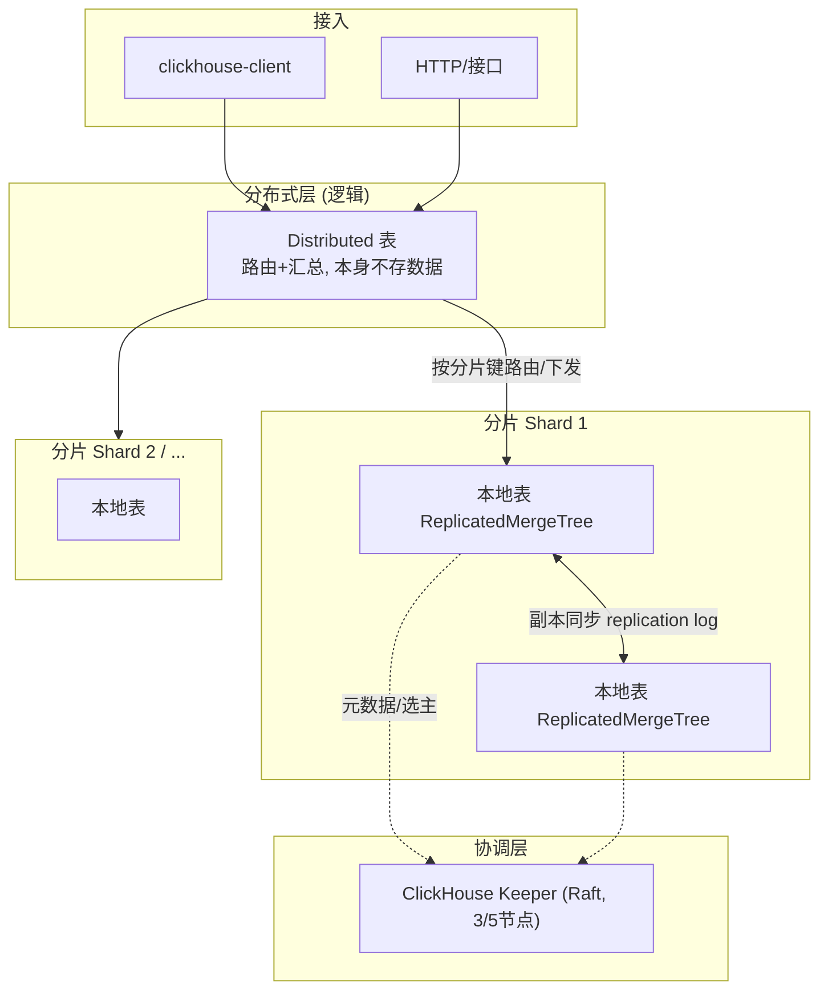
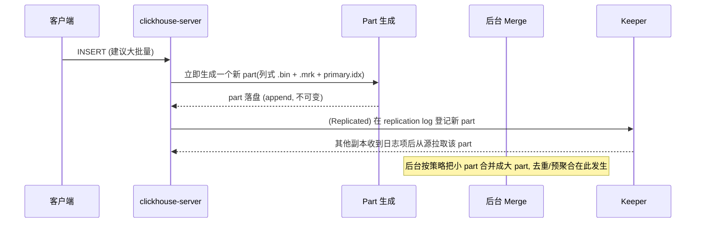
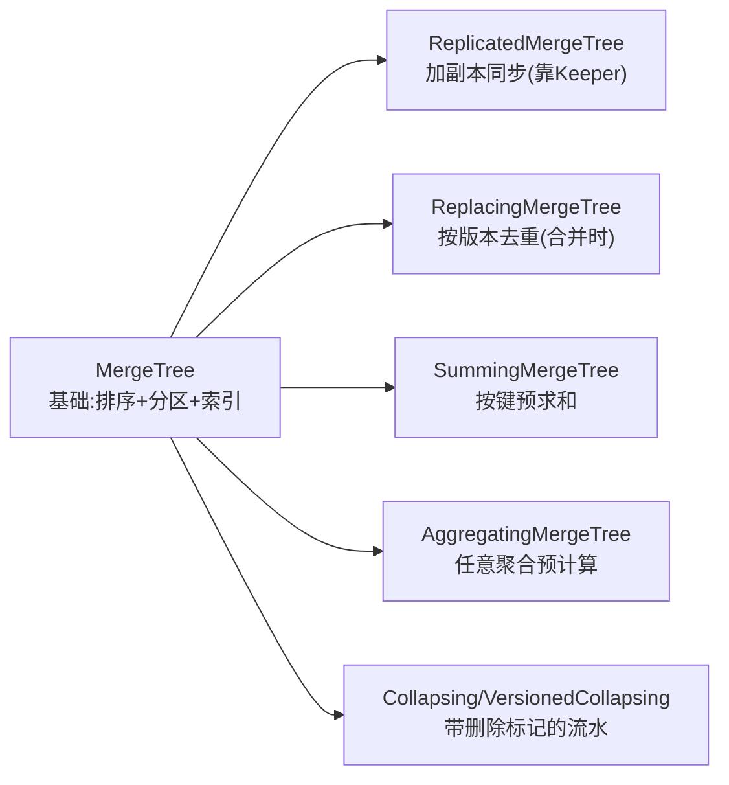
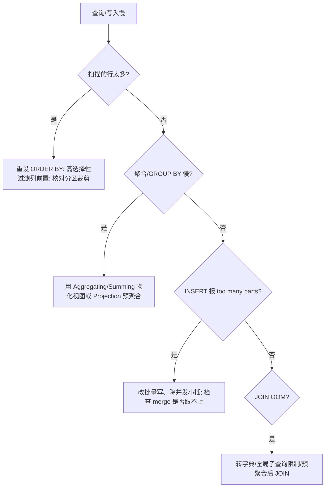

> 这是一篇 ClickHouse 的"地基 + 实操"合一篇：从**为什么列式 + 稀疏索引能让千亿行秒级出结果**讲起，落到 MergeTree 家族选型、Replicated + Keeper 高可用、Distributed 分片、写入批处理纪律、物化视图预聚合，再到生产最常见的踩坑（小批量写、高基数、JOIN）与调优。适合做过传统关系库、第一次把 ClickHouse 用于日志/行为/指标分析的工程师。
>
> 口径说明：版本锚定 ClickHouse **26.x（2026 稳定线，26.3 为 LTS）**；协调服务用内置 **ClickHouse Keeper**（自 21.8 起提供、协议兼容 ZooKeeper，新集群首选）。语法与默认值以官方文档为准，性能数字为量级参考、非某机实测结论。

---

# 第 1 章：基础概念 - ClickHouse 在想什么

## 1.1 一句话定义

> **ClickHouse 是一个面向 OLAP 的列式数据库：把同一列的数据连续存放并压缩、用稀疏主键索引 + 向量化执行按列批处理，从而在海量数据上做聚合/过滤类分析查询时快几个数量级——代价是它不擅长按行事务与高频点改。**

行式（OLTP）把"一条记录的所有字段"放一起，适合"取某一整行"；列式（OLAP）把"一个字段的所有值"放一起，适合"对某几列做全表聚合"。ClickHouse 押注后者。

## 1.2 它解决的痛点

| 传统做法的痛 | ClickHouse 的解 |
|-------------|----------------|
| MySQL 大表 `GROUP BY` 慢到不可用 | 列式扫描 + 向量化，扫描列更少、SIMD 并行 |
| 数仓(如 Hadoop 系)重、延迟高、运维复杂 | 单二进制即可跑，SQL 原生，实时入库秒级可查 |
| 原始日志/事件存了查不动 | 高压缩比 + 稀疏索引，PB 级也能交互式查询 |
| 预聚合与明细难两全 | 物化视图(MergeTree 家族)增量预聚合 |

## 1.3 三份账

| 问题域 | 追问 | ClickHouse 答案 |
|--------|------|----------------|
| **怎么存得快** | 数据物理布局 | 列式 + part + 稀疏索引 + 压缩 |
| **怎么算得快** | 查询执行模型 | 向量化 + 多线程 pipeline |
| **怎么扩/怎么可靠** | 分片与副本 | Distributed + ReplicatedMergeTree + Keeper |

## 1.4 核心术语表

| 术语 | 含义 | 类比 |
|------|------|------|
| Part | 一次 INSERT 生成的一个不可变数据块 | "一段 append 上去的账页" |
| Merge | 后台把小 part 合成大 part | "把碎账页装订成册" |
| Primary Key（稀疏） | 每 `index_granularity`(默认 8192)行记一个索引点 | "书每几十页一个章节标记" |
| Mark（.mrk） | 列数据文件里的偏移标记，granule→磁盘位置 | "每段文字的书签" |
| Granule | 索引最小扫描单元（默认 8192 行） | "一次翻一页的量" |
| Partition Key | 按表达式(常按天)把数据划块, 便于裁剪/ TTL | "按月份分抽屉" |
| Keeper | 副本协调/Raft 共识服务 | "集群的元数据裁判" |
| Projection/MV | 表级预聚合/物化视图 | "提前算好的小抄" |

---

# 第 2 章：基础架构 - 单机内核与分布式

## 2.1 架构总览



## 2.2 核心组件职责

| 组件 | 职责 | 关键点 |
|------|------|--------|
| 表引擎(MergeTree 家族) | 决定数据如何落盘、索引、合并、复制 | 99% 生产表基于它 |
| Distributed 引擎 | 把查询扇出到各分片、汇总结果 | "逻辑表", 不存数据 |
| ClickHouse Keeper | 存副本元数据/replication log、DDL 锁、选主 | 替代外部 ZooKeeper |
| Merge 调度器 | 后台合并小 part | 影响写放大与查询性能 |
| Mutation 执行器 | 异步 `ALTER UPDATE/DELETE` | 非即时, 重写 part |

## 2.3 部署形态

- **单机**：一个 `clickhouse-server`，适合起步/中小规模。
- **多副本单分片**：同一份数据 N 副本，靠 Replicated + Keeper 高可用读扩展。
- **多分片多副本**：Distributed 水平切数据(容量/算力扩展) + 每分片内副本(可用性)。生产建议 Keeper 3 或 5 节点。

---

# 第 3 章：工作原理 - 一次写入与一次查询

## 3.1 数据落盘全链路（写入）



关键纪律：**ClickHouse 的写入是"每 INSERT 一个 part"**，part 越多、合并压力越大、查询要扫的碎块越多。**必须批量写**（一次几千~几万行，秒级合并频率），高频单行小插是头号性能杀手。

## 3.2 一次查询的管线

```text
SQL 文本
  → Parser(语法树) → Analyzer(语义/类型) → Interpreter(执行计划)
  → QueryPipeline(处理器图) → Processors 并行执行
       Source 读列数据 → Transform 过滤/聚合 → Sink 输出
按 index_granularity 的 granule 为单位裁剪/并行, 跨 part/跨核并行
```

稀疏主键的作用：**用 ORDER BY 前缀在 part 内快速跳过不相关 granule**（不是 B+Tree 全键索引）。因此**主键设计=查询裁剪效率**：把最常用来过滤/排序的高选择性列放 ORDER BY 前面。

## 3.3 列式 + mark 索引读取一个过滤查询

1. 根据 `WHERE` 命中主键范围 → 定位候选 granule 区间。
2. 读这些列的 `.mrk` 找到 `.bin` 中对应偏移。
3. 只解压/扫描需要的**列**（列少、数据块连续、SIMD 向量化）。
4. 聚合/投影，返回。

---

# 第 4 章：结构设计 - MergeTree 家族选型

## 4.1 引擎家族谱系



| 引擎 | 解决什么 | 典型场景 | 坑 |
|------|---------|---------|----|
| MergeTree | 通用明细存储 | 日志/事件流 | 不去重(原样留) |
| ReplacingMergeTree | 按 ORDER BY/版本列去重 | CDC、状态表 | 去重**异步**, 查询去重需 `FINAL`(开销大) |
| SummingMergeTree | 维度相同自动求和 | 指标累计 | 只擅长 sum |
| AggregatingMergeTree | 复杂预聚合 | 报表加速 | 需 AggregateFunction 列 |
| (Versioned)Collapsing | 撤销旧记录 | 变更流水 | 语义要设计好 |

## 4.2 建表要点（实践骨架）

```sql
CREATE TABLE events ON CLUSTER 'main'
(
    ts      DateTime,
    user_id UInt64,
    type    LowCardinality(String),   -- 低基数字符串字典编码, 省空间提速
    dur     UInt32
)
ENGINE = ReplicatedMergeTree('/clickhouse/tables/{shard}/events','{replica}')
PARTITION BY toYYYYMMDD(ts)            -- 按天分区, 便于 TTL/裁剪
ORDER BY (type, ts, user_id)           -- 稀疏主键前缀 = 高频过滤列在前
TTL ts + INTERVAL 90 DAY               -- 生命周期
SETTINGS index_granularity = 8192;
```

## 4.3 副本与分片的关系

- **分片（shard）**：数据横向切，解决"存不下/算不动"。分片键（如 `cityHash64(user_id)`）决定去哪片。
- **副本（replica）**：数据纵向冗余，解决"高可用/读扩展"，靠 ReplicatedMergeTree + Keeper。
- Distributed 表把两者粘成一个逻辑视图。

---

# 第 5 章：应用场景与选型

| 场景 | 适配度 | 说明 |
|------|-------|------|
| 实时数仓/BI 聚合 | ★★★★★ | 看家本领 |
| 日志/可观测分析 | ★★★★★ | 高压缩 + TTL, 契合(呼应 ClickHouse 自身常被用于监控栈后端) |
| 用户行为/漏斗/留存 | ★★★★ | 大宽表 + 位图/字典优化 |
| 指标监控后端 | ★★★★ | 时序用 MergeTree/特定排序 |
| 事务型 OLTP/高频点改 | ★ | 不适合:无强事务、UPDATE 是异步 mutation |
| 强一致多表 JOIN 大数据 | ★★ | JOIN 内存受限, 尽量字典/预聚合规避 |

**对比**：与 Elasticsearch 比，ClickHouse 聚合更快、存储更省，但全文检索/倒排弱；与传统 MPP 数仓比，ClickHouse 部署更轻、单表极快，跨大表复杂 JOIN 与事务是其短板。

---

# 第 6 章：性能特性与参数优化

## 6.1 性能影响因素

1. **ORDER BY 主键设计**：决定扫描裁剪效果，错设计=全表扫。
2. **PARTITION BY 粒度**：分区太多(小文件碎)或太少(裁剪差)都伤；避免按高基数列分区。
3. **写入批量**：大批量顺序写，避免高频小插。
4. **列类型选择**：`LowCardinality`、定宽整型、合适编码(`CODEC(Delta, ZSTD)`)提升压缩与速度。
5. **max_threads / 并行**：向量化按线程/granule 并行。
6. **part 数量**：未合并小 part 多→查询慢、`too many parts` 报错。

## 6.2 关键参数速查

| 参数 | 默认/建议 | 说明 |
|------|----------|------|
| `index_granularity` | 8192 | granule 行数; 太小索引大, 太大扫描粗 |
| `max_insert_threads` / 批量 | 大批优先 | 单次 INSERT 行数/字节尽量大 |
| `parts_to_throw_insert` | 300 | 分区内 part 数超此拒写(背压) |
| `max_bytes_before_external_group_by` | 按内存 | group by 超阈值溢盘, 防 OOM |
| `join_use_nulls`/`max_memory_usage` | — | JOIN 内存控制 |
| `ttl` / `move_factor` | 按策略 | 冷热分层到 S3/慢盘 |
| `replicated_canary`/Keeper 节点 | 3/5 | 协调层高可用 |

## 6.3 调优决策树



---

# 第 7 章：局限缺陷与解决方案

| 问题 | 表现 | 根因 | 规避 |
|------|------|------|------|
| 高频小批量写 | part 暴涨、`too many parts`、查询抖 | 每 INSERT 一 part | 客户端攒批(几千~数万行)、异步插入 buffer |
| UPDATE/DELETE 非即时 | mutation 异步重写 part, 期间看到旧值 | 面向追加的不可变 part | 业务上少改; 用 ReplacingMergeTree 版本覆盖思路 |
| 去重要 FINAL 才即时 | 不 FINAL 可能读到重复 | 去重在 merge 时 | 查询用 `argMax`/`FINAL` 权衡, 或预聚合 |
| 大表 JOIN 弱 | 内存受限、易 OOM | 无分布式 shuffle 优化(相对) | 字典化、GLOBAL JOIN、预聚合降基数 |
| 高基数列分区/排序爆炸 | 索引/分区失控 | 按 user_id 等做分区键 | 分区用日期等低基数, 基数列放 ORDER BY 末 |
| 无完整事务/行级约束 | 不适合 OLTP | OLAP 定位 | 事务型数据走 MySQL/PG, CK 只做分析副本 |
| Keeper/ZK 运维 | 协调层抖动影响副本 | 外部依赖 | 用内置 Keeper, 3/5 节点, 独立部署 |

---

# 附录

## A. 实操速记

```bash
# 批量写入(生产推荐从文件/流批插)
clickhouse-client --query "INSERT INTO events FORMAT JSONEachRow" < batch.ndjson
# 查看 part 数与合并
SELECT table, count() FROM system.parts WHERE active GROUP BY table;
SYSTEM START MERGES / STOP MERGES ...
# 建 Distributed 逻辑表
CREATE TABLE events_all AS events
ENGINE = Distributed('main','default','events', rand());
```

## B. 术语速查

| 术语 | 一句话 |
|------|--------|
| OLAP/列式 | 面向分析、按列存储压缩 |
| Part | 一次插入生成的不可变数据块 |
| 稀疏主键/mark | 每 8192 行一索引点, granule 级裁剪 |
| MergeTree 家族 | ClickHouse 核心引擎族 |
| Replicated | 副本间靠 Keeper 同步 replication log |
| Distributed | 跨分片路由+汇总的逻辑表 |
| ClickHouse Keeper | C++ Raft、兼容 ZK 的协调服务(21.8+) |
| Mutation | 异步 UPDATE/DELETE |
| 物化视图/Projection | 增量预聚合加速查询 |
| LowCardinality | 低基数字符串字典编码 |

## C. 参考资料

1. [ClickHouse Docs · MergeTree](https://clickhouse.com/docs/en/engines/table-engines/mergetree-family) — 家族/复制/分区。✅ 已核实
2. [ClickHouse Docs · Primary Index](https://clickhouse.com/docs/en/primary-key) — 稀疏索引与 granule。✅ 已核实
3. [ClickHouse Docs · ClickHouse Keeper](https://clickhouse.com/docs/en/operations/clickhouse-keeper) — Raft/ZK 兼容协调。✅ 已核实
4. [ClickHouse Docs · Best Practices / 批量写](https://clickhouse.com/docs/en/best-practices) — 小插入反模式。✅ 已核实

## D. 变更记录

| 日期 | 版本 | 变更内容 |
|------|------|---------|
| 2026-10-29 | v1.0 | 首版：ClickHouse 列式内核、MergeTree 家族选型、稀疏索引/向量化、Replicated+Keeper 与 Distributed、批量写与调优九维全解，含架构、写路径、选型、调优四张 Mermaid 图 |
