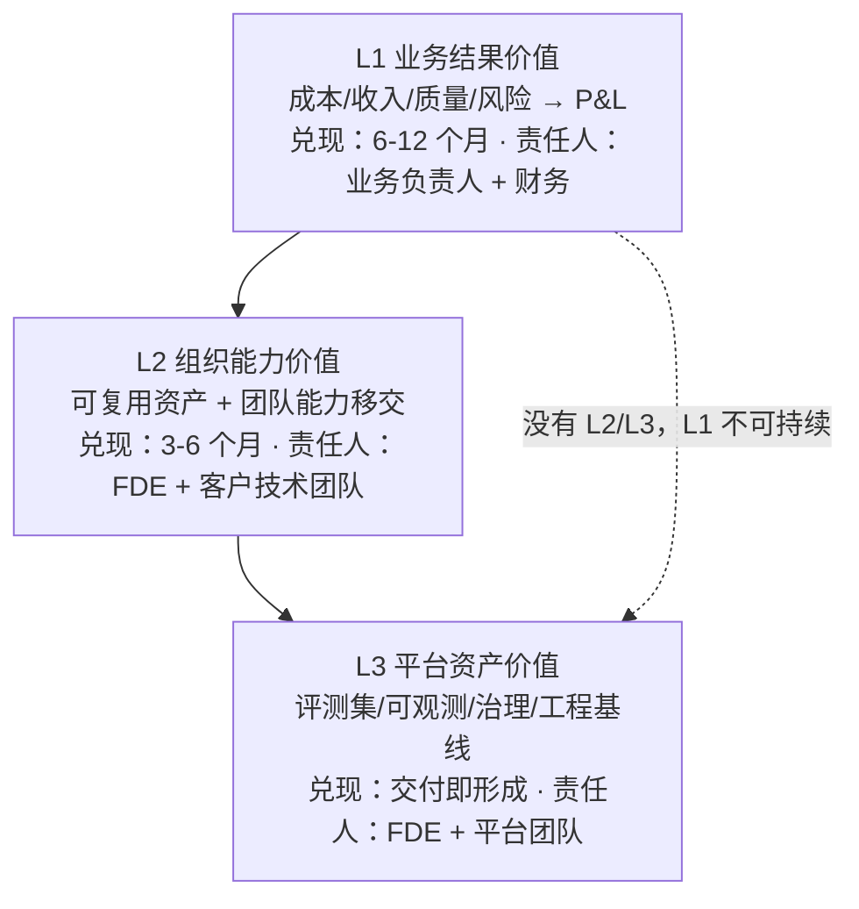

> 本篇是《FDE》系列的**第 1 篇**。FDE（Forward Deployed Engineer，前沿部署工程师）是 Palantir 在 2009 年前后创立、2025 年起被 OpenAI、Anthropic 等模型厂商大规模复制的交付模式：把工程师派驻到客户现场，对端到端的落地结果负责，而不只是交付软件。本篇回答一个所有 FDE、AI 解决方案与企业采购方都绕不开的问题：**FDE 交付的企业 AI 价值，到底该怎么评？**——给出一套三层价值模型、指标体系、度量方法与可复制的价值记分卡。与站内体系的关系：成熟度口径直接复用《LLM 应用工程化》的 PoC/MVP/生产级三级基线，成本口径复用《FinOps》的"成本-归属-利用率"闭环，AI 能力评估对接《企业 AI 平台工程》的四维 Agent 评估体系。
>
> 口径说明：文中外部事实以 **2026-10-29** 联网核实为准，逐条标注 ✅（已核实）或 ⚠️（有争议/二手来源）；所有案例数字均为**假设数据**，仅演示记分卡与 ROI 算法，不代表任何真实项目；量化论断均可在文末《参考来源》中追溯原始出处。

---

# 第 1 章：为什么 FDE 交付的价值难评

## 1.1 FDE 模式的一句话定义

> **FDE = 把"工程师"当成交付物的一部分：驻场（或深度嵌入）客户现场，横跨咨询、架构、开发、上线、移交全流程，对"系统在客户业务里真正跑起来并产生结果"负责，而不是对"把软件装好"负责。**

三个关键事实（均经联网核实）：

| 事实 | 内容 | 来源与状态 |
|------|------|-----------|
| 模式起源 | Palantir 于 2009 年前后创立 FDE 模式，早期客户（情报机构等）数据敏感、需求无法远程澄清，只能把工程师放进现场，对完整部署结果负责 | ✅ 已核实（a16z、Palantir DevCon 资料） |
| 模式扩散 | 2025 年起 OpenAI、Anthropic 等模型厂商大规模招聘 FDE/解决方案工程师；a16z 观察到 OpenAI 招聘页 311 个开放岗位中 22 个属于此类（截至其成文时） | ✅ 已核实（a16z《Trading Margin for Moat》，2025-06） |
| 经济逻辑 | a16z 将其概括为"用毛利换护城河"（Trading Margin for Moat）：FDE 人力密集、毛利低，换来的是深度嵌入客户核心工作流形成的壁垒与续约 | ✅ 已核实（同上） |

Palantir 自身也在把 FDE "AI 化"——其 DevCon 3 发布的 AI FDE 产品用自然语言自动化 Foundry 运维操作（✅ 已核实，Palantir DevCon3 官方页面）。换句话说，**"FDE 交付"本身正在从人力驻场演变为"人 + AI 工具链"的混合交付**，这使得价值口径更难拍：到底哪些结果该记在 FDE 头上，哪些该记在产品/模型头上？

## 1.2 演示 ≠ 生产：企业 AI 的价值鸿沟

2025 年 7 月 MIT NANDA 发布的《The GenAI Divide: State of AI in Business 2025》给出了一个病毒式传播的数字：**95% 的企业 GenAI 试点在 P&L 上零回报**，仅 5% 的"集成式"试点创造了数百万美元级价值（✅ 已核实，报告原文）。

但这个数字必须带着警示号使用（⚠️ **有争议**）：

- 沃顿商学院教授 Kevin Werbach 公开质疑：95% 这一数字在报告中几乎只有一句话陈述，找不到推导数据，呼吁作者公开数据或撤回（⚠️ 已核实批评存在，批评来源为二手汇总）；
- 报告实际样本是 **52 场高管访谈 + 153 份问卷**，而将其带火的 Fortune 报道称"150 场访谈、350 名员工调研"，样本量被放大 2-3 倍（⚠️ 同上）；
- 更精确的口径是：5% 指的是"自研定制 AI 工具进入生产并产生可测回报"这一**窄类别**，不是"所有 AI 试点"（⚠️ 同上）。

**真正稳健的结论不是"95% 失败"，而是报告的结构性发现**：失败集中在"用了 AI"但"没改工作流"的项目上；成功者普遍做了三件事——把 AI 深度集成进端到端流程、建立持续的评估-迭代循环、由业务方（而非纯 IT）主导。这与 McKinsey 2026 年 4 月的价值度量文章相互印证：近八成组织已在至少一个业务职能使用 GenAI、62% 在试 Agentic AI，但 **60% 的受访组织尚未看到企业级 EBIT 影响**（✅ 已核实，McKinsey）。

## 1.3 价值难评的三个结构性错位

```text
  交付物粒度错位                周期错位                    归因错位
 ┌──────────────┐        ┌──────────────────┐      ┌──────────────────┐
 │ FDE 交付的是  │        │ 交付周期以周计     │      │ 业务结果由 AI、   │
 │ 系统/工作流/  │        │ 价值兑现以季度计   │      │ 流程改造、市场环境 │
 │ 移交的能力    │        │ 验收时价值还没长出来│      │ 共同决定，无法单因 │
 │ 业务方要的是  │        │ 价值长出来时人已撤场│      │ 归给一个项目       │
 │ P&L 结果      │        │                    │      │                    │
 └──────────────┘        └──────────────────┘      └──────────────────┘
```

- **粒度错位**：FDE 的可交付物是"上线的系统 + 移交的能力"，业务方要的是"成本下降、收入上升"。两者之间隔着流程再造与组织采纳。
- **周期错位**：交付验收在 T+1 月，运营 KPI 动起来在 T+3 月，财务影响确认在 T+6~12 月（McKinsey 五层框架中财务层的典型兑现节奏）。用交付验收时点评价价值，注定低估或高估。
- **归因错位**：业务结果是多因一果。没有对照设计，任何"上线后提升了 30%"都经不起追问。

**评价 FDE 交付价值的本质，就是用一套机制把这三个错位弥合掉**——这正是后文框架要做的事。

---

# 第 2 章：评估前先纠偏——五个常见误区

| 误区 | 为什么错 | 替代口径 |
|------|---------|---------|
| 用 Demo 惊艳度当价值 | 演示级 PoC 的验收标志只是"能回答问题"（《LLM 应用工程化》三级成熟度基线），惊艳感 3 天即衰减 | 用生产级验收标志：SLO、值守、成本归因、审计 |
| 用 token 成本当总成本 | token 只是 TCO 的一小部分：漏掉人工复核、集成维护、变更管理、FDE 驻场工时 | 用全口径 TCO（McKinsey 明确要求含云与 token 及实施成本），成本归属用《FinOps》闭环 |
| 把采纳当价值 | 采纳（DAU、渗透率）是必要非充分条件——大家在用，不代表业务在变好 | 采纳只作中间层指标，价值看运营 KPI 与财务层 |
| 把感知提效当真实提效 | 2025 年 DORA 报告、GitClear 代码质量分析与 METR 随机对照试验的汇总结论：AI 采纳率极高、感知提效上升，但交付稳定性与代码可维护性指标走平甚至变差（⚠️ 二手汇总，详见来源） | 感知数据只做线索，结论必须落在客观指标 + 对照设计上 |
| 直接套行业均值当自己的目标 | "行业 AI ROI 平均 49%"之类的数字（某 2026 调研口径，⚠️ 二手）与自身场景、基线、归因口径都不同 | 只用自己的基线做前后/对照比较，行业数据仅用于校准预期 |

一句话：**价值不是"感觉"，也不是"行业数字"，而是"相对于自己基线、可归因、可复核的差异"。**

---

# 第 3 章：三层价值模型

把"AI 价值"拆成三层，每层回答不同的问题、有不同的兑现节奏与责任人。这是全篇的骨架：



## 3.1 三层的含义

| 层 | 回答的问题 | 典型内容 | 兑现节奏 |
|----|-----------|---------|---------|
| **L1 业务结果价值** | 客户的业务变好了吗？ | 单位成本下降、处理周期缩短、转化/留存提升、风险事件减少 | 6-12 个月，季度复盘 |
| **L2 组织能力价值** | 客户团队接得住吗？ | 交接的运行手册/评测集/提示词资产、客户工程师可独立迭代、FDE 依赖度衰减 | 3-6 个月，交付期即开始 |
| **L3 平台资产价值** | 留下了什么可复用的底座？ | 评测基线、Trace 可观测、权限治理、降级路径、成本归因账单 | 交付即形成，持续增值 |

**为什么必须分层？** 因为 FDE 交付有一个独特性质：**FDE 撤场后价值是否延续，取决于 L2/L3 留得够不够**。只看 L1 的项目，往往在 FDE 离场三个月后打回原形——这不是价值兑现，是价值借用。反过来，一家采购方评价 FDE 交付时，只验收 L3 的工程资产而从不追踪 L1，则陷入了"平台很美、业务没动"的另一种失败。

## 3.2 与业界框架的对齐

McKinsey 的五层 AI 度量框架（技术性能 → 用户采纳 → 运营 KPI → 战略结果 → 财务影响，每层有明确责任人）是目前公开资料中对"AI 价值链"最完整的拆解（✅ 已核实）。三层模型与它的映射关系：

| 三层模型 | McKinsey 五层 | 站内体系对接 |
|---------|--------------|-------------|
| L3 平台资产价值 | L5 技术性能（幻觉率、延迟、token 单价、漂移） | 《企业 AI 平台工程》四维评估（结果/过程/成本/安全） |
| L2 组织能力价值 | L4 用户采纳与依赖度（AI 接受率 vs 覆盖率） | 《LLM 应用工程化》三级成熟度的"可交付 MVP"标志 |
| L1 业务结果价值 | L3 运营 KPI + L2 战略结果 + L1 财务影响 | 《FinOps》成本-归属-利用率闭环（成本侧） |

McKinsey 框架中每层的 Owner 设计值得直接抄：**技术层归数据科学/工程负责人，采纳层归产品与一线运营，运营 KPI 归端到端流程负责人，财务层归财务/FP&A**。价值没人认领，价值就不会被度量。

---

# 第 4 章：指标体系与度量方法

## 4.1 分层指标表（可直接抄进项目）

| 层 | 指标 | 定义 | 数据源 | 责任人 |
|----|------|------|--------|--------|
| L3 | 幻觉/错误率 | 输出被人工判定为事实错误的比例 | 评测集 + 抽检记录 | FDE/工程 |
| L3 | 单次交互全成本 | token + 推理算力 + 人工复核均摊 | AI Gateway/账单 + FinOps 归因 | 平台/财务 |
| L3 | 可恢复性 | 故障降级路径演练通过率、MTTR | 演练记录、监控 | 平台/SRE |
| L2 | 工作流渗透率 | 可用 AI 完成的任务中实际使用 AI 的比例 | 应用埋点 | 产品/一线 |
| L2 | AI 接受率 | AI 产出被直接采用（不改或微改）的比例 | 埋点 + 抽样 | 产品/一线 |
| L2 | 能力移交度 | 客户团队独立完成迭代/排障的比例（交接验收项） | 交接清单、演练 | FDE + 客户技术负责人 |
| L1 | 单位流程成本 | 每单/每票/每案件的全口径处理成本 | 业务系统 + 财务 | 流程负责人 |
| L1 | 流程周期 | 从进入到完成的端到端时长 | 业务系统 | 流程负责人 |
| L1 | 质量/风险事件率 | 返工率、投诉率、合规事件数 | 业务系统、客服 | 业务负责人 |
| L1 | 归因后财务影响 | 经对照设计可归因的成本节省/收入增量 | 财务核算 | 财务/FP&A |

## 4.2 度量方法：基线-对照优先

没有基线的数字不是度量，是装饰。三种方法按可信度排序：

| 方法 | 做法 | 可信度 | 适用阶段 |
|------|------|--------|---------|
| **随机对照（A/B）** | 一半工作流走 AI、一半走原流程 | ★★★ | MVP 期即可设计（McKinsey 明确建议把 A/B 或阶梯式 rollout 建进发布过程） |
| **阶梯式 rollout** | 分批次开放，后开的批次当对照组 | ★★★ | 多团队/多区域推广期 |
| **前后对比** | 上线前 N 周 vs 上线后 N 周同口径对比 | ★★ | 无法做对照时的退路，须声明混杂因素 |

三条铁律：

1. **对照设计在交付启动时锁定**，不是验收前补——McKinsey 总结的"逃出试点陷阱"组织做的第一件事就是"up front 定义价值并锁定归因方法"（✅ 已核实）；
2. **成本侧必须走全口径 TCO + 归因**：复用《FinOps》"成本-归属-利用率"闭环，把模型/算力/人工复核/FDE 工时归属到具体用例，利用率决定下一轮治理动作；
3. **防指标操纵（Goodhart 定律）**：任何指标一旦与考核强绑定就会被优化掉测量意义。对策是指标成对使用（接受率 + 覆盖率、周期 + 缺陷率），且保留抽样人工复核。

## 4.3 采集成本控制

价值度量本身也有成本。原则：**优先复用交付物里本来就要建的可观测设施**（Trace、评测集、埋点、账单归因——《LLM 应用工程化》生产级基线的标配），价值度量只是对同一批数据的二次加工，与 FinOps 用 Prometheus 既有指标算成本账单是同一个思路。L1 层的财务归因数据无法从系统里"长出来"，必须在项目章程里明确由财务侧按月供给。

---

# 第 5 章：交付价值记分卡与阶段门

## 5.1 把三级成熟度改造成价值阶段门

《LLM 应用工程化》的 PoC/MVP/生产级三级成熟度回答"系统到什么程度了"；叠加价值维度后，每道门多问一句"价值证据到什么程度了"：

| 阶段门 | 系统门（原有） | **价值门（本篇新增）** | 不过门的后果 |
|--------|--------------|----------------------|-------------|
| PoC 门 | 单路径跑通 | **价值假设锁定**：写清目标指标、基线数、归因方法、数据供给责任人 | 无基线不立项 |
| MVP 门 | 真实用户小流量、有回滚 | **采纳 + 早期运营信号**：工作流渗透率、AI 接受率达标；运营 KPI 出现同向早期信号；度量已内置到系统（不是人肉导表） | 不扩流量 |
| 生产级门 | SLA/SLO、值守、成本归因 | **可归因的运营/财务影响**：对照设计下运营 KPI 改善统计显著；全口径 TCO 算清；规模化经济性成立 | 不签长期、不扩容 |

这与 McKinsey 建议的治理节奏同构：**固定月度/季度复盘 + 一份共享证据包（evidence pack）+ 明确决策门**——"证据包提供事实，节奏提供惯性，门提供决策逻辑"（✅ 已核实）。区别只是把它的四阶段（Pilot/MVP/Initial scaling/Scale）映射到本站三级成熟度的语境里。

## 5.2 价值记分卡模板

一张表，交付方与采购方同表双向使用——交付方用它证明价值，采购方用它验收价值：

| 维度 | 指标 | 基线 | 目标 | 实测 | 证据链接 | 责任人 | 门状态 |
|------|------|------|------|------|---------|--------|--------|
| L3 质量 | 幻觉率 | 12% | ≤3% | — | 评测报告 | FDE | — |
| L3 成本 | 单次交互全成本 | 无 | ≤¥0.8 | — | 归因账单 | 平台 | — |
| L2 采纳 | 工作流渗透率 | 0 | ≥60% | — | 埋点看板 | 产品 | — |
| L2 移交 | 独立迭代演练 | 0/5 项 | 5/5 项 | — | 交接清单 | 双方 | — |
| L1 效率 | 单均处理时长 | 42 min | ≤30 min | — | 业务系统导出 | 流程负责人 | — |
| L1 财务 | 归因后月节省 | 0 | ≥¥15 万 | — | 财务核算 | FP&A | — |

填表规则：

- **基线列在项目启动周填完**，此后不许修改——改基线 = 重新立项；
- **实测列只填对照设计口径下的数字**，裸的"上线后提升了 X%"填不进去；
- **证据链接必须可复核**（评测报告、看板、账单、演练记录），口头汇报不算证据；
- 门状态只用四种值：`未开` / `通过` / `有条件通过（写明补数期限）` / `叫停`。

## 5.3 双向使用说明

- **交付方（FDE）视角**：记分卡是"价值对账单"。L2/L3 是交付期就能挣到的分，L1 是帮客户挣、按兑现节奏分期确认的分。敢于在基线列写真实数字，比任何 Demo 都更能建立信任。
- **采购方（企业）视角**：记分卡是"验收与续费依据"。三道价值门就是三次"继续投/调整/止损"的决策点；FDE 撤场后 L2/L3 列是否有人接手填，是检验"能力是否真的移交"的照妖镜。

---

# 第 6 章：案例演算（假设数据）

场景：某 30 人客服团队，FDE 交付"工单辅助 + 自动回复建议"系统。**以下全部为假设数据，仅演示算法**。

## 6.1 基线与目标

| 指标 | 基线（上线前 4 周） | MVP 门目标 | 生产级门目标 |
|------|-------------------|-----------|-------------|
| 单均处理时长 | 42 min | ≤36 min | ≤30 min |
| 一次解决率 | 61% | ≥65% | ≥70% |
| 工作流渗透率 | 0 | ≥50% | ≥70% |
| AI 接受率 | — | ≥55% | ≥65% |
| 幻觉率（抽检） | — | ≤5% | ≤3% |
| 单均全成本 | ¥4.2 | ≤¥3.8 | ≤¥3.2 |

## 6.2 对照设计与 ROI 算法

采用阶梯式 rollout：A 组 15 人先上、B 组 15 人 8 周后上，B 组前 8 周作为对照。生产级门结算时（假设数据）：

- 对照期两组单均时长差（季节混杂修正后）：**11 min/单**；
- 月工单量（假设）12,000 单，A 组覆盖率 70%，可归因节省 = 12,000 × 70% × 11 min ÷ 60 ≈ **1,540 工时/月**；
- 客服全口径人力成本（假设）¥60/工时 → **月节省 ≈ ¥9.24 万**；
- 全口径 TCO（假设）：模型/推理 ¥1.8 万 + 平台运维 ¥0.7 万 + 人工复核 ¥0.6 万 + FDE 撤场后驻留支持 ¥1.0 万 = **¥4.1 万/月**；
- **月净收益 ≈ ¥5.1 万，ROI ≈ 124%（年化）**；L2 移交项 5/5 通过，L3 评测集与成本归因账单留存在客户侧。

注意三个算法要点：节省只算**对照可归因部分**（1,540 工时而非全部人时）；TCO 是**全口径**而非 token 单价；L2/L3 的"留下物"不折算进月净收益，但写进记分卡——它们是下一阶段 ROI 的乘数，不是本期利润。

---

# 第 7 章：反模式与边界

## 7.1 四个价值注水手法（采购方审查清单）

| 手法 | 识别特征 |
|------|---------|
| 基线漂移 | 复盘时"重新校准"了基线；对照期被悄悄缩短 |
| 归因全收 | 把同期所有业务改善全记给 AI 项目，无对照或对照期数据缺失 |
| 成本瘦身 | ROI 只算 token 成本，TCO 表里没有人工复核与实施工时 |
| 指标挑选 | 只报上升的指标，接受率不报覆盖率、周期不报缺陷率 |

## 7.2 Goodhart 定律与指标疲劳

指标与考核强绑定后必然被操纵——接受率可以靠"只在简单任务上用 AI"刷高。两个结构性对策：**成对指标**（任何效率指标配一个质量指标）与**抽样盲审**（不预告的第三方抽检）。另外控制指标总数：每层 2-3 个为宜，一张记分卡超过 15 行就没人填了。

## 7.3 归因不了的场景怎么办

有些价值天然不可归因：战略卡位、组织学习、期权价值（今天不做、明天接不住某类需求）。处理原则：

1. **不硬算**。不可归因的价值写进 L2/L3 定性列，标注"不可量化"，绝不折成假 ROI；
2. **用领先指标替代**。如"独立迭代演练通过项数"是能力移交的领先指标，可数、可验，不需要归因到 P&L；
3. **设定止损线而非 ROI 目标**。战略型项目给预算上限与阶段性继续/止损门，允许"花钱买认知"，但不允许"无上限买故事"。

## 7.4 没有历史数据的项目，从今天开始

"我们没有基线"是最常见的借口，也是最容易消除的问题：**基线采集只需要 2-4 周的现状数据**，而多数 FDE 项目的需求澄清期就有 2-4 周。正确的顺序是——需求澄清与基线采集并行，PoC 门之前基线必须锁定。至于历史上缺失的数据，接受缺失，不回填、不估算、不编造。

---

# 收尾：一页结论

1. **FDE 交付的价值 = L1 业务结果 + L2 组织能力 + L3 平台资产三层之和**；只看 L1 是价值借用，只看 L3 是平台空转。
2. **价值的定义是"相对自身基线、可归因、可复核的差异"**——不是 Demo 惊艳度，不是行业均值，不是感知提效。
3. **归因设计前置到立项时**（A/B 或阶梯式 rollout），成本走全口径 TCO + FinOps 归因闭环。
4. **三道价值门（PoC 锁假设 / MVP 看采纳 / 生产级结归因）+ 一张双向记分卡**，把"评价值"从验收时刻的一次性辩论，变成贯穿交付全程的持续对账。
5. 外部数字（95%、49%、25-30%……）只用来校准预期，**项目自己的记分卡才是唯一的记分牌**。

---

# 参考来源

以下均为 2026-10-29 联网核实的来源；标注 ⚠️ 者为二手汇总或存在争议的引用，正文已相应降权使用。

1. ✅ Andreessen Horowitz（a16z），*Trading Margin for Moat: Why the Forward Deployed Engineer Is the Hottest Job in Startups*（2025-06）：https://a16z.com/services-led-growth/
2. ✅ Palantir DevCon3 官方页面（AI FDE 产品发布）：https://www.palantir.com/devcon3/
3. ✅ MIT NANDA，*The GenAI Divide: State of AI in Business 2025*（2025-07）报告原文：https://d1yei2z3i6k35z.cloudfront.net/10403754/68f8e27a1a058_MIT-TheGenAIDivide-StateofAIinBusiness2025.pdf
4. ✅ Fortune，*MIT report: 95% of generative AI pilots at companies are failing*（2025-08-18）：https://fortune.com/2025/08/18/mit-report-95-percent-generative-ai-pilots-at-companies-failing-cfo/
5. ⚠️ NewMR，*Myth Number 2: MIT Showed That 95% of AI Pilots Fail*（Werbach 等对 95% 数字的方法论质疑）：https://newmr.org/blog/myth-number-2-mit-showed-that-95-of-ai-pilots-fail/
6. ⚠️ 80,000 Hours，*The story behind the bad AI stat that moved markets and misled millions*（样本量出入的梳理）：https://80000hours.org/podcast/episodes/ai-workplace-mit-study/
7. ✅ McKinsey，*From promise to impact: How companies can measure—and realize—the full value of AI*（2026-04-24，五层度量框架与阶段门）：https://www.mckinsey.com.br/our-insights/from-promise-to-impact-how-companies-can-measure-and-realize-the-full-value-of-ai
8. ✅ Gartner，*Don't Limit AI in Software Engineering to Coding*（2028 年 25-30% 生产率预测）：https://www.gartner.com/en/articles/ai-in-software-engineering
9. ⚠️ SourceCode，*AI Coding Metrics BFSI Leaders Should Track in 2026*（DORA 2025 / GitClear / METR 结论的二手汇总）：https://www.sourcecode.com.au/blog/ai-coding-productivity-metrics-regulated-financial-services

站内关联：《LLM 应用工程化专题体系总目录》（三级成熟度基线）、《FinOps 成本估算：从 Prometheus 指标到服务容器成本账单》（成本-归属-利用率闭环）、《企业 AI 平台工程：LLM 全栈架构开发》（四维 Agent 评估体系）。
