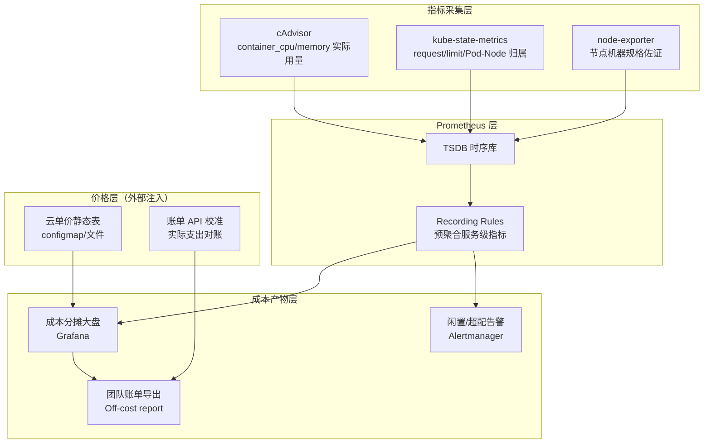
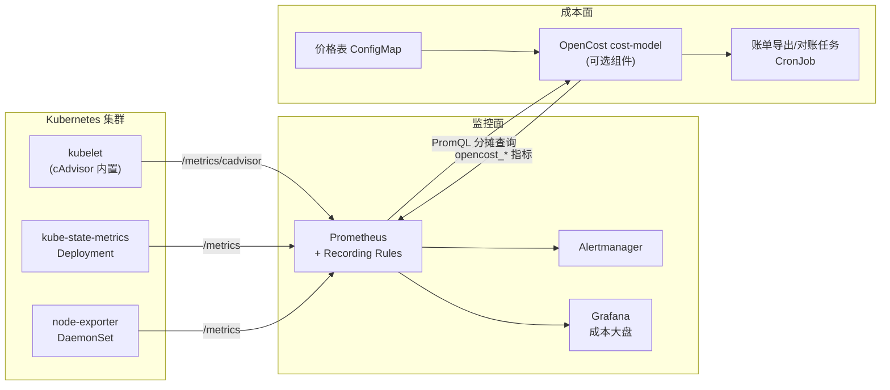

> 云原生可观测系列的成本篇。此前的《Ceph 监控日志指标告警》解决"集群是否健康"，《Koordinator》《Kueue》解决"资源怎么分"；本篇回答另一个问题：**"每个服务到底花了多少钱"**——如何用 Prometheus 已有的指标（cAdvisor、kube-state-metrics、node-exporter）加上云厂商单价，把集群账单拆解到命名空间/服务/团队粒度。
>
> 口径说明：以 **Kubernetes 1.28+**、kube-state-metrics v2.8+（`kube_pod_container_resource_requests` 新格式）、cAdvisor 指标为基准；云单价以按量计费（on-demand）为锚点示例，Spot/预留券换算在 §7 展开。所有 PromQL 可直接在装了 kube-prometheus-stack 的集群运行，指标名以实际环境为准。文中金额均为演示用的假设单价。

---

# 第 1 章：基础概念 - 容器成本从哪来

## 1.1 一句话定义

> **FinOps 容器成本估算 = 把"集群每小时产生的机器钱"，按某种可解释的归属规则（request / limit / 实际用量）摊到每个 Pod、进而聚合到服务与团队头上——Prometheus 提供了归属所需的全部资源侧指标，缺的只是一张"单价表"。**

云账单只告诉你"这台 ECS 今天花了 12 元"，但不会告诉你"这 12 元里订单服务占几元、推荐服务占几元"。一个节点上跑着几十个 Pod，**账单粒度（机器）和管理粒度（服务）天然错位**，成本估算的本质就是弥合这个错位。

## 1.2 三个必须先想清楚的词

| 概念 | 含义 | 典型数据源 |
|------|------|-----------|
| **成本（Cost）** | 真实花钱：机器按量单价 × 时长，含磁盘/网络附加费 | 云账单 API / 价格表 |
| **归属（Allocation）** | 把成本切给谁：按 request？limit？还是实际用量？ | K8s 资源对象 |
| **利用率（Utilization）** | 分摊后各资源真实用了多少，决定下一轮治理动作 | cAdvisor |

三者相乘才构成完整闭环：`服务成本 = Σ(节点成本 × 该服务在该节点上的归属占比)`，利用率则决定这个占比是否合理。

## 1.3 为什么偏偏用 Prometheus 做

- **指标已经在那了**：做过监控的集群必然有 cAdvisor（容器用量）+ kube-state-metrics（request/limit/拓扑），成本估算只是对同一批指标的**二次加工**，边际采集成本近零；
- **粒度对得上**：成本归属需要的 Pod→Node→Namespace 映射、按时间窗积分的用量，恰好是 Prometheus 数据模型（带 label 的时间序列）的强项；
- **PromQL 就是分摊公式**：一次除法 `服务用量 / 节点容量` 即完成比例分摊，无需 ETL；
- **局限也要说清**：Prometheus 只知道"资源"，不知道"钱"——单价、折扣、Spot 波动必须外部注入（§2.4）。

---

# 第 2 章：工作原理 - 指标、模型与算法

## 2.1 端到端计算链路



## 2.2 关键指标清单（成本估算的最小集合）

| 指标 | 来源 | 提供的成本事实 |
|------|------|---------------|
| `kube_pod_container_resource_requests{resource="cpu"}` | KSM | 申请核数（分摊分母的常规选择） |
| `kube_pod_container_resource_requests{resource="memory"}` | KSM | 申请字节数 |
| `kube_pod_info{node=...}` | KSM | **Pod→Node 归属关系**（整条链路的粘合剂） |
| `kube_node_status_allocatable` | KSM | 节点可分配容量（分摊分母） |
| `container_cpu_usage_seconds_total` | cAdvisor | CPU 实际用量（rate 后为核） |
| `container_memory_working_set_bytes` | cAdvisor | 内存实际工作集 |
| `kube_namespace_labels` | KSM | 团队/业务线标签（账单聚合键） |

## 2.3 三种分摊模型（Cost Model）

| 模型 | 公式核心 | 谁该用 | 缺陷 |
|------|---------|--------|------|
| **Request 分摊** | 服务占比 = Σrequests / 节点可分配 | 最普遍默认；"谁申请谁付费"，倒逼精准申请 | 超配的服务付冤枉钱；空闲成本也算在服务头上 |
| **Limit 分摊** | 服务占比 = Σlimits / 节点容量 | 少见，仅当组织严格管理 limit 时可用 | limit 常是虚高保险值，失真最严重 |
| **Usage 分摊** | 服务占比 = Σ实际用量 / 节点容量 | 平台方内核算力、共享池结算 | 突发型服务忽高忽低；剩余空闲无处归属，需额外拆"公共空闲成本" |

实践共识：**对外账单用 Request 模型（规则稳定、可预期），对内治理同时看 Usage 模型（暴露浪费）**，两者的差额就是"闲置成本"，是第三章治理动作的靶心。

## 2.4 单价注入：Prometheus 缺的那半张拼图

Prometheus 不存钱数，通用做法是把单价做成**静态映射**再参与计算：

- **方案 A（最简）**：节点 label/annotation 打上机型，配置文件维护 `机型 → 小时单价`，离线侧（脚本/查询服务）做 Join；
- **方案 B（指标化）**：用 exporter 把价格表暴露成自定义指标，如 `node_cost_per_hour{instance="node-1"} 0.85`，则**整条分摊公式可以纯 PromQL 表达**（§5.2）；
- **方案 C（对账）**：每月拉云账单 API 实际支出，与 Prometheus 估算总额做比值，修正系统性偏差（折扣、免费额度、按量差价）。

OpenCost / Kubecost 走的正是 B+C 路线：一个 cost-model 服务持有价格表，从 Prometheus 拉资源指标，输出标准化的 `*_cost_per_month` 指标族。

---

# 第 3 章：技术框架 - 组件位置与部署拓扑

## 3.1 成本估算在可观测体系中的位置



## 3.2 各组件职责边界

| 组件 | 在成本链路中的职责 | 是否必需 |
|------|-------------------|---------|
| cAdvisor | 提供 Usage 模型的分子（真实用量） | 必需 |
| kube-state-metrics | 提供 Request 模型的分子 + Pod→Node 拓扑 | 必需 |
| node-exporter | 校验节点规格、提供机器级佐证 | 可选 |
| Recording Rules | 把昂贵的高基数分摊计算预聚合成小时级指标 | 强烈建议 |
| OpenCost cost-model | 价格表管理、标准化成本指标、UTC 账单 API 对接 | 规模化后建议 |
| Grafana + 大盘 | 成本可视化与下钻 | 必需 |
| 对账 CronJob | 估算值 vs 真实账单的偏差监控 | 规模化后必需 |

## 3.3 与成熟开源方案的关系

| 方案 | 定位 | 与"纯 Prometheus 手工版"的取舍 |
|------|------|-------------------------------|
| **OpenCost** | CNCF 标准化成本框架，核心即"Prometheus 指标 + 价格表 + cost-model 服务" | 拿来即用、口径统一；引入额外组件 |
| **Kubecost** | OpenCost 的商业超集（持久化、多集群、ROI 分析） | 功能全但有许可成本 |
| **云厂商 CMP**（阿里云成本分析等） | 账单侧下钻，部分支持 ACK 成本分摊 | 与云绑定，粒度受账单限制 |
| **手工 PromQL** | 本文路线：理解原理、轻量起步、完全可控 | 需要自己维护口径与价格表 |

推荐路径：**先用手工 PromQL 跑通一两个核心大盘建立口径共识，再评估是否引入 OpenCost 固化**——直接上工具而不懂分摊模型，账单出来没人信。

---

# 第 4 章：设计思想 - 为什么这样算钱

## 4.1 可解释性优先于精确性

成本账单的第一用户是**被分摊的团队**，不是财务。一个能被团队自行复核的粗模型（request × 单价），远胜一个没人看得懂的精模型（回归拟合用量）。所以分摊公式的每个因子都必须来自团队自己写的 K8s 配置——**你申请的，就是你付费的**。

## 4.2 分摊比例 = 资源占用的时间积分，而非瞬时值

瞬时采样会让账单抖动（一次 FullGC 拉高内存就"涨价"）。设计上应以**时间窗积分**为计费量：CPU 是 `rate(container_cpu_usage_seconds_total[1h])` 的窗内平均核数，内存是 working_set 的窗内均值或分位数，再乘以节点小时单价。这也是 Recording Rules 按小时预聚合的原因。

## 4.3 空闲成本必须显式拆分

Request 模型下，节点不会被 100% 申请满（系统预留 + 碎片 + 未调度余量）。若不处理，空闲部分会被"按占比"暗中摊给已有服务，虚增其账单。正确姿势是把节点成本拆三段：

`节点成本 = 服务分摊成本 + 公共空闲成本(idle) + 系统预留成本(system)`

公共空闲成本归属平台/公司层，而不是伪装成业务成本——这是 FinOps "Showback 可信度"的基石。

## 4.4 成本是指标的函数，不是数据库的函数

架构上刻意不新建成本数据库：所有中间结果（分摊、聚合）都表达为对既有指标的查询/预聚合。好处是**零额外存储、口径与监控天然一致、Prometheus 保留期内可回溯重算**；代价是历史深度受保留期限制（§8.4 给出补救）。

---

# 第 5 章：核心模块 - 可直接运行的分摊公式

## 5.1 模块一：集群/节点成本基线

假设价格已按 §2.4 方案 B 暴露为 `node_cpu_cost_per_core_hour`、`node_memory_cost_per_gb_hour`（演示单价：CPU 4 元/核/月、内存 1 元/G/月，即约 0.0055 元/核/时、0.0014 元/G/时）：

```promql
# 单节点每小时机器成本（CPU + 内存两维分别计价相加）
sum by (node) (
  kube_node_status_allocatable{resource="cpu"}
    * on(node) group_left node_cpu_cost_per_core_hour
)
+
sum by (node) (
  kube_node_status_allocatable{resource="memory"} / 1024^3
    * on(node) group_left node_memory_cost_per_gb_hour
)
```

## 5.2 模块二：服务级 Request 分摊（核心公式）

```promql
# 命名空间维度的 CPU 分摊成本 /小时
sum by (namespace) (
  kube_pod_container_resource_requests{resource="cpu"}
    * on(pod, namespace) group_left(node) kube_pod_info
)
* on(node) group_left
  (
    sum by (node) (
      kube_node_status_allocatable{resource="cpu"}
        * on(node) group_left node_cpu_cost_per_core_hour
    )
    /
    sum by (node) (kube_node_status_allocatable{resource="cpu"})
  )
```

要点拆解：
- `* on(pod, namespace) group_left(node) kube_pod_info`：给 request 序列**贴上 node 标签**，完成"谁在哪个节点"的归属；
- 右乘的 `节点单价 / 节点可分配容量`：把"核数"换算成"该节点上的钱"，即按申请量占比分摊；
- 内存公式同构，把 `resource="cpu"` 换成 `resource="memory"` 并除以 `1024^3`。

## 5.3 模块三：Usage 模型与闲置成本

```promql
# 服务实际平均用核（Usage 分摊的分子）
sum by (namespace) (
  rate(container_cpu_usage_seconds_total{container!="", pod!=""}[1h])
)

# 命名空间闲置成本 = request 分摊成本 − usage 分摊成本（同一口径相减）
namespace:cpu_cost_by_request - namespace:cpu_cost_by_usage
```

闲置成本高的服务即"超配大户"，是右sizing 的第一批候选。

## 5.4 模块四：GPU 与存储附加项

GPU 按整卡计价（不可共享时 request 数即卡数），显存指标需 DCGM exporter；Pod 挂载盘用 `kubelet_volume_stats_*` + 云盘单价：

```promql
# GPU 分摊成本：按 Pod 申请的卡数 × 卡时单价
sum by (namespace) (
  kube_pod_container_resource_requests{resource="nvidia_com_gpu"}
    * on(pod, namespace) group_left(node) kube_pod_info
) * 22   # 示例：A10 单卡约 22 元/时（假设单价）
```

注意：若未装 `kubelet_container_log_filesystem_used_bytes` 类 volume 指标或 PV 价格表，存储成本只能到节点级近似，这是手工版常见盲区（§8.5）。

## 5.5 模块五：预聚合与大盘固化

高基数分摊不适合同步查询，固化成 Recording Rules：

```yaml
groups:
  - name: cost-namespace-hourly
    interval: 30m
    rules:
      - record: namespace:cpu_cost_per_hour:request
        expr: sum by (namespace) (kube_pod_container_resource_requests{resource="cpu"}
                * on(pod, namespace) group_left(node) kube_pod_info)
      - record: namespace:memory_cost_per_hour:request
        expr: sum by (namespace) (kube_pod_container_resource_requests{resource="memory"} / 1024^3
                * on(pod, namespace) group_left(node) kube_pod_info)
```

大盘层再乘单价与节点归属，月账单即 `sum_over_time(namespace:*_cost_per_hour:request[30d]) × 单价因子`。

---

# 第 6 章：应用场景

## 6.1 场景一：Showback 团队账单

按 `namespace` 或团队标签聚合 §5.2 指标，月度输出"各团队 CPU/内存/GPU 分摊曲线 + TopN 花钱服务"。价值不在数字本身，而在让团队**看见自己的申请即成本**，行为随之收敛。

## 6.2 场景二：超配识别与右sizing

`闲置成本 = request成本 − usage成本`，对闲置率 > 60% 且持续一周的服务自动生成工单，建议下调 request。经验上第一轮右sizing 普遍能砍掉 20–40% 集群规模。

## 6.3 场景三：Quota 与预算告警

把命名空间成本写入 LimitRange/Quota 的软预算，Alertmanager 规则示例：

```yaml
- alert: NamespaceMonthlyCostRunaway
  expr: sum(namespace:cpu_cost_per_hour:request) by (namespace) * 720 > 5000
  for: 3d
  labels: {severity: warning}
  annotations:
    summary: "{{ $labels.namespace }} 月化成本预计超 5000 元，请复核资源申请"
```

## 6.4 场景四：混合策略采购的性价比评估

Spot 折扣真实节省 = `Spot 时长占比 × 折扣率 − 因抢占重调度损耗`。用 Prometheus 按节点 label（`cloud.google.com/gke-spot` / 阿里云抢占式标记）切分成本基线，对比同业务在按量节点与 Spot 节点上的**单位吞吐成本**，让"要不要上 Spot"从感觉变成数据。

## 6.5 场景五：GPU 训练任务的显式计费

GPU 单价高、独占性强，是成本估算收益最直接的场景：按 `pod × 卡数 × 卡时单价` 出账，叠加 §8.2 的 DCGM 利用率判定"占卡摸鱼"任务。

---

# 第 7 章：性能参数与口径基准

## 7.1 计算与存储开销

| 项 | 量级参考 | 说明 |
|----|---------|------|
| KSM + cAdvisor 指标量 | 每 Pod 约 15–30 个活跃序列 | 成本相关子集仅其中数个 |
| 分摊查询（即时） | 5000 万活跃序列集群单次 200–800 ms | `group_left` Join 成本高，**不要放高频看板自动刷新** |
| Recording Rules 后 | 大盘读预聚合序列，毫秒级 | 30m 窗口足够账单粒度，计算成本可控 |
| 序列基数控制 | `container_*` 务必 `container!="", pod!=""` 过滤 infra 容器 | 否则 cgroup 层级重复计数 |

## 7.2 精度基准（能指望它到什么程度）

| 对比对象 | 典型偏差 | 偏差主因 |
|---------|---------|---------|
| 云**真实账单**总额 | ±5–15% | 折扣/代金券未建模；计费粒度（秒 vs 分钟）差异 |
| OpenCost/Kubecost 同类估算 | <5%（同口径时） | 分摊模型与分母定义差异 |
| **服务粒度**归属 | 相对误差可达 20–30% | 共享 DaemonSet、系统 Pod 剔除口径不一 |

结论：**趋势与相对比较可信，绝对金额必须每月对账修正**（§2.4 方案 C）。

## 7.3 时间粒度建议

- 实时看板：小时粒度（Recording Rule 30m interval）；
- 月度账单：以"自然月 × 单价快照"重算，避免月中改价混入历史；
- 回溯重算：受 Prometheus 保留期限制，至少保留**聚合后的成本指标**到远端存储/对象存储（如 Thanos 降采样到 5m 后长期保存）。

---

# 第 8 章：问题缺陷与解决方案

## 8.1 CPU 与内存计价维度混淆

**问题**：CPU 分摊与内存分摊单价不同，若合成单一"成本"会掩盖内存超配型浪费。
**解决**：账单永远分列 CPU/内存/GPU 三行展示，仅在汇总层折算为金额；右sizing 建议按维度分别触发。

## 8.2 GPU 缺原生指标

**问题**：cAdvisor 对 GPU 只报 request 数，无利用率，"占卡不用"不可见。
**解决**：部署 DCGM exporter，`DCGM_FI_DEV_GPU_UTIL`（需持续观测 ≥1 小时规避采样突发）与卡时成本并列展示；调度侧配合 Koordinator/MIG 切分提升共享率。

## 8.3 多占与重复计数

**问题**：Pod 内多容器 request 之和才是真实占用；`group_left` Join 写反会把一 Pod 成本乘上节点数。
**解决**：Join 前 `sum by (pod, namespace)` 收敛，再贴 node；用单 Pod/单节点的"金丝雀查询"（§5.2 公式去掉 sum 逐条核对）验证口径。

## 8.4 保留期外的历史账单

**问题**：TSDB 默认保留 15d，无法回答"去年 Q3 哪个服务最贵"。
**解决**：成本类 Recording Rules 结果**单独长期保留**—— Thanos/Rule 导出 CSV 归档，成本指标体积小（命名空间×小时），长期存储几乎免费。

## 8.5 Spot 与动态定价

**问题**：单价表静态化后，Spot 价格波动导致账单失真。
**解决**：价格表改为日更任务拉云定价 API；Spot 节点建议按"同规格按量价 × 实际持有小时"记机会成本，或直接采用账单 API 回写的实际金额。

## 8.6 冷启动与生命周期边角

**问题**：Pending/Completed 的 Pod、Job 短暂生命周期在快照型指标（KSM）里可能整点漏采，造成瞬时分摊跳变。
**解决**：分摊查询一律用**窗均值**（`avg_over_time[1h]`）而非即时值；Job 类负载改按 `kube_job_*` 完成时间 × 峰值 request 单独建模。

## 8.7 信任问题（组织缺陷）

**问题**：账单口径未经被分摊方确认，数字再准也没人认账。
**解决**：FinOps 的惯例——**分摊规则由财务+平台+业务三方评审并公示**，账单附带口径说明页（本系列 §2.3/§4 即模板），任何改口径必须在账单中做环比标注。

---

# 附录：术语速查表

| 术语 | 英文 | 释义 |
|------|------|------|
| FinOps | Financial Operations | 云成本精细化运营的文化与实践框架（Inform→Optimize→Operate 三阶段） |
| Showback | 成本透视 | 只展示归属不实际扣款，团队账单的初级形态 |
| Chargeback | 成本回溯计费 | 把估算成本真正记入团队损益，需口径强共识 |
| 分摊 | Cost Allocation | 按规则把共享资源成本切给消费方的算法 |
| Request 模型 | Request-based Allocation | 按 K8s 申请量分摊，"谁申请谁付费" |
| Usage 模型 | Usage-based Allocation | 按实际用量分摊，暴露真实消耗 |
| 闲置成本 | Idle Cost | request 与 usage 差额对应的那部分账单 |
| 公共空闲成本 | Shared Idle | 节点未被申请满的余量成本，应归平台而非业务 |
| OpenCost | OpenCost | CNCF 开源成本模型标准，K8s 容器成本估算的事实规范 |
| DCGM | Data Center GPU Manager | NVIDIA GPU 管理/指标工具，成本场景供利用率数据 |
| 右sizing | Right-sizing | 依利用率将 request 调到合理值的治理动作 |
| 对账 | Reconciliation | 估算总额与云真实账单的偏差校准 |
| Thanos 降采样 | Downsampling | 长保留成本指标的低分辨率归档形态 |
