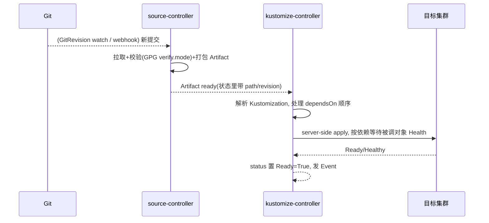
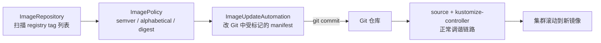
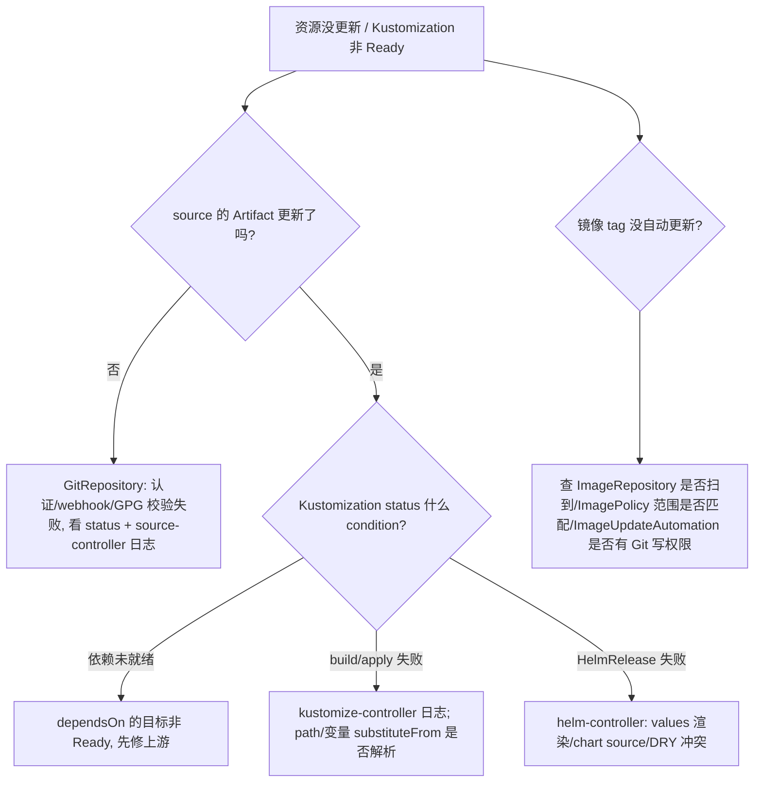

> 《GitOps》系列第 3 篇。姊妹篇《Argo CD 基础应用实践》展示的是"一体化大控制器"路线，Flux 走的是另一条哲学：**把 GitOps 拆成一组各司其职的小控制器（GitOps Toolkit），用 CRD 把它们串成流水线**。本篇讲清六件套控制器的分工、Source→Kustomization/HelmRelease 的调谐链、Flux 招牌的镜像自动化（扫描→定策→回写 Git 的闭环），以及 v2.6/v2.7 把"配置源"从 Git 扩展到 OCI 制品后出现的 **GitLess GitOps** 新范式。三篇读完，你对"GitOps 双雄"的选型应有肌肉记忆：要门户与多租户 UI 选 Argo CD，要轻量、Git/OCI 双原生、与集群 API 亲和选 Flux。
>
> 口径说明：版本锚定 **Flux v2（controllers 独立版本化）**，关键事实：v2.6（2025-06）OCI 源与镜像自动化摘要绑定 GA、v2.7（2025-10）Image Automation API 升 v1 稳定并引入 ExternalArtifact/ArtifactGenerator、v2.8（2026-03）Flux Operator Web UI。Flux 架构上控制器通过 Kubernetes API 对象通信而非内部 gRPC，故不存在 Argo CD 那类"内部流量 mTLS"问题。性能数字为经验量级。

---

# 第 0 章：全景链路

```text
 开发者/CI ──git push──▶ Git 仓库 ┐                      ┌─ 容器镜像仓库(新 tag)
                                 │                              │
                    ┌────────────▼─────────┐        ┌──────────▼───────────┐
                    │ source-controller    │        │ image-reflector-ctl  │
                    │  GitRepository /     │        │  ImageRepository 扫描 │
                    │  OCIRepository /     │        │  ImagePolicy 定策     │
                    │  HelmRepository      │        └──────────┬───────────┘
                    └────────────┬─────────┘                   │ 新镜像事件
                         Artifact(CR 状态)                      ▼
                    ┌────────────▼─────────┐        ┌──────────────────────┐
                    │ kustomize-controller │        │ image-automation-ctl │
                    │  Kustomization → apply│       │  回写 Git(manifest 改tag)│
                    │ helm-controller      │        └──────────┬───────────┘
                    │  HelmRelease → chart  │◀──────────────────┘(Git 又更新)
                    └────────────┬─────────┘
                         真实资源 + 依赖 Wait/Health
                                 ▼
                            目标命名空间/集群
```

一句话主线：**Flux = "source 拉取并产出 Artifact 对象 → kustomize/helm 消费 Artifact 落到集群 → image 控制器把新镜像写回 Git 形成自驱动闭环"的一条声明式数据流水线；每个环节都是一个可独立替换、独立伸缩的小控制器。**

---

# 第 1 章：基础概念——GitOps Toolkit 与设计哲学

## 1.1 是什么

Flux（Flux v2，CNCF毕业生态）是"保持集群与配置源（Git 仓库 / OCI 制品）同步、并自动化更新"的持续交付工具。v2 把它重构为 **GitOps Toolkit**：一组可组合的 API + 控制器，你既能用全套，也能只用其中一两个源/部署控制器。

## 1.2 三条设计哲学（与 Argo CD 分野的根源）

| 哲学 | Flux 的落地 | 对比 Argo CD |
|------|------------|-------------|
| **微控制器、单一职责** | source/kustomize/helm/notification/image 各自独立 Deployment | 一个大 application-controller 揽下渲染+调谐 |
| **一切经 K8s API 对象通信** | 控制器间传 `Artifact`/自定义资源, 无内部 RPC | Argo 组件间曾有 gRPC 内部流量(3.5 才补 mTLS) |
| **Git 与 OCI 双原生源** | OCIRepository 把 manifest 打包成镜像般的制品, 支持"GitLess GitOps" | OCI 为 3.1 后追赶项 |

代价是"组装感"更强：Flux 没有内置 Web 控制台（v2.8 的 Flux Operator 才补了仪表盘），日常靠 `flux` CLI + 资源状态。

## 1.3 六件套控制器与核心 CRD

| 控制器 | 消费的 CRD | 产出 |
|--------|-----------|------|
| source-controller | GitRepository / OCIRepository / HelmRepository / HelmChart / Bucket | `Artifact`(tar.gz 存于内部存储) |
| kustomize-controller | Kustomization | apply 到集群 + 依赖排序/Health 等待 |
| helm-controller | HelmRelease | 渲染并安装/升级 Helm Release |
| notification-controller | Alert / Provider | 事件出口(Slack/MTGS/自定义 webhook) |
| image-reflector-controller | ImageRepository / ImagePolicy | 镜像 tag 反射进集群 |
| image-automation-controller | ImageUpdateAutomation | **回写 Git**(生成 commit) |

---

# 2 章：工作原理——一条调谐链的旅程



## 2.1 Kustomization：不只是 overlay，还是编排器

Flux 的 `Kustomization`（`kustomize.toolkit.fluxcd.io`）不是 `kustomize build` 的包装，而是一个**带依赖图与健康等待的部署单元**：

```yaml
apiVersion: kustomize.toolkit.fluxcd.io/v1
kind: Kustomization
metadata: {name: web, namespace: flux-system}
spec:
  interval: 10m
  retryInterval: 2m
  sourceRef: {kind: GitRepository, name: flux-system}
  path: "./clusters/production/apps/web"
  targetNamespace: web
  prune: true                    # 等价 Argo 的 auto-prune
  wait: true                     # 等待资源 Ready 才算完
  timeout: 3m
  dependsOn:                   # ★ Flux 独有: 跨 Kustomization 的部署顺序
    - {name: infra-controllers} # 例如先装 CRD/operator 再装依赖它的 CR
  healthChecks:
    - {kind: Deployment, name: web, namespace: web}
  postBuild:
    substituteFrom:
      - {kind: ConfigMap, name: cluster-vars}   # 变量注入(Kustomize substitution)
```

`dependsOn` 解决了 Argo CD 要靠 Sync Wave/depends-on 注解绕路的"基础设施→应用"顺序问题，是 Flux 编排能力的招牌。**Flux 的调和单位天然是命名空间隔离的**——source 和 Kustomization 都在 `flux-system`，跨命名空间靠 `targetNamespace` 与 RBAC。

## 2.2 OCIRepository 与 GitLess GitOps（v2.6 GA）

把 Kustomize/Helm 产物 `flux create source oci` 指向一个 OCI 制品（镜像仓库里的 tarball），集群可从对象存储之外、以镜像分发的方式获取期望状态——金融机构常用它满足"Git 不承载生产清单、制品仓才是权威源"的合规诉求。v2.6 的**摘要绑定（digest pinning）**让 ImagePolicy 跟踪不可变 digest 而非易变 tag，堵住"同 tag 被覆盖"的供应链攻击面。

## 2.3 镜像自动化：Flux 自驱动的闭环（v2.7 GA）

这是 Flux 与 Argo CD 最本质的能力差异——**Argo CD 的 Image Updater 是插件、回写能力弱，而 Flux 把"发现新镜像 → 决定用哪个 → 提交回 Git"做成三个一等 CRD 的标准流水线**：



```yaml
apiVersion: image.toolkit.fluxcd.io/v1
kind: ImagePolicy
metadata: {name: web, namespace: flux-system}
spec:
  imageRepositoryRef: {name: web}
  policy: {semver: {range: "1.x"}}          # 只接受 1.x 内新版本
---
apiVersion: image.toolkit.fluxcd.io/v1
kind: ImageUpdateAutomation
spec:
  git: {checkout: {ref: {branch: main}}, commit: {author: {...}, messageTemplate: '[auto] ...'}}
  update: {path: {exclude: ["./.github/**"]}, strategy: BranchCommit}
```

manifest 里用 `// {"image": "web", "automatable": "true"}` 标记（或 `images:` 占位）声明"这里可被改写"。闭环语义：CI 只负责构建推镜像打 tag，**"选哪个版本上线"完全由集群内的 ImagePolicy 决定并回写 Git**，Git 依旧是唯一权威源——与"CI 直接改 Git 里 tag"的外力写入路线形成对照。

---

# 第 3 章：安装、结构与生产部署

## 3.1 两种安装姿势

```bash
# A. flux bootstrap git: 自举, 把 flux-system 自身也纳入 GitOps(推荐)
flux bootstrap github --owner=org --repository=gitops --path=clusters/production \
  --components-extra=image-reflector-controller,image-automation-controller  # 镜像自动化默认不装

# B. flux install: 手动装组件, 再单独建 source(适合隔离控制面)
```

`bootstrap` 的巧思：它先在集群装 Flux，又把"Flux 自己的配置"提交进 Git 并建一个指向它的 Kustomization——于是**连 GitOps 工具本身也进入被 GitOps 管理**的自举闭环（management-as-code）。

## 3.2 仓库结构选型（官方三范式）

| 结构 | 特点 | 适用 |
|------|------|------|
| 每集群一目录（`clusters/<name>/`） | 环境边界清晰、权限按目录隔离 | 多环境/多租户主流做法 |
| 分层 overlay（`base` + `overlays`） | 复用 Kustomize 继承 | 应用跨环境差异大 |
| apps + clusters 交叉（`apps/<app>/overlays/<env>`） | 应用视角组织, 一次改全环境 | 平台团队自助 |

## 3.3 与集群 API 亲和带来的安全红利

Flux 六件套都是标准 controller-runtime 程序，凭 **各自 ServiceAccount 的 RBAC** 访问集群 API，组件间通过读对方 CR 的 `status` 协作。因此：不存在 Argo 那类需要额外保护的内部 gRPC 通道；对外连接（Git/Registry 自签/证书）用 `certSecretRef` 挂客户端证书即可做双向 TLS；GPG 提交校验（`GitRepository.spec.verify.mode: head`）比 Argo CD 的源码完整性早得多就原生提供。**权限审计的落点是每个控制器的 SA 与它 watch 的资源范围**。

## 3.4 参数速查

| 参数 | 默认/建议 | 说明 |
|------|----------|------|
| `spec.interval`（各源/Kustomization） | 1h(源)/10m(Kus) | 调谐周期; webhook 已覆盖增量, 不必过密 |
| `retryInterval` | 1m | 失败后重试节奏 |
| `prune` | false / 生产 true | 删除语义, 开前确保 Git 权威 |
| `wait` + `healthChecks` | false | 开启后同步阻塞至 Ready, 支撑 dependsOn |
| `GitRepository.verify.mode` | 无 / `head` | 提交签名校验 |
| `ImagePolicy.policy` | semver/alphabetical | 版本选择器 |
| Flux Operator（v2.8） | 单独装 | 管 Flux 实例本身生命周期 + Web 仪表盘 |

---

# 第 4 章：应用场景、局限与排障

## 4.1 适合 / 不适合

**适合**：Git 与 OCI 双源交付、金融/合规要求 digest 不可变与签名校验、需要镜像自动回写 Git 的自动升级、平台工程团队偏好"小工具组合 > 大平台"、重度 Kustomize。
**不适合**：要一个开箱即用的多租户 Web 门户给业务方自助点发布（Argo CD UI 更成熟，Flux 侧要靠 Flux Operator 或外接 Backstage）、跨集群统一应用视图（Flux 每集群自治，需 Karmada/多集群编排补足）、需要复杂发布门禁 UI（渐进式交付交给 Flagger，见《ArgoRollout》篇的 Flagger 对照）。

## 4.2 已知局限

- **无内置强 UI**（历史痛点）：可观测靠 `flux get all` + 事件 + 指标；v2.8 Operator 补了仪表盘，但成熟度仍逊 Argo CD；
- **镜像自动化默认不安装**，需 `--components-extra`，且 v2.7 有破坏性变更（autologin 移除、commit 模板字段 `.Updated` 等被删）；
- **排障链更长**：一次失败可能在 source→kustomization→helm 三个控制器间传递，定位要看每个 CR 的 `status.conditions` 逐段确认（Argo 一个大 controller 反而更集中）。

## 4.3 故障定位树



排障心法：**Flux 的可观测单位是"每个 CR 的 status.conditions"**，`flux reconcile source git flux-system` / `flux reconcile kustomization web --with-source` 是手动催一轮调谐、分离"是 source 问题还是部署问题"的利器；把 `gotk_*` 指标接 Prometheus 可对齐站内监控方法论。

---

# 附录

## A. 实操速查

```bash
flux check --pre                       # 安装前体检
flux get sources git                   # 源同步状态
flux get kustomizations,helmreleases   # 部署单元状态
flux get image repositories,policies   # 镜像自动化状态
flux reconcile kustomization web --with-source --verbose
flux trace web --kind Kustomization    # 追一个资源被哪个 Kustomization 管理
```

## B. 术语速查

| 术语 | 一句话 |
|------|--------|
| GitOps Toolkit | Flux v2 的微控制器 + CRD 组合基座 |
| Artifact | source-controller 产出的、可供下游消费的制品对象 |
| Kustomization(Flux) | 带 dependsOn/healthChecks 的部署单元, 非 kustomize build 包装 |
| GitLess GitOps | 以 OCI 制品(而非 Git)为期望状态权威源 |
| digest pinning | ImagePolicy 跟踪不可变镜像摘要而非 tag |
| Image 三件套 | Repository(扫)/Policy(选)/UpdateAutomation(回写 Git) |
| bootstrap 自举 | 把 Flux 自身配置也纳入 GitOps 管理 |
| Flux Operator | 管理 Flux 实例生命周期并提供 Web UI(v2.8) |

## C. 参考资料

1. [fluxcd/flux2 (GitHub) 与官方文档](https://fluxcd.io/docs/) — 控制器分工、Kustomization/HelmRelease、镜像自动化。✅ 已核实
2. Flux v2.7 发布说明（2025-10）— Image Automation API GA、ExternalArtifact/ArtifactGenerator、OTel 跟踪、autologin 移除等破坏性变更。✅ 已核实
3. InfoQ《Flux 2.6 GA 发布及安全性改进》(2025-06)— OCI 制品 GA、GitLess GitOps、摘要绑定。✅ 已核实
4. InfoQ《Argo CD 3.5…》对比段 — Flux 以 K8s API 对象通信规避内部 mTLS、`verify.mode: head` 原生 GPG。✅ 已核实
5. 姊妹篇：《【ArgoCD】基础应用实践》《【ArgoRollout】基础应用实践》。✅ 站内

## D. 变更记录

| 日期 | 版本 | 变更内容 |
|------|------|---------|
| 2026-10-29 | v1.0 | 首版：GitOps Toolkit 六件套控制器与三条设计哲学、Source→Kustomization/Helm 调谐链、dependsOn 编排、OCI 与 GitLess GitOps、镜像自动化自驱动闭环、bootstrap 自举与仓库范式、API 亲和安全红利、参数速查、故障树，含全景链路与多处 Mermaid 图 |
