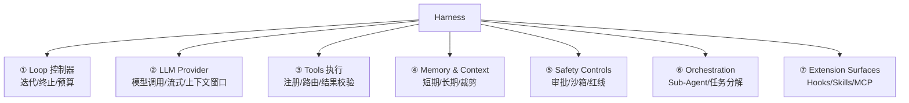
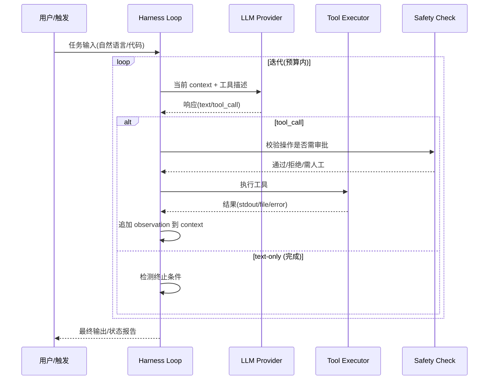

> 《智能执行与任务编排》专题 3.1 Agent 核心架构的工程深化篇。当业界讨论"LLM 能做什么"时，真正决定 Agent **在生产环境里能不能用**的不是模型本身，而是包裹模型的那层 **"脚手架"——Harness**。Wavestone 团队在 arXiv 论文（2609.00006）中解剖 11 个生产级编码 Harness 后提出：**Agent = LLM（决策） + Harness（调度与约束） + Tools（手脚） + Memory（记忆）**，四者缺一不可，而 Harness 是把模型不确定输出变成外部可核对、可恢复、可追查动作的唯一保障。LangChain 用 Harness Engineering 方法把 deepagents-cli 在 Terminal Bench 2.0 上从 52.8 提到 66.5——模型不变，只改脚手架。它与姊妹篇《Loop Engineering》互为表里：Harness 定义"有什么部件"，Loop 定义"部件怎么转起来"。
>
> 口径说明：Harness 定义锚定 Wavestone arXiv 2609.00006 论文（解剖 Claude Code/Codex CLI/Gemini CLI/Mistral Vibe/OpenHands/Aider/Mini-SWE-Agent/Hermes/Pi/OpenCode/OpenClaw 共约 400 万行代码）与 DeepSeek 2026 Harness 定义；Agent SDK 循环以 Claude Agent SDK 文档为准。本文不是某款产品的使用手册，而是跨产品的工程方法论。

---

# 第 0 章：全景链路

```text
┌─────────────────────────────────────────────────────────────────────────┐
│                        HARNESS (外骨骼)                                  │
│                                                                         │
│  ┌───────────┐   ┌──────────────┐   ┌──────────┐   ┌───────────────┐  │
│  │ ① Loop    │──▶│ ② LLM        │──▶│ ③ Tools  │──▶│ ④ Memory &   │  │
│  │ 控制器     │   │ Provider 层   │   │ 执行层    │   │   Context Mgmt│  │
│  └───────────┘   └──────────────┘   └──────────┘   └───────────────┘  │
│        ▲                                                       │        │
│        │              ┌──────────────┐   ┌───────────────┐    │        │
│        └──────────────│ ⑤ Safety     │◀──│ ⑥ Orchestration│◀───┘        │
│                       │   Controls    │   │ (Sub-Agent)   │             │
│                       └──────────────┘   └───────────────┘             │
│                                               ▲                       │
│                       ┌───────────────┐       │                       │
│                       │ ⑦ Extension   │───────┘                       │
│                       │   Surfaces    │  Hooks / Skills / MCP         │
│                       └───────────────┘                               │
└─────────────────────────────────────────────────────────────────────────┘
         ▲                                    ▲
         │                                    │
    ┌────┴────┐                         ┌─────┴─────┐
    │  LLM    │                         │  Human    │
    │ (Brain) │                         │  (审批)    │
    └─────────┘                         └───────────┘
```

一句话主线：**Harness Engineering 研究的是"模型之外、用户之内"的所有工程机制——它回答的不是"模型能不能做"，而是"在模型能力波动、上下文有限、环境不可信的约束下，怎样让 Agent 稳定、安全、可审计地完成任务"。**

---

# 第 1 章：基础概念与学科定位

## 1.1 定义与边界

| 术语 | 边界 |
|------|------|
| Harness | 包裹 LLM 的运行时系统——调度循环、约束执行、工具管理、安全策略、状态持久化 |
| Agent | LLM + Harness + Tools + Memory 的整体（Harness 是 Agent 的骨架） |
| Loop | Harness 内部"接收→决策→执行→观测→继续/终止"的迭代模式（Loop 是 Harness 的一个子系统） |
| Prompt Engineering | 关注输入文本设计——属于 Harness 的 ② LLM Provider 层的子关注点 |

**Harness 不是什么**：不是模型微调、不是 Agent 框架选型、不是 Prompt 模板——它是让任何框架和任何模型都能在生产环境"不崩"的工程层。

## 1.2 为什么 2026 才成为独立学科

- 2024-2025 是"能跑就行"阶段——PoC 里裸调 API 即可完成。
- 2026 进入"要上生产"——多租户、预算、审计、安全、恢复等要求让"裸调"不再可行。
- 四支独立团队（Anthropic/OpenAI/Cursor/Devin）在无相互参考的情况下，Harness 功能边界几乎重合——证明这是必然收敛的工程问题，而非人为设计选择。

---

# 第 2 章：七大子系统（Wavestone 分类）

## 2.1 总览



## 2.2 逐子系统职责

| # | 子系统 | 核心职责 | 工程关注点 |
|---|--------|---------|-----------|
| ① | Loop 控制器 | 决定"继续还是停"——迭代预算、终止条件、超时 | 防无限循环; 预算耗尽优雅退出 |
| ② | LLM Provider 层 | 模型调用封装——多后端、流式、上下文窗口管理 | Token 预算分配; 降级切换 |
| ③ | Tools 执行层 | 工具注册发现、参数校验、执行、结果包装 | Schema 严格性; 超时与重试 |
| ④ | Memory & Context | 对话历史、工作记忆、长期知识的存取与裁剪 | 窗口有限下的优先级; 冲突合并 |
| ⑤ | Safety Controls | 操作审批、沙箱隔离、输出过滤、红线拦截 | 最小权限; 可审计; 人工介入点 |
| ⑥ | Orchestration | 多 Agent/子任务分解、角色分工、汇合 | 成本上界; 全局终止 |
| ⑦ | Extension Surfaces | 插件/Hooks/Skills/MCP 接入点 | 版本兼容; 安全边界 |

## 2.3 11 个生产 Harness 的对照矩阵（摘要）

| Harness | 开发方 | 独有特色 |
|---------|--------|---------|
| Claude Code | Anthropic | Hooks 系统 + MCP 原生集成 + 子 Agent orchestration |
| Codex CLI | OpenAI | Sandbox 容器隔离 + 审批工作流 |
| Gemini CLI | Google | Grounding(搜索增强) + 多模态 |
| OpenHands | All Hands AI | Docker 沙箱 + 事件驱动架构 |
| Aider | Aider AI | Git-native diff + 自动 commit |
| Mini-SWE-Agent | SWE-bench | 极简设计——只做 shell+python 两工具 |
| Cursor | Anysphere | IDE 深度集成 + 多模型路由 + Tab 补全与 Agent 共存 |
| Devin | Cognition | 自主长跑 + 浏览器操作 + 工作日志 |
| Hermes | NousResearch | 开源可自部署 + function calling 原生 |
| OpenCode / OpenClaw | 社区 | 可组合 + 本地优先 |

论文关键发现：**七大子系统在每个成熟 Harness 中都独立存在且可辨识——无论架构差异多大，这七块"骨架"是工程必然收敛的最小完备集。**

---

# 第 3 章：工作原理——Claude Agent SDK 五步循环



关键设计：

- **接收**：从 context 组装 prompt（含最近 N 轮对话 + 系统指令 + 工具 schema）。
- **评估响应**：区分 text / tool_use / error 三种分支。
- **执行工具**：超时 + 重试 + 结果截断（避免单条输出撑爆窗口）。
- **重复**：检查 iteration budget / wall-clock timeout / token budget。
- **返回**：优雅终止时输出"做了什么 + 剩余待办"。

## 3.1 与 DeepSeek 12 维定义的映射

DeepSeek 给出的 Harness 全定义包含 12 维度：LLM / Context / Tools / Memory / Session / Sandbox / Policy / Loop / Persistence / UI / Observability。与 Wavestone 七子系统对照：

| Wavestone 七系统 | 覆盖 DeepSeek 维度 |
|-----------------|-------------------|
| ② LLM Provider | LLM |
| ④ Memory & Context | Context + Memory + Session |
| ③ Tools 执行 | Tools |
| ⑤ Safety Controls | Sandbox + Policy |
| ① Loop 控制器 | Loop + Persistence |
| ⑥ Orchestration | (扩展) |
| ⑦ Extension | (扩展) |
| — (跨) | UI + Observability 在七系统外作为接口面 |

---

# 第 4 章：工程实践——设计一个 Harness 的核心决策

## 4.1 参数速查表

| 决策点 | 选项 | 推荐（生产级） | 理由 |
|--------|------|---------------|------|
| Loop 终止策略 | 固定轮数 / Token 预算 / 任务完成标志 / 超时 | 多条件组合, 任一触发即停 | 防单维度失控 |
| 工具执行隔离 | 进程内 / 容器 / gVisor / WASM | 容器(写操作) + 进程内(只读查询) | 安全-性能平衡 |
| 上下文裁剪 | 滑动窗口 / 摘要压缩 / 分段检索 | 滑动窗口 + 关键信息 pin | 保留决策链路 |
| 审批粒度 | 全量审批 / 风险分级 / 白名单免审 | 风险分级(读免审, 写需审, 删强审) | 效率与安全 |
| 子 Agent 模型 | 同模型 / 异构(便宜做规划) | 异构: 主模型决策, 轻量模型执行机械任务 | 成本降 60%+ |
| 可观测粒度 | 仅最终输出 / 每步 trace / 全 context dump | 每步 trace + 采样 dump | 调试 vs 隐私 |

## 4.2 生产级 Harness 必具备的可靠性机制

| 机制 | 说明 |
|------|------|
| 幂等执行 | 工具操作设计幂等——重试不产生副作用 |
| 状态持久化 | 崩溃后从 checkpoint 恢复, 不重跑已完成步骤 |
| 优雅降级 | 模型不可用时切备用 / 明确告知用户而非静默失败 |
| 预算熔断 | 超 Token/时间/调用次数硬上限, 停止并报告 |
| 操作审计 | 所有工具调用记录: 谁、何时、做了什么、结果如何 |
| 沙箱逃逸检测 | 工具输出不可直接作为代码执行(防 Prompt 注入→RCE) |

---

# 第 5 章：应用场景与局限

## 5.1 适合的场景

- **编码 Agent**：Claude Code、Cursor、Codex——Harness 管理 LLM 与文件系统/Git/终端的交互。
- **运维自动化**：AI SRE 场景下 Harness 封装 Prometheus API、kubectl、日志检索, 加安全审批。
- **数据分析**：Harness 管理 SQL 执行沙箱、结果验证、报告生成循环。
- **客服工单**：Harness 路由不同工具(知识库查询/CRM 操作/审批流), 管控操作权限。

## 5.2 局限与开放问题

| 局限 | 说明 | 当前状态 |
|------|------|---------|
| 标准化缺失 | 七子系统有分类但无统一 API 规范 | 生态靠 MCP 和各家 SDK 各自演进 |
| 模型能力边界 | Harness 再好也无法让弱模型做对——它保证"不错误地执行"而非"正确地思考" | 需与模型评测配合 |
| 长任务上下文膨胀 | 超过窗口后必须裁剪/摘要, 可能丢关键决策依据 | 分层记忆 + 外部检索是主流方向 |
| 安全与自主性矛盾 | 审批越多越安全但越慢; 全自动越高效但越危险 | 风险分级是务实折中 |

---

# 附录

## A. 术语速查

| 术语 | 一句话 |
|------|--------|
| Harness | 包裹 LLM 的运行时骨架(调度/约束/工具/安全/状态) |
| Loop | Harness 内部"决策→执行→观测→继续/终止"的迭代 |
| Safety Controls | 审批/沙箱/红线拦截等防事故机制 |
| Orchestration | 多 Agent 或子任务分工与汇合 |
| Extension Surfaces | Hooks/Skills/MCP 等可扩展接入点 |
| Context Window | 模型一次能"看到"的 Token 上限 |
| Cooldown | 操作失败后暂不重试的等待窗口 |
| Budget | Token/时间/调用次数的硬上限 |

## B. 参考资料

- Wavestone, arXiv 2609.00006 "Harness Engineering: Anatomy, Architecture, and Evolution of Coding Agents" (✅ 已核实: 七子系统, 11 个 Harness 解剖, 400 万行)
- Claude Agent SDK: https://docs.anthropic.com/en/docs/claude-code (✅ 已核实: 五步循环)
- LangChain Blog: Harness Engineering for deepagents-cli (✅ 已核实: Terminal Bench 52.8→66.5)
- DeepSeek Harness 定义 (✅ 已核实: 12 维度)
- OpenHands: https://github.com/All-Hands-AI/OpenHands (✅ 已核实: 事件驱动架构)

## C. 变更记录

| 日期 | 变更 |
|------|------|
| 2026-10-30 | 初版成文, 锚定 Wavestone 论文与 Claude Agent SDK 2026 文档 |
