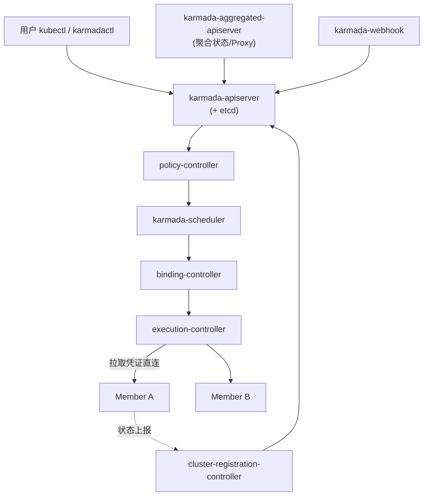
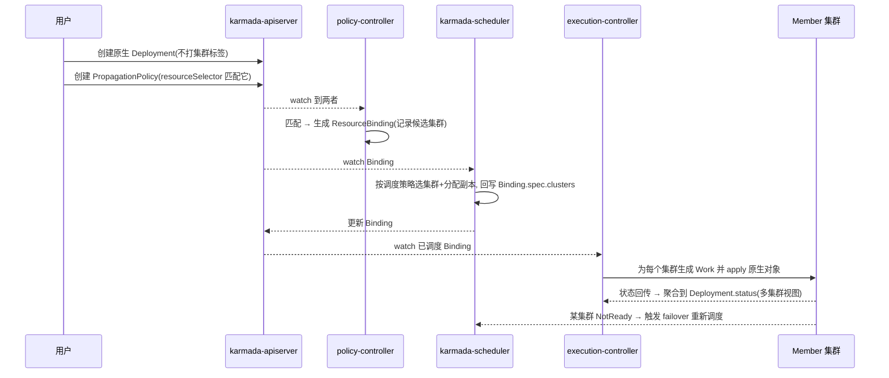

> 《多集群》篇。如果你读过站内《【Kubefed】基础应用实践》，会记得 KubeFed 用一套平行的 `FederatedXxx` API 做配置分发、最终却在 2023 年被官方归档。Karmada（Kubernetes Armada）正是社区公认的**头号继任者**，而且它最大的产品主张恰好是对 KubeFed 痛点的直接回应：**原生 K8s API 兼容——业务侧 YAML 一个字都不用改**。2026-09 它在 KubeCon China 上正式从 CNCF 毕业。本篇讲透它的控制面架构、PropagationPolicy→ResourceBinding→Work 三级分发链、差异化调度与故障漂移，并把"多集群 AI/GPU"这一最新主线（v1.19 的多组件调度、优先级抢占）落到实处——这条线与本站《Kueue》《Volcano》《Koordinator》三篇单集群批调度专题在 L5 层衔接。
>
> 口径说明：版本锚定 **Karmada v1.19（2026，随 CNCF 毕业）**；关键事实：2021-09 入 CNCF Sandbox、2023-12 转 Incubating、2026-09-08 毕业；v1.19 将基于优先级的调度提升至 Beta 且默认启用、增强分布式 AI 训练的多组件调度；核心 API（PropagationPolicy/ResourceBinding/Work）稳定。性能数字为经验量级，非实测。

---

# 第 0 章：全景链路

```text
 用户(原生 kubectl 体验) ──apply 原生 Deployment/... 到 Karmada 控制面
                                   │
     ┌─────────────────────────────▼──────────── Karmada 控制面(≈一个"超级 apiserver") ───────────┐
     │ karmada-apiserver + etcd   ── 存原生对象 + 多集群策略对象                                   │
     │ karmadactl / kubectl-proxy ── 用户入口(兼容 kubectl)                                        │
     │ policy-controller:  按 PropagationPolicy 匹配资源 → 生成 ResourceBinding                    │
     │ karmada-scheduler:  为 ResourceBinding 选集群 + 算副本分布(分数/动态/优先级/拓扑)            │
     │ binding-controller: 把每个集群的那份拆成 Work 对象                                            │
     │ cluster-controller: 管成员集群生命周期/健康/资源上报                                          │
     └───────┬───────────────────────┬───────────────────────────┬──────────────────────────────┘
        Work 下发(execution-controller)                    状态聚合(从成员回传)
             ▼                       ▼                          ▼
       Member 集群 A            Member 集群 B             Member 集群 C
     (真实 Deployment/Pod)    (真实, 副本被差异化)       (故障→Work 漂移走)
```

一句话主线：**Karmada = "把单集群 Kubernetes 控制面放大成多集群控制面"——你在它上面用熟悉的 YAML 和 kubectl 语义描述应用，它用 PropagationPolicy 这一层策略把对象拆成各成员集群里的 Work，并持续做调度、差异化、故障漂移与状态归集。**

---

# 第 1 章：基础概念——它比 KubeFed 前进了什么

## 1.1 是什么

Karmada 是 CNCF **毕业**项目（2026-09），由华为云、工商银行等 2021 年发起并捐赠。它在标准 Kubernetes API 之上提供：**集中式多集群部署、资源分发、故障转移、多集群自动伸缩、差异化调度**，且对应用无侵入。

## 1.2 对照 KubeFed 的三大升级

| 维度 | KubeFed（已归档） | Karmada |
|------|-----------------|---------|
| API 形态 | 引入平行 `FederatedXxx` API，用户要学新对象（"API 税"） | **原生 API 兼容**：直接 apply 原生 Deployment，策略另用 PropagationPolicy 附加 |
| 调度能力 | 静态 placement + 弱 RSP，被批"是分发器不是调度器" | **独立 karmada-scheduler**：分数策略、动态副本、优先级抢占(Beta默认)、资源/拓扑感知 |
| 生态与治理 | 长期 beta→停滞→归档 | CNCF 毕业, 华为/字节/小红书等大规模生产, Bloomberg 等全球用户 |

> 换句话说：KubeFed 教给社区的"template+placement+override 三段式"抽象被 Karmada 完整继承，但 Karmada 把"placement"从静态名单升级成了真正的多集群调度器，并把"用户要不要改 YAML"这个最大的采用障碍消除了。

## 1.3 核心对象速览

| 对象 | 角色 | 类比单集群 |
|------|------|-----------|
| 原生工作负载 | 用户直接创建的资源 | Deployment 本身 |
| PropagationPolicy / ClusterPropagationPolicy | 分发策略(给谁、怎么分、怎么差异化) | 无(跨集群概念) |
| ResourceBinding / ClusterResourceBinding | 策略解析后"该资源↔该组集群"的绑定 | Binding |
| Work | 落到某成员集群的一份资源清单(执行单元) | 相当于下发到集群的对象 |
| Cluster(CAR) | 成员集群注册与健康 | Node(集群级) |
| ResourceInterpreterCustomization | 自定义资源的差异化/回写规则 | 无 |

---

# 第 2 章：核心架构与组件职责



| 组件 | 职责 | 关键点 |
|------|------|--------|
| karmada-apiserver | 多集群 API 与存储(独立 etcd) | 与成员集群 etcd 隔离, 是"控制面即集群"的代价——需独立高可用 |
| karmadactl / kubectl proxy | 用户入口 | `karmadactl init` 拉起; 兼容 kubectl 语义 |
| policy-controller | watch 原生资源 + PropagationPolicy → 生成/更新 ResourceBinding | selector 匹配是它的心脏 |
| karmada-scheduler | 给 Binding 选集群、算副本分布 | 支持静态分数、动态资源感知、优先级、拓扑 |
| binding + execution controller | Binding→各集群 Work；Work→真正 apply 到成员 | 解耦"决定放哪"与"怎么落地" |
| cluster-registration controller | join/unjoin 成员集群、健康、资源上报 | 集群被当作一等资源 |
| aggregated apiserver | 把成员侧 Pod/节点状态聚合回控制面可查 | 多集群可观测与 `klogs` 基础 |

**信任模型**：与 KubeFed 一样, Karmada 控制面持各成员集群凭证（`karmadactl init`/`join` 生成的 Cluster 对象里带 ServiceAccount token）直连成员 apiserver；成员集群对 Karmada **无感、无需装 agent**——纯"推送式配置分发 + 控制面调度"，这与 OCM 的 agent 流派形成分野。

---

# 第 3 章：工作原理——一条分发链的旅程



## 3.1 PropagationPolicy：一个对象讲完分发、差异化与容灾

```yaml
apiVersion: policy.karmada.io/v1alpha1
kind: PropagationPolicy
metadata: {name: web, namespace: default}
spec:
  resourceSelectors:
    - apiVersion: apps/v1
      kind: Deployment
      name: web
  placement:
    clusterReplicas: 3            # 每个选中集群铺 3 份基线
    clusterAffinity:
      matchExpressions:
        - {key: region, operator: In, values: [cn-east, cn-north]}
    replicaScheduling:            # 副本分布策略
      replicaSchedulingType: Divided
      dynamicDiversion: {}        # ★ 按各集群空闲资源动态分副本(替代 KubeFed 弱 RSP)
  conflictPolicy: Abort            # 同名原生资源已在成员存在时的处理
```

- **差异化（Override Policy）**：`ClusterOverridePolicy` 用 `overriders`（imageTag / command-args / labels / annotations / **taints 表达式**）按集群改写模板——例如把镜像仓库换成 region-local、把 storageClass 换成本地型号。对应 KubeFed 的 overrides，但走独立 CR 而非塞进同一对象。
- **容灾（workload failover）**：`spreadConstraints` + `priority` 让某集群 NotReady 时把该集群 Work 迁到健康集群——这是"故障转移"作为产品能力、而非运维剧本的落地。
- **多集群 HPA（MPA）**：`MultiClusterPolicy` 家族里的 `WorkloadProxyRebalancer`/多集群弹性，把副本在集群间随负载再平衡。

## 3.2 调度器：为什么说"它是调度器不只是分发器"

`karmada-scheduler` 复用 K8s 调度框架思想，插件化打分：资源估算（读各成员集群上报的 allocatable）、副本分数（static weighted / dynamic）、**v1.19 默认启用的优先级调度**让关键工作负载先占资源、支持抢占；针对 AI 训练的**多组件调度**把一组关联 Pod（如 PS/Worker）作为整体跨集群摆放，减少"半调度死锁"。

---

# 第 4 章：安装、接入与生产实践

## 4.1 最小可用流程

```bash
# 1) 拉起 Karmada 控制面(宿主集群上)
karmadactl init --cluster-name host

# 2) 注册成员集群(把它们的 kubeconfig 作为 Cluster 资源加入)
karmadactl join member1 --cluster-kubeconfig=~/.kube/member1
karmadactl join member2 --cluster-kubeconfig=~/.kube/member2
kubectl --kubeconfig=karmada.get klogs get clusters   # 或 kubectl get clusters

# 3) 直接 apply 原生应用 + 一个 PropagationPolicy(无需 FederatedXxx)
kubectl --kubeconfig=karmada.get apply -f deployment.yaml -f pp.yaml
```

## 4.2 实践要点

| 事项 | 建议 |
|------|------|
| 命名空间/CRD | 成员集群需已有对应 ns 与 CRD；Karmada 有 CRD 传播策略自动化这一步 |
| 存量收编 | 成员侧已存在的同名资源用 `conflictPolicy: Overwrite/Hibernate` 或 adopt 注解接管, 避免打架 |
| 状态一致性 | 业务改副本要用 `kubectl patch --raw /apis/...` 经控制面, 直连成员改会被 Work 纠回 |
| 排障入口 | `kubectl get rr`(ResourceRegistry)、`describe resourcebinding`、`get work -o yaml`, 分层看策略→绑定→下发哪一段断了 |
| 观测 | aggregated apiserver 聚合成员 Pod 状态; 多集群 metrics 可接自定义看板 |

## 4.3 参数速查

| 项 | 说明 |
|----|------|
| `spreadConstraints.revisionAntiAffinity` | 同版本副本避免全压一个集群 |
| `replicaScheduling.dynamicDiversion` | 按集群空闲动态分副本(需资源上报准确) |
| `priority`（调度） | v1.19 Beta 默认启用, 关键负载优先 |
| Override `overriders.taints` | 表达式级按集群改写, 承载大部分 region 差异 |
| WorkloadRebalance | 主动触发跨集群再平衡(容灾演练/成本) |

---

# 第 5 章：场景、局限与选型

## 5.1 适合 / 不适合

**适合**：多活/异地容灾（failover）、跨云跨地域就近部署降延迟、混合云统一交付、**大规模 AI/GPU 训练与推理的多集群资源编排**（v1.19 主线）、把"多集群"这一层做厚而不想改任何业务 YAML。
**不适合**：单集群场景（徒增控制面 etcd 运维）、需要 GPU 拓扑/ gang 等**集群内**细粒度调度（那是 Volcano/Kueue 的活, Karmada 管集群间）、只要一个轻量"配置复制到几个集群"而不需要调度器（Flux 多集群更省事）。

## 5.2 已知局限（如实记录）

- **控制面即一个集群**：karmada-apiserver + etcd 本身是高可用负担, 超大规模集群数下调度吞吐与 etcd 容量需专门规划；
- **CRD/自定义资源的完整联邦**不如原生工作负载顺滑, 复杂资源要靠 ResourceInterpreterCustomization 手写解释器（Lua）声明"哪些字段可 diff、status 如何回写"——这是上手最陡的坡；
- 生态仍在快速演进, 部分高级特性（优先级、多组件调度、抢占）处于 Beta/路线图阶段, 生产启用前须核对所钉版本的行为边界。

## 5.3 与近邻方案对照

| 方案 | 模型 | 相比 Karmada |
|------|------|-------------|
| KubeFed | FederatedXxx 配置分发 | Karmada 是其继任者, 原生 API + 真调度 |
| OCM/ACM | agent 舰队管理 | 偏"集群即资产"的平台治理, Karmada 偏"应用即负载"的调度分发 |
| ClusterSet/多集群 Service | 跨集群服务发现 | Karmada 靠自身 + 外部网格补足跨集群流量, 不主打 service export/import |
| Flux/Argo 多集群 | GitOps 多仓库 | 交付层, 缺全局调度器; 常与 Karmada 分层共存 |

---

# 附录

## A. 术语速查

| 术语 | 一句话 |
|------|--------|
| 控制面 / 成员集群 | 运行 Karmada 的"超级 apiserver" / 被纳管、真正跑 Pod 的集群 |
| PropagationPolicy | 分发策略: 给谁、怎么分、冲突怎么办 |
| ResourceBinding | 策略解析后资源与候选集群的绑定, 调度器的输入输出载体 |
| Work | 下发到某单一成员集群的一份资源清单(执行单元) |
| dynamicDiversion | 按各集群空闲资源动态分配副本 |
| Override Policy | 按集群差异化模板字段(region 差异) |
| workload failover | 集群 NotReady 时把 Work 迁到健康集群 |
| ResourceInterpreterCustomization | 自定义 CRD 如何被联邦化(diff/status 回写)的 Lua 解释器 |

## B. 参考资料

1. [Karmada 官方文档](https://karmada.io/docs/) — 架构、PropagationPolicy/Work、调度与 Override。✅ 已核实
2. [CNCF 宣布 Karmada 毕业（2026-09-08, KubeCon China）](https://www.cncf.io/) — v1.19 优先级调度 Beta 默认启用、多集群 AI 多组件调度、Bloomberg/小红书等用户。✅ 已核实
3. karmada-io/karmada (GitHub) — 原生 API 兼容、Sandbox→Incubating→毕业时间线。✅ 已核实
4. 站内姊妹篇：《【Kubefed】基础应用实践》（归档现状与三段式抽象的来源）、《【Kueue】/【Volcano】/【Koordinator】》（集群内调度层）。✅ 站内

## C. 变更记录

| 日期 | 版本 | 变更内容 |
|------|------|---------|
| 2026-10-29 | v1.0 | 首版：对照 KubeFed 的三大升级、控制面组件与信任模型、三级分发链时序、PropagationPolicy/Override/failover 与调度器能力、karmadactl 接入实操、参数速查、场景局限与近邻方案对照，含全景链路与多处 Mermaid 图 |
