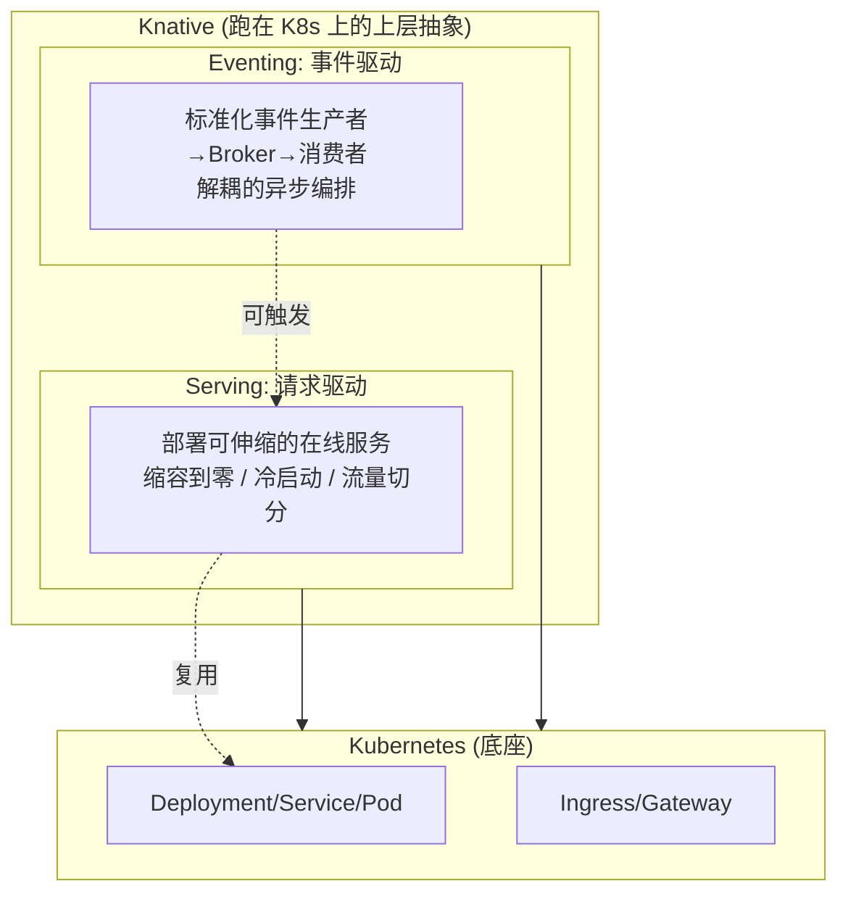
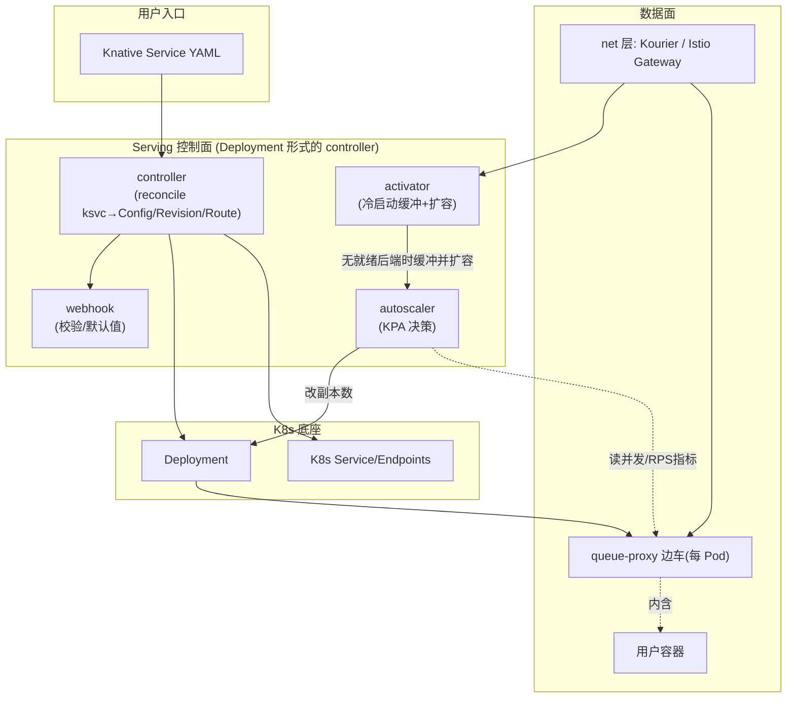
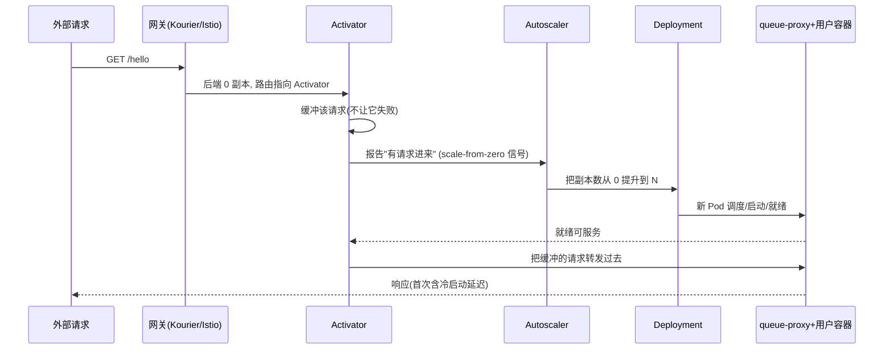
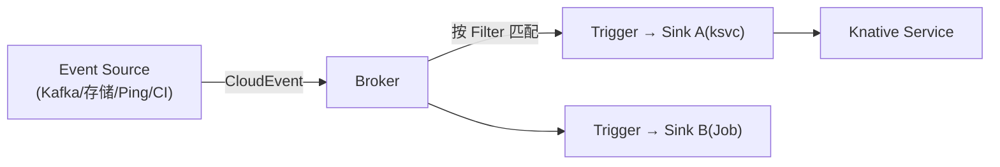

> 这是《Knative》系列第 1 篇，讲**它是什么、由哪些部件构成、请求/事件如何在其上流动**；第 2 篇《Knative Serving》深入 Serving 这一半的实现细节（Revision、流量分配、KPA 伸缩、冷启动）。它也是姊妹篇《云原生体系》里"Knative/Serverless + 事件驱动"那一层的展开——云原生讲体系，Knative 讲"如何用声明式把'请求驱动、缩容到零'这套 Serverless 语义落到 K8s 上"。
>
> 口径说明：版本锚定 Knative **v1.x（2021 年 1.0 GA，此后 Serving/Eventing 稳定迭代）**，安装口径为 Kubernetes 1.2x+。网络层以社区常用的 **Kourier**（轻量）与 **Istio**（服务网格集成）为例。演进线：2018 发布 → 2019 KPA 成默认 → 2021 1.0 GA → 近年 scale-to-zero 与 AI 推理弹性广泛采用。

---

# 第 1 章：基础概念 - Knative 在回答什么问题

## 1.1 一句话定义

> **Knative 是一组跑在 Kubernetes 之上的上层 CRD 与控制器，用"请求驱动的计算（缩容到零）+ 事件驱动的接线"两大能力，把 K8s 从'容器编排'抬升为'应用/函数级 Serverless 平台'，同时不牺牲可移植性。**

它不替代 K8s，而是**站在 K8s  shoulders 上再加一层抽象**：Deployment/Service 太"底层"，Knative 给你 `Service`（一个会随流量自伸缩、没流量就归零的可寻址端点）。

## 1.2 它解决的痛点

| 裸 K8s 的痛 | Knative 的解 |
|------------|-------------|
| 常驻 Pod, 空闲也占资源, 成本高 | **缩容到零**：无请求时 0 副本, 来请求再拉起 |
| HPA 基于 CPU/内存, 对突发流量反应慢 | **KPA**：基于并发/RPS 请求指标秒级伸缩 |
| 从零扩容有冷启动、请求会丢 | **Activator** 缓冲请求 + 驱动扩容 |
| 事件源(消息/存储/CI)集成靠自己写胶水 | **Eventing**：标准化的事件产生/过滤/投递模型 |
| 版本发布/灰度要自己搭 | Revision + Route 流量切分(蓝绿/灰度) |

## 1.3 两份核心能力



- **Serving**：管"请求来了就有实例、请求走了就归零"的同步服务（本篇后续 + 第 2 篇重点）。
- **Eventing**：管"事情发生了要通知谁"的异步解耦（Event Source → Broker/Trigger → Sink）。二者可组合（事件触发一个 Serverless 服务）。

## 1.4 核心术语表

| 术语 | 含义 | 类比 |
|------|------|------|
| Knative Service (ksvc) | 用户主要入口, 一个可寻址、会自伸缩的服务 | "一个会自动开关的微服务" |
| Configuration | ksvc 里"期望运行什么代码/配置"的部分, 改它就产生新版本 | "部署规格说明书" |
| Revision | 一次不可变的版本快照(代码+配置), 真正被伸缩的单元 | "一次发布的镜像固化版" |
| Route | 把流量按百分比分配到不同 Revision | "灰度/蓝绿的水龙头" |
| KPA | Knative Pod Autoscaler, 基于请求并发/RPS 的伸缩器 | "看流量而非看 CPU 的 HPA" |
| Activator | 0→N 冷启动时缓冲请求、驱动扩容的组件 | "先接电话再叫醒工人" |
| queue-proxy | 注入到每个 Pod 的边车, 收集并发指标+排队+限流 | "门口数人头+叫号的人" |
| Net layer | 可插拔入口网关(Istio/Kourier/Contour) | "小区大门" |
| Broker/Trigger | Eventing 的事件中枢与订阅过滤 | "消息总线+订阅" |

---

# 第 2 章：基础架构 - 组件与控制面

## 2.1 组件总览



## 2.2 核心组件职责

| 组件 | 职责 | 关键点 |
|------|------|--------|
| **controller** | 监听 ksvc，reconcile 出 Configuration/Revision/Route 并落到 Deployment/Service | 声明式收敛, 无状态可多副本 |
| **webhook** | 资源准入校验、填默认值 | 保证 CRD 语义一致 |
| **autoscaler** | 从 queue-proxy 收并发/RPS，算目标副本数，改 Deployment scale | KPA 核心; 支持缩容到 0 |
| **activator** | 后端为 0/扩容中时接收并代理请求，触发并等待扩容 | 解决"scale from zero"冷启动丢请求 |
| **queue-proxy** | 每 Pod 边车：指标上报、请求排队、并发限制、健康探测 | 并发默认上限影响伸缩点 |
| **net 层(Kourier/Istio/Contour)** | 对外暴露路由, 把域名映射到 ksvc | 可插拔, 一套 Serving 多入口实现 |

---

# 第 3 章：工作原理 - 一个请求的生命周期

## 3.1 缩容到零后来了请求（冷启动全链路）



## 3.2 稳态伸缩（KPA 逻辑）

- queue-proxy 持续上报每个 Pod 的**并发数（或 RPS）**。
- autoscaler 按 `目标总并发 / 每 Pod 目标并发` 算期望副本数，结合稳定窗口/突发窗口两个尺度取较保守者，避免抖动。
- 无流量超过保留期（`scale-to-zero-grace-period` 等）→ 降到 0。

## 3.3 版本与流量（Route 切分）

改 Configuration 会生成新 Revision；Route 决定流量落到哪个/哪些 Revision，天然支持 **蓝绿、按百分比灰度、A/B**，并可固定某个 Revision 不被回收。

---

# 第 4 章：结构设计 - CRD 对象模型与可插拔网络

## 4.1 对象层级

```text
Service (ksvc)  ── 一把梭的用户视图, 内含:
   ├── Configuration  (期望的代码/环境/并发参数)
   │       └── 每次变更 → 生成一个 Revision
   ├── Revision (不可变版本快照)  ×N
   └── Route (流量分布: latest / 指定 revision 百分比)
```

设计思想：**把"运行什么(Configuration)"和"怎么发版/切流(Route→Revision)"解耦**，Configuration 改动产生不可变 Revision，Route 只是把流量指针拨向不同 Revision——这让回滚/灰度成为纯流量层操作，不动代码。

## 4.2 可插拔网络层（net-*)

Serving 把入口实现抽成 `net-istio`/`net-kourier`/`net-contour` 等，通过 `config-network` 的 ingress class 切换。好处：不绑定某一家网关，Kourier 轻量易装、Istio 提供 mTLS/流量治理、Contour 对接项目contour。

## 4.3 Eventing 的解耦模型



事件统一用 **CloudEvents** 规范，Source 产生 → Broker 汇聚 → Trigger 过滤投递到 Sink，Sink 常是一个 Serverless 服务，实现"事件到计算"的弹性闭环。

---

# 第 5 章：应用场景与选型

| 场景 | 用哪半 | 为什么 |
|------|--------|-------|
| 间歇性/突发在线 API | Serving | 空闲归零省成本, 来了秒级起 |
| AI 推理弹性服务 | Serving(KPA) | 看请求并发伸缩, 契合推理负载(呼应过载摘流思路) |
| Webhook/事件后端 | Serving+Eventing | 事件驱动、按需拉起 |
| 数据/CI 流水线编排 | Eventing | 解耦的产生→过滤→消费 |
| 灰度/蓝发发布 | Serving(Route) | 流量百分比切分内置 |
| 稳定高负载常驻服务 | ❌ 不必用 Knative | 缩容到零/冷启动对它没收益, 反增复杂度 |

**与其他 Serverless 对比**：FaaS（如云函数）更"函数粒度、强托管"，Knative 更"容器粒度、可移植、跑在自己 K8s 上、兼容现有镜像"；代价是你要自运维 K8s + Knative。

---

# 第 6 章：性能特性与关键参数

## 6.1 冷启动与伸缩是核心体验

| 因素 | 影响 | 缓解 |
|------|------|------|
| Pod 调度 + 拉镜像 + 启动 | 冷启动 P99 延迟主因 | 小镜像、预热镜像、`initial-scale`、保留实例(厂商方案) |
| Activator 缓冲路径 | 冷启动期多一跳 | 稳态后请求绕过 Activator 直连 |
| `container-concurrency` 默认 | 每 Pod 目标并发, 决定伸缩点 | 按应用调(queue-proxy 默认并发上限) |
| scale-to-zero 阈值与 grace | 决定何时归零、会不会过早归零 | 调 `scale-to-zero-grace-period` |
| KPA 稳定/突发窗口 | 兼顾平滑与快速响应 | 按流量波动特征调窗 |

## 6.2 关键参数（config 级 + 注解级）

| 参数 | 位置 | 说明 |
|------|------|------|
| `autoscaling.knative.dev/min-scale` | Revision 注解 | 最小副本(设 1 可禁归零/保留热实例) |
| `autoscaling.knative.dev/max-scale` | 注解 | 上限, 防失控 |
| `autoscaling.knative.dev/target` | 注解 | 每 Pod 目标并发/RPS(默认并发 100 量级) |
| `autoscaling.knative.dev/metric` | 注解 | concurrency / rps |
| `class` | 注解 | kpa.autoscaling.knative.dev(默认) 或 hpa |
| `scale-to-zero-grace-period` | config-autoscaler | 归零等待 |
| `containerConcurrency` | spec | 单容器最大并发 |

---

# 第 7 章：局限缺陷与解决方案

| 问题 | 表现 | 根因 | 规避 |
|------|------|------|------|
| 冷启动延迟 | 首次/归零后请求慢 | 从 0 拉起 Pod | min-scale≥1 保留实例、小镜像预热、AHPA 预测 |
| 缩容到零丢请求担忧 | 归零瞬间请求 | — | Activator 缓冲已内建; 配 grace 期 |
| 运维复杂度 | 多一层 CRD+组件要管 | 平台栈变厚 | 用发行版/云托管(ACK/CCE Knative)降低自运维 |
| 网络层耦合 | 网关选型影响功能 | 依赖 net-* 实现 | Kourier 起步、需 mTLS/治理再上 Istio |
| 对常驻高负载无收益 | 白增复杂度 | 它面向请求驱动波动 | 稳态服务用原生 Deployment+HPA 即可 |
| KPA 与 HPA 指标不同 | CPU 维度不适用 | 设计上 KPA 看请求 | 用请求指标; 特殊负载可切 hpa class |

---

# 附录

## A. 快速上手速记

```bash
# 装 CRD + core controller
kubectl apply -f https://github.com/knative/serving/releases/latest/download/serving-core.yaml
# 装一个 net 层(示例 Kourier) 并指向它
kubectl apply -f https://github.com/knative/net-kourier/releases/latest/download/kourier.yaml
kubectl patch configmap/config-network -n knative-serving --type merge \
  -p '{"data":{"ingress-class":"kourier.ingress.networking.knative.dev"}}'
# 部署一个服务
kubectl apply -f hello.yaml   # kind: Service(apiVersion serving.knative.dev/v1)
```

## B. 术语速查

| 术语 | 一句话 |
|------|--------|
| ksvc / Configuration / Revision / Route | Serving 四件套: 入口/规格/版本/流量 |
| KPA | 基于请求并发/RPS、可缩容到零的伸缩器 |
| Activator | 冷启动时缓冲请求并驱动 0→N 扩容 |
| queue-proxy | 每 Pod 边车, 指标+排队+限流 |
| net-kourier/istio/contour | 可插拔入口网关实现 |
| Broker/Trigger | Eventing 的事件中枢与订阅过滤 |
| CloudEvents | 事件统一格式规范 |

## C. 参考资料

1. [Knative Docs · Serving 架构](https://knative.dev/docs/serving/) — 组件、对象模型、伸缩。✅ 已核实
2. [Knative Docs · 缩容到零/冷启动](https://knative.dev/docs/serving/autoscaling/) — KPA 参数与 Activator。✅ 已核实
3. [Knative Docs · Eventing](https://knative.dev/docs/eventing/) — Broker/Trigger/CloudEvents。✅ 已核实
4. [Knative Blog · 1.0 GA](https://knative.dev/blog/) — 2021 GA 里程碑。✅ 已核实

## D. 变更记录

| 日期 | 版本 | 变更内容 |
|------|------|---------|
| 2026-10-29 | v1.0 | 首版：Knative 双层(Serving/Eventing)概念与架构、核心组件、请求冷启动链路、CRD 对象模型、可插拔网络与选型九维全解，含分层、组件、冷启动、事件、对象五处 Mermaid 图 |
