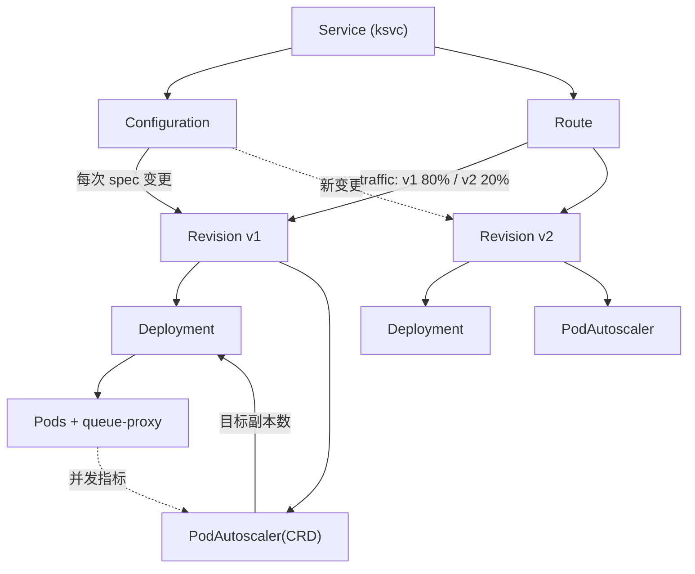
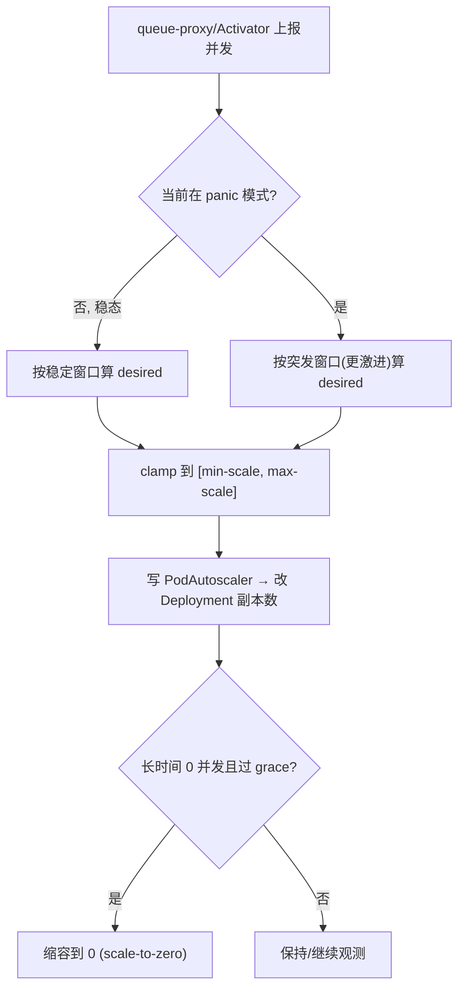
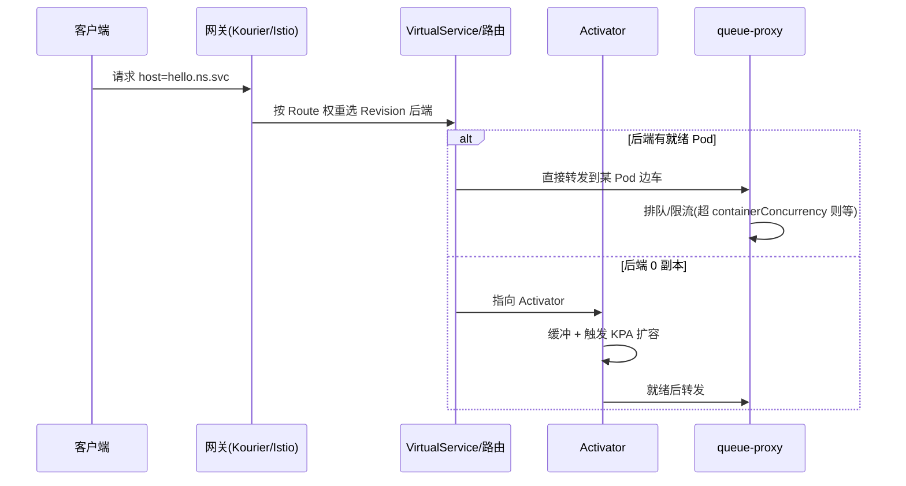
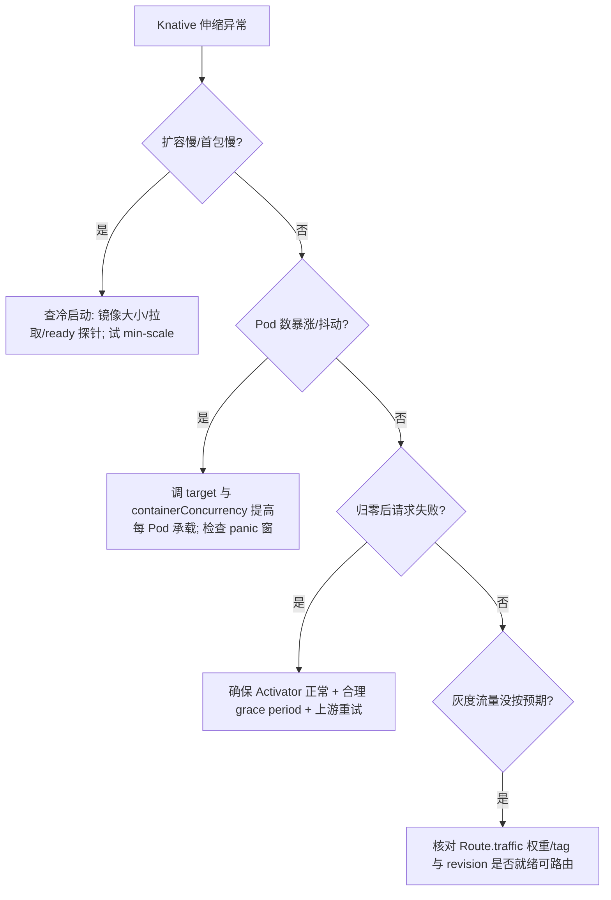

> 《Knative》系列第 2 篇。第 1 篇《基础概念与核心架构》把 Knative 的地图铺开，本篇只钻 **Serving** 这一半的实现内核：一个 `Service` 如何被逐级 reconcile 成 Deployment、KPA 到底怎么算该留几个 Pod、Revision 怎么灰度/回滚、冷启动怎么压、并发参数怎么设。读完你应该能从"Knative 能跑"进到"Knative 能调、能归因伸缩问题"。伸缩与过载治理的思路，可对照姊妹篇《Kubernetes Service 四层负载均衡》里"用指标驱动收敛"的闭环一起理解。
>
> 口径说明：版本锚定 Knative Serving **v1.x**；伸缩以 **KPA（kpa.autoscaling.knative.dev）** 默认算法为准；并发指标含 `concurrency`（默认）与 `rps`。配置落在 `config-autoscaler`/`config-deployment` 等 ConfigMap 与 Revision 注解两级，**注解优先**。性能数值为机制性说明与经验量级，非某集群实测。

---

# 第 1 章：Serving 对象模型与 reconcile 链

## 1.1 一句话主线

> **你写一个 `Service`，Knative 把它拆成"规格(Configuration)"与"流量(Route)"两半，Configuration 每次变更固化出一个不可变 `Revision`，每个 Revision 背后生成一个 K8s `Deployment` + 一个 `PodAutoscaler(CRD)`，由 autoscaler 接管副本数——这就是 Serving 的全部机械结构。**

## 1.2 reconcile 链条



| 对象 | 角色 | 生命周期要点 |
|------|------|-------------|
| Service | 用户聚合视图 | 声明"跑什么 + 流量给谁" |
| Configuration | 期望运行规格(镜像/env/并发/伸缩参数) | 改它 → 新 Revision |
| Revision | 不可变版本快照 | 真正被部署与伸缩的单元; 可被 GC |
| Route | 流量分配指针 | latest/指定 revision + 百分比 |
| Deployment | K8s 实际工作负载 | 由 revision controller 生成 |
| PodAutoscaler(CRD) | KPA 目标载体 | autoscaler 据此调 Deployment scale |

## 1.3 Revision 命名与回收

- 命名自动带哈希（`hello-00001` 之类），保证不可变与可追溯。
- **Revision GC**：默认保留最近若干个 Revision（`config-gc` 控制），旧的、无流量的 Revision 连同其 Deployment 被回收。`traffic` 固定引用的 Revision 不会被删。

---

# 第 2 章：KPA 伸缩算法（Serving 的心脏）

## 2.1 目标副本数怎么算

KPA 基于**每个 Pod 的平均并发（或 RPS）**做决策：

\[
\text{desiredPods} = \left\lceil \frac{\text{系统总并发}}{\text{每 Pod 目标并发} \times \text{target利用率}} \right\rceil
\]

- **系统总并发** = queue-proxy 上报的各 Pod 并发之和（0→N 期间由 Activator 上报）。
- **每 Pod 目标并发** 由 `autoscaling.knative.dev/target`（或 spec `containerConcurrency` 推导）设定。
- autoscaler 同时算两个尺度：**稳定窗口（steady）** 与 **突发窗口（panic）**，取更"敢扩"的那个应对尖峰、用稳定窗避免抖动回落。



## 2.2 panic 模式与迟滞（防抖）

- 短时间并发陡增会进入 **panic**：用更短的评估窗、更快扩容，抓突发流量。
- 退出 panic 有**冷却**，避免在阈值线附近反复扩缩（churn）。这与第 6 篇 K8s Service 过载治理里"迟滞 + 时间窗平滑"是同一防抖哲学，只不过 Knative 内建在 KPA 里。

## 2.3 scale-to-zero 与 min/max

| 机制 | 控制项 | 效果 |
|------|--------|------|
| 缩容到零 | `enable-scale-to-zero`(config) + grace period | 空闲释放全部算力 |
| 保底副本 | 注解 `min-scale` | 设 1 可消除该服务冷启动(牺牲省成本) |
| 上限 | 注解 `max-scale` | 防止流量异常打爆集群 |
| 初始副本 | `initial-scale` | 新建 revision 起始 Pod 数 |

---

# 第 3 章：流量分配与发布策略（Route/Revision）

## 3.1 灰度/蓝绿/回滚都是"拨流量指针"

```yaml
apiVersion: serving.knative.dev/v1
kind: Service
metadata: {name: hello}
spec:
  template:
    metadata:
      annotations:
        autoscaling.knative.dev/target: "50"     # 每 Pod 目标并发
    spec:
      containers:
        - image: ghcr.io/me/hello:v2
      containerConcurrency: 0                     # 0=自动; CPU密集常设 1
  traffic:
    - latestRevision: true
      percent: 20                                  # 新版本 20% 灰度
    - tag: stable
      revisionName: hello-00001
      percent: 80                                  # 旧版本兜底 80%
```

- **按百分比切流**：`traffic` 给不同 revision 分配权重 → 天然金丝雀/蓝绿。
- **固定 tag**：给某 Revision 打 `tag` 得到独立子域名，便于 A/B 测试与回滚锚点。
- **回滚**：把 100% 流量指回旧 Revision，不动镜像、秒级。

## 3.2 请求路由全路径



---

# 第 4 章：queue-proxy 与并发控制

| 职责 | 说明 |
|------|------|
| 指标采集 | 统计进入用户容器的并发/RPS，上报 autoscaler |
| 请求排队 | 超过 `containerConcurrency` 的请求在边车里排队, 不丢弃(受超时约束) |
| 健康/就绪探测 | 代理 readiness, 决定 Pod 是否接流量 |
| 限流与优雅下线 | Pod 缩容时先停止接新请求再退出 |

**并发参数是伸缩效果的总开关**：
- `containerConcurrency`：单容器最大并发。CPU 密集/怕互相干扰设 `1`；I/O 密集可调高甚至 `0`(自动)。
- `autoscaling.knative.dev/target`：KPA 每 Pod 目标并发（一般 ≤ containerConcurrency）。
- 两者设太小 → Pod 数暴涨；设太大 → 响应变慢、扩容迟钝。

---

# 第 5 章：冷启动优化（生产最关心）

冷启动 = 从 0 拉起：调度 + 拉镜像 + 容器启动 + 应用 ready + Activator 转发。优化手段分层：

| 层 | 手段 | 收益 |
|----|------|------|
| 保底 | `min-scale=1` / 保留实例 | 彻底消除该服务归零冷启动(牺牲空闲省成本) |
| 镜像 | 小镜像、镜像预热到节点、同地域仓库 | 砍掉拉取时间(常是最大头) |
| 启动 | 快起应用、懒加载、`initial-scale>1` | 缩短 ready 时间 |
| 伸缩预测 | 厂商 AHPA/预测式预热(周期性负载) | 流量到来前先备好 |
| 请求缓冲 | Activator 已内建, 配合理 grace 期 | 冷启动期不丢请求 |
| 快照 | 运行时快照/Checkpoint(生态方案) | 进一步压首包 |

> 权衡：缩容到零是"省钱"，冷启动是"延迟税"。延迟敏感就别让它归零（min-scale≥1），把 Knative 只当"自动扩"而非"缩到零"用。

---

# 第 6 章：应用场景、性能参数与局限

## 6.1 适合 / 不适合

- **适合**：波动明显的在线 API、事件触发的按需服务、需要灰度/回滚标准化的发布、AI 推理弹性服务。
- **不适合**：恒定高负载（归零无收益、冷启动纯亏）、长连接/流式/WebSocket 默认模型不友好（需专门配置 `timeoutSeconds` 与并发策略）、强依赖复杂有状态拓扑的服务。

## 6.2 关键参数速查

| 参数 | 位置 | 默认/建议 | 说明 |
|------|------|----------|------|
| `containerConcurrency` | spec | 0(自动) | 单容器最大并发, CPU 密集设 1 |
| `autoscaling.knative.dev/target` | 注解 | — | 每 Pod 目标并发/RPS |
| `autoscaling.knative.dev/metric` | 注解 | concurrency | 或 rps |
| `min-scale` / `max-scale` | 注解 | 0 / 无上限 | 保底与封顶 |
| `scale-to-zero-grace-period` | config-autoscaler | 数十秒级 | 归零等待 |
| `stable-window`/`panic-window-percentage` | config-autoscaler | 默认 | 稳/突窗口 |
| `timeoutSeconds` | spec | 数十秒 | 请求硬超时(流式要调大) |
| revision GC 数量 | config-gc | 保留最近若干 | 控制历史版本堆积 |

## 6.3 伸缩问题调优决策树



---

# 附录

## A. Serving 实操速查

```bash
kubectl get ksvc,config,route,revision -n myapp        # 看对象链路
kubectl get pa                                          # PodAutoscaler 与当前/目标副本
kubectl -n knative-serving get cm config-autoscaler -o yaml
kubectl describe revision hello-00002                   # 看该版本伸缩/就绪事件
# 打 tag 子域名做 A/B
kubectl get route hello -o jsonpath='{.status.address.url}'
```

## B. 术语速查

| 术语 | 一句话 |
|------|--------|
| KPA | Knative 专属伸缩器, 看并发/RPS 且能归零 |
| PodAutoscaler(CRD) | autoscaler 落地的伸缩目标载体, 背后改 Deployment |
| panic / stable window | KPA 突发激进窗口 / 稳态平滑窗口 |
| containerConcurrency | 单容器最大并发, 伸缩与排队的基准 |
| Activator | 0→N 时缓冲并代理请求、上报并发 |
| queue-proxy | 每 Pod 边车, 采指标/排队/限流/健康 |
| traffic tag | 给 Revision 的具名流量入口, 便于灰度/回滚 |
| config-autoscaler/deployment/gc | 全局默认值落地的 ConfigMap |

## C. 参考资料

1. [Knative Docs · Autoscaling](https://knative.dev/docs/serving/autoscaling/) — KPA、并发、scale-to-zero、注解。✅ 已核实
2. [Knative Docs · Traffic & Deployments](https://knative.dev/docs/serving/using-a-tag/) — Route 灰度/tag/回滚。✅ 已核实
3. [Knative Docs · Cold Starts / Concurrency](https://knative.dev/docs/serving/autoscaling/concurrency/) — 并发与冷启动权衡。✅ 已核实
4. [Knative Docs · Config Maps](https://knative.dev/docs/serving/configuration/) — config-autoscaler/gc/deployment。✅ 已核实

## D. 变更记录

| 日期 | 版本 | 变更内容 |
|------|------|---------|
| 2026-10-29 | v1.0 | 首版：Serving 对象 reconcile 链、KPA 伸缩算法与防抖、灰度流量/回滚、queue-proxy 并发、冷启动优化与参数调优九维全解，含对象链路、KPA 流程、路由、调优多处 Mermaid 图 |
