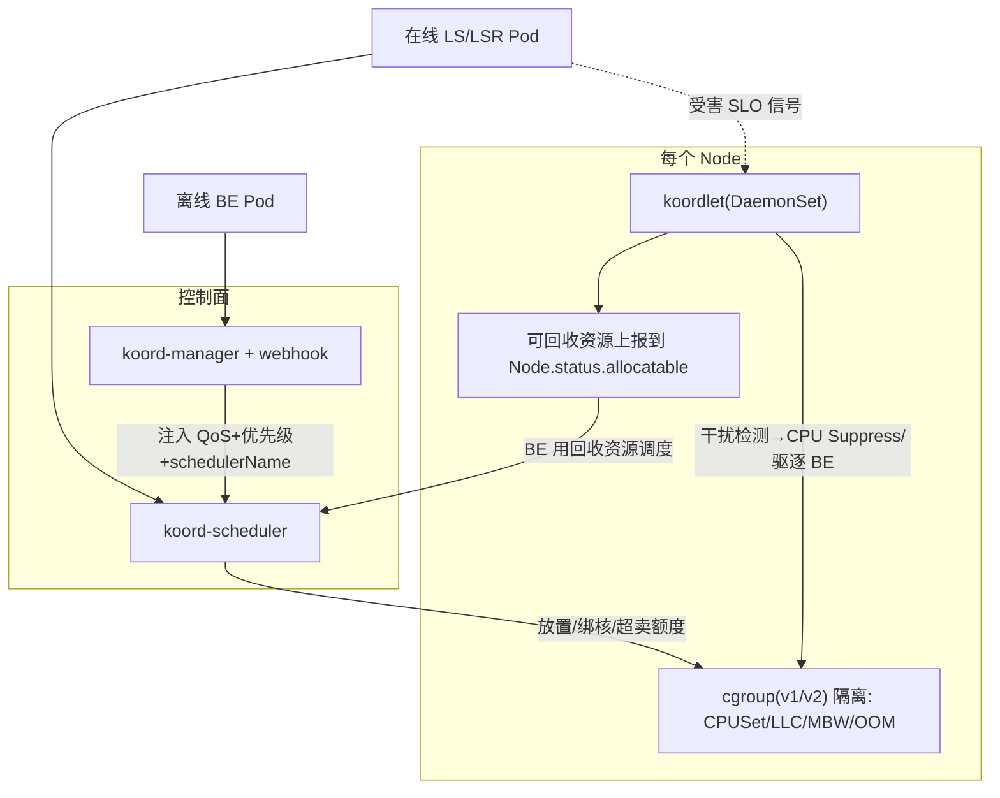
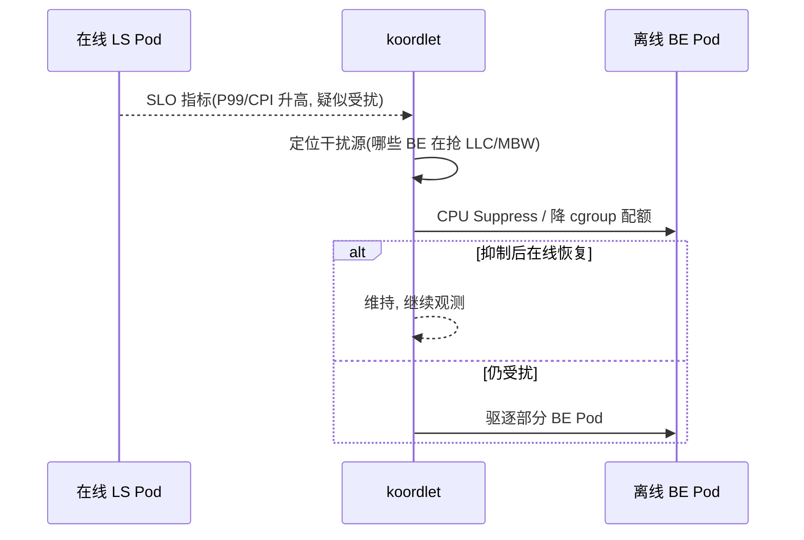

> 《批调度三部曲》第 2 篇。前两篇里，《Kueue》管"作业排队准入"、《Volcano》管"整组原子调度"，本篇的 Koordinator 解决第三个维度的问题：**同一台机器上，延迟敏感的在线服务和吞吐优先的离线任务如何安全共存**。它由阿里巴巴混部实践孵化、捐给 CNCF，核心是一套 QoS 分级（LSR/LS/BE）+ 单机侧干扰检测与抑制 + 资源超卖回收的完整体系——把集群"账面用满、实际还闲"的那部分资源真正榨出来。小红书把 Spark/Flink/转码等离线负载与在线业务共池混部即是标杆案例。读完你应该能设计"一键灰度开启混部"的接入方案，并理解它与 Kueue/Volcano 的分工边界。
>
> 口径说明：版本锚定 **Koordinator v1.x（v1.8 于 2026-05/06 发布，主线是混部场景的调度与 GPU 能力增强）**；核心 CRD（`ClusterColocationProfile`、`Node` 扩展资源、QoS 相关）以 `config.koordinator.sh/v1alpha1` 等为主，部分能力随版本从 alpha/beta 演进。性能与利用率收益为公开分享的经验量级，非某集群实测。

---

# 第 0 章：全景链路

```text
 在线 Pod(LSR/LS)                 离线 Pod(BE: Spark/Flink/训练/转码)
      │                                 │
      └──────────┬──────────────────────┴───────────┐
                 ▼                                   ▼
     ┌────────────────────  Koordinator 控制/节点面 ────────────────────┐
     │ koord-scheduler(增强调度: Gang/负载均衡/NUMA/超卖感知/优先级)      │
     │ koord-manager + webhook: ClusterColocationProfile 准入改写        │
     │ koordlet(DaemonSet, 单机大脑):                                     │
     │   ├ 资源画像与"可回收资源"上报(reclaimable CPU/Mem 到 Node)         │
     │   ├ 干扰检测(CPI/PSI/LLC/内存带宽)→ 识别受害 Pod                    │
     │   ├ QoS 动作: CPU Suppress / 驱逐 BE / NUMA/L3/MBW 分区            │
     │   └ 指标采集与 SLO 守护                                             │
     └──────────────┬───────────────────────────┬───────────────────────┘
              在线独占/绑核+LLC隔离          离线吃"账面空闲"回收资源
                    ▼                               ▼
                 Node(同一台机器, 延迟受保护, 利用率拉高)
```

一句话主线：**Koordinator = "把集群 CPU 从平均 15% 用到 45%"的混部引擎——它给 Pod 分三六九等（QoS），让在线独占关键资源、让离线吃机器真实空闲的回收资源，再用单机侧的干扰检测与抑制保证在线 SLO 不被拖垮。**

---

# 第 1 章：基础概念——混部到底在解决什么

## 1.1 问题起点：集群利用率的两副面孔

企业集群常见"账面满载、实际很闲"：在线服务按峰值申请 CPU，长期平均利用率却只有 10–20%；离线大数据/AI 任务又在外部排队等机器。把这些负载**混跑在同一批节点**（colocation / 混部），用在线的闲置资源喂离线批任务，是降本最直接的杠杆。难点从来不是"能不能塞进去"，而是**塞进去后在线 P99 会不会被拖崩**——这就是 QoS 存在的理由。

## 1.2 QoS 三级模型（Koordinator 的世界观）

| QoS | 定位 | 典型负载 | 关键保障差异 |
|-----|------|---------|-------------|
| **LSR**(Latency-sensitive Reserved) | 延迟极敏、独占绑核 | 搜推广核心 | 绑核保证、LLC/MBW 100%、OOM 优先级最低 |
| **LS**(Latency-sensitive) | 默认在线级 | 网关、Java 微服务 | share 绑核(prefer NUMA)、LLC 100%、CPU burst 开 |
| **BE**(Best-Effort) | 吞吐优先、随时可抢 | Spark/Flink/转码/训练 | 用回收资源、LLC 约 30%、无 CPU burst、OOM 优先级最高 |

这套分级不是 K8s 原生 `PriorityClass` 能表达的——它同时驱动**调度侧**（谁和谁不能放一起、绑核、超卖额度）与**单机侧**（LLC/内存带宽/CPU/内存回收的差异化控制）。

## 1.3 组件速览

| 组件 | 形态 | 职责 |
|------|------|------|
| koord-scheduler | Deployment(增强调度器) | 在默认调度器扩展点上加 Gang、负载均衡、超卖感知、NUMA 编排、优先级重调度 |
| koord-manager | Deployment + webhook | 管 CRD；`ClusterColocationProfile` 把普通 Pod 准入改写为带混部协议的离线 Pod |
| koordlet | **DaemonSet(每台机一个)** | 单机 QoS 大脑：资源画像/回收上报、干扰检测、CPU Suppress、驱逐、指标 |
| koord-runtime-proxy(可选) | 节点侧 | 拦截容器运行时, 做 cgroup 级细粒度管控 |

---

# 第 2 章：核心架构与工作原理



## 2.1 一键开启混部：ClusterColocationProfile（招牌设计）

Koordinator 降低混部门槛的关键——**不侵入存量组件, 用一个 CRD + webhook 按规则给新建 Pod 自动注入混部协议**：

```yaml
apiVersion: config.koordinator.sh/v1alpha1
kind: ClusterColocationProfile
metadata: {name: spark-be}
spec:
  namespaceSelector: {matchLabels: {koordinator.sh/enable-colocation: "true"}}
  selector: {matchLabels: {"sparkoperator.k8s.io/launched-by-spark-operator": "true"}}
  qosClass: BE
  priorityClassName: koord-batch
  schedulerName: koord-scheduler
  # 命中规则的 Spark Pod 会被自动改写为 BE 离线 Pod, 无需改 SparkOperator 或业务 YAML
```

接入动作被压缩成两条命令：`kubectl apply -f profile.yaml` + 给目标命名空间打 `enable-colocation=true` 标签。**灰度、回滚都围绕"选择器范围"**，这与站内《Ceph 监控告警》强调的"渐进式变更"一脉相承。

## 2.2 资源超卖：回收资源从哪来

koordlet 周期测量节点上在线 Pod 的**实际用量 vs 申请量**, 把"申请的但没用"的那部分作为 **reclaimable resources** 上报到 `Node.status`（扩展资源如 `kubernetes.io/batch-cpu`、`batch-memory`）。BE 作业用这些回收资源来调度——于是同一台机器的"账面 allocatable"被合法地撑大, 而在线应用的 request 仍被完整尊重（一旦在线回升, 触发对 BE 的抑制/驱逐）。

## 2.3 干扰治理：混部可靠性的分水岭

在线被离线拖慢, 根因是**共享硬件竞争**：LLC 缓存、内存带宽(MBW)、CPU IPC 下降、内存回收。koordlet 的检测—动作闭环：

- **检测**：采 CPI（cycles per instruction）、PSI（pressure stall info）、LLC miss、MBW 等微架构指标, 判定在线是否受干扰、谁是干扰源；
- **抑制**：`CPU Suppress` 动态调低离线组的 cgroup CPU 配额（不杀任务, 只是让它慢下来给在线让路）；
- **隔离**：LSR 绑核 + `resctrl`(Intel RDT) 给不同 QoS 分 LLC/MBW 比例(BE 默认 ~30%)；
- **驱逐**：抑制仍救不回在线 SLO 时, 按优先级驱逐 BE Pod。



## 2.4 GPU 与 Gang（v1.8 主线增强）

- **GPU 调度**：支持共享 GPU（显存/算力切分）、拓扑感知、GPU 资源上报, 与《Kueue》的 ResourceFlavor 思路互补（Koordinator 偏单机 QoS + 设备细粒度）；
- **Gang 调度**：koord-scheduler 提供 Strict/NonStrict 模式的整组调度, 大数据场景按分组整体抢占——这与 Volcano 的 PodGroup 有功能重叠, 选型见第 5 章。

---

# 第 3 章：安装、接入与生产参数

## 3.1 最小接入

```bash
helm repo add koordinator-sh https://openkruise.github.io/charts/  # 官方 chart(以项目页为准)
helm install koordinator koordinator-sh/koordinator -n koordinator-system --create-namespace
kubectl get nodes -o custom-columns=NAME:.metadata.name,BATCH_CPU:.status.allocatable.'kubernetes\.io/batch-cpu'  # 看回收资源是否上报
```

## 3.2 关键参数速查

| 项 | 位置 | 说明 |
|----|------|------|
| `qosClass` / `priorityClassName`(koord-lsr/koord-LS/koord-batch) | Profile/Pod | 决定 QoS 待遇与调度优先级 |
| `koordinator.sh/cpu-burst` | 注解 | LS 类突发容忍, 短高峰不违反 SLO |
| 资源超卖比率/安全水位 | koordlet 配置 | 回收多少、留多少缓冲, 激进=高利用率高风险 |
| LLC/MBW 配额比例 | resctrl 策略 | BE 的 cache/带宽上限(默认 ~30%) |
| CPU Suppress 阈值 | koordlet QoS 策略 | 触发抑制的 CPI/PSI 门限 |
| `enable-colocation` 命名空间标签 | 接入开关 | 灰度控制混部生效范围 |

## 3.3 调优决策要点

收益与风险都在"超卖激进度"这一根轴上：起步保守（回收上限低、安全水位高）→ 观测在线 P99 无损再逐步放大；一旦某类在线服务对抖动极敏感（如内存型 KV），单独把它设成 LSR 绑核 + 不参与混部节点, 而不是全局调。这与《K8S 排障系列》"先圈爆炸半径再优化"的思路一致。

---

# 第 4 章：应用场景与效果

## 4.1 典型场景

- **搜推广 + 大数据共池**：白天在线扛流量、闲时同机器跑离线 ETL/模型训练（小红书、阿里双 11 弹性）；
- **在离线混合编排**：Spark/Flink/转码等 BE 负载吃回收资源, 提升整集群 CPU 利用率；
- **GPU 共池**：在线推理（延迟敏感）与离线批量推理/训练同卡/同机分时, 靠 QoS + MIG/共享切分保障。

## 4.2 收益量级（经验）

混部核心 KPI 是"在不违反在线 SLO 前提下提升利用率": 社区公开案例中 CPU 平均利用率可从 ~15–20% 提升到 ~40–45%+（取决于负载错峰程度）；**收益强依赖在线与离线的时间互补性**——峰值重叠的负载混在一起只会互相拖累。

---

# 第 5 章：局限、反模式与选型三角

## 5.1 已知局限

- **依赖内核/cgroup 能力**：LLC/MBA 隔离需 Intel RDT/PQoS、cgroup v2 部分特性, 异构机型/老内核上能力降级；
- **单机侧较重**：koordlet 常驻每节点、采微架构指标, 有自身开销, 观测与调优门槛高；
- **场景前提**：只有存在"在线闲置 + 离线积压"错峰时才划算, 纯在线或纯离线集群收益有限。

## 5.2 反模式

| 反模式 | 后果 | 纠正 |
|--------|------|------|
| 一上来全局开混部、超卖拉满 | 在线 P99 抖动甚至雪崩 | 按命名空间灰度、保守水位起步 |
| 把延迟极敏服务也卷进 BE 共池 | 关键 SLO 破线 | 该服务设 LSR 绑核并隔离节点 |
| 只看利用率不看干扰指标 | 隐患积累到爆发 | 必看 CPI/PSI/LLC 与在线 P99 联动 |

## 5.3 与 Kueue / Volcano 分工

| 维度 | Kueue | Volcano | Koordinator |
|------|-------|---------|-------------|
| 层次 | 作业准入队列(集群级) | 批/AI 调度器(替换默认) | QoS 混部 + 单机资源治理 |
| 主问题 | 谁能占多少配额、何时放行 | 整组任务怎么原子编排 | 在线离线怎么安全共存在一台机 |
| Gang | ACC/waitForPodsReady | PodGroup 一等公民 | 调度器 Gang 插件 |
| 组合姿势 | Kueue 准入 + Koordinator 混部可叠加 | 重度编排独立成栈 | 混部是横向能力, 可与前两者共存 |

> 一句话收束三部曲：**Kueue 决定"排不排得上"、Volcano 决定"整组怎么摆"、Koordinator 决定"同机怎么不打架"**——三者回答的是不同维度的问题, 成熟的 GPU 平台往往三者按需叠加。

---

# 附录

## A. 术语速查

| 术语 | 一句话 |
|------|--------|
| 混部(colocation) | 在线与离线负载跑同一批节点, 靠 QoS 隔离 |
| LSR/LS/BE | 三档 QoS: 独占绑核 / 默认在线 / 尽力而为离线 |
| 回收资源(reclaimable) | 在线申请未用、被 koordlet 上报给 BE 复用的额度 |
| CPU Suppress | 动态压低离线 cgroup CPU 配额给在线让路 |
| resctrl/LLC/MBW | 缓存与内存带宽的硬件隔离控制 |
| ClusterColocationProfile | 按选择器给 Pod 自动注入混部协议的准入 CRD |
| koordlet | 每台机的 QoS 大脑(检测/抑制/上报) |

## B. 参考资料

1. [Koordinator 官方文档](https://koordinator.sh/) — QoS 模型、混部设计、Gang 调度。✅ 已核实
2. 云原生周刊《Koordinator v1.8 正式发布：混部场景调度与 GPU 能力增强》(2026)。✅ 已核实
3. 掘金《小红书混部技术实践》(2023) — LSR/mid/batch 三级 QoS 与保障参数矩阵。✅ 已核实
4. 阿里云/社区《Koordinator 架构详解》《支持 K8s 与 YARN 混部》 — ClusterColocationProfile 接入与 CPU Suppress。✅ 已核实
5. 姊妹篇：《【Kueue】基础应用实践》《【Volcano】基础应用实践》。✅ 站内

## C. 变更记录

| 日期 | 版本 | 变更内容 |
|------|------|---------|
| 2026-10-29 | v1.0 | 首版：混部动因与利用率两副面孔、LSR/LS/BE 三级 QoS、四组件与 koordlet 单机大脑、ClusterColocationProfile 一键接入、资源超卖回收、干扰检测-CPU Suppress-驱逐闭环、GPU/Gang、参数速查、收益量级、反模式与三部曲选型三角，含全景链路与多处 Mermaid 图 |
