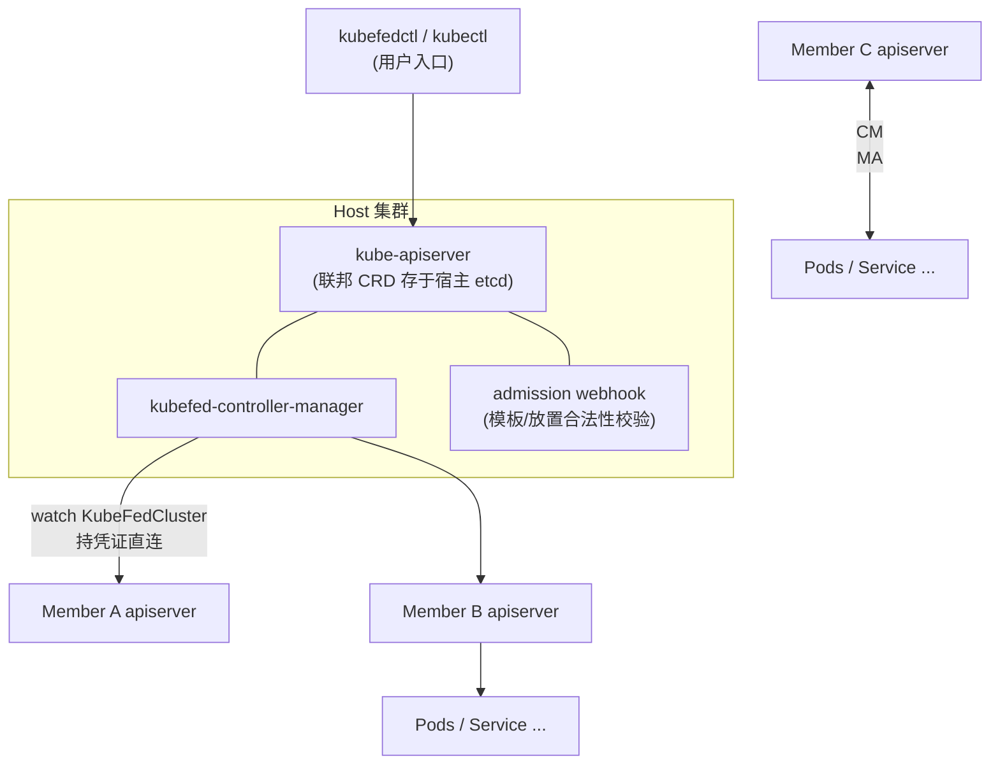
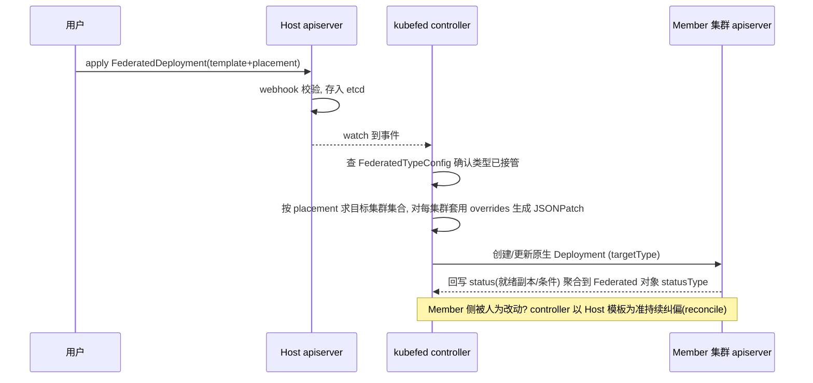

> 《Knative》系列之后，本篇把视角从"单集群内的弹性"拉到"多集群之间的分发"。KubeFed（Federation v2）曾是 Kubernetes SIG 官方出品的集群联邦方案：在 Host 集群里写一份"联邦资源"，controller 自动把它铺到 N 个 Member 集群。它的设计思想（Template/Placement/Overrides 三段式）影响了后来几乎所有多集群项目，但它本身**已于 2023 年被官方归档（repository archived）**。本文既讲清楚它"怎么工作"，也讲明白它"为什么死掉"、以及今天该用什么替代——读完你应该能评估存量 KubeFed 集群的迁移风险，也能理解多集群编排这一层的通用抽象。负载均衡与流量层的单集群视角，可对照姊妹篇《Kubernetes Service 四层负载均衡》；弹性调度层可回看《Knative》系列。
>
> 口径说明：版本锚定 KubeFed **v2（types.kubefed.io/v1beta1，末版 v0.10.0）**；原仓库 `kubernetes-sigs/kubefed` 已迁移至 `kubernetes-retired/kubefed` 并归档为只读。文中"社区现状/替代方案"信息以 2023 年归档公告与 SIG Multicluster 现状为准，性能数值为机制性说明与经验量级，非某集群实测。

---

# 第 0 章：全景链路

```text
 用户/kubefedctl ──kubectl apply──▶ ┌────────────── Host 集群 ──────────────┐
                                   │ kube-apiserver + etcd                  │
                                   │  ├─ FederatedTypeConfig (类型开关)      │
                                   │  ├─ FederatedDeployment/ConfigMap/...  │
                                   │  │    spec: template + placement + overrides
                                   │  ├─ KubeFedCluster (成员注册表)          │
                                   │  └─ ReplicaSchedulingPreference (副本编排)
                                   │  kubefed-controller-manager ── watch/reconcile
                                   │  kubefed admission webhook  ── 准入校验
                                   └───────┬──────────────┬───────────────┬──┘
                                    JSONPatch 下发   状态回传(sync)   凭证/健康探测
                                     ▼                  ▼               ▼
                              Member 集群 A       Member 集群 B     Member 集群 C
                              (真实 Deployment,   (真实 Deployment,  (真实 Deployment,
                               Service, Pod...)    副本数被 override)  按 RSP 分配副本)
```

一句话主线：**KubeFed 不做调度、不搬 Pod，它做的是"配置分发"——把 Host 集群里的一份 API 对象，按 placement 和 overrides 翻译成各 Member 集群里的原生对象，再把状态同步回来。**

---

# 第 1 章：基础概念——从 Federation v1 的覆辙说起

## 1.1 是什么、解决什么问题

**KubeFed（Kubernetes Cluster Federation v2）** 是运行在一个 Host 集群上的控制平面，用一组 CRD 描述"资源应该出现在哪些成员集群、各自要做哪些本地化修改"，由 controller 完成跨集群的对象同步与状态聚合。典型动机：

- 突破单集群规模瓶颈（APIServer/etcd 容量上限，节点数万级即吃紧）；
- 控制故障爆炸半径（单集群误操作/升级事故不至于全域瘫痪）；
- 就近部署降低延迟、合规分区（数据不出境）、混合云/多云容灾。

## 1.2 v1 为什么被废弃（对照着理解 v2 的设计取舍）

| v1 痛点 | v2 的回应 |
|---------|----------|
| 独立的 federation-apiserver + 独立 etcd，运维成本高 | **删掉独立 API Server**，联邦对象全部做成 Host 集群的原生 CRD，复用 kube-apiserver/etcd |
| 新增资源类型要写 Adapter 改代码 | 任意资源用 `FederatedTypeConfig` 声明式接管，无需改 controller 源码 |
| 不支持 RBAC 等集群级权限模型 | 权限下沉给各 Member 集群自己管，Host 只管分发 |
| 策略靠 Annotations 表达，脆弱 | 独立的 Placement/Overrides 结构化字段 |

v1 在 K8s v1.6 时代进过 Beta 后停步不前，约 v1.11 起被官方弃用；v2 由 SIG Multicluster 接手重构，长期停留在 **v1beta1**——这个"长期 beta"本身已是社区投入不足的信号（详见第 7 章）。

---

# 第 2 章：核心架构与组件职责



| 组件 | 职责 | 部署位置 |
|------|------|---------|
| kube-apiserver (Host) | 暴露 `core.kubefed.io` 与 `types.kubefed.io` 两组 CRD | Host |
| kubefed-controller-manager | 核心调和循环：类型接管、资源分发、状态同步、副本编排 | Host |
| admission webhook | 校验 Federated 对象的 template/placement/overrides 合法性 | Host |
| kubefedctl | CLI：`init` 装控制面、`join/unjoin` 注册成员、`federate` 把已有原生资源转联邦对象 | 运维机器 |
| KubeFedCluster (CR) | 成员集群注册表：API Endpoint、CA、ServiceAccount 凭证、健康状态 | Host |
| FederatedTypeConfig (CR) | 声明"哪种原生资源被联邦化"及其 federated/target/status 类型映射 | Host |

注意角色关系：**Host 也可以同时作为一个 Member 加入联邦**；Member 集群对 KubeFed 无感知，装 agent 是不需要的——这正是"配置分发模型"和"调度器模型"（如 Karmada/OCM 有 agent 流派）的关键分野。

---

# 第 3 章：工作原理——一份 Deployment 的跨集群旅程

## 3.1 分发全时序



## 3.2 三段式数据模型（本篇最值得带走抽象）

```yaml
apiVersion: types.kubefed.io/v1beta1
kind: FederatedDeployment
metadata: {name: web, namespace: prod}
spec:
  template:                      # ① 基础模板: 一个完整的原生 Deployment
    spec:
      replicas: 3
      template: {spec: {containers: [{name: app, image: nginx:1.27}]}}
  placement:                     # ② 放置: 给谁; 具名列表或 clusterSelector 按标签匹配
    clusters:
      - {name: cluster-bj}
      - {name: cluster-sh}
  overrides:                     # ③ 修正: JSONPatch 式按集群覆写模板字段
    - clusterName: cluster-sh
      clusterOverrides:
        - path: /spec/replicas
          value: 5
        - path: /spec/template/spec/containers/0/image
          value: nginx:1.26        # 例如灾备集群钉旧版本
```

- **Template** 保持"应用长什么样"，**Placement** 回答"铺到哪"，**Overrides** 回答"到每个地方改什么"——三层分离使同一份 YAML 同时表达多云差异（镜像仓库地址、存储类名、副本数、region 标签）。
- 每个被联邦化的原生类型 T 都有一对 CRD：`FederatedT`（用户写）与 controller 生成的 `targetType` 原生对象（Member 里真实生效）；`FederatedTypeConfig` 里的 `federatedType / targetType / statusType` 三元组完成映射，这也是它能覆盖 Deployment、ConfigMap、Secret、Service、Ingress 乃至任意 CRD 的机制。

## 3.3 副本编排：ReplicaSchedulingPreference（RSP）

静态 placement 之外，RSP 提供"总量 N 副本、按策略分摊到各集群"的动态能力：controller 读取各 Member 可用资源/权重/固定比例，算出每集群副本数后**写回 overrides**，从而复用同一条分发通道。局限：仅支持 Deployment/ReplicaSet 类工作负载，且算法插件有限（weighted / split / dynamic-balance）。

---

# 第 4 章：集群部署应用实践

## 4.1 最小可用流程

```bash
# 1) 在 Host 安装控制面 (helm 或 kubefedctl init, 镜像与 chart 均来自 retired 仓库, 版本冻结)
kubefedctl init --kubefed-image-tag v0.10.0 --kubeconfig host.kubeconfig

# 2) 注册成员集群（本质是生成 KubeFedCluster CR + 成员侧 RBAC/ServiceAccount）
kubefedctl join member-bj.kubeconfig --cluster-name cluster-bj --host-cluster-context host --v=2
kubefedctl join member-sh.kubeconfig --cluster-name cluster-sh --host-cluster-context host

# 3) 把已存在的原生资源"联邦化"（自动转 template+placement, 原对象加 owner 引用）
kubefedctl federate deployment web -n prod --host-cluster-context host --source-cluster-context cluster-bj

# 4) 日常运维: 像用 kubectl 一样操作联邦 CRD
kubectl --context host get federateddeployments.types.kubefed.io -n prod
kubectl --context host get kubefedclusters.core.kubefed.io        # 成员健康状态
```

## 4.2 实践要点

| 事项 | 建议 |
|------|------|
| 命名空间 | 联邦对象命名空间必须在各 Member 已存在（KubeFed 不自动建 ns，或联邦化 Namespace 对象） |
| 凭证轮转 | KubeFedCluster 里的 ServiceAccount token 过期=成员失联，纳入定期轮转 |
| 升级 | `template` 更新会全量下发; 逐集群灰度只能靠"先 override 单集群→验证→改模板"手工编排 |
| 排障入口 | controller 日志 + Federated 对象 `status.conditions`（SyncSucceed）+ 事件；`kubefedctl unjoin --dry-run` 看清理影响面 |
| 存量迁移 | `federate` 命令是收编单集群既有应用为联邦管理的最短路径 |

---

# 第 5 章：应用场景与选型对照

| 场景 | KubeFed 适配度 | 说明 |
|------|--------------|------|
| 配置/密钥多集群一致性分发 | 高 | FederatedSecret/ConfigMap 是它最好用的子集 |
| 双集群应用级容灾（非流量级） | 中高 | placement 同时铺两套; 但跨集群流量切换它不管(需 DNS/GSLB/服务网格) |
| 突破单集群规模上限 | 中 | 分发模型可行, 但无全局调度视图, 容量规划靠 RSP 粗粒度做 |
| 混合云/多云差异化部署 | 高 | overrides 天然表达 region 差异 |
| 跨集群服务发现与流量编排 | 低 | v2 从未实现 v1 式的服务发现; 需搭配 ClusterSet API(同样停滞)或外部方案 |
| 需要抢占/亲和/全局调度器语义 | 不适合 | 它不是调度器, 是分发器 |

---

# 第 6 章：性能特性与关键参数

- **规模手感**：分发延迟主要在 controller 对每个 (对象 × 成员) 的 reconcile，正常秒级；实测社区反馈在**成员数十、联邦对象数千**量级开始吃力——controller 单副本 LeaderElection 架构，队列吞吐是硬顶。
- **对 Member 的冲击**：一次模板热变更会放大为 N 个集群的同时写入，注意 Member APIServer 限流（APF）被打满。

| 参数 | 位置 | 默认/建议 | 说明 |
|------|------|----------|------|
| `--controllers` | controller-manager | 全部 | 可只启用 configmap/secret/deployment 等子集，减小面 |
| `--cluster-health-check-period` | 参数 | 约 60s 级 | 成员健康探测间隔 |
| reconcile worker 数 | 控制器内部/特性开关 | 默认偏保守 | 大规模需上调, 但受 Host etcd 写放大约束 |
| FederatedTypeConfig `syncOnlyNotOwnedResources` | 类型配置 | 关 | 只同步非本管对象, 用于灰度接管存量 |
| `disableStoreTemplates` | 类型配置 | 关 | 模板不落 member 注解, 省 etcd 体积但丧失部分自愈 |

---

# 第 7 章：局限缺陷与"项目之死"——本文最重要的章节

## 7.1 产品级缺陷（活着时就有的）

1. **无全局调度**：placement 静态、RSP 弱动态，不感知 Pod 级资源拓扑；与拓扑感知路由（Topology Aware Routing）等单集群特性割裂。
2. **API 税**：用户要学 `FederatedXxx` 这套平行 API，而不是给原生对象加一层策略——这正是社区文章总结的"采用障碍"，也导致各家大厂分叉出互不兼容的内部版。
3. **CRD 双份维护成本**：每接一种新资源都要维护 CRD 定义 + TypeConfig + 控制器逻辑，长尾 CRD 联邦化成本高。
4. **无升级编排**：模板变更一次性下发所有集群，缺内置灰度/分批。

## 7.2 项目现状：已正式归档

- SIG Multicluster 官方公告：仓库迁入 **kubernetes-retired**，转为**只读归档**，不再接受 issue/PR；最后一个发布版本 **v0.10.0**（2022 年），此后无安全补丁。
- 长期停留 v1beta1，API 与社区贡献在 2020 年后实质性停滞；蚂蚁等早期大规模用户已迁移出自建联邦栈。

## 7.3 替代方案矩阵（2026 视角）

| 方案 | 定位 | 与 KubeFed 的关系 |
|------|------|------------------|
| **Karmada** | CNCF 毕业路线的多集群编排, 原生 API 兼容(不引入 FederatedXxx)、PropagationPolicy/Work API、调度器可插拔 | 社区公认的头号继任者, 迁移首选 |
| **Open Cluster Management (OCM/ACM)** | Red Hat 主导的集群管理舰队模型, agent 流派 | 偏"集群即工作负载"的平台化治理 |
| **多集群 Service / ClusterSet** | SIG Multicluster 的跨集群服务发现提案 | 该提案自身也进展有限, 落地多靠商业产品或 Istio 多集群网格 |
| **Argo CD App-of-Applications / Fleet** | GitOps 流派: 用 Git 仓库+ApplicationSet 做多集群分发 | 与"配置分发"心智最接近, 运维团队改造成本最低 |
| **Gate/KubeSphere 多集群、各云厂商舰队实例** | 商业托管 | 买服务替代自维护归档项目 |

**决策建议**：新项目**不要选 KubeFed**；存量 KubeFed 集群应制定退出计划（归档仓库的镜像/chart 源与未修复 CVE 都是长期雷），迁移路径优先评估 Karmada（工作负载联邦）或 Argo CD ApplicationSet（配置分发），两者按团队 GitOps 成熟度取舍。

---

# 第 8 章：核心机制解析（源码思路）

KubeFed 的 controller 族是标准 controller-runtime 风格，值得拆开看三点：

```go
// 1) 通用同步: SyncController 不针对具体资源类型, 靠 FedTypeConfig 驱动
//    reconciler 取 template -> 按目标集群套用 overrides 生成 JSONPatch -> Patch 到 member
func (c *SyncController) reconcileTarget(...) {
    patch := jsonpatch.CreateMergePatch(original, modified) // overrides 本质是 JSONPatch 引擎
    c.memberClient.Patch(targetObj, patch)                   // 幂等重放, 漂移自动纠偏
}

// 2) placement 的"删除语义": 从 placement 摘掉集群 != 删 member 对象,
//    需要 unjoin/federate --do-not-federate 等显式动作, 防止误删业务流量
//    (设计意图: 配置分发器宁可"多活"不可"误杀", 但也因此留下孤儿资源隐患)

// 3) 状态聚合: member 原生对象的 status 被 mirror 回 Federated 对象 statusType,
//    形成"多集群健康视图"——这是它给监控层留下的唯一钩子
```

设计遗产：Karmada 的 `ResourceBinding/Work`、Fleet 的 `Bundle` 都能看出 template+placement+override 三段式的影子——学 KubeFed 的真正价值在于这套抽象，而不是这个已归档的实现。

---

# 附录

## A. 术语速查

| 术语 | 一句话 |
|------|--------|
| Host 集群 | 运行 KubeFed 控制面、承载联邦 CRD 的集群 |
| Member 集群 | 被 join 注册、真实运行工作负载的集群, 无需装 agent |
| KubeFedCluster | 成员注册表 CR: endpoint/CA/凭证/健康 |
| FederatedTypeConfig | 把原生类型 T 映射到 FederatedT 的"接管开关" |
| template/placement/overrides | 三段式: 长什么样 / 铺到哪 / 每地改什么 |
| RSP | ReplicaSchedulingPreference, 总量副本按策略分摊 |
| kubefedctl | init/join/federate 的 CLI 入口 |
| kubernetes-retired | K8s 官方归档组织, KubeFed 现居此处的只读仓库 |

## B. 参考资料

1. [kubernetes-retired/kubefed (GitHub, archived)](https://github.com/kubernetes-retired/kubefed) — 官方归档声明："no longer active development"。✅ 已核实
2. [KubeFed 官方文档站 (冻结版)](https://kubefed.io/) — 架构/CRD/kubefedctl 用法。✅ 已核实
3. [SIG Multicluster 归档讨论(社区博客: Karmada 与 OCM 应对多集群挑战)](https://www.cncf.io/blog/2022/12/16/) — KubeFed EOL 与继任者定位。✅ 已核实
4. [Karmada 官方文档](https://karmada.io/docs/) — 迁移对照与 PropagationPolicy 模型。✅ 已核实

## C. 变更记录

| 日期 | 版本 | 变更内容 |
|------|------|---------|
| 2026-10-29 | v1.0 | 首版：v1 覆辙与 v2 CRD 驱动架构、Host/Member 组件职责、三段式数据模型与分发时序、kubefedctl 实操、场景选型、性能参数、归档现状与 Karmada/OCM/GitOps 替代矩阵、核心同步机制解析，含全景链路图与多处 Mermaid 图 |
