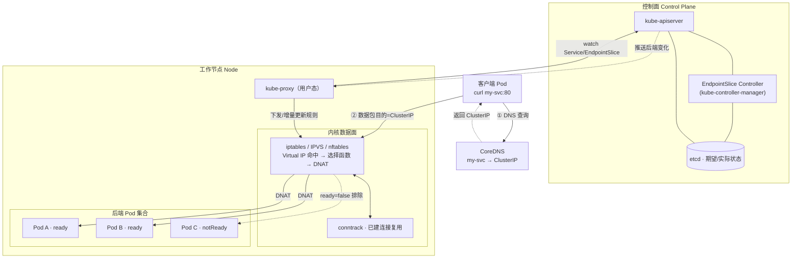
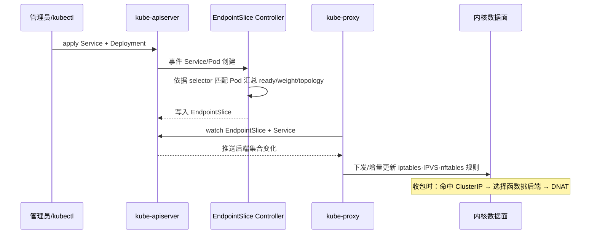
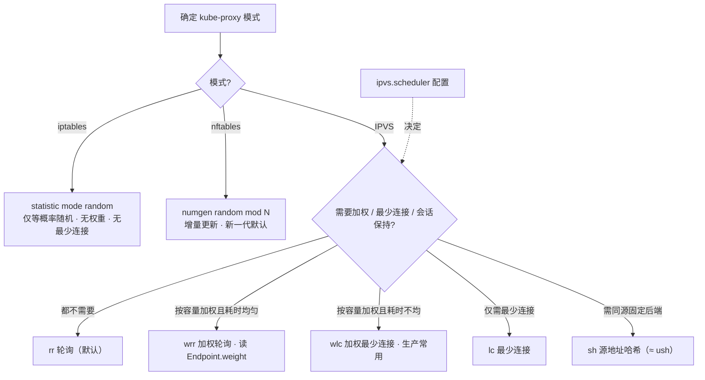

> 姊妹篇《Kubernetes 排障实战系列》讲的是 Service "通不通"——流量在数据路径上被哪一层卡住。本篇讲的是 Service "怎么分"——一个 ClusterIP 请求进来后，kube-proxy 依据什么算法从一堆后端里挑出一个，以及我们如何从 **EndpointSlice、Label、调度算法** 三个入口去改写这个选择结果。
>
> 口径说明：全文以 Kubernetes 1.28+ 为基准，EndpointSlice 自 1.22 GA 起作为唯一后端载体（`Endpoints` API 已废弃）；kube-proxy 三种数据面 iptables / IPVS / nftables 并列讨论；涉及 `trafficDistribution`、`topology-mode` 等新特性处逐条标注 Alpha/Beta/GA，具体行为以本机源码与版本为准，不做经验性断言。

---

# 第 1 章：引言 - Service 四层负载均衡要回答的三个问题

## 1.1 三份账，一条链

Service 的 L4 负载均衡自始至终只在回答三个问题：

1. **该发给谁**——算法侧。一个 Virtual IP 后面挂了 N 个 Pod，这次连接选哪个？随机？轮询？加权？还是按源地址哈希固定？
2. **发给谁还活着**——健康侧。被选中的后端是不是 Ready？连接是不是已经建在旧后端上？（`readinessProbe`、EndpointSlice `conditions.ready`）
3. **能不能更聪明地发**——策略侧。能不能就近（同 Zone / 同 Node）？能不能按业务权重灰度？能不能让同一个用户的会话黏在同一后端？

```text
   该发给谁   → 调度算法：rr / wrr / lc / wlc / sh / dh / maglev
   发给谁还活着 → readiness → EndpointSlice.conditions → 后端集合刷新
   更聪明地发  → 权重 / 拓扑就近 / 会话亲和 / 连接保持
```

> **关键认知**：kube-proxy 做的是**连接级（L4 / L3+L4）**的负载均衡，不是**请求级（L7）**。一旦 TCP 连接建立并被转发到某个后端，这条连接上的**所有后续请求都固定发给同一个后端**——即便后端此刻已经不是最优。这正是"长连接 + HTTP/1.1 keepalive 会让 kube-proxy 轮询严重失衡"这一经典坑的根因，也是 Service Mesh（L7）要解决的问题。

## 1.2 全景：一次 ClusterIP 访问如何选中后端

```text
   应用 curl http://my-svc:80
        │
        ↓
   ① CoreDNS 把 my-svc 解析成 Service 的 ClusterIP（不是 Pod IP！）
        │
        ↓
   ② 数据包发往 ClusterIP，进入本机 netfilter/IPVS 钩子
        │
        ↓
   ③ kube-proxy 事先下发的规则命中该 ClusterIP:Port
        │
        ├── iptables: -m statistic mode random 在 N 个 -j DNAT 目标里随机挑
        ├── IPVS:     按 scheduler(rr/wlc/sh…) 在本地 IPVS 服务表里选一个 real server
        └── nftables: numgen random mod N 选一个后端做 DNAT
        │
        ↓
   ④ DNAT：目的地址 ClusterIP → 选中的 Pod IP
        │
        ↓
   ⑤ 连接/会话被内核 conntrack 记录，后续包复用同一目标
        │
        ↓
   ⑥ 若开了 sessionAffinity=ClientIP：按源 IP 哈希锁定后端（conntrack 之外的额外约束）
```

后文所有"改策略"的手段，本质都是在干预③这一跳的**候选集合**或**选择函数**。

## 1.3 组件位置拓扑（Mermaid）

上面的链路是"时间维度"。换个"空间维度"看：这些角色分别坐在**控制面 / 节点用户态 / 内核数据面 / Pod** 四个位置上，谁 watch 谁、谁给谁下规则、包又在哪一层被改写：



> 读图要点：**控制面只负责"算出后端集合"并写进 etcd/EndpointSlice**；真正把集合变成转发规则、并在收包时选择函数的是**每个节点上的 kube-proxy + 内核数据面**。所以改 label/EndpointSlice 影响的是"候选集合"，改 `ipvs.scheduler` 影响的是内核里的"选择函数"——两者分处不同位置，正交组合。

---

# 第 2 章：基础概念 - 支撑 L4 负载均衡的五个原子

## 2.1 Service 类型与 VIP 从哪来

| 类型 | ClusterIP | 谁做 LB |
|------|-----------|---------|
| ClusterIP | 有 | kube-proxy（集群内 L4） |
| NodePort | 有 | kube-proxy + 节点端口 |
| LoadBalancer | 有 | 云厂商 LB + kube-proxy |
| ExternalName | 无 | 仅 CNAME，不经 kube-proxy |
| Headless（`clusterIP: None`） | **无** | **没有 VIP，DNS 直接返回 Pod IP，LB 下沉到客户端** |

Headless 是唯一**绕过** kube-proxy L4 的类型——它的负载均衡发生在客户端（DNS 轮询）或由 StatefulSet 的稳定网络标识决定。

## 2.2 kube-proxy 三种数据面模式

- **iptables**（经典默认）：`-m statistic mode random` 实现等概率随机。规则数随 Service×后端线性膨胀，大规模集群下全量刷新慢（O(n) 规则重算）。**无加权、无最少连接**。
- **IPVS**（大规模推荐）：内核 LVS 的哈希表实现，后端查找 O(1)，天生支持 rr / wrr / lc / wlc / sh / dh 多种调度算法。适合上千 Service 的场景。
- **nftables**（新一代，逐步替代 iptables）：`numgen random` 做负载均衡，规则增量更新、性能与一致性优于 iptables，是社区明确的未来方向。

## 2.3 EndpointSlice

`discovery.k8s.io/EndpointSlice` 是对"某 Service 的后端地址集合"的分片表示。一个 Service 对应多个 EndpointSlice，每个 slice 最多容纳 100 个 endpoint（可配），解决旧 `Endpoints` API 在大 Service 上的体积与刷新风暴问题。它是 kube-proxy、Service Mesh、Ingress Controller 共同的**后端事实源**。

## 2.4 Session Affinity

`service.spec.sessionAffinity: ClientIP`（默认 `None`）：让同一客户端 IP 在 `timeoutSeconds` 内固定命中同一后端。它在 kube-proxy 里通过额外的哈希/`--` 命中记录实现，**独立于** conntrack 的连接保持。

## 2.5 权重（Weight）

EndpointSlice 中每个 `Endpoint.weight`（0–100，`nil` 视作 1）表达后端的相对容量。**只有加权算法（wrr / wlc）才会真正读它**；rr / sh 等算法忽略 weight。这是"用 label / slice 做灰度分流"的底层抓手。

---

# 第 3 章：工作原理 - 选择函数与候选集合

## 3.1 选择函数 × 候选集合

kube-proxy 把 Service 的行为抽象成两个可变部分：

```text
   选择函数 f(candidateSet, requestContext) → 选中的后端
        ↑                        ↑
   调度算法(可配置)          后端集合(由 label / readiness / topology / weight 决定)
```

- 想改变**发给哪些后端**：动候选集合 → 第 4 章（EndpointSlice）+ 第 5 章（Label）。
- 想改变**从候选里怎么选**：动选择函数 → 第 6 章（调度算法）。

两者正交，组合起来就是本篇的全部可操作面。

## 3.2 服务生效协作时序（Mermaid）

从"apply 一个 Service"到"内核真正能 DNAT"，各组件的控制环协作如下：



## 3.3 数据面模式与算法决策流（Mermaid）

"能不能用某个算法"首先被**数据面模式**卡住——随机是所有模式的公共底座，但 wrr/wlc/sh 只有 IPVS 才有：



> 一句话决策：要随机就 iptables/nftables 够用；要**加权、最少连接、会话保持**必须切 IPVS；要**后端频繁伸缩下仍稳定映射**则上移到 Maglev/一致性哈希（见 6.3）或直接走 L7 网格。

---

# 第 4 章：通过 EndpointSlice 配置修改

对应大纲第一点。EndpointSlice 本身不写"算法"，但它决定**候选集合、后端权重、拓扑归属**——这三样直接改变负载均衡结果。

## 4.1 EndpointSlice 的结构与关键字段

```yaml
apiVersion: discovery.k8s.io/v1
kind: EndpointSlice
metadata:
  name: my-svc-abcde
  labels:
    kubernetes.io/service-name: my-svc       # 归属于哪个 Service
addressType: IPv4
endpoints:
  - addresses: ["10.1.2.3"]                  # Pod IP
    conditions: { ready: true, serving: true }
    weights: {}                              # 可选：per-endpoint 权重
    targetRef: { kind: Pod, name: my-svc-xxx }
    nodeName: node-a                          # 拓扑就近要用
ports:
  - name: http
    port: 8080
    protocol: TCP
```

kube-proxy 监听 `kubernetes.io/service-name` label 拉取本 Service 的所有 slice，把 `ready=true` 的地址汇成后端池。

## 4.2 修改后端集合：改 slice 就是改 LB 池

- **删掉某 endpoint / 置 `conditions.ready=false`**：把该后端移出候选池（等价摘流，常用于排障与手工摘除）。
- **手动增加 endpoint**：可把不在 selector 匹配范围内的地址纳入 LB（自定义网关、外部后端），Headless + 手动 EndpointSlice 是实现"Service 指向外部服务"的标准手法。
- 注意：由 EndpointSlice Controller 自动托管的 slice，手改会被覆盖；自定义场景需给 Service 打 `service.kubernetes.io/service-proxy-name` label 让系统控制器放弃托管（见 5.3）。

## 4.3 后端权重：Endpoint.weight

```text
   weight 范围 0~100，默认视为 1
   仅 wrr / wlc 生效；rr / sh / lc 会忽略
   典型用途：按 Pod CPU/内存规格差异化分配流量；金丝度按权重放量
```

给小规格 Pod 低权重、大规格 Pod 高权重，是加权轮询最直接的应用。weight 由 EndpointSlice Controller 依据 Pod 上的提示生成，或直接编辑 slice。

## 4.4 拓扑就近：topology-mode 与 trafficDistribution

目标是让"同 Zone 的请求优先发给同 Zone 的后端"，减少跨可用区流量与延迟。

- `service.kubernetes.io/topology-mode: Auto`（label，早期为 `topology-aware-hints` 注解）：kube-proxy 依据 endpoint 的 `topology.kubernetes.io/zone` 做区域感知路由，当本区容量不足时回退到全域。
- `.spec.trafficDistribution: PreferNear`（1.33+ Alpha/Beta，早期等价 `PreferSameZone`/`PreferSameNode` 的 hint 演进，以本机版本为准）：比 topology-mode 更细的就近策略，优先级"同 Node > 同 Zone > 同 Region > 全域"。

两者都依赖 slice 里每个 endpoint 的 `topology` 字段与 `nodeName`，因此是"通过 EndpointSlice 修改"的一条主线。

## 4.5 Headless 与客户端侧负载均衡

Headless Service 没有 ClusterIP，DNS 解析直接返回全部就绪 Pod IP：

- 普通客户端：靠 **DNS 轮询 + 连接复用**，负载均衡粒度=连接，且受客户端 DNS 缓存影响极大（长连接会一直黏在第一个 IP）。
- gRPC / 长连接：必须用**客户端 LB**（round_robin pick、重解析），否则 kube-proxy 和 DNS 都救不了它。

---

# 第 5 章：通过 Label 标签修改

对应大纲第二点。Label 是候选集合的"上游开关"——Service 用 selector 选 Pod，控制器用 label 决定 slice 归属与是否被代理。

## 5.1 Service Selector → EndpointSlice 的生成链

```text
   Pod.labels  ──匹配──▶  Service.spec.selector
                              │  (EndpointSlice Controller)
                              ▼
                        EndpointSlice（自动维护）
                              │  (kube-proxy watch)
                              ▼
                     iptables / IPVS / nftables 规则
```

**改 Pod 的 label**，让它命中/脱离 selector → 秒级把 Pod 加入/摘出 LB 池。这是最常用的"打标签摘流量"手法（排障时先给故障 Pod 改 label 摘流，再动探针）。

## 5.2 拓扑标签：zone / region

`topology.kubernetes.io/zone`、`topology.kubernetes.io/region` 由云厂商 CCM 打在 Node 上，Pod 继承 Node 拓扑。拓扑感知路由（4.4）完全依赖这些 label，因此"给 Node 打对 zone 标签"是就近 LB 的前置条件。

## 5.3 `service-proxy-name`：让 kube-proxy 让路

给 Service 打 `service.kubernetes.io/service-proxy-name: <任意值>`，kube-proxy 会**忽略该 Service**（不生成规则）。用于把某些 Service 的负载均衡交给自定义代理或外部 LB——本质是"通过 label 改变谁来选后端"。

## 5.4 通过 Label 做灰度与分流

| 目标 | 手段 |
|------|------|
| 摘除单个后端 | 改 Pod label 脱离 selector，或置 slice `ready=false` |
| 按版本分池 | 两个 Service（stable/canary）用不同 selector 圈不同 Pod，上层按权重聚合 |
| 规格差异化 | 配合 Endpoint.weight，大规格 Pod 承接更多连接 |
| 就近优先 | Node 拓扑 label + topology-mode/trafficDistribution |

> **提示**：Service 层只有 L4 连接级分流。要做**按 Header/百分比**的精确请求级灰度，应上移到 Ingress / Service Mesh（L7），而非在 label/weight 上硬凑。

---

# 第 6 章：进阶调度算法 wrr / wlc / sh / dh 等

对应大纲第三点。这一层改的是"选择函数"。

## 6.1 在哪配：kube-proxy `ipvs.scheduler`

调度算法**只有 IPVS 模式**才可选，通过 `KubeProxyConfiguration` 配置：

```yaml
apiVersion: kubeproxy.config.k8s.io/v1alpha1
kind: KubeProxyConfiguration
ipvs:
  scheduler: wlc          # 默认 rr；可选 rr/lc/wrr/wlc/sh/dh
```

或 kubelet/kubeadm 部署时的 `--ipvs-scheduler=wlc`。iptables / nftables 模式没有算法开关（只有随机），**要 wrr/wlc/sh 必须切 IPVS**。

## 6.2 IPVS 支持的核心调度算法

| 算法 | 全称 | 选择依据 | 适用 | 注意点 |
|------|------|---------|------|--------|
| `rr` | Round Robin | 轮转计数 | 后端同构、连接时长均匀 | 忽略 weight；长连接易失衡 |
| `wrr` | Weighted Round Robin | 按 weight 轮转 | 后端异构（规格不同） | 需配 Endpoint.weight |
| `lc` | Least Connection | 当前连接数最少 | 请求耗时不均 | 需周期同步连接计数 |
| `wlc` | Weighted Least Connection | 连接数/weight 比值最小 | **异构 + 耗时不均，生产最常用** | 依赖准确连接数 |
| `sh` | Source Hash | 源 IP 哈希 | 会话保持 / 缓存局部性 | 同"ush/源哈希"，见下 |
| `dh` | Destination Hash | 目的 IP 哈希 | 特定分片场景 | 均衡性弱 |

> 大纲里的 "ush" 对应 **源地址哈希类**算法（`sh` = source hash，等价 LVS 的 `sh`）。它把同一客户端 IP 恒定映射到同一后端，效果近似 `sessionAffinity: ClientIP`，但**由哈希而非 conntrack 实现**，后端增减时会有部分键重映射。

## 6.3 一致性哈希与 Maglev

普通 `sh`/`dh` 的致命弱点：后端数量变化时，几乎所有哈希键都会重新映射 → 大面积缓存失效 / 会话漂移。**一致性哈希**把扰动限制在相邻节点。

- **Maglev**（Google 的查找表算法）：Cilium 的 `loadBalancer.algorithm: maglev`、部分 Mesh 的 `RING_HASH`/`MAGLEV` 都基于此，用一张 `hashTableSize`（取质数）查找表，增删后端只重写极小比例槽位。
- **ring hash（哈希环）**：Envoy/Istio 的 `LB_POLICY.LOCALITY` + `consistentHash`，虚拟节点平滑负载。

适用：**需要"同 key 稳定命中 + 后端频繁伸缩"** 的场景，如带本地缓存的会话、分片写入。

## 6.4 L4 与 L7 算法对照

| 层次 | 单位 | 典型算法 | 代表实现 |
|------|------|---------|---------|
| L4（本篇） | TCP 连接 | rr/wrr/lc/wlc/sh/dh/maglev | kube-proxy IPVS / Cilium |
| L7（网格/Ingress） | HTTP 请求 | least-request / P2C / 请求级一致性哈希 | Envoy / Istio / HAProxy |

连接级 vs 请求级 的差异，决定了"长连接、多路复用 gRPC、HTTP/2"场景下 L4 会失真，需要上移 L7 或客户端 LB。

---

# 第 7 章：设计思想 - 三层可组合的正交模型

```text
   ┌──────────────────────────────────────────┐
   │  选择函数层   ipvs.scheduler / maglev       │  ← 第6章：怎么在候选里挑
   ├──────────────────────────────────────────┤
   │  候选集合层   EndpointSlice(weight/topology)│  ← 第4章：有哪些候选、多重、在哪
   ├──────────────────────────────────────────┤
   │  归属控制层   Label(selector/proxy-name)     │  ← 第5章：谁来维护、谁被纳入
   └──────────────────────────────────────────┘
```

设计原则：

1. **声明式**：只描述期望的后端集合与算法，控制环自动收敛（改 label → controller 改 slice → kube-proxy 改规则）。
2. **正交可组合**：算法、权重、就近、亲和四件事互不耦合，可单独开关。
3. **连接级为底，请求级上盖**：L4 是默认兜底，精确分流交给 L7，避免用 L4 硬凑语义。

---

# 第 8 章：应用场景与选型

## 8.1 该用哪种策略

| 场景 | 推荐组合 |
|------|---------|
| 中小规模、后端同构 | iptables/nftables + 随机即可 |
| 大规模（千级 Service） | IPVS + `rr` 或 `wrr` |
| 后端规格异构 | IPVS + `wrr` / `wlc` + Endpoint.weight |
| 请求耗时差异大 | IPVS + `wlc`（加权最少连接） |
| 会话/缓存局部性 | `sessionAffinity: ClientIP` 或 IPVS `sh` |
| 跨可用区降延迟/降成本 | topology-mode `Auto` / `trafficDistribution: PreferNear` |
| 后端频繁伸缩 + 稳定映射 | Maglev / 一致性哈希（Cilium / Mesh） |
| 精确按 Header/百分比分流 | 上移 Ingress / Service Mesh（L7），别在 L4 硬做 |

## 8.2 反模式

| 反模式 | 后果 |
|--------|------|
| gRPC/长连接依赖 kube-proxy 轮询 | 流量全压第一个后端，严重失衡 |
| 只给 Service 配 `wrr` 却不设 Endpoint.weight | weight 全默认，退化成 rr |
| 手改系统托管 EndpointSlice | 立刻被 controller 覆盖，白改 |
| 用 iptables 模式想找"最少连接" | iptables 根本没有该算法，必须切 IPVS |
| 拓扑就近但 Node 没打 zone 标签 | topology-mode 无数据，静默回退全域 |
| 会话保持只看 sh 不看后端伸缩 | 扩缩容时大面积会话漂移 |

---

# 第 9 章：性能参数

以下为常见部署下的量级参考，非 SLA。

| 项 | 指标 | 典型量级 / 说明 |
|----|------|----------------|
| iptables 规则规模 | Service×后端 → 规则条数 | 万级规则，全量刷新可达秒级 |
| IPVS 后端查找 | 单次选择延迟 | 哈希 O(1)，微秒级 |
| IPVS 适用规模 | 稳定 Service 数 | 数千~上万，优于 iptables |
| wlc 准确性 | 连接数同步 | 依赖周期 sync，突发下短暂偏估 |
| sh/dh 会话稳定 | 后端变化重映射比例 | O(全部)，一致性哈希可降到 ~1/N |
| Maglev 表 | hashTableSize | 取质数，内存换稳定 |
| trafficDistribution | 就近收益 | 跨 AZ 流量显著下降，本区不足时回退全域 |
| conntrack | 每条连接占用 | 高并发大 Service 易打满 `nf_conntrack_max` |

**规模建议**：Service/后端数量大时优先 IPVS 或 nftables；高并发短连接注意 conntrack 表容量与 `nf_conntrack_tcp_timeout_established`。

---

# 第 10 章：问题、缺陷与解决方案

## 10.1 长连接让 L4 轮询失真

**缺陷**：连接级 LB 对 keepalive/HTTP2/gRPC 无效。
**解决**：客户端侧 LB（gRPC round_robin + 周期重解析）或上移 L7（Mesh 的请求级 least-request）；控制单连接请求数（连接池 max requests 上限触发重连）。

## 10.2 算法与权重不匹配

**缺陷**：`rr`/`sh` 忽略 weight，异构后端配了权重也不生效。
**解决**：需要按容量分配就用 `wrr`/`wlc`，并确认 EndpointSlice 里 weight 已被 controller 正确写入。

## 10.3 会话保持与弹性伸缩冲突

**缺陷**：`sh`/`sessionAffinity` 在后端增减时大面积重映射。
**解决**：一致性哈希（Maglev / ring hash）降低扰动面；`sessionAffinity` 设合理 `timeoutSeconds` 而非 0（永久）。

## 10.4 拓扑就近的容量倾斜

**缺陷**：`PreferNear`/`topology-mode` 在本区后端不足时可能过载热区。
**解决**：确保回退阈值正确（Auto 会在本区健康后端 < 全域 1/2 时回退）；配合 HPA 让本区容量跟随本区流量。

## 10.5 iptables 刷新风暴

**缺陷**：大规模 Service 下 iptables 全量重算导致规则下发慢、抖动。
**解决**：切换 IPVS 或 nftables；EndpointSlice 本身就为降低刷新粒度而生，配合使用。

## 10.6 可观测盲区

**缺陷**：kube-proxy 不做 L7，看不到请求级错误率与分布是否真的均匀。
**解决**：结合 `kube_proxy_*` 指标 + 后端 Pod 侧连接数/请求数分布交叉验证"是否均衡"；真正的请求级观测交给 Mesh/Ingress。

---

# 附录：术语速查

| 术语 | 释义 |
|------|------|
| ClusterIP | Service 的虚拟 IP，非任何网卡真实地址，由 kube-proxy 拦截 |
| EndpointSlice | 后端地址集合的分片表示，kube-proxy/网格的共同事实源 |
| IPVS | 内核 LVS，哈希表实现的高性能 L4 转发，支持多种 scheduler |
| wrr / wlc | 加权轮询 / 加权最少连接，唯二读取 Endpoint.weight 的算法 |
| sh / dh | 源地址哈希 / 目的地址哈希（"ush" 即源哈希类） |
| Maglev | Google 一致性哈希查找表算法，增删后端仅重映射极小比例 |
| sessionAffinity | Service 层的 ClientIP 会话亲和，基于 conntrack 之外的哈希锁定 |
| topology-mode / trafficDistribution | 拓扑感知 / 就近流量分发（PreferNear 等） |
| service-proxy-name | 让 kube-proxy 忽略该 Service 的 label，转交自定义代理 |
| Headless Service | `clusterIP: None`，DNS 直接返回 Pod IP，LB 下沉客户端 |
| conntrack | 内核连接跟踪表，维护已建立连接的 DNAT 复用 |
