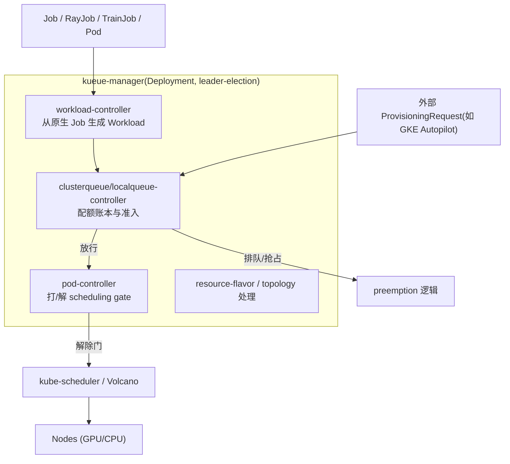

> 《批调度三部曲》第 1 篇。Kueue 是 Kubernetes SIG-Scheduling 主导的**作业级队列管理器**，它的定位常被误解为"又一个调度器"——恰恰相反，Kueue **不替代 kube-scheduler**，而是站在它前面做"准入裁决"：一个 Job/RayJob/训练任务什么时候被放行、能占哪个队列的多少配额、要不要为它抢占别人。这套"先准入后调度"的分层，让 Kueue 能与默认调度器、autoscaler、甚至 Volcano 共存，也成了 2026 年 GPU 集群"资源怎么排队"这条线上的社区默认答案之一（Google 13 万节点 GKE 集群的训练/微调即靠 Kueue 做 gang 与抢占）。本篇讲透 Queue/LocalQueue/ClusterQueue/ResourceFlavor/Cohort 五对象、waitForPodsReady 的 all-or-nothing 语义、ProvisioningRequest 真 gang、公平共享与拓扑感知（TAS），并与姊妹篇《Volcano》《Koordinator》给出选型三角。
>
> 口径说明：版本锚定 **Kueue v0.1x 系列（API 以 v1beta1 为主，随版本向 v1 收敛）**；关键事实：v0.19 将未显式配置时的 waitForPodsReady 默认超时收紧为 30m（升级前须检查长拉镜像/挂载任务）；K8s 1.35 引入原生 PodGroup/Workload（KEP-4671，alpha 默认关闭），但生产 gang 仍依赖 Kueue/Volcano 这类成熟方案。性能数字为经验量级。

---

# 第 0 章：全景链路

```text
 提交作业(带 label kueue.x-k8s.io/queue-name)  Job / RayJob / TrainJob / Pod / StatefulSet
                     │
        ┌───────────▼──────── Kueue(准入层, 站在 kube-scheduler 之前) ────────┐
        │ 本地队列 LocalQueue(命名空间) ──▶ 集群队列 ClusterQueue(全局配额)     │
        │            └── Cohort(队列组, 可借用 idle 配额)                       │
        │ ResourceFlavor(硬件画像: GPU型号/拓扑/污点)                           │
        │ 准入控制器: 有配额吗? → 放行(去挂调度门) / 排队(等) / 抢占(挤掉低优)   │
        │ waitForPodsReady: 放行后限时等全部 Pod 就绪, 超时→取消准入 重排         │
        │ ProvisioningRequest(ACC): 真 gang — 凑不齐整组资源就不开闸             │
        │ TAS 拓扑感知: 按机房/交换机层级为 Pod 组选通信最优的节点域             │
        └───────────┬────────────────────────────────────────────────────────┘
              解除调度门(scheduling gate)后交给下层
                    ▼                          ▲
             kube-scheduler / Volcano ── 实际 bind Pod 到 Node ── 状态回传
```

一句话主线：**Kueue 决定"作业何时被允许存在"，kube-scheduler 决定"每个 Pod 落到哪台机器"；Kueue 用配额+优先级+公平+gang+拓扑这五把尺子，在作业粒度上治理一整个 GPU/CPU 资源池。**

---

# 第 1 章：基础概念——为什么单集群调度器不够用

## 1.1 问题起点：AI 负载打穿了 kube-scheduler 的假设

原生调度器是 **Pod 中心、尽力而为**的：它逐个 Pod 决策，不理解"这 512 个 Pod 其实是一个原子作业"。后果在训练场景致命——

- **部分调度死锁**：A 作业 512 Pod 只调度上 400 个就卡住占着卡等余下 112 个，B 的小 Pod 见缝插针把零散卡吃光，两边都饿死；
- **无配额/公平**：多团队抢一张 GPU 网, 没有"每组保底、闲时可借"的账本；
- **无准入**：作业一旦 `kubectl apply` 就开始建 Pod、就开始排队占资源, 平台无法"先拒后放"。

## 1.2 Kueue 的分层答案

Kueue 在 Pod 之上引入 **Workload（作业）**抽象与一层**准入闸门**：作业先申请、Kueue 按配额与全局资源决定放不放行；放行了才解除 Pod 的 scheduling gate、交给调度器。它**不抢 kube-scheduler 的活**，因此能与默认调度器、cluster-autoscaler、甚至另一个批调度器（Volcano）叠加使用——这正是它与"替换默认调度器"路线的本质区别。

| 能力 | Kueue 的落地 |
|------|-------------|
| 配额与多租户 | ClusterQueue(硬配额) + Cohort(借用) + 层级队列 |
| Gang(all-or-nothing) | waitForPodsReady(时限版) / ProvisioningRequest(真原子) / 原生 PodGroup(演进中) |
| 抢占与回收 | 同队列抢占 + cohort 内 reclaim(把被借走的要回来) |
| 公平共享 | Fair Sharing(按权重分资源, 非硬配额) |
| 拓扑感知 | TAS: 按 block/pod/domain 层级选通信最优域 |
| 弹性 | Elastic Workloads(Ray 动态 worker)、Workload 优先级 |

## 1.3 核心对象速览

| 对象 | 作用域 | 一句话 |
|------|--------|--------|
| Workload | 命名空间 | Kueue 对"一个作业"的内部表示(自动从 Job/RayJob 等生成) |
| LocalQueue | 命名空间 | 团队/命名空间的收件箱, 指向某 ClusterQueue |
| ClusterQueue | 集群 | 全局配额账本: 每类资源多少 nominalQuota、能否借用 |
| ResourceFlavor | 集群 | 硬件画像(GPU 型号、拓扑、污点容忍), 区分 A100/H100/MIG |
| Cohort | 集群 | 一组 ClusterQueue, 共享 idle 配额与抢占域 |
| AdmissionCheck/ProvisioningRequest | 集群 | 放行前的外部就绪校验(如 autoscaler 扩容到位) |
| Topology | 集群 | 数据中心网络层级, 供 TAS 使用 |

---

# 第 2 章：核心架构与组件职责



| 组件 | 职责 | 关键点 |
|------|------|--------|
| kueue-manager | 全部控制循环, 单 Deployment 多控制器 | LeaderElection 高可用; `manager` 配置见 `kueue-manager-config` CM |
| pod-controller | 给受管 Pod 加 `kueue.x-k8s.io/pod-suspend`/scheduling gate, 准入通过后解除 | 这是"准入而非调度"的技术落点 |
| clusterqueue controller | 维护配额、就绪资源、admission 状态机 | 配额变更即时影响排队决策 |
| 集成适配 | Job/CronJob/Argo Workflows/Kubeflow/Ray/MPI/LeaderWorkerSet 各一 Dialect | "不改业务镜像"接入多种框架的关键 |

**Kueue 不改工作负载本身**：它靠 mutating webhook 给提交上来的 Job 打 `queue-name`、把 `suspend` 字段握在手里, 由准入结果决定挂起还是放行——所以 Kueue 是**旁路治理**, 存量作业几乎零改造接入。

---

# 第 3 章：工作原理——准入、Gang 与抢占

## 3.1 一次训练作业的准入时序

```mermaid
sequenceDiagram
    participant U as 用户
    participant J as Job(webhook 挂起)
    participant K as kueue 准入
    participant S as kube-scheduler
    participant N as Nodes
    U->>J: apply(带 queue-name 标签)
    J->>K: Kueue 生成 Workload, 挂起(suspend=true)
    K->>K: 查 ClusterQueue 配额/Cohort 借用/优先级
    alt 配额够且资源可预留
        K->>J: 放行(suspend=false), 解除 Pod scheduling gate
        J->>S: Pod 进入常规调度
        S->>N: bind 到 GPU 节点
    else 不足
        K->>K: 排队; 若有更低优可抢占则 preempt/reclaim
        Note over K: 或触发 AdmissionCheck 等 autoscaler 扩卡
    end
```

## 3.2 all-or-nothing 的两档实现

Kueue 对 gang 语义提供**由弱到强**两条路：

| 机制 | 语义 | 适用 |
|------|------|------|
| `waitForPodsReady` | 放行后限时(如 30m)等全部 Pod 就绪; 超时→取消准入、挂起、重排 | 与 autoscaler 配合, "尽量凑齐"的软 gang |
| `ProvisioningRequest`(ACC) | 经 autoscaler 的 PodSet 预置,**凑不齐整组就不开闸** | 真 gang, 需 cluster-autoscaler ProvisioningRequest API |
| 原生 PodGroup(KEP-4671) | K8s 内建 gang, Kueue 未来对接 | 1.35 alpha, 尚不作为生产依赖 |

> 陷阱：v0.19 起未配置时默认 waitForPodsReady 超时=30m——**长拉镜像/初始化挂载数据**的重型任务可能误触发超时被重新排队。上线前务必按业务真实就绪时长显式设定 `recoveryTimeout`/超时，别用默认。

## 3.3 配额、借用与抢占

- **nominalQuota**：队列的保底份额；**borrowingLimit**：最多能借 cohort 里别人闲置的量；**reclaimWithinCohort**：当自己的保底被借走时, 能否用抢占把资源要回来。
- **抢占两型**：`preemption` 与 `reclaimWithinCohort`（Never/LowerPriority/Any），跨队列抢占按 Workload 优先级；被抢占的作业会重新回队列排队。
- **Fair Sharing**：不设硬配额时按权重比例动态分配全局空闲资源, 适合"配额弹性大、团队多"的共享池。

## 3.4 ResourceFlavor 与 TAS：贴合 GPU 现实

```yaml
apiVersion: kueue.x-k8s.io/v1beta1
kind: ResourceFlavor
metadata: {name: h100-nvlink}
spec:
  nodeLabels: {accelerator: nvidia-h100}
  tolerations: [{key: nvidia.com/gpu, operator: Exists, effect: NoSchedule}]
```

一个 ClusterQueue 可挂多个 Flavor, Kueue 会为作业挑"配额满足 + flavor 可放置"的组合——这是区分 A100/H100、整卡/MIG 切片的抓手。**TAS** 进一步在 flavor 上声明 `topologyAssignment`（按 `Topology` 对象的机房/交换机层级），调度时优先把同一作业的 Pod 塞进通信最优的最小网络域, 对 all-reduce 这类强耦合训练尤其实用。

---

# 第 4 章：安装、接入与生产参数

## 4.1 最小可用流程

```bash
# 安装(不替换默认调度器, 叠加使用)
kubectl apply --server-side -f https://github.com/kubernetes-sigs/kueue/releases/latest/download/manifests.yaml
# 定义资源画像与配额
kubectl apply -f resource-flavor.yaml -f cluster-queue.yaml -f local-queue.yaml
# 提交作业: 打上队列标签即可被 Kueue 接管
kubectl create -f training-job.yaml -l kueue.x-k8s.io/queue-name=trainers
kubectl get workloads -w        # 观察准入/排队状态
```

## 4.2 关键配置速查（`kueue-manager-config`）

| 参数 | 默认/建议 | 说明 |
|------|----------|------|
| `waitForPodsReady.timeout` | 60s→v0.19 未配置默认 30m | 软 gang 等待上限, 按业务就绪时长显式设 |
| `waitForPodsReady.blockAdmission` | false | 未就绪是否挡住后续同类准入 |
| `requeuingStrategy` | 尾部/头部 | 被抢占/超时后重排头还是排尾(公平) |
| `preemption.reclaimWithinCohort` | Never | 组内回收策略 |
| `admissionChecks` | 空 | 接 autoscaler/自定义就绪校验 |
| `namespaceLabelSelector` | — | 限定 Kueue 管理的命名空间范围 |

## 4.3 落地顺序（社区最佳实践）

第一周只接离线评测类轻任务记录基线等待时间与失败原因；第二周引入团队 LocalQueue + GPU Flavor 但暂不启用抢占；第三周配置公平共享、waitForPodsReady 与告警；最后再接高成本训练与 MultiKueue（跨集群找容量）。**渐进引入**能把"调度策略变更打爆在跑作业"的风险摊薄。

---

# 第 5 章：场景、局限与选型三角

## 5.1 适合 / 不适合

**适合**：GPU/CPU 批资源的**多租户配额治理**、ML 训练/微调/批推理的 gang 与抢占、与在线服务分时共池、需要"准入而非替换调度器"的低侵入演进、Kubeflow/Ray/Argo Workflows 等框架统一排队。
**不适合**：需要极端复杂的任务间拓扑/依赖编排（Volcano 的 plugin 生态更厚）、在线低延迟服务调度（那是默认调度器/Koordinator QoS 的活，见《Koordinator》篇）、纯单团队无配额诉求（Kueue 反成负担）。

## 5.2 已知局限

- **gang 依赖外部件**：真 all-or-nothing 需 cluster-autoscaler ProvisioningRequest 或未来的原生 PodGroup, 单装 Kueue 只有"软 gang"；
- **配置面宽**：Cohort/借用/抢占/Fair Sharing 组合多, 参数配错会出现"饿死某队列"或"抢占风暴", 需要观测 `kueue_*` 指标回归调参；
- **准入与调度解耦的代价**：Kueue 放行后仍可能被 kube-scheduler 挡住（节点碎片）, 排障要跨两层看。

## 5.3 批调度选型三角

| 维度 | Kueue | Volcano | Koordinator |
|------|-------|---------|-------------|
| 定位 | 作业级**准入队列** | 批/AI **独立调度器**(替换默认) | **QoS 混部**+调度增强 |
| 是否替换 kube-scheduler | 否(叠加) | 是(schedulerName: volcano) | 增强(自带 koord-scheduler) |
| Gang | waitForPodsReady/ACC | 原生 PodGroup minMember, 一等公民 | Gang 插件(Strict/NonStrict) |
| 主战场 | 配额/公平/多租户准入 | 大数据/HPC/训练复杂编排 | 在离线混部/资源超卖/QoS 保障 |
| 组合 | 常与 Volcano/默认调度器搭配 | 独立成栈 | 可与 Kueue 分工(准入 vs 单机 QoS) |

> 经验法则：**先问"我要的是排队治理(Kueue)、还是重编排调度器(Volcano)、还是单机混部 QoS(Koordinator)"**——三者可叠加而非互斥, 2026 年"标准答案"常是 `DRA 管资源 + Kueue/Volcano 管排队`。

---

# 附录

## A. 术语速查

| 术语 | 一句话 |
|------|--------|
| Workload | Kueue 对一个作业的内部表示, 准入的最小单位 |
| ClusterQueue / LocalQueue | 全局配额账本 / 命名空间收件箱 |
| Cohort | 一组队列, 可互相借用闲置配额 |
| ResourceFlavor | 硬件画像(GPU 型号/拓扑/污点), 让配额贴着真实机器 |
| all-or-nothing / gang | 整组 Pod 要么一起跑要么都不占资源 |
| waitForPodsReady | 放行后限时等全部就绪的软 gang 机制 |
| ProvisioningRequest(ACC) | 经 autoscaler 预置、凑不齐不开闸的真 gang |
| reclaim | 把自己的保底配额从借用者手里抢占回来 |
| TAS | 按网络拓扑层级为 Pod 组选通信最优域 |

## B. 参考资料

1. [Kueue 官方文档](https://kueue.sigs.k8s.io/docs/) — Concepts、waitForPodsReady、TAS、Fair Sharing、MultiKueue。✅ 已核实
2. Google《How we built a 130000-node GKE cluster》(2025-11) — Kueue 做 gang + 抢占支撑大规模训练。✅ 已核实
3. 《用 Kueue v0.19 构建 AI 批任务治理闭环》(2026-07) — v0.19 默认 30m 超时与渐进上线顺序。✅ 已核实
4. Kubernetes KEP-4671 Gang Scheduling 与 1.35 原生 PodGroup(alpha) 现状。✅ 已核实
5. 姊妹篇：《【Volcano】基础应用实践》《【Koordinator】基础应用实践》《【Karmada】基础应用实践》。✅ 站内

## C. 变更记录

| 日期 | 版本 | 变更内容 |
|------|------|---------|
| 2026-10-29 | v1.0 | 首版：AI 负载打穿原生调度器的动因、准入而非调度的分层定位、五核心对象、准入/Gang/抢占/借用/TAS 机制、waitForPodsReady 默认超时陷阱、ResourceFlavor 接入与渐进上线顺序、与 Volcano/Koordinator 选型三角，含全景链路与多处 Mermaid 图 |
