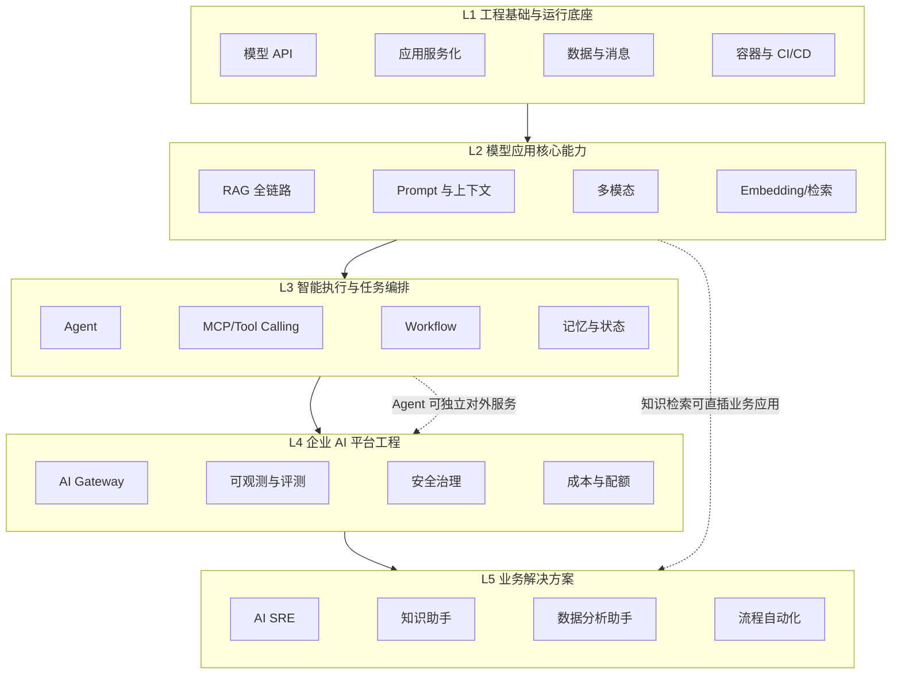
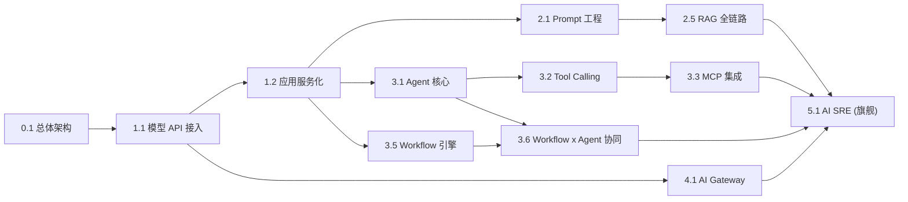

> 本篇是《LLM 应用工程化》系列的**第 0 篇·体系总目录**，执行的是整个专题规划的第一阶段交付：一张完整的专题地图。它不展开任何技术正文，而是定义边界、分层、编号、依赖、产物与优先级——后续每一篇专题文档都挂在这张地图上，编号即承诺。体系的选型立场与本站的云原生底座一脉相承：平台层可回看《Knative 基础概念与核心架构》系列（弹性与网关思路在 AI Gateway 专题中直接复用），运维自动化主线与《SRE 团队能力建设系列》《K8S 排障系列》互为上下游，Agent 的信任与权限模型则与姊妹篇《智能体可信基础设施平台(ATI)》共享同一套治理框架。
>
> 口径说明：本体系面向**企业生产环境的 LLM 应用工程化**，不覆盖大模型原理、训练算法与论文解读。生态锚点：MCP 协议以 2024-11 首发、2025-03-26 引入 Streamable HTTP、2025-11-25 一周年修订、2026-07-28 无状态架构大修订为时间基线（✅ 已核实），并于 2025-12 移交 Linux 基金会 Agentic AI Foundation 治理（✅ 已核实）；各专题成文时对版本敏感事实逐条联网核验。

---

# 第 0 章：体系全景链路

```text
                       ┌────────────────────────────────────────────────┐
  业务问题             │  L5 业务解决方案  AI SRE / AIOps / DevOps /     │
  「值不值得做」        │  知识助手 / 研发助手 / 数据分析 / 服务台 / 流程自动化 │
                       └───────────────▲────────────────────────────────┘
                       ┌───────────────┴────────────────────────────────┐
  平台能力             │  L4 企业 AI 平台工程  AI Gateway / 版本管理 /     │
  「能不能规模化」      │  多租户配额 / 可观测 / 评测 / 安全治理 / 可靠性 / CI-CD │
                       └───────────────▲────────────────────────────────┘
                       ┌───────────────┴────────────────────────────────┐
  执行编排             │  L3 智能执行与任务编排  Agent / Tool Calling /    │
  「能不能自动干活」    │  MCP / Workflow / 记忆与状态 / 人工审批 / 多 Agent   │
                       └───────────────▲────────────────────────────────┘
                       ┌───────────────┴────────────────────────────────┐
  核心能力             │  L2 模型应用核心能力  Prompt / Token 成本 /       │
  「回答得准不准」      │  Embedding / RAG 全链路 / 权限溯源 / 评测 / 多模态   │
                       └───────────────▲────────────────────────────────┘
                       ┌───────────────┴────────────────────────────────┐
  运行底座             │  L1 工程基础  模型 API 接入 / 应用服务化 /         │
  「跑不跑得起来」      │  数据与消息设施 / 容器化与 CI-CD 基座              │
                       └────────────────────────────────────────────────┘
        横切专题 0.1《LLM 应用总体架构与参考架构》 —— 定义六层边界、组件目录与选型矩阵
```

一句话主线：**这套体系回答的不是"LLM 能做什么"，而是"LLM 应用如何在企业生产环境里可靠、可控、可审计、可算清成本地长期运行"——每一层解决一类工程问题，每一个专题交付一件可复用的工程资产。**

---

# 第 1 章：体系定位与组织原则

## 1.1 是什么、不是什么

| 是 | 不是 |
|----|------|
| 面向企业落地的工程技术体系 | 大模型原理/训练算法百科 |
| 架构设计 + 端到端解决方案 + 工程实现 | 框架 API 学习笔记堆砌 |
| 问题驱动（业务瓶颈 → 方案 → 验证） | 概念驱动（先名词后解释） |
| 区分 PoC / MVP / 生产级三个阶段的能力差异 | 把演示代码当生产方案 |
| 每篇有可验收的工程产物（架构图/模板/清单/基线） | 泛泛而谈的综述文章 |

## 1.2 单篇专题的组织方式

每个专题按同一条证据链组织：**业务问题 → 场景分析 → 解决方案 → 核心架构 → 关键技术 → 工程实现 → 部署运维 → 效果评估**。落地为四块结构（对 16 章完整模板做实用化压缩，不适用的章节须说明原因而非填充）：

1. **问题定义**——解决什么业务问题、现有方案缺口、适用/不适用场景、工程约束；
2. **架构设计**——系统上下文、组件职责边界、数据流/控制流/状态流、正常/异常/降级/人工接管四条路径；
3. **工程实现**——目录结构、依赖版本、核心代码与配置、API/数据模型、本地运行到 K8s 部署的最小可运行→生产级演进；
4. **生产运维**——超时重试幂等限流降级、可观测与审计、评测与回归、成本优化、故障排查与反模式。

## 1.3 三级成熟度基线（贯穿全体系的验收语言）

| 阶段 | 能力特征 | 验收标志 |
|------|---------|---------|
| 演示级 PoC | 单路径跑通、无并发无持久化、密钥硬编码可接受 | "能回答问题"即可 |
| 可交付 MVP | 异常处理/超时重试齐备、有 Trace、权限过滤生效、离线评测过基线 | 可给真实用户小流量使用, 有回滚方案 |
| 生产级系统 | 多租户隔离、配额熔断、灰度发布、在线评测与漂移告警、成本归因、审计合规 | SLA/SLO 签署, 值守与应急演练到位 |

体系内所有"推荐做法"默认以**生产级**为终点，明示每一能力是在哪个阶段引入的。

---

# 第 2 章：五层技术架构



**分层不是强制的单向依赖**：RAG 服务可以直接嵌入 L5 应用而不经过 Agent 层；L3 的 Agent 也可以绕过 L4 网关在 PoC 阶段直连模型（并在生产化清单中作为反模式被纠正）。分层的目的是**职责边界与问题归因**——出问题时能回答"这是哪一层的责任"。

| 层 | 回答的核心问题 | 失败时的典型症状 |
|----|--------------|----------------|
| L1 | 服务跑不跑得起来、连接稳不稳定 | 5xx、超时、队列积压 |
| L2 | 回答得准不准、上下文喂得对不对 | 幻觉、答非所问、上下文丢失 |
| L3 | 任务能不能自动完成、状态会不会丢 | 死循环、半途而废、越权执行 |
| L4 | 多应用能不能规模化、可管可控 | 成本失控、无法排障、审计缺位 |
| L5 | 业务价值是否兑现 | 用户不用、投诉、ROI 为负 |

---

# 第 3 章：专题体系总目录

> 表头统一为：**编号 | 专题 | 核心问题 | 前置依赖 | 工程实践产物 | 优先级**。产物即该专题的"交付承诺"，成文时逐项落实。

## 3.0 横切专题

| 编号 | 专题 | 核心问题 | 产物 | 优先级 |
|------|------|---------|------|--------|
| 0.1 | LLM 应用总体架构与参考架构 | 一个企业级 LLM 应用由哪些组件构成？六层边界、调用链、状态归属怎么划？ | 参考架构图、组件目录、选型矩阵（框架/模型/向量库/网关）、PoC→MVP→生产演进图 | P0 |

## 3.1 L1 工程基础与运行底座

| 编号 | 专题 | 核心问题 | 前置依赖 | 工程实践产物 | 优先级 |
|------|------|---------|---------|-------------|--------|
| 1.1 | 模型服务与推理 API 接入 | 云 API 与自托管(vLLM 等)怎么接、怎么抽象、怎么兼容 OpenAI 协议族？ | — | 统一客户端封装模板、超时/重试/流式处理基类、自建 vs 云 API 对比表 | P0 |
| 1.2 | 应用服务化与工程分层 | 会话、异步任务、队列、API 设计如何分层才不被框架绑架？ | 1.1 | 项目脚手架目录结构、FastAPI 服务模板、异步任务方案对比(线程/队列/工作流) | P0 |
| 1.3 | 数据与消息设施选型 | 向量库、OLTP、对象存储、消息队列在 LLM 应用里的职责怎么切？ | 1.2 | 存储选型矩阵(含规模/过滤/一致性维度)、数据模型 ER 示例 | P1 |
| 1.4 | 容器化与 CI/CD 基座 | GPU 资源、镜像、密钥、环境隔离怎么在 K8s 上落地？ | 1.2 | Dockerfile/Compose/K8s Manifest 模板、密钥管理方案、流水线定义 | P1 |

## 3.2 L2 模型应用核心能力

| 编号 | 专题 | 核心问题 | 前置依赖 | 工程实践产物 | 优先级 |
|------|------|---------|---------|-------------|--------|
| 2.1 | Prompt 工程与上下文管理 | Prompt 作为"可版本化的工程资产"如何设计、测试、管理？ | 1.1 | Prompt 模板规范与变量约定、few-shot/结构化输出模式库、Prompt 单测方法 | P0 |
| 2.2 | Token、上下文窗口与成本控制 | 窗口预算怎么分配？裁剪/压缩/摘要策略怎么选？ | 2.1 | Token 预算分配表、上下文压缩策略对比、成本估算器脚本 | P0 |
| 2.3 | 流式响应、异步任务与会话管理 | SSE/WebSocket 怎么选？长任务的状态机与断线语义？ | 1.2 | 流式协议封装、会话状态存储方案、断点续传设计示例 | P1 |
| 2.4 | Embedding 与向量检索 | 嵌入模型怎么选？相似度、索引(HNSW/IVF)与召回质量关系？ | 1.3 | 嵌入模型评测基线方法、索引参数速查表、召回率调优清单 | P1 |
| 2.5 | RAG 企业知识检索全链路 | 解析→切分→入库→混合检索→重排→生成，每环节的工程要点？ | 2.4 | 文档入库流水线模板、BM25+向量+rerank 混合检索配置、端到端最小可运行示例 | **P0** |
| 2.6 | 权限过滤、租户隔离与知识溯源 | 检索结果如何继承文档 ACL？引用如何落到 chunk 级？ | 2.5, 4.6 | 元数据过滤方案、多租户隔离矩阵、溯源标注格式 | P1 |
| 2.7 | RAG 评测与幻觉治理 | 召回率/答案质量怎么量化？幻觉如何分级治理？ | 2.5 | 评测数据集构建指南、RAGAS 类指标基线、拒答与置信度策略 | P1 |
| 2.8 | 多模态理解与多模态 RAG | 图像/文档/音频如何进同一条检索与生成链路？ | 2.5 | 文档版面解析方案对比、图文混合索引设计、多模态评测方法 | P2 |

## 3.3 L3 智能执行与任务编排

| 编号 | 专题 | 核心问题 | 前置依赖 | 工程实践产物 | 优先级 |
|------|------|---------|---------|-------------|--------|
| 3.1 | Agent 核心架构与运行机制 | ReAct/规划-执行-反思的循环怎么实现？终止条件与预算控制？ | 2.1, 1.1 | Agent 运行时骨架(状态机)、终止/预算策略表、可靠性清单 | **P0** |
| 3.2 | Tool Calling 与工具注册管理 | 工具 schema 定义、注册发现、执行结果校验的最小工程闭环？ | 3.1 | 工具注册中心设计、schema 规范模板、参数校验与结果包装代码 | **P0** |
| 3.3 | MCP 与企业系统集成 | MCP 的 Tools/Resources/Prompts 职责与客户端/服务端架构？与 REST/SDK/Tool Calling 的边界？ | 3.2 | MCP Server 封装模板(对接企业内部系统)、认证与网络隔离方案、协议版本迁移注意项 | **P0** |
| 3.4 | 规划、执行、反思与状态管理 | 长任务怎么拆、断点怎么恢复、中间状态存哪里？ | 3.1, 1.3 | 任务状态持久化模型、checkpoint/恢复实现示例、失败重放设计 | P1 |
| 3.5 | 确定性 Workflow 引擎 | DAG/分支/并行/循环、重试补偿幂等与人工介入怎么工程化？ | 1.2 | 工作流引擎选型对比(Temporal/Argo/LangGraph 类)、DSL 示例、补偿事务模板 | **P0** |
| 3.6 | Workflow 与 Agent 协同架构 | 确定性骨架 + LLM 动态决策的组合边界？人工审批(HITL)怎么嵌入？ | 3.1, 3.5 | 组合架构图、审批流设计、"哪些环节必须确定性"判据表 | **P0** |
| 3.7 | 记忆与上下文工程 | 短期/长期记忆分层？写入、冲突、过期与删除机制？ | 2.2, 2.4 | 记忆存储模型、遗忘/固化策略配置、多租户记忆隔离方案 | P1 |
| 3.8 | 多 Agent 协同与长任务系统 | 角色分工、通信协议、全局终止与成本上界？ | 3.4, 3.6 | 协作拓扑模式库、任务分解示例、失控防护清单 | P2 |
| 3.9 | 工具执行沙箱与操作审批 | 高危操作隔离、最小权限、执行审计怎么落地？ | 3.2, 4.6 | 沙箱方案对比(容器/gVisor/权限降维)、审批工作流、操作审计日志规范 | P1 |

## 3.4 L4 企业 AI 平台工程

| 编号 | 专题 | 核心问题 | 前置依赖 | 工程实践产物 | 优先级 |
|------|------|---------|---------|-------------|--------|
| 4.1 | AI Gateway 与多模型路由 | 统一 API 入口、路由策略、配额限流、熔断降级与成本统计？ | 1.1, 1.2 | 网关部署模板(含 K8s)、路由/降级策略配置、容灾切换演练方案 | **P0** |
| 4.2 | Prompt、模型与知识库版本管理 | AI 资产如何像代码一样版本化、 diff、回滚？ | 2.1, 3.5 | 资产仓库结构、发布流程规范、可复现构建方案 | P1 |
| 4.3 | 多租户、配额与成本分摊 | 租户隔离粒度、配额算法、token 成本如何归因到部门？ | 4.1 | 配额限流实现、成本归因模型与看板指标定义 | P1 |
| 4.4 | LLM 应用可观测性 | Trace 粒度(调用链/span)、指标(延迟/Token/错误)与日志如何关联？ | 4.1 | 观测埋点 SDK 方案、OpenTelemetry GenAI 语义约定落地、看板模板 | P1 |
| 4.5 | 分层评测工程 | RAG/Agent/Workflow 各自的评测指标、离线回归与在线评测怎么建？ | 2.7, 3.1 | 评测数据集规范、CI 中回归门禁配置、漂移检测告警规则 | P1 |
| 4.6 | LLM 应用安全与风险治理 | Prompt 注入(含间接注入)、数据泄露、输出滥用、供应链与合规审计？ | 2.1, 3.3 | 威胁模型清单、输入/输出过滤层设计、红队测试用例集 | P1 |
| 4.7 | 性能、可靠性与成本优化 | 缓存/批处理/并发控制、超时重试熔断降级的参数怎么定？质量-延迟-成本三角怎么权衡？ | 4.1, 4.4 | 韧性参数速查表、优化决策树、压测基线报告模板 | P1 |
| 4.8 | LLM 应用 CI/CD 与发布工程 | Prompt/模型/检索器变更的灰度发布、评测门禁与回滚？ | 4.2, 1.4 | 发布流水线定义、评测门禁通过标准、金丝雀流量方案 | P2 |

## 3.5 L5 业务解决方案

| 编号 | 专题 | 核心问题 | 前置依赖 | 工程实践产物 | 优先级 |
|------|------|---------|---------|-------------|--------|
| 5.1 | AI SRE：告警聚合、故障诊断与受控处置 | K8s/Prometheus/日志/发布平台接入统一 Agent-Workflow：证据关联→根因假设→风险判断→人工审批→处置验证 | 3.6, 4.4, 4.6 | 端到端参考架构、工具集(MCP)封装、处置审批矩阵、误报率基线 | **P1·旗舰** |
| 5.2 | AIOps：日志分析、异常检测与容量预测 | LLM 在时序/日志信号链路上的增量价值边界在哪里？ | 5.1, 4.5 | 场景-能力对照表、日志聚类+LLM 解读实现示例 | P2 |
| 5.3 | DevOps 智能助手 | 代码理解、流水线诊断、发布辅助怎么嵌入现有 CI/CD？ | 3.3, 4.8 | 流水线诊断 Agent 设计、MR 评审助手提示链与评测 | P2 |
| 5.4 | 企业知识助手 | 制度/技术文档问答的权限、溯源与运营闭环？ | 2.5, 2.6, 2.7 | 全链路部署清单、冷启动知识运营 SOP、采纳率度量 | P1 |
| 5.5 | 研发助手：代码库 RAG 与测试生成 | 代码切分、AST 感知检索、生成测试的质量门禁？ | 2.5, 4.5 | 代码索引方案、测试生成验收标准 | P2 |
| 5.6 | 数据分析助手 | 自然语言→SQL→指标解读→报告，错误代价怎么控制？ | 2.5, 3.6 | Schema 链接方案、查询校验层、数字可追溯输出模板 | P2 |
| 5.7 | IT 服务台智能化 | 工单受理、分类、知识匹配与自动处置的分级授权？ | 5.4, 3.9 | 分诊流程图、处置授权分级表、效果运营看板 | P2 |
| 5.8 | 跨系统业务流程自动化 | 审批/数据处理流程中 LLM 节点的可审计性与补偿设计？ | 3.5, 3.6 | 流程改造方法论、补偿事务模板、审计存证方案 | P2 |

---

# 第 4 章：依赖关系与三条工程主线

## 4.1 P0 关键路径依赖图



关键路径读法：**0.1 → 1.x → 2.1/2.5 与 3.1/3.5 → 3.6 → 4.1 → 5.1**，这是体系里最长也最值钱的一条链——走完即可交付第一个生产级场景（AI SRE 的 MVP）。

## 4.2 三条主线与专题映射

| 主线 | 解决的问题 | 覆盖专题 |
|------|-----------|---------|
| 主线一 · LLM 应用开发工程 | 怎么把模型能力变成能跑的应用 | 1.1-1.3, 2.1-2.8, 3.1-3.8 |
| 主线二 · 企业 AI 平台工程 | 怎么让多个 AI 应用稳定、安全、低成本地规模化 | 1.4, 4.1-4.8 |
| 主线三 · AI 驱动的复杂系统自动化 | 怎么把 AI 嵌入运维/研发/业务流程形成可审计闭环 | 3.3, 3.5-3.6, 3.9, 5.1-5.8 |

**主线三是最值得优先深入的方向**：它与本站既有的 Kubernetes 排障、SRE 能力建设、Linux 内核分析等专题天然衔接——AI SRE 专题(5.1)的"证据采集"层直接消费 Prometheus 指标与 K8s 事件，"受控执行"层复用《基于指标的自动摘流保护》已验证的执行-验证闭环思想，并与《智能体可信基础设施平台(ATI)》共同构成 Agent 信任边界的两块拼图。

---

# 第 5 章：优先级与写作批次

| 批次 | 专题 | 目标 |
|------|------|------|
| 第一批 (P0) | 0.1, 1.1, 1.2, 2.1, 2.5, 3.1, 3.2, 3.3, 3.5, 3.6, 4.1 | 搭起"能开发"的最小完整闭环：接入→服务化→Prompt→RAG→Agent→工具/MCP→工作流→网关 |
| 第二批 (P1) | 2.2-2.4, 2.6, 2.7, 3.4, 3.7, 3.9, 4.2-4.7, 5.1, 5.4, 1.3, 1.4, 2.3 | 补齐"可生产"：评测、安全、成本、可观测，落地旗舰场景 AI SRE 与知识助手 |
| 第三批 (P2) | 2.8, 3.8, 4.8, 5.2, 5.3, 5.5-5.8 | 扩展"能演进"：多模态、多 Agent、发布工程与更多业务场景 |

执行顺序对应总控规划的五个阶段：① 总目录（本篇）→ ② 依赖与路线（第 4、5 章）→ ③ 逐篇成文（第一批起，每次一篇）→ ④ 横向拉通（统一选型/数据标准/安全规范/评测体系, 反哺修订 0.1）→ ⑤ 参考架构与可复用模板定型。

---

# 第 6 章：单篇写作规范与验收基线

## 6.1 每篇必交付清单

| # | 交付物 | 要求 |
|---|--------|------|
| 1 | 核心架构图 | Mermaid, 组件有输入/输出/依赖边界, 与正文一致 |
| 2 | 端到端执行流程图 | 含正常/异常/降级/人工接管路径 |
| 3 | 技术选型对比表 | 维度含复杂度/成本/延迟/可靠性/可维护性/适用边界, 有明确推荐与不推荐条件 |
| 4 | 分步实施清单 | 从最小可运行到生产级, 每步可验证 |
| 5 | 关键配置或核心代码 | 自洽、可运行、标注在系统中的职责与调用关系; 框架 API 须核对对应版本官方文档 |
| 6 | 测试与验收标准 | 功能/边界/性能/效果/安全五类, 量化上线门槛 |
| 7 | 生产风险清单 | 故障模式、影响面、缓解与预案 |
| 8 | 专题关联说明 | 依赖谁、谁依赖它、边界在哪个专题收口 |

不适用项须写原因，禁止为模板填充空泛内容。

## 6.2 内容质量红线

- **区分四类陈述**：已核实事实(标来源与日期) / 设计建议 / 假设 / 示例，不虚构生产案例与测试数据；
- 版本敏感信息（框架能力、模型参数、协议特性）成文时联网核验并在口径说明中锚定；
- 每个核心技术回答八问：解决什么问题 / 机制 / 架构位置 / 组合关系 / 实现 / 验证 / 生产风险 / 演进替换；
- 站内规范沿用统一模板：front-matter、姊妹篇引导语、`# 第N章` 层级、术语速查/参考资料/变更记录附录。

---

# 第 7 章：体系自身的边界与风险

| 风险 | 说明 | 对策 |
|------|------|------|
| 生态时效 | LLM 框架/模型/协议以月为单位演进（MCP 一年内从有状态握手走到 2026-07-28 无状态修订），专题正文存在过时窗口 | 每篇标注核验日期与版本锚点; 总目录每季度按第 8 节机制复审 |
| 专题重叠 | 如"上下文压缩"同时出现在 2.2 与 3.7、"评测"贯穿 2.7/4.5/各 L5 场景 | 在 0.1 参考架构中为每个概念指定**唯一定义权专题**, 其余只引用 |
| 粒度失衡 | 部分专题(如 5.2 AIOps)内涵过宽 | 成文前若发现单一专题超约 400 行体量, 按系列拆分编号(如 5.2.1/5.2.2) |
| 选型立场漂移 | 不同篇各自选型导致示例栈互不兼容 | 第一批 P0 成文时同步沉淀"统一技术栈基线"(模型/向量库/网关/工作流引擎各一主一备), 后续专题默认引用 |
| 不适用边界 | 模型预训练/微调算法、纯提示词技巧合集、厂商产品评测不在体系内 | 需要时另开系列, 不占用本体系编号 |

---

# 附录

## A. 术语速查

| 术语 | 一句话 |
|------|--------|
| RAG | 检索增强生成: 先查知识库再让模型基于证据回答 |
| Agent | 模型驱动的"感知-决策-执行"循环体, 能调工具、有状态、需预算控制 |
| Tool Calling | 模型按 schema 生成结构化调用意图, 由运行时执行并回填结果 |
| MCP | Model Context Protocol, 模型/宿主与外部工具数据源之间的开放协议(2024-11 Anthropic 首发, 现由 Linux 基金会 AAIF 治理) |
| AI Gateway | 所有 LLM 调用的统一入口: 路由、配额、鉴权、熔断、计费、观测锚点 |
| HITL | Human-in-the-loop, 工作流中的人工审批/接管节点 |
| 评测门禁 | 在 CI 中以数据集回归拦截 Prompt/模型/检索器变更引起质量回退 |
| PoC/MVP/生产级 | 本体系 1.3 定义的三级成熟度基线 |

## B. 参考资料

1. [Model Context Protocol 官方站与规范](https://modelcontextprotocol.io/) — 2024-11 首发、2025-03-26 Streamable HTTP、2025-11-25 修订、2026-07-28 无状态大修订。✅ 已核实
2. Anthropic 于 2025-12-09 将 MCP 移交 Linux 基金会 Agentic AI Foundation (AAIF) — 公开报道与百科条目交叉印证。✅ 已核实
3. 本站姊妹篇：《智能体可信基础设施平台(ATI)》《SRE 团队能力建设系列一》《Knative 1/2》《【Kubernetes】K8S 排障系列》—— L4/L5 专题的站内依赖参照。✅ 站内已有
4. 用户需求原文（总控提示词·2026-10）—— 体系目标、组织原则与生产级标准的定义来源。✅ 一手输入

## C. 变更记录

| 日期 | 版本 | 变更内容 |
|------|------|---------|
| 2026-10-29 | v1.0 | 首版：五层体系定位与全景链路、36+1 个专题总目录（编号/核心问题/依赖/产物/优先级）、P0 关键路径与三条工程主线、三批次写作路线、单篇验收基线、体系边界与风险对策 |
