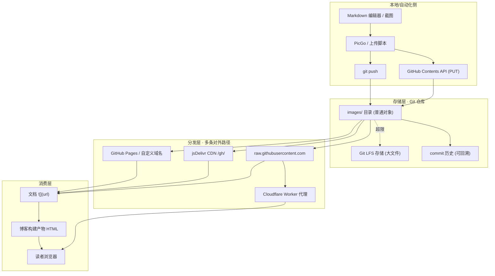
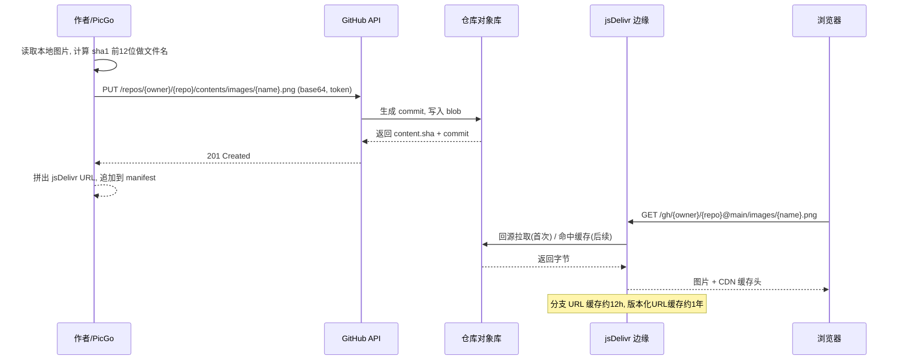
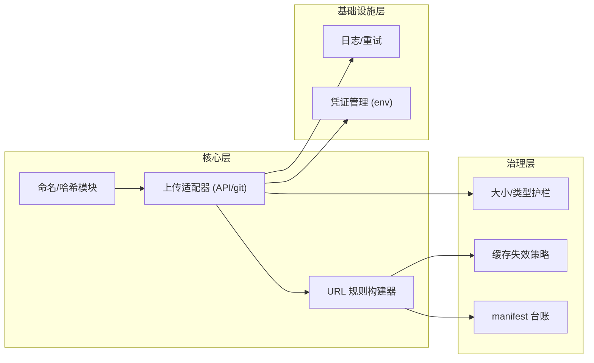
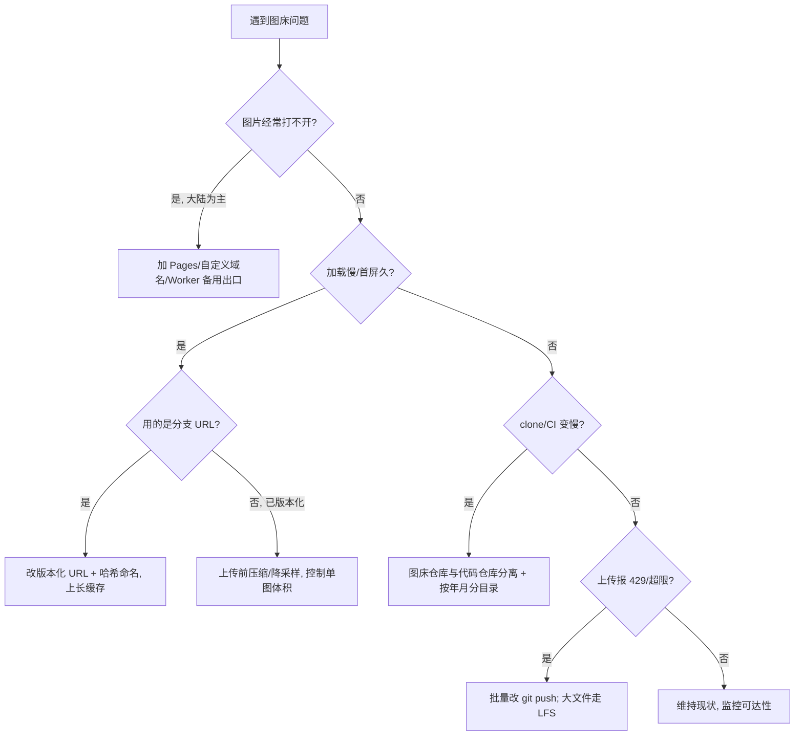

> 姊妹篇《云原生体系》讲的是"应用如何跑在云上"，本篇讲的是更朴素的一件事：**文档里的图片该放在哪里**。本站自身就是用 GitHub Actions 把 Hexo 产物推到 GitHub Pages 的（见 `.github/workflows/static.yml`），所以"把 Git 仓库当图床"对本仓不是抽象话题，而是每天都在发生的工程决策。读完本篇，你会知道一条图片 URL 从"拖进编辑器"到"浏览器渲染"到底经过哪些环节、每个环节会怎么坏、以及怎么把它做成一个可自动化、可缓存、可迁移的闭环。
>
> 口径说明：全文以 **GitHub（github.com）+ jsDelivr CDN** 为主线，版本口径为 Git 2.40+ / GitHub 2026 年现行限制 / jsDelivr v10.x / Git LFS 3.x。所有限制值（文件大小、速率、缓存时长）均来自 GitHub Docs 与 jsDelivr 官方文档并经交叉核验，标注于附录；Gitee / Coding / 对象存储等只做类型化对比，不绑定单一厂商。国内可达性部分是经验性结论，会明确标注"因地域/时间波动"。

---

# 第 1 章：引言 - 图床到底在回答什么问题

## 1.1 一句话定义

> **图床 = 一个把本地图片换成"稳定、可外链、带 CDN 的 URL"的静态文件存储服务。**

写 Markdown 文档时，图片不能像 Word 那样内嵌在正文里，只能"引用一个 URL"。图床就是负责**托管这个 URL 背后的字节**，并保证任何人、任何设备、任何时间打开都能拿到同一张图。

## 1.2 为什么想到用 Git 仓库做图床

传统图床要买对象存储（OSS/S3）、配访问密钥、担心被盗刷产生天价账单。而一个 Git 仓库天然具备图床需要的几乎全部要素，且**免费**：

| 图床需求 | Git 仓库如何满足 |
|---------|-----------------|
| 持久化存储二进制 | commit 把图片字节固化进对象库，历史可回溯 |
| 唯一稳定 URL | `用户名/仓库/分支/路径` 天然可寻址 |
| 版本管理 | 图片被覆盖也能从 history 找回 |
| 分发加速 | 叠加 jsDelivr / Pages / Cloudflare 得到 CDN |
| 自动化入口 | GitHub REST API + token 可脚本化上传 |
| 成本 | 公开仓库存储与 API 均免费（有大小/速率上限） |

> **关键认知**：Git 仓库解决的是"**存**"和"**寻址**"，但它**不直接解决"高速稳定分发"**——`raw.githubusercontent.com` 没有面向图床的 CDN 优化，且在中国大陆长期存在可达性问题。所以自建 Git 图床的真正工程量，在于给"存"这一层**外挂一个分发层**（jsDelivr / Pages / Worker 代理），并处理好缓存、体积、滥用这三道坎。

## 1.3 三份账

和内核资源管理、云原生栈一样，Git 图床也在回答三份账：

| 问题域 | 具体追问 | 对应能力 |
|--------|---------|---------|
| **存得下吗** | 图片字节放哪、多大、会不会把仓库撑爆 | Git 对象库 / Git LFS / 仓库大小限制 |
| **取得到吗** | 读者能否低延迟、跨地域拿到图 | raw / jsDelivr / Pages / Worker 代理 |
| **管得住吗** | 如何批量上传、命名去重、防止缓存陈旧、便于迁移 | 上传脚本 + 哈希命名 + manifest + 版本化 URL |

## 1.4 全景：一张图从"拖入"到"渲染"穿过的那条链

```text
   作者本地图片
        │  (1) 上传：git push / GitHub API PUT / PicGo
        ↓
   ┌──────────────────────┐
   │  Git 仓库（source）   │  ← 存储层：commit 固化字节
   │  images/a1b2c3.png    │     超过 100 MiB 走 Git LFS
   └──────────┬───────────┘
              │  (2) 分发：选择一条对外路径
              ↓
   ┌──────────────────────┐
   │ raw / jsDelivr /      │  ← 分发层：CDN 边缘缓存
   │ Pages / Worker 代理    │     默认分支缓存 12h，版本化 1 年
   └──────────┬───────────┘
              │  (3) 引用：Markdown 里写 
              ↓
   ┌──────────────────────┐
   │  Hexo 构建 → 博客 HTML │  ← 渲染层
   └──────────┬───────────┘
              ↓
        读者浏览器 
```

本篇其余章节就是把这条链的 **(1) 存储 / (2) 分发 / (3) 自动化与治理** 逐层拆开。

---

# 第 2 章：基础概念与核心术语

## 2.1 图床的三种存储形态

同样叫"Git 图床"，图片字节实际可能落在三个不同位置，特性差别很大：

| 形态 | 字节存放位置 | 单文件上限 | 对外 URL 形态 | 适用 |
|------|-------------|-----------|--------------|------|
| **普通 Git 对象** | 随 commit 进 `.git` | 硬拦 100 MiB，>50 MiB 警告 | raw / jsDelivr `/gh/` | 小图、图标、截图（<1 MiB） |
| **Git LFS** | 仓库外 LFS 存储，仓库只存指针 | Free 计划单文件 2 GiB | raw（LFS 感知）/ LFS 下载域名 | 大图、原始设计稿、视频 |
| **GitHub Release 资产** | Release attachment | 单文件 < 2 GiB | `github.com/.../releases/download/...` | 版本化大文件、二进制分发 |

> 选型口诀：**99% 的文档配图都应该走"普通 Git 对象 + jsDelivr"**——体积小、URL 干净、免费额度几乎用不完。只有确实要放原始大图/视频时才碰 LFS，且要意识到 LFS 有月度免费额度、超额计费。

## 2.2 核心术语表

| 术语 | 含义 | 通俗类比 |
|------|------|---------|
| raw URL | `raw.githubusercontent.com` 直接返回文件原始字节，无 HTML 包装 | 仓库文件的"出厂裸链" |
| jsDelivr `/gh/` | 把 GitHub 仓库当源、套上全球 CDN 的代理前缀 | 给裸链加了"快递网点" |
| 版本化 URL | `@tag` 或 `@commit` 锁死到不可变快照，可长缓存 | "签好日期的存档" |
| 分支 URL | `@main` 指向可变动分支，短缓存（约 12h） | "活页夹，随时能换页" |
| Git LFS | 大文件外置存储、仓库内只留文本指针 | "把行李寄存，只留取物小票" |
| 内容哈希命名 | 用 `sha1(字节)` 前若干位做文件名，天然去重 | "指纹当姓名，绝不重名" |
| manifest | `path → url` 的映射清单，便于检索/迁移 | "仓库的记账台账" |
| 防盗链 hotlink | 别站直接引用你的图 URL，消耗你的配额 | "别人拿你的会员卡消费" |

---

# 第 3 章：基础架构

## 3.1 架构总览

一个可生产使用的 Git 图床由**四层**构成。下图是组件位置拓扑（存储层→分发层→治理层→消费层）：



## 3.2 核心组件职责

| 组件 | 职责 | 关键依赖 |
|------|------|---------|
| 上传脚本 / PicGo | 把本地图片搬到仓库，回吐 URL | GitHub token（`repo` 权限） |
| GitHub Contents API | 单文件 PUT 提交，无需本地 clone | REST 速率限制（5,000 req/h） |
| Git 仓库 | 固化字节、提供可寻址路径 | 单文件 ≤100 MiB、仓库建议 <1 GB |
| Git LFS | 承接超限大文件外置存储 | LFS 免费额度、`.gitattributes` 追踪规则 |
| raw | 原始裸链出口 | 大陆可达性差、无 CDN |
| jsDelivr `/gh/` | 主力分发：全球 CDN + 缓存 | 单文件 ≤20 MB、仓库须 public |
| GitHub Pages / 域名 | 稳定可控的备用出口 | 需开启 Pages、仅静态 |
| Worker 代理 | 私有仓库鉴权 / 换一条可达路径 | 自己部署、承担额度 |

## 3.3 典型部署拓扑

- **纯公开方案（推荐起步）**：一个专用 public 仓库 `image-bed`，目录 `images/`，对外统一用 `https://cdn.jsdelivr.net/gh/<user>/image-bed@<commit>/images/<hash>.png`。零服务器、零费用。
- **加一层自有域名**：把 GitHub Pages 仓库或 Cloudflare 绑到 `img.example.com`，便于日后从 jsDelivr 平滑切走（URL 不变，只换 DNS 指向）。
- **混合大文件**：普通图进 Git 对象，设计稿/视频进 LFS 或 Release，避免污染轻量仓库的 clone 速度。

---

# 第 4 章：工作原理

## 4.1 上传 → 分发 → 渲染 的完整时序



## 4.2 关键路径分阶段说明

1. **命名与去重（客户端）**：对图片字节算 `sha1`，取前 12 位 + 原扩展名做文件名。相同内容 → 相同文件名 → 天然幂等，重复上传直接被"已存在"短路。
2. **入库（API/git）**：Contents API 走 base64 PUT，一次一张，返回该文件的 `sha`（后续覆盖同名文件需要带上旧 `sha`）；批量场景用 `git push` 更省 API 配额。
3. **寻址（URL 规则）**：
   - raw：`https://raw.githubusercontent.com/{owner}/{repo}/{branch}/{path}`
   - jsDelivr：`https://cdn.jsdelivr.net/gh/{owner}/{repo}@{branch或tag或commit}/{path}`
4. **分发（CDN）**：jsDelivr 首次回源后在边缘缓存；**分支 URL 约 12 小时**、**版本化（@commit/@tag）约 1 年不可变**——这决定了"覆盖同名文件"在分支 URL 下不会立即生效。
5. **渲染**：文档写 ``，博客构建把它嵌进 HTML，读者浏览器发起 GET。

## 4.3 异常与边界处理机制

| 异常 | 触发条件 | 系统行为与应对 |
|------|---------|---------------|
| 429 Too Many Requests | raw/API 被高频访问，命中次要速率限制 | 退避重试；API 走条件请求；分发流量交给 CDN 而非 raw |
| 上传 403/超限 | 单文件 >100 MiB，或浏览器上传 >25 MiB | 转 Git LFS，或压缩后重传 |
| 覆盖不生效 | 分支 URL 命中 CDN 旧缓存 | 用内容哈希命名（永不覆盖）或 URL 带 commit |
| 大陆打不开 | raw/jsDelivr 在部分地区被污染或不可达 | 切 Pages/自定义域名/自建 Worker 代理，或对象存储兜底 |
| 私有仓库读不到 | jsDelivr 不能读 private 仓库 | 改 public，或走带 token 的 Worker 代理 |
| 仓库膨胀变慢 | 频繁传图使 history 与 `.git` 激增 | 专用图床仓库、浅目录分段、定期归档 |

---

# 第 5 章：结构设计与模块划分

## 5.1 模块划分



## 5.2 关键接口/职责

| 模块 | 职责 | 关键函数 |
|------|------|---------|
| 命名模块 | 字节 → 稳定唯一文件名 | `hash_name(bytes, ext) -> str` |
| 上传适配器 | 屏蔽 API/git 差异，幂等提交 | `upload(path, repo, branch) -> url` |
| URL 构建器 | 按分发路径拼最终外链 | `build_url(repo, ref, path, provider)` |
| manifest | 维护 `local→remote→url` 台账 | `record(path, url)` / `lookup(path)` |
| 护栏 | 超限拦截与降级提示 | `check_size(bytes) -> allow/need_lfs` |

## 5.3 仓库目录组织（工程约定）

```text
image-bed/
├── images/
│   ├── 2026/10/        # 按 年/月 浅分层，规避单目录 3000 条目上限
│   └── a1b2c3d4e5f6.png # 内容哈希命名，天然去重
├── .gitattributes       # 仅对需要的类型启用 LFS 追踪
├── manifest.json        # path -> url 台账，可 diff/检索/迁移
└── README.md
```

> **浅目录 + 哈希命名**是两条最省钱的经验：前者把 GitHub 建议的"单目录 ≤3,000 条目、深度 ≤50"踩在安全线内，后者从根上消灭缓存陈旧与重复上传两类顽疾。

---

# 第 6 章：应用场景与选型

## 6.1 典型场景 - 方案对照

| 场景 | 推荐方案 | 关键配置 | 预期效果 |
|------|---------|---------|---------|
| 个人技术博客配图 | GitHub public + jsDelivr 版本化 URL | 哈希命名、`@commit` | 零成本、全球 CDN、缓存稳定 |
| 团队协作文档 | Git 仓库 + PicGo 插件 | 统一 token 走 env、共享 manifest | 拖拽即得外链 |
| 大量原始设计稿/视频 | Git LFS 或 Release 资产 | `.gitattributes` 精确追踪 | 不污染轻量仓库 |
| 大陆读者为主 | GitHub Pages/自定义域名 + 对象存储兜底 | 域名回退、多 CDN 源 | 规避 raw/jsDelivr 波动 |
| 敏感/内部图 | 私有仓库 + Cloudflare Worker 鉴权代理 | token 存 Worker env | 不外泄、可控访问 |

## 6.2 与其他图床方案对比

| 维度 | Git 仓库自建 | 云对象存储(OSS/S3) | 第三方免费图床 |
|------|-------------|-------------------|---------------|
| 成本 | 免费（有上限） | 按存储+流量计费 | 免费但常变动/倒闭 |
| 可控性 | 高（在自己账号） | 高 | 低 |
| 分发速度 | 依赖 CDN 叠加 | 原生 CDN 快 | 不稳定 |
| 上限风险 | 100 MiB/文件、jsDelivr 20 MB | 几乎无 | 随机 |
| 可追溯 | git history 天然版本化 | 需开版本控制 | 无 |
| 运维心智 | 中（需处理缓存/可达性） | 低 | 极低 |

> 结论：**非敏感、中小体积、重可控与可追溯** → Git 自建最合适；**大流量生产业务、强 SLA** → 老老实实上对象存储，Git 仓库只当源站/备份。

---

# 第 7 章：核心源码解析

## 7.1 上传脚本（GitHub Contents API，Python）

设计意图：单文件 PUT、幂等、内容哈希命名、直接吐 jsDelivr 版本化 URL。

```python
import base64, hashlib, os, requests

def hash_name(raw: bytes, ext: str) -> str:
    # 用内容 sha1 前 12 位命名：相同字节永远同名 → 天然去重、无缓存陈旧
    return hashlib.sha1(raw).hexdigest()[:12] + ext

def upload_image(path: str, repo: str, branch="main", token=None):
    token = token or os.environ["GH_TOKEN"]        # 凭证从 env 注入，勿硬编码
    with open(path, "rb") as f:
        raw = f.read()
    name = hash_name(raw, os.path.splitext(path)[1])
    remote = f"images/{name}"
    url = f"https://api.github.com/repos/{repo}/contents/{remote}"
    headers = {"Authorization": f"Bearer {token}", "Accept": "application/vnd.github+json"}

    # 幂等：先查是否已存在，存在则直接返回，省去重复 commit
    exist = requests.get(url, headers=headers, params={"ref": branch})
    if exist.ok:
        sha = exist.json()["sha"]
    else:
        sha = None

    body = {"message": f"upload {name}", "branch": branch,
            "content": base64.b64encode(raw).decode()}
    if sha:                                   # 覆盖已存在文件必须带旧 sha
        body["sha"] = sha
        return f"https://cdn.jsdelivr.net/gh/{repo}@{branch}/{remote}"  # 内容不变, URL 不变

    resp = requests.put(url, headers=headers, json=body)
    resp.raise_for_status()                    # 403/422 等暴露出来, 便于定位超限
    # 返回带 commit sha 的版本化 URL, 绕过分支缓存, 可长期缓存
    commit = resp.json()["commit"]["sha"]
    return f"https://cdn.jsdelivr.net/gh/{repo}@{commit}/{remote}"
```

**解析**：
- `hash_name`：内容寻址（content-addressable）思想，把"去重"和"缓存失效"两问题一次解决——这是本方案最关键的一行。
- 先 GET 再 PUT：命中已存在直接返回，避免制造无意义 commit，节省 API 配额（REST 个人 5,000 req/h）。
- 返回体用 `commit sha` 而非 `main`：把 URL 钉在不可变快照上，jsDelivr 可缓存约 1 年，且杜绝"改了同名图读者看不到"。

## 7.2 PicGo 配置（GUI 方案，JSON 片段）

```json
{
  "picBed": {
    "uploader": "github",
    "github": {
      "repo": "yourname/image-bed",
      "token": "${GH_TOKEN}",
      "branch": "main",
      "path": "images/",
      "cdn": "https://cdn.jsdelivr.net/gh/yourname/image-bed@main"
    }
  }
}
```

> PicGo 把上面的 Python 逻辑封装成"拖拽即上传 + 自动复制链接"。`cdn` 字段决定它回吐给你的 URL 前缀——填 jsDelivr 而不是 raw，就从源头避开了大陆打不开 raw 的问题。

## 7.3 Cloudflare Worker 代理（私有仓库/换路径兜底）

设计意图：给 raw 加一层鉴权与可改道，图片请求带 token 转发，公开侧只暴露 Worker 域名。

```javascript
export default {
  async fetch(request, env) {
    const url = new URL(request.url);
    // /{owner}/{repo}/{branch}/{path...} → 转发到 raw
    const raw = `https://raw.githubusercontent.com${url.pathname}`;
    const resp = await fetch(raw, {
      headers: { Authorization: `token ${env.GH_TOKEN}` }, // 私有仓库鉴权
    });
    return new Response(resp.body, {
      status: resp.status,
      headers: { "Content-Type": resp.headers.get("Content-Type") || "image/png",
                 "Cache-Control": "public, max-age=86400" },
    });
  },
};
```

---

# 第 8 章：性能特性

## 8.1 性能基准（经验区间，随网络/地域波动）

| 指标 | 典型表现 | 测试条件 |
|------|---------|---------|
| 首次加载（边缘未命中） | 回源 raw 延迟，数百 ms～数 s | 新图/缓存过期 |
| 命中 CDN 缓存 | 数十 ms 级，取决于离边缘节点距离 | 版本化 URL、热点图 |
| jsDelivr 单文件上限 | 20 MB（超过可能加载失败） | 官方限制，建议图片远低于此 |
| REST 上传速率 | 5,000 请求/小时（认证） | 单文件 PUT 逐个计 |
| Git LFS 批量 API | 认证 3,000 请求/分钟，每请求处理约 100 对象 | 大文件上传 |

## 8.2 影响性能的关键因素

1. **缓存命中 > 一切**：分支 URL（~12h）频繁回源，慢且不稳；版本化 URL（~1 年）几乎恒命中 CDN。
2. **文件体积**：图越大，回源与首屏越慢，jsDelivr 超限直接失败。上传前压缩/降采样收益最大。
3. **仓库体积**：`.git` 越大，clone/CI 越慢（建议 <1 GB、`.git` 磁盘 <10 GB）。图床仓库要与代码仓库分离。
4. **地域可达性**：raw/jsDelivr 在大陆部分地区波动，是"能不能打开"而非"快不快"的问题——需备用出口。

## 8.3 性能模型

- 图片 URL 命中分布随引用次数上升趋于**全 CDN 命中**，回源成本被摊薄；
- 单仓库图片总量线性影响 clone 时长，**与请求延迟无关**（分发只读特定 blob，不读整仓）；
- 因此优化优先级：**① 命名让缓存可长期命中 → ② 压体积 → ③ 分仓库 → ④ 加备用分发路径**。

---

# 第 9 章：参数优化与限制速查

## 9.1 关键限制 / 参数速查表

| 参数 / 限制 | 默认/硬值 | 推荐值 | 说明 |
|------------|----------|--------|------|
| Git 单文件大小 | 硬拦 100 MiB | ≤1 MiB | >50 MiB 警告；浏览器上传 ≤25 MiB |
| 建议仓库大小 | 理想 <1 GB，强建议 <5 GB | 图床独立仓库尽量小 | `.git` 磁盘建议 <10 GB |
| 单目录条目 | 建议 ≤3,000 | 按 年/月 分段 | 规避目录宽度惩罚 |
| 单 push 大小 | 2 GiB | 分批 | 超限报 `pack exceeds maximum` |
| jsDelivr 单文件 | 20 MB | 远低于此 | GitHub 源包 >50 MB 会 403 |
| 分支 URL 缓存 | ~12 h | 非关键图可用 | 覆盖同名不立即生效 |
| 版本化 URL 缓存 | ~1 年 | **首选** | 内容不可变，长缓存 |
| REST 认证速率 | 5,000 req/h | 批量走 git push | 次要限制另有并发/点数 |
| Git LFS 单文件 | Free 2 GiB | 大图才用 | 有月度免费额度，超额计费 |

## 9.2 调优决策树



---

# 第 10 章：局限缺陷与解决方案

## 10.1 已知问题清单

| 问题 | 影响范围 | 严重度 | 根因 | 规避/解决方案 |
|------|---------|-------|------|--------------|
| raw/jsDelivr 大陆可达性波动 | 国内读者 | 高 | 无面向大陆的稳定 CDN、偶发污染 | 自定义域名 + Pages/Worker + 对象存储兜底；不要当关键生产图床 |
| 滥用导致 429 限流 | 高频访问仓库 | 中 | raw 被当公共图床外链，触发次要速率限制 | 分发走 jsDelivr/Pages，raw 只作源；降低外链热度 |
| 覆盖同名图不生效 | 更新图片时 | 中 | 分支 URL CDN 缓存 ~12h | 内容哈希命名（永不覆盖）或 URL 带 commit |
| 仓库膨胀、clone 变慢 | 长期维护 | 中 | 图片字节进 history 不可逆 | 专用图床仓库、LFS 外置、定期归档旧目录 |
| 私有仓库 CDN 读不到 | 内部文档 | 低 | jsDelivr 仅读 public | 带 token 的 Worker 代理，或转 public |
| 单文件超 100 MiB 被拦 | 大媒体 | 低 | Git 对象硬限制 | 走 Git LFS（≤2 GiB/文件）或 Release 资产 |

## 10.2 边界条件

- **公开性**：走 jsDelivr 的仓库**必须 public**，含敏感信息的图不可用此方案。
- **不可逆历史**：图片一旦 commit，即便删除文件，blob 仍在 history；换密钥/删隐私需重写历史。
- **配额不确定性**：Git LFS 免费额度、jsDelivr 政策、GitHub 速率限制都可能随时间调整，生产使用前应重新核对官方页面（见附录链接）。

## 10.3 不适用场景

- 高并发、强 SLA 的商业生产图片服务 → 用对象存储 + 专业 CDN；
- 涉密/内部资料 → 不要用 public Git 图床；
- 超大媒体（视频/原始设计稿海量）→ 仓库会被拖垮，用 LFS/媒体专用服务；
- 需要精细访问统计/鉴权/防盗链策略 → Git 方案能力有限，转对象存储。

---

# 附录

## A. 术语速查

| 术语 | 一句话 |
|------|--------|
| 图床 | 把图片换成稳定可外链 URL 的静态存储 |
| raw | 仓库文件裸链，无 CDN，大陆常不可达 |
| jsDelivr `/gh/` | GitHub 源 + 全球 CDN，单文件 ≤20 MB |
| 版本化 URL | `@commit/@tag`，可缓存约 1 年，防陈旧 |
| 内容哈希命名 | `sha1(字节)` 前缀做文件名，去重+免覆盖 |
| Git LFS | 大文件外置，仓库只留指针，Free 单文件 2 GiB |
| manifest | `path→url` 台账，便于检索/迁移 |

## B. 参考资料（关键事实来源）

1. [GitHub Docs · 关于 GitHub 上的大文件](https://docs.github.com/en/repositories/working-with-files/managing-large-files/about-large-files-on-github) — 单文件 100 MiB 硬拦、50 MiB 警告、浏览器 25 MiB。✅ 已核实
2. [GitHub Docs · 存储库限制](https://docs.github.com/en/repositories/creating-and-managing-repositories/repository-limits) — 仓库建议 <1 GB/强建议 <5 GB、`.git` 磁盘 10 GB、单目录 3,000、深度 50、单 push 2 GiB。✅ 已核实
3. [GitHub Docs · Releases / LFS 配额](https://docs.github.com/en/repositories/releasing-projects-on-github/about-releases) — Release 单文件 <2 GiB；LFS 随计划分级。✅ 已核实
4. [GitHub Docs · REST 速率限制](https://docs.github.com/en/rest/using-the-rest-api/rate-limits-for-the-rest-api) — 认证 5,000 req/h；LFS 批处理认证 3,000 req/min。✅ 已核实
5. [jsDelivr Docs · GitHub 托管与限制](https://www.jsdelivr.com/documentation) — `/gh/` 规则、单文件 20 MB、分支~12h/版本~1年缓存。✅ 已核实（数值以官方现行页为准）
6. 社区实测：raw/jsDelivr 在中国大陆存在可达性波动（多来源、时间相关）。⚠️ 经验性，因地域/时间变化

> **知识验证说明**：本文的文件大小、速率、缓存时长等硬指标均对到 GitHub/jsDelivr 官方文档；国内可达性属经验结论，已显式标注波动性，落地前请复核当前政策。

## C. 变更记录

| 日期 | 版本 | 变更内容 |
|------|------|---------|
| 2026-10-29 | v1.0 | 首版：Git 仓库自建图床九维全解，含存储/分发/自动化三层与 Mermaid 拓扑、时序、决策树 |
