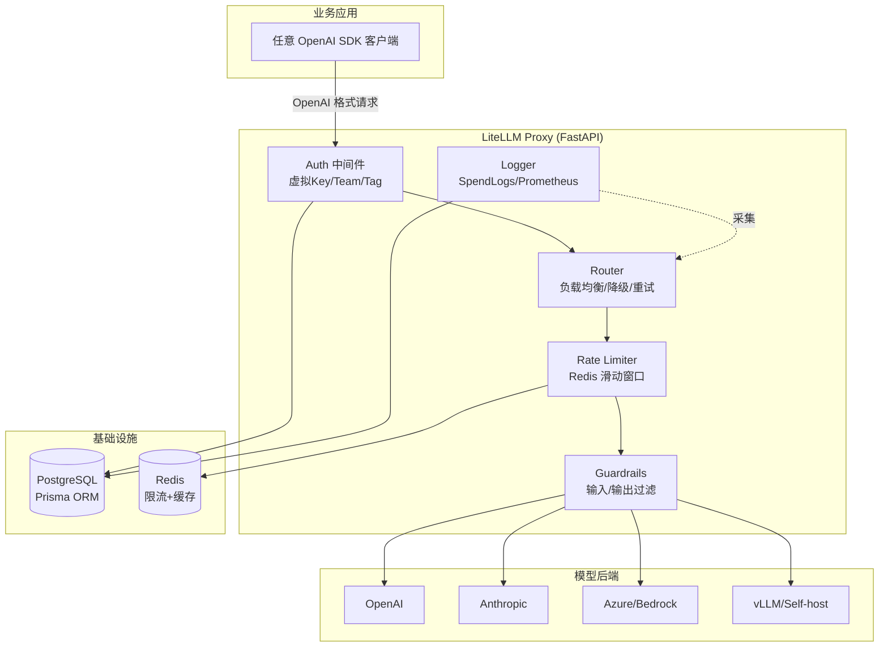
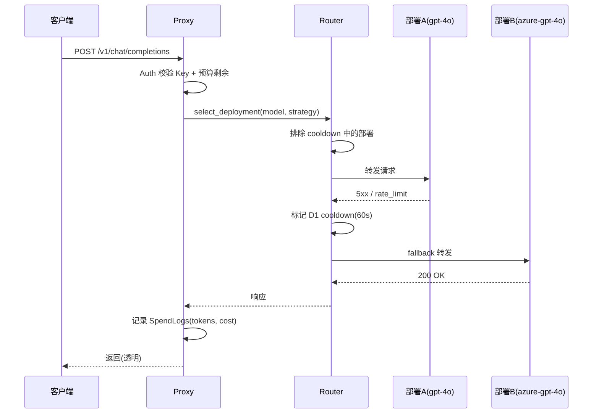

> 《企业 AI 平台工程》专题 4.1 的实现参考篇。LLM 应用从 PoC 走向生产时第一个撞到的墙是**多模型/多供应商接入的复杂度爆炸**——每家 API 格式不同、限流策略不同、计费维度不同，业务代码被迫变成供应商适配器。LiteLLM 用 **OpenAI 兼容协议族** 做统一抽象层：一套 `/v1/chat/completions` 接口背后路由 100+ 提供商（140+ 含 Azure/Bedrock/Vertex 变体）的 1800+ 模型，叠加虚拟密钥、预算配额、失败降级与成本追踪。它与《Knative》网关思路互补——Knative 管"服务怎么弹性"，LiteLLM 管"模型调用怎么走、怎么算钱"。在《LLM 应用工程化》总目录中，本篇直接落地 4.1 AI Gateway 的产物承诺。
>
> 口径说明：版本锚定 **LiteLLM 2025-2026 主线**（Python SDK + Proxy Server 双形态）；核心依赖 Prisma + PostgreSQL 做持久化（Proxy 硬依赖）、Redis 做分布式限流与缓存；Rust 核心路由层实测 p99 额外延迟仅 0.66ms。性能数字为官方基准与经验量级，非某集群实测。MCP Server 网关化与 A2A 代理为 2026 新能力。

---

# 第 0 章：全景链路

```text
                         ┌──────────────────────────────────────────────────┐
  业务应用               │  统一 OpenAI 兼容入口: /v1/chat/completions       │
  「一份代码跑所有模型」   │  /v1/embeddings /v1/audio /v1/images /v1/messages│
                         └─────────────────────┬────────────────────────────┘
                                               │
                         ┌─────────────────────▼────────────────────────────┐
  网关层                 │  LiteLLM Proxy (FastAPI)                         │
  「谁能调、调多少、      │  ├─ Auth: 虚拟 Key / Team / Tag                   │
   超了怎么办」           │  ├─ Router: LB / cooldown / fallback / retry     │
                         │  ├─ Budget & Rate-Limit (Redis 滑动窗口)         │
                         │  └─ Guardrails: 输入/输出过滤                    │
                         └─────────────────────┬────────────────────────────┘
                                               │
              ┌────────────────────────────────┼────────────────────────────────┐
              │                                │                                │
  ┌───────────▼───────────┐    ┌──────────────▼──────────────┐    ┌────────────▼────────────┐
  │ OpenAI / Azure OpenAI │    │ Anthropic / Bedrock / Vertex│    │ Qwen / DeepSeek / vLLM  │
  │ gpt-4o, o3-mini       │    │ claude-4, nova, gemini      │    │ 自托管推理端点          │
  └───────────────────────┘    └─────────────────────────────┘    └─────────────────────────┘
              │                                │                                │
                         ┌─────────────────────▼────────────────────────────┐
  可观测/计费            │  SpendLogs (PostgreSQL) + Prometheus metrics     │
  「每笔调用花了多少」    │  Admin UI: 用户/Key/Model 维度看板                │
                         └──────────────────────────────────────────────────┘
```

一句话主线：**LiteLLM = 协议归一化 + 智能路由 + 企业治理三合一；解决的不是"模型不够多"，而是"接入成本 O(N) 降到 O(1)，同时不丢供应商级的容灾与成本控制"。**

---

# 第 1 章：基础概念与为什么需要

## 1.1 没有网关的痛点

| 问题 | 表现 | 量级 |
|------|------|------|
| 协议碎片化 | 每接一家模型改一次 SDK/格式/错误码 | 5+ 供应商 = 5 套适配器 |
| 无统一鉴权 | API Key 散落在各服务、无审计 | 安全合规硬伤 |
| 成本黑箱 | 月底收到各供应商账单才知道花了多少 | 无法归因到业务 |
| 单点依赖 | 供应商 A 宕机 = 全链路中断 | RTO 取决于供应商 |
| 限流粗糙 | 只能全局设 QPS，无法按 Team/Key 粒度 | 互相影响 |

## 1.2 LiteLLM 的解法定位

- **SDK 形态**（Python `litellm` 包）：嵌入应用代码，提供 `litellm.completion(model="...")` 统一接口。
- **Proxy 形态**（独立服务）：作为 HTTP 网关部署，业务只需把 `base_url` 指向 LiteLLM Proxy，**零代码改动** 获得路由/鉴权/计费/降级全套能力。

生产环境推荐 Proxy 形态——治理逻辑与业务代码彻底解耦。

---

# 第 2 章：核心架构与组件职责



| 组件 | 职责 | 关键设计决策 |
|------|------|-------------|
| FastAPI 网关 | HTTP 入口、异步、SSE 流式 | 天然兼容 OpenAI streaming 协议 |
| Router | 多部署选择、cooldown、fallback、重试 | 支持 weighted/random/least-busy/latency-based 四种策略 |
| Virtual Key | 每用户/团队独立 Key，绑预算和速率 | 真实供应商 Key 不出网关 |
| Prisma + PostgreSQL | 持久化 Key/预算/日志/配置 | Proxy 硬依赖，无 PG 不能启 |
| Redis | 分布式限流计数 + 响应缓存 | 多副本 Proxy 共享限流状态 |
| Guardrails | 预定义或自定义输入/输出检查 | 拦截 Prompt 注入/PII 泄露 |
| Rust 核心 | 路由决策热路径 | p99 额外延迟 0.66ms |
| Admin UI | 可视化 Key 管理/成本看板 | 内置于 Proxy `/ui` 路由 |

---

# 第 3 章：工作原理——请求路由全路径

## 3.1 Router 决策流程



关键机制：

- **Cooldown**：部署连续失败 N 次后暂时摘除（默认 60s），避免坏部署反复被选中。
- **Fallback Chain**：配置 `fallbacks: [{"gpt-4o": ["claude-sonnet-4", "qwen-max"]}]`，跨供应商降级。
- **重试**：内置 exponential backoff，可按 HTTP 状态码定制。
- **Budget 硬熔断**：Key/Team 消耗达预算上限直接返回 403，不透传后端。

## 3.2 流式请求路径

SSE (`text/event-stream`) 在 Proxy 层透传，Router 选定部署后直连后端流式返回——不缓冲全量，首 token 延迟取决于后端本身。LiteLLM 在流结束后异步写 SpendLogs，不阻塞客户端。

---

# 第 4 章：部署与生产参数速查

## 4.1 最小部署（Docker Compose）

```yaml
services:
  litellm:
    image: ghcr.io/berriai/litellm:main
    ports: ["4000:4000"]
    environment:
      DATABASE_URL: "postgresql://user:pass@db:5432/litellm"
      REDIS_URL: "redis://redis:6379"
      MASTER_KEY: "sk-my-admin-key"
    volumes:
      - ./config.yaml:/app/config.yaml
    command: ["--config", "/app/config.yaml", "--port", "4000"]
  db:
    image: postgres:16-alpine
  redis:
    image: redis:7-alpine
```

`config.yaml` 核心片段：

```yaml
model_list:
  - model_name: gpt-4o
    litellm_params:
      model: openai/gpt-4o
      api_key: os.environ/OPENAI_API_KEY
  - model_name: gpt-4o
    litellm_params:
      model: azure/completions-deploy
      api_key: os.environ/AZURE_KEY
      api_base: os.environ/AZURE_BASE
  - model_name: claude-sonnet-4
    litellm_params:
      model: anthropic/claude-sonnet-4-20250514
      api_key: os.environ/ANTHROPIC_KEY

router_settings:
  routing_strategy: least-busy
  num_retries: 3
  cooldown_duration: 60
  fallbacks: [{"gpt-4o": ["claude-sonnet-4"]}]

litellm_settings:
  drop_params: true
  request_timeout: 120
  set_verbose: false
```

## 4.2 生产关键参数

| 参数 | 位置 | 默认 | 推荐 | 说明 |
|------|------|------|------|------|
| `request_timeout` | litellm_settings | 6000s | 120s | 单次后端调用超时 |
| `num_retries` | router_settings | 3 | 3 | 同部署重试次数 |
| `cooldown_duration` | router_settings | 60 | 60-120s | 故障部署摘除时长 |
| `routing_strategy` | router_settings | simple-shuffle | least-busy | 负载均衡策略 |
| `max_budget` | Key/Team 级 | 不限 | 按业务配额 | 超限 403 硬熔断 |
| `tpm_limit`/`rpm_limit` | Key/Team 级 | 不限 | 后端限流的 80% | 令牌/分钟 & 请求/分钟 |
| `store_prompts` | general_settings | false | 合规评估后决定 | 是否存原始 prompt |
| `use_public_balances` | Key | false | true | 团队共享预算池 |

## 4.3 K8s 部署注意

- **PostgreSQL 硬依赖**：Proxy 启动即执行 Prisma migrate，PG 不可达 = CrashLoop。
- **Redis 推荐**：单副本可用内存限流，多副本必须 Redis 否则限流失效。
- **Secret 管理**：供应商 Key 放 K8s Secret → 注入环境变量，LiteLLM config 中 `os.environ/KEY` 引用。
- **Health Check**：`GET /health/liveliness` + `/health/readiness`（检查 DB/Redis 连通）。

---

# 第 5 章：进阶能力与选型对比

## 5.1 MCP Server 网关化（2026）

LiteLLM 把 MCP Server 当作"模型"注册——Agent 通过统一网关调用 MCP Tools，享受同一套鉴权、限流、审计。意义：MCP 从"点对点裸连接"升级为"经网关治理的服务"。

## 5.2 Guardrails 与合规

内置 `presidio`（PII 检测）、`lakera`（Prompt 注入检测）；支持自定义 Python guardrail 函数做业务级过滤。位置在 Router 之前（输入）和响应返回客户端之前（输出）。

## 5.3 竞品对比

| 维度 | LiteLLM Proxy | One-API | Envoy AI Gateway | Kong AI Gateway |
|------|-------------|---------|-----------------|----------------|
| 定位 | Python 生态 AI 网关 | Go 轻量转发 | Envoy 原生 L7 AI 路由 | Kong 插件 |
| 模型覆盖 | 100+ 提供商 | 主流 10+ | 依赖后端适配器 | 依赖插件 |
| 治理深度 | Key/Team/Budget/Guardrails 全套 | 基础 Key + 额度 | 需配合 Envoy 生态 | 需 Enterprise 版 |
| 流式 | 原生透传 | 支持 | 支持 | 支持 |
| 扩展性 | Python 插件 + Rust 核心热路径 | Go 代码改 | Wasm 过滤器 | Lua/JSP 插件 |
| 自托管推理 | 内置 vLLM/Ollama 适配 | 需手动配 | 后端 Service 透明 | Upstream 配置 |
| 适合 | 中大规模多租户 AI 平台 | 小团队快速统一 | 已有 Envoy 基础设施 | 已有 Kong 生态 |

## 5.4 局限与规避

| 局限 | 说明 | 规避 |
|------|------|------|
| PG 硬依赖 | 无 PG 不能启动、单 PG 成瓶颈 | 托管 PG + read replica; 日志表定期归档 |
| 非 Rust 全栈 | 除路由热路径外仍为 Python, GIL 限并发 | 多副本 + HPA; CPU 密集场景评估专用推理网关 |
| 模型能力差异不可抹平 | OpenAI 格式是"最小公倍数", 高级参数(如 Anthropic tool_use) 需 `extra_body` | 对关键参数写 fallback 逻辑 |
| Admin UI 权限粗 | 仅 Master Key 区分管理员/普通 | 前置 OIDC/反向代理做 RBAC |

---

# 附录

## A. 术语速查

| 术语 | 一句话 |
|------|--------|
| Virtual Key | 网关签发的代理密钥, 背后映射到真实供应商 Key |
| Cooldown | 部署故障后临时摘除窗口 |
| Fallback | 跨模型/跨供应商的降级链 |
| SpendLogs | 每次调用的 token 消耗与费用记录 |
| Guardrails | 输入/输出的合规检查拦截层 |
| Routing Strategy | 多部署间的负载均衡选择算法 |
| TPM/RPM | Tokens Per Minute / Requests Per Minute 限流粒度 |
| drop_params | 不支持的参数静默丢弃而非报错 |

## B. 参考资料

- LiteLLM 官方文档: https://docs.litellm.ai (✅ 已核实: Proxy 架构/Router 策略/Guardrails/MCP 网关化)
- GitHub: https://github.com/BerriAI/litellm (✅ 已核实: 100+ providers, 1800+ models, Rust core p99 0.66ms)
- Prisma: https://www.prisma.io (✅ 已核实: Proxy 硬依赖)
- Envoy AI Gateway: https://aigateway.envoyproxy.io (✅ 已核实: 对比定位)

## C. 变更记录

| 日期 | 变更 |
|------|------|
| 2026-10-29 | 初版成文, 锚定 LiteLLM 2025-2026 主线 |
