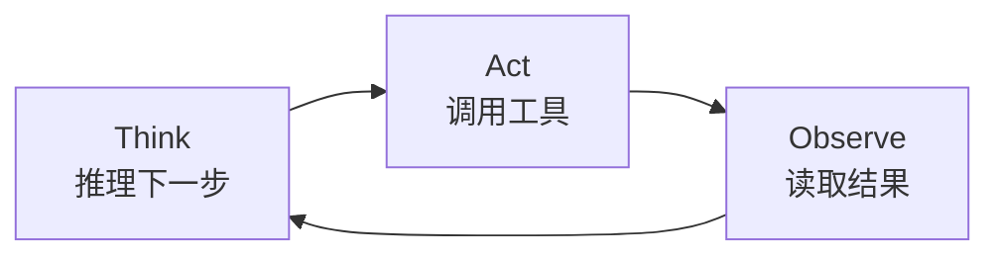
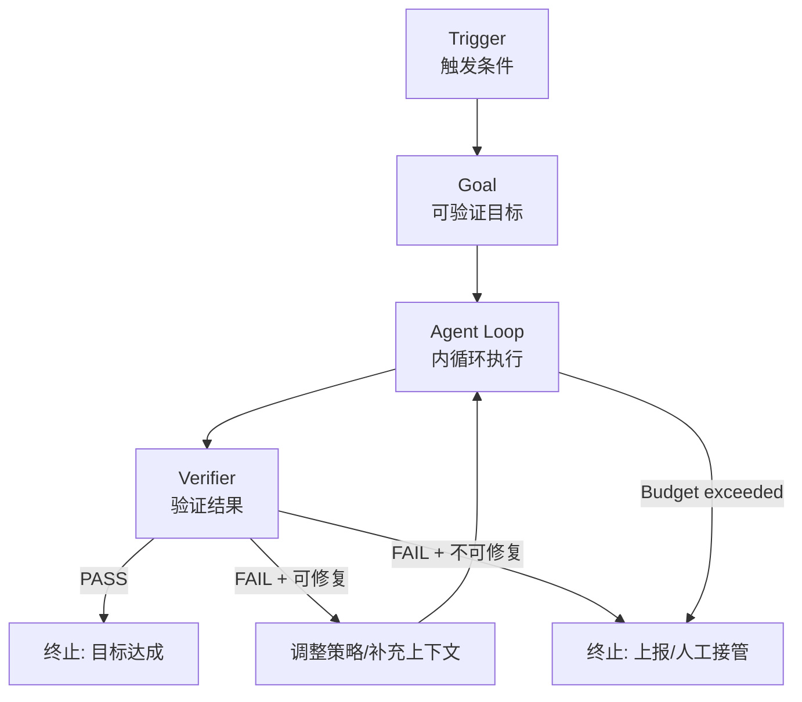
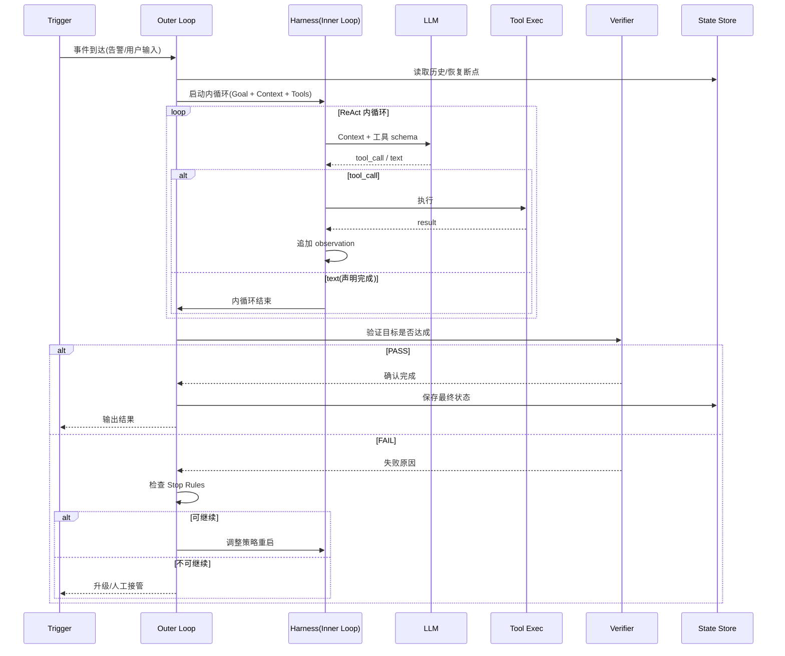

> 《智能执行与任务编排》专题 3.1 Agent 核心运行机制的 Loop 深化篇。2026 年 Agent 工程领域出现了一个高频词——**Loop Engineering**。Boris Cherny（Claude Code 负责人）说"我的工作是写 Loop"；Peter Steinberger 说"设计能提示 Agent 的 Loop"；IBM 在 2026-07 给出正式定义："设计能持续让 Agent 行动、观察、决策、迭代的工作流"。它与姊妹篇《Harness Engineering》互为表里：Harness 回答"有什么部件"，**Loop 回答"部件按什么节奏转起来、什么时候停、怎么判断做对了"**。Addy Osmani 的《Loop Engineering》一文把结构补全为四要素：任务触发→状态保存→结果检查→循环继续/停止条件。本篇聚焦从 ReAct 内循环到生产级七部件闭环的完整工程知识。
>
> 口径说明：Loop 定义锚定 IBM 2026-07 / Boris Cherny / Addy Osmani / Peter Steinberger 四方公开表述；验证循环参考 LangChain deepagents 实现；内循环以 ReAct (Reasoning + Acting) 范式为准。性能与效率数字为经验量级与论文数据。

---

# 第 0 章：全景链路

```text
                    ┌─────────────────────────────────────────────────────┐
  外层 Engineering  │  ① Trigger     ② Goal(可验证)     ③ Policy/Agent   │
  Loop              │  何时开始      什么算完成          谁来做、怎么做    │
  "任务级闭环"       └────────────────────────┬────────────────────────────┘
                                             │ 启动内循环
                    ┌────────────────────────▼────────────────────────────┐
  内层 Agent Loop   │  ReAct: Think → Act → Observe → Think → ...        │
  (Harness ①)      │  工具调用 / 模型推理 / 结果观测                       │
                    └────────────────────────┬────────────────────────────┘
                                             │ 产出中间结果
                    ┌────────────────────────▼────────────────────────────┐
  外环关键节点      │  ④ Tools/Environment  ⑤ Verifier  ⑥ State           │
                    │  执行沙箱/外部系统     判断对不对    进度/断点/历史    │
                    └────────────────────────┬────────────────────────────┘
                                             │
                    ┌────────────────────────▼────────────────────────────┐
  终止判定          │  ⑦ Stop Rules: Goal met / Budget exhausted /       │
                    │  Safety veto / Max iterations / Timeout              │
                    └─────────────────────────────────────────────────────┘
```

一句话主线：**Loop Engineering 的核心价值不是"让 Agent 多跑几轮"，而是"每一轮都有明确验证标准、可检查状态和可控终止"——把不确定的 LLM 输出纳入确定性的工程闭环。**

---

# 第 1 章：基础概念——内外双循环

## 1.1 内循环（Agent Loop / ReAct）



- **定义**：LLM 在 Harness 驱动下的"推理→行动→观察"迭代——一次工具调用 + 一次模型推理 = 一轮内循环。
- **终止**：模型输出无 tool_call（纯文本=任务完成信号），或触及迭代上限。
- **问题**：裸 ReAct 终止靠模型"自觉"——模型可能幻觉式宣布完成、或陷入无意义循环。

## 1.2 外循环（Engineering Loop）



- **定义**：包裹内循环的工程控制层——负责触发、目标定义、验证、状态保存和终止决策。
- **核心差异**：内循环由模型驱动（"模型决定下一步"），外循环由**确定性代码**驱动（"验证器决定继续还是停"）。
- **设计哲学**：**确定性优先**——凡能用规则/测试/断言验证的环节，绝不交给模型自评。

## 1.3 Ralph Wiggum Loop（反例）

"Ralph Wiggum"是 Agent 社区对"没有外循环验证的裸 ReAct"的戏称——来自《辛普森一家》中 Ralph 盲目重复行为。**特征**：Agent 自己宣布"我完成了"、没有独立验证、循环到 Token 耗尽。生产环境禁止。

---

# 第 2 章：生产级闭环七部件

| # | 部件 | 职责 | 设计要点 |
|---|------|------|---------|
| ① | Trigger | 决定何时启动 Loop | 事件驱动(webhook/告警) / 定时 / 人工 |
| ② | Goal | 定义什么算"完成" | **必须可验证**——有明确断言/测试/指标, 非模糊自然语言 |
| ③ | Policy/Agent | 执行主体与策略约束 | 模型选型 + 工具集 + 权限边界 |
| ④ | Tools/Environment | 外部交互面 | 沙箱隔离 + 幂等设计 + 结果截断 |
| ⑤ | Verifier | 判定本轮/整体结果是否达标 | **确定性优先分层**（见 2.1） |
| ⑥ | State | 进度、历史、断点 | 可持久化 + 可回放 + 可人工修正 |
| ⑦ | Stop Rules | 何时必须停 | Goal met / Budget / Safety veto / Timeout |

## 2.1 验证器分层（确定性优先）

```text
优先级从高到低:
  Layer 0  硬验证器  ─ 单元测试/编译/类型检查/Schema 校验/数值范围断言
  Layer 1  规则验证器 ─ 正则/黑白名单/业务规则引擎
  Layer 2  模型验证器 ─ 用另一个 LLM 做评审(成本最高、确定性最低)
  Layer 3  人工验证器 ─ 抽样审查/关键操作审批
```

**原则**：能在 Layer 0 验证的绝不下沉到 Layer 2。LangChain 实测：仅引入确定性验证器（不改变模型和 Prompt），Terminal Bench 2.0 分数从 52.8 → 66.5（+26%）。

## 2.2 Stop Rules 设计

| 条件 | 触发行为 | 说明 |
|------|---------|------|
| Goal met (verifier PASS) | 正常终止, 输出结果 | 唯一"成功"出口 |
| Budget exhausted (Token/Time/Calls) | 停止, 输出当前进度 + 剩余待办 | 防失控 |
| Safety veto (高危操作被拒) | 立即停止, 人工接管 | 安全红线 |
| Consecutive failures (N 次验证失败) | 停止, 报告失败模式 | 防无效循环 |
| Wall-clock timeout | 强制停止 | 适合定时任务场景 |

---

# 第 3 章：工作原理——完整时序



---

# 第 4 章：工程实现要点

## 4.1 Goal 的写法（从模糊到可验证）

| 反例(模糊) | 正例(可验证) |
|-----------|-------------|
| "修复登录 bug" | "所有 test_auth.py 用例通过, 且 CI lint 无 error" |
| "写好文档" | "README 包含安装/配置/FAQ 三节, 每节≥3 条, spellcheck 0 error" |
| "优化性能" | "p99 延迟 < 200ms (基准 Prometheus query X), 连续 3 轮满足" |

**检验标准**：Goal 必须存在一个**确定性函数** `verify(state) → bool`。

## 4.2 状态持久化模型

```python
@dataclass
class LoopState:
    task_id: str
    goal: str                    # 可验证目标描述
    iteration: int = 0           # 当前内循环轮次
    history: list[Step] = []     # 每步 action + observation
    verifier_results: list[Verdict] = []
    budget_used: Budget = Budget()  # token/time/calls 消耗
    status: Literal["running","paused","completed","failed","escalated"]
```

关键要求：
- 每步结束即写入（崩溃可恢复）
- 历史不可变（append-only），支持回放
- 状态变更需幂等（重试不重复计数）

## 4.3 生产参数速查

| 参数 | 推荐值 | 说明 |
|------|--------|------|
| `max_inner_iterations` | 15-50 | 内循环单次最大轮数 |
| `max_outer_restarts` | 2-3 | 验证失败后外循环重启上限 |
| `token_budget` | 按任务复杂度 | 50K-500K, 耗尽即停 |
| `wall_clock_timeout` | 10-60 min | 端到端最大时间 |
| `verifier_type` | Layer 0 优先 | 编译/测试/schema 校验 |
| `state_flush_interval` | 每步 | 崩溃恢复保证 |
| `consecutive_fail_limit` | 3 | 连续验证失败后停止 |
| `human_escalation_on` | safety_veto + budget_exceeded | 何时人工介入 |

---

# 第 5 章：应用场景与批评

## 5.1 典型场景

| 场景 | Trigger | Goal 验证 | 特点 |
|------|---------|-----------|------|
| 编码 Agent (Cursor/Codex) | 用户指令 | 编译+测试通过 | 高频短循环 |
| AI SRE 故障处置 | 告警事件 | 恢复确认+指标回归 | 含审批, 低频长循环 |
| 数据管道修复 | 定时检查失败 | 数据完整性校验 | 幂等重试 |
| 文档自动化 | Issue 创建 | 模板合规检查+链接有效 | 无副作用, 低风险 |

## 5.2 批评与开放问题

| 批评 | 核心观点 | 回应 |
|------|---------|------|
| "Loop 不能替代不稳定的输入输出治理" | 即使循环设计完美, 模型幻觉/上下文漂移/记忆污染仍会导致"每轮都错但每轮都验证不过"的死循环 | 验证器分层 + consecutive_fail_limit 兜底; 根因仍需模型能力/上下文工程解决 |
| "过度工程化" | 简单任务用 Loop 七部件是浪费 | 七部件是生产级底线; PoC 可用 3 部件(Trigger-Loop-Stop) |
| "标准缺失" | Loop Engineering 无行业规范, 各做各的 | 2026 仍处概念收敛期; IBM/Addy/Boris 定义互补 |

## 5.3 工程闭环标准（四个"可"）

| 标准 | 含义 | 对应部件 |
|------|------|---------|
| **可观测** | 每步做了什么、消耗多少、当前状态 | State + Observability |
| **可验收** | 目标有确定性验证, 非模型自评 | Verifier (Layer 0-1) |
| **可止损** | 出错时不继续浪费资源 | Budget + Stop Rules |
| **可回归** | 修改后能重放验证不退步 | 历史 append-only + 重放 |

---

# 附录

## A. 术语速查

| 术语 | 一句话 |
|------|--------|
| Loop Engineering | 设计 Agent 工作流"行动→观察→决策→迭代"闭环的工程学科 |
| 内循环 (Agent Loop) | 模型驱动的 ReAct: Think→Act→Observe |
| 外循环 (Engineering Loop) | 代码驱动的验证→决策→重启/终止 |
| Verifier | 独立于模型的验证器, 判断目标是否达成 |
| Ralph Wiggum Loop | 无外循环验证的裸 ReAct(反模式) |
| Stop Rules | 何时必须停止循环的确定性条件集 |
| Budget | Token/时间/调用次数的消耗上限 |
| Deterministic-first | 验证器选择原则: 能确定性验证绝不用模型评审 |
| HITL | Human-In-The-Loop, 人工审批节点 |

## B. 参考资料

- Boris Cherny (Claude Code lead): "My job is to write Loop" (✅ 已核实: 2026 公开访谈)
- Peter Steinberger: "Design Loops that can prompt Agents" (✅ 已核实: 2026 推文)
- Addy Osmani, "Loop Engineering" (✅ 已核实: 四要素结构——Trigger/State/Check/Stop)
- IBM 2026-07: "Design Agent workflows that continuously act, observe, decide, iterate" (✅ 已核实)
- LangChain deepagents Terminal Bench 2.0 (✅ 已核实: 52.8→66.5 仅改 Harness 验证循环)
- Wavestone arXiv 2609.00006 Harness Engineering (✅ 已核实: Loop 作为七子系统之一)

## C. 变更记录

| 日期 | 变更 |
|------|------|
| 2026-10-30 | 初版成文, 锚定 2026 Loop Engineering 四方定义 |
