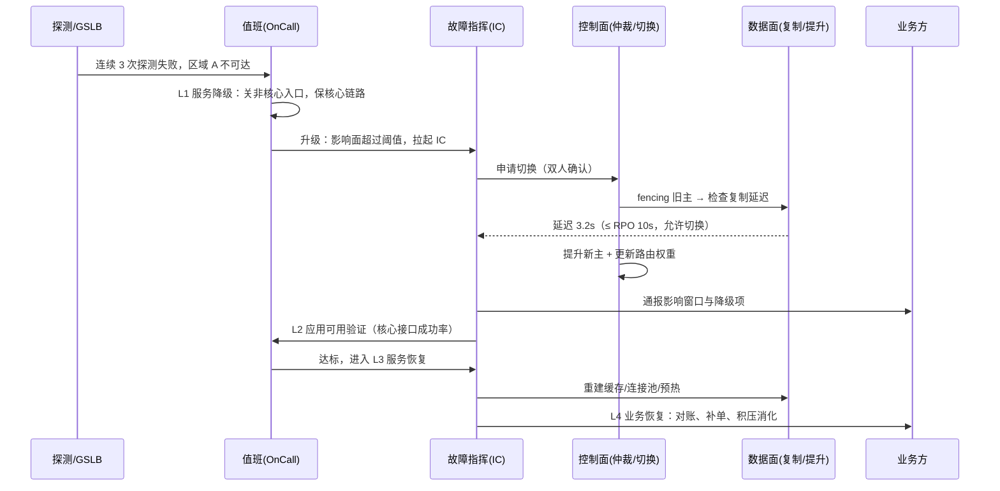

> 本篇是《MHA》系列的**第 1 篇·基础设施层**。MHA 在这里指 **Multi-site High Availability（跨地域多活高可用体系）**，与 MySQL 生态里那个同名的 MHA（Master High Availability）高可用工具无关——同名不同物，写方案时先把口径钉住，否则讨论会两小时都在各说各的。
>
> 两篇的分工很干脆：本篇只谈**基础设施**——计算、网络、存储、数据库、配置这五层怎么划故障域、怎么复制、怎么切换、怎么演练；姊妹篇《应用服务多活及灾备建设方案》谈**应用**——无状态化、单元化、数据一致性、流量灰度、业务级对账。基础设施篇给出的 RTO/RPO 是"底座能力上限"，应用篇决定"能把这个上限用出几成"。与站内其他篇的衔接：存储层直接复用《Ceph》第 3 篇的 RBD-Mirror 与第 5 篇的 RGW Multi-Site；计算层复用《Karmada》《Kubefed》的跨集群分发与漂移；故障定界复用《K8S 排障系列》；自动化阶梯（人决策→人审批→自治）复用《AI-SRE 职业发展阶段演进》的五阶段坐标；成本口径复用《FinOps》的"成本—归属—利用率"闭环。
>
> 口径说明：文中所有 RTO/RPO 数值均为**业务目标口径与经验量级**，不是任何产品的实测数据；成本倍数（1.2×、2×）是容量与带宽的粗略量级，用于比较排序，不用于报价；GB/T 20988 的六级按标准条目**大意归纳**（⚠️ 未逐字核验），落地时以标准原文与行业监管要求为准；产品行为（RBD-Mirror 异步、RGW Multi-Site 的 zone 同步、S3 CRR）以官方文档为准。

---

# 第 0 章：全景链路

```text
故障域：越往外，故障概率越低，但影响半径与恢复成本指数上升
┌─────────┬──────────────┬──────────────┬──────────────┬───────────────┬──────────────┐
│ 进程/实例 │     AZ       │  Region/城市  │   运营商/电网  │   地域性灾难   │   人为误操作   │
└─────────┴──────────────┴──────────────┴──────────────┴───────────────┴──────────────┘
   秒级修复      分钟级切换       小时级切换        小时~天级         天级重建        随时发生

                    ┌──────────── 控制面：谁说了算 ────────────┐
                    │ 健康探测 · 仲裁 quorum · 切换决策 · 回切 │
                    │ 窗口 · 演练编排 · 漂移检测              │
                    └────────┬───────────────────────┬────────┘
                             ▼                       ▼
     流量面：把请求送对地方                     数据面：把数据放对地方
     接入 → DNS/GSLB → Anycast → 网关 → 服务     块复制 → 对象复制 → 数据库主备/多副本
                             ▲                       ▲
        ┌────────────────────┴───────────────────────┴────────────────────┐
        │ 计算（多集群/多 AZ）· 网络（双专线/双路由）· 存储 · 数据库 · 配置（GitOps）│
        └──────────────────────────────────────────────────────────────────┘

一句话主线：灾备不是"再建一套"，而是把故障域一次性划对外，再让流量面与数据面各自能在
            有限时间内"换个位置继续算"；RPO 决定数据面怎么复制，RTO 决定控制面自动化到哪一步。
```

## 0.1 结论先行

- **灾备的能力上限由数据面决定，落地效果由控制面决定。** 复制做得再好，切换靠一个人翻脚本，RTO 依然是四小时。
- **RTO 里最大的块不是执行，是发现与决策。** 经验量级：执行 5–20 分钟，人工决策 10–30 分钟，而"发现"取决于探测与 TTL，常常比前两者之和还长。
- **多活不等于双写。** 双写是数据分叉的入口，不是高可用的手段；能同时写的只有"分区主"或"分片"，不能是"同一个主键两个主"。
- **灾备系统的首要失效模式不是"切不过去"，是"腐化"**——版本漂移、配置漂移、容量漂移，三者任一发生，方案就等于纸面方案。
- **一切切换必须设计回切。** 去程是演练过的路径，回程通常是没演练过的那条，风险更高。

## 0.2 建设愿景（四条，可长期挂在墙上）

这一节是整篇的出发点，也是我做基础设施这些年唯一没变过的四条判断：

1. **以故障为老师，持续改造组件。** 每一次故障事件都要落到至少一个**组件级改造项**上——核心组件、非核心组件、网络组件、计算组件、数据库组件、存储组件，六类逐一问"这次它表现如何、下次怎么让它表现更好"。反思的产出不是复盘报告，是改造项；没有改造项的复盘等于没复盘。
2. **故障处理分等级推进。** 从**服务降级**到**应用可用**，从**服务恢复**到**业务恢复**，四级依次推进，不允许跳级（第 6 章展开）。
3. **把"主动思考"制度化为可执行动作。** 主动思考不是态度，是三张清单：假设清单（我们假设什么不会发生）、单点清单（哪些东西只有一份）、演练清单（哪些能力还没被验证过）。清单每季度刷新一次，比任何口号都有效。
4. **职业操守是可靠性的最后一道冗余。** 不擅自变更、不隐瞒故障、不虚报演练结果——这三条守住，技术不足还有机会补；这三条破了，技术再好也只是把事故推迟到下一次（第 11 章展开）。

## 0.3 本文覆盖与不覆盖

| 覆盖 | 不覆盖 |
|------|--------|
| 故障域划分、RTO/RPO 目标推导 | 业务连续性管理体系（BCM）的组织流程 |
| 流量面调度、数据面复制的工程取舍 | 具体产品的完整安装配置手册 |
| 五层基础设施的灾备手段与失败模式 | 监管合规的逐条映射 |
| 四级故障处理阶梯、演练体系 | 应用层无状态化与单元化（见姊妹篇） |

---

# 第 1 章：基础概念与边界

## 1.1 五个词的分野

行业里这五个词经常混着用，混用的直接后果是需求谈不拢——业务说"要容灾"，运维听成"要备份"，最后交付的东西双方都不满意。

| 词 | 回答的问题 | 判别特征 | 典型交付物 |
|----|-----------|---------|-----------|
| **备份** | 数据能不能找回来 | 允许服务停，只关心历史可回溯 | 快照、备份介质、恢复演练记录 |
| **高可用** | 单点坏了服务能不能不停 | 通常是同机房/同 AZ 内的冗余 | 多副本、健康检查、自动摘除 |
| **容灾** | 整个机房没了能不能继续 | 有备用场地，但可能不承载流量 | 异地机房、复制链路、切换预案 |
| **多活** | 多个场地能不能同时承载 | 流量分片/分流，容量是叠加的 | 双活/多活路由、数据同步、切流机制 |
| **演练** | 上面这些到底行不行 | 唯一能验证能力的手段 | 盲演、切流演练、复盘改造项 |

判别顺序建议固定为三问：**数据能丢吗 → 服务能停吗 → 谁来按下那个按钮。** 三问答完，方案形态基本就定了。

## 1.2 四个度量与"9 的代价"

| 度量 | 定义 | 容易搞错的地方 |
|------|------|---------------|
| **RTO** | 从故障发生到业务可用的时长 | 不只是"切换执行"，还含发现、决策、验证 |
| **RPO** | 允许丢失的数据时间窗 | 异步复制的 RPO 不是一个常数，是延迟的函数 |
| **MTTR** | 平均修复时长 | 与 RTO 同向但不等价，MTTR 是统计值，RTO 是目标 |
| **可用性** | 可用时长 / 总时长 | 折算时务必用"每月分钟数"，不要用百分比想象 |

可用性折算（按 30 天 = 43200 分钟）：

| 可用性 | 每月不可用 | 现实含义 |
|--------|-----------|---------|
| 99.9% | 43.2 分钟 | 一次常规变更窗口就能吃掉 |
| 99.95% | 21.6 分钟 | 需要"变更不中断"的能力 |
| 99.99% | 4.32 分钟 | 人工决策已经来不及，必须自动化 |
| 99.999% | 26 秒 | 需要多活 + 自动摘流，且要接受成本翻几倍 |

最后一行是这一章最重要的一句话：**可用性目标一旦越过 99.99%，就不是"更努力"能解决的，而是架构形态必须换。** 这也是为什么同城双活几乎是 99.99% 的入场券。

## 1.3 故障域：六个层级与对应的钱

| 故障域 | 典型故障 | 影响半径 | 主要对策 | 成本量级 |
|--------|---------|---------|---------|---------|
| 进程/实例 | OOM、死锁、泄漏 | 单实例 | 多副本、健康检查、自动重启 | 极低 |
| AZ | 机房供电/网络/空调 | 单可用区 | 同城双活、跨 AZ 副本 | 2× |
| Region/城市 | 城市级网络、区域性云故障 | 单地域 | 异地灾备、跨地域复制 | 2.5–3× |
| 运营商/电网 | 单运营商出口中断、区域限电 | 跨地域但同运营商 | 双运营商、双路供电、BGP 多出口 | 1.2–1.5× |
| 地域性灾难 | 地震、洪水、极端天气 | 大范围 | 三地多中心、离线备份 | 3–4× |
| 人为误操作 | 误删、误改配置、错误发布 | 不限（往往最大） | 权限最小化、审批、不可变备份、快速回滚 | 低（但最常被忽略） |

把人为误操作放在最后一行是有意的：**它概率最高、成本最低、最容易被技术方案忽略。** 一份 Object Lock 的不可变备份，价格远低于第二个数据中心，却能挡住勒索与误删这两类最常见的"数据全灭"。

## 1.4 三个高频混淆

- **备份 ≠ 容灾。** 备份解决"数据要回来"，容灾解决"服务要活着"。把备份当容灾的组织，往往在真实故障里发现恢复要 8 小时。
- **多活 ≠ 双写。** 双写只是"两边都收写请求"，如果没有分区主或分片规则，它就是数据分叉的生产线。
- **RTO ≠ 切换时长。** 切换只是 RTO 的一段。RTO = 发现 + 决策 + 执行 + 验证 + 预热（缓存、连接池、JIT）。

---

# 第 2 章：灾备等级与目标设定

## 2.1 两条轴：数据可用性 × 场地可用性

GB/T 20988 把灾难恢复能力分成六级，思路其实就两条轴（⚠️ 按条目大意归纳，落地以原文为准）：

- **数据这条轴**：从"定期备份到介质"→"电子传输到备用场地"→"实时数据传输"→"数据零丢失"。
- **场地这条轴**：从"没有备用场地"→"有备用场地但需人工到场"→"部分设备就位"→"完整设备就位"→"远程集群自动接管"。

两条轴同时上移，等级才提升。只做数据轴不做场地轴，就是"数据在、机器不在"；只做场地轴不做数据轴，就是"机器在、数据是昨天的"。**这就是温备最常见的死法。**

## 2.2 六个典型形态

| 形态 | 数据副本方式 | RTO（经验） | RPO（经验） | 成本倍数 | 致命弱点 |
|------|------------|-----------|-----------|---------|---------|
| 冷备 | 定期备份到离线介质/异地对象存储 | 24–72h | 24h 起 | 1.05× | 全靠手工，恢复从未验证 |
| 温备 | 异步复制 + 待命资源（不预热） | 4–24h | 分钟~小时 | 1.2–1.5× | 资源起不来、镜像过期 |
| 热备 | 同步/半同步 + 立即可用资源 | 30–60min | 秒级 | 1.8–2× | 备用侧长期空转，隐蔽缺陷多 |
| 同城双活 | 双 AZ 同步复制 + 流量分流 | 0–5min | 0 | 2× | 只挡 AZ 级故障，挡不住城市级 |
| 两地三中心 | 同城双活 + 异地异步 | 30min–2h（异地） | 秒~分钟 | 2.5–3× | 异地有滞后，切换要做数据取舍 |
| 三地五中心 | 多副本 + 多数派仲裁 | 5–30min | 秒级 | 3–4× | 跨地域写延迟、仲裁复杂度陡增 |

选型时不要问"哪个最先进"，要问"我的业务能接受哪一行的致命弱点"。**表格的最后一列才是决策依据，前几列只是价格。**

## 2.3 目标由业务定，不由运维定

这一步经常被反过来做：运维先算出"我们能做到 2 小时"，然后业务被动接受。正确的顺序是业务影响分析（BIA）先出三个答案：

1. **停多久开始真的丢钱？**（不是"有影响"，是"进不了账"）
2. **丢多少数据必须上报/赔付/重做？**（这条决定 RPO，而不是技术偏好）
3. **哪些功能可以先没有？**（这条是降级清单，直接决定第 6 章 L1 的可行性）

## 2.4 一个反例：把 RTO 定成 0 的组织

我见过不止一次这样的目标："核心系统 RTO 为 0，RPO 为 0"。这句话在物理上要求：跨城同步复制 + 零人工决策 + 全链路自动接管 + 双活写。多数组织付出三倍成本后，得到的真实成绩是 RTO 45 分钟——因为卡在"谁来确认切换"这一步。

更有用的写法是把它拆开：**核心交易 RTO ≤ 5min（自动化，无人确认）；核心查询 RTO ≤ 30min；报表与对账 RTO ≤ 24h；RPO = 0（同城）/ ≤ 10s（异地）。** 分档之后，成本立刻从"全面三地五中心"降到"同城双活 + 异地异步 + 分级预案"，而业务体感几乎不变。

---

# 第 3 章：工作原理——流量面、数据面与控制面

## 3.1 流量面：四种调度手段的真实边界

| 手段 | 生效速度 | 优点 | 硬限制 |
|------|---------|------|--------|
| **DNS 轮询/多 A 记录** | 分钟~小时 | 成本为零，无需设备 | TTL 受 LocalDNS 与客户端缓存支配，运营商侧常不遵守 |
| **GSLB（智能 DNS）** | 秒级探测 + TTL 生效 | 可按地域/健康状态返回不同地址 | 依然受 DNS 缓存约束，切换不"即时" |
| **Anycast** | 秒级（BGP 收敛） | 天然就近与抗 DDoS | 需自有 AS 与 IP 段；会话粘性差；回程路径不可控 |
| **客户端多活（SDK/长连接）** | 秒级，最可控 | 可主动断连、主动重连、带灰度权重 | 需要改客户端，老版本兼容期长 |

结论很明确：**DNS 是"兜底"，不是"主手段"。** 把 RTO 压在 DNS 切换上的方案，实际 RTO 通常被"最长缓存时间"支配，而不是被你的脚本支配。要做秒级切换，客户端多活或网关层调度是必选项。

## 3.2 数据面：复制模式与 RPO 的定量关系

| 模式 | RPO | 代价 | 适用 |
|------|-----|------|------|
| 同步复制 | 0 | 写 RT 增加一个往返；跨城时会把可用性"传染"（对端慢=本地慢） | 同城双活、金融核心账务 |
| 半同步（至少一副本确认） | ≈0（仅故障瞬间可能丢） | 退化风险：副本不足时自动降级为异步，必须监控降级状态 | 核心库、需要兼顾延迟 |
| 异步复制 | ≈ 复制延迟 | 延迟即损失；批量导入与大事务会放大延迟 | 异地灾备、跨地域只读 |
| 日志订阅（CDC） | ≈ 消费延迟 | 需要幂等与顺序保证 | 跨系统同步、单元间同步 |

这里有一个必须写进方案的事实：**异步复制的 RPO 不是一个常数。** 它等于"故障时刻的复制延迟"，而延迟会被三类事件突然放大——大事务（一次批量更新几百万行）、DDL（长事务阻塞）、网络抖动。所以"异地 RPO ≤ 10s"这类目标必须配三件东西：延迟告警、大事务治理、写入限流。

## 3.3 控制面：仲裁、fencing 与脑裂

三个典型脑裂场景，几乎覆盖了所有真实事故：

1. **双主写**：主库网络分区后仍认为自己健康，备库被提升，两边同时接受写入。
2. **仲裁脑裂**：仲裁节点与被隔离的一侧网络可达，与健康一侧反而不可达——判定方向反了。
3. **回切脑裂**：去程切换后旧主未彻底下线，回切时"两个主"短暂并存。

对策是三条组合拳，缺一不可：

- **奇数仲裁，且第三点在独立故障域**（不能和第二点同机房，否则一次 AZ 故障带走两票）。
- **fencing 优先于提升**：先确保旧主真的写不了（隔离网络、下电、只读强制），再提升新主。
- **只写一侧**：任何时刻写入口只能有一个，切换是"开关"不是"叠加"。

## 3.4 一次区域故障的完整时序



时序图里最值得注意的不是箭头，是**两次人工确认点**：L1 的降级（单人可执行）和 L3 的切换（双人确认）。这两点决定了 RTO 的下限——如果 RTO 目标是 5 分钟，它们就必须被设计成自动或半自动。

---

# 第 4 章：分层建设——五层的目标、手段与失败模式

## 4.1 计算层

- **目标**：AZ 级故障 5 分钟内恢复调度能力，Region 级故障 1 小时内恢复。
- **手段**：多 AZ 节点池（反亲和打散）、多集群注册与统一分发（Karmada 的 PropagationPolicy / ClusterAffinity）、故障时按集群优先级漂移、镜像与依赖在灾备侧预热（预拉镜像是最容易被漏掉的一项，它能把 5 分钟变成 40 分钟）。
- **失败模式**：灾备集群的 CNI/CSI 版本落后于生产，Pod 起来但挂不上卷；镜像仓库是单点；调度策略只写了"优先"没写"必须"。

## 4.2 网络层

- **目标**：单运营商出口故障不影响可用性；跨地域互通在主链路中断后 5 分钟内恢复。
- **手段**：双运营商双专线（不同物理路由）、BGP 多出口与本地优先级、跨区 VPN/DCI 备份链路、DNS 与 GSLB 两级兜底、健康检查阈值与 TTL 的联动调参。
- **失败模式**：两条专线走了同一条光缆（"双线"只是账单上的双线）；NAT/防火墙会话表在切换后不重建；MTU 不一致导致跨区大包黑洞。

## 4.3 存储层

- **目标**：块存储 RPO ≤ 5 分钟（异步复制），对象存储 RPO ≤ 1 分钟，且必须有"不可变"的一份。
- **手段**：
  - 块存储：Ceph RBD-Mirror 做集群间异步镜像（journal 模式延迟更低、snapshot 模式更省带宽，二者取舍要按业务写入特征选）。
  - 文件/对象：RGW Multi-Site 做 zone 间同步（注意它的同步是异步的，元数据与数据的一致性窗口不同）；对象侧配合版本控制与跨区域复制。
  - 备份：快照 + 异地对象存储 + **Object Lock/WORM**（挡勒索与误删，这是性价比最高的那一份）。
- **失败模式**：镜像关系建了但从未验证"能不能恢复到时间点"；快照策略覆盖了错误的池；对象桶没开版本控制，覆盖即不可回。

## 4.4 数据层

- **目标**：核心库 RPO = 0（同城）/ ≤ 10s（异地），RTO 分档。
- **手段**：主备 + 半同步（监控"降级为异步"的状态）、跨地域只读副本、分片/单元化让写入可分区、消息队列的跨集群复制（异步，需幂等消费）、缓存的"可丢弃"设计（缓存不做灾备，做重建设计）。
- **失败模式**：半同步退化无人告警；从库延迟被误当成健康；缓存被当成"数据"，故障时无法重建。

## 4.5 配置与交付层（最容易被忽略的一层）

- **目标**：灾备环境的配置与生产**同源**，差异只允许存在于显式声明的差异文件里。
- **手段**：GitOps 单一事实源（ArgoCD/FluxCD 双集群纳管）、环境差异用 values/overlay 表达而不是手工改、每日漂移检测（对比集群实际状态与 Git 期望状态）。
- **失败模式**：灾备环境是"去年某次手工搭的"，版本落后三个大版本——这是"灾备腐化"的主要成因，也是演练永远失败的第一原因。

## 4.6 分层失败模式汇总

| 层 | 最可能的失效 | 一句话处方 |
|----|-------------|-----------|
| 计算 | 灾备集群起不来（版本/镜像/网络插件） | 灾备侧保持"能跑一次"的最小验证集 |
| 网络 | 双线同沟、会话表不重建 | 物理路由审计 + 切换后主动重建连接 |
| 存储 | 镜像建了但恢复从未验证 | 每月一次"恢复到时间点"抽检 |
| 数据 | 半同步静默降级 | 把降级状态做成一级告警 |
| 配置 | 灾备长期漂移 | GitOps 同源 + 每日漂移报告 |

---

# 第 5 章：设计思想——七条硬约束

1. **故障域隔离优先于冗余。** 三个副本放在同一个机柜，等于一个副本；两个机房共用一路市电，等于一个机房。先问"它们会不会一起坏"，再问"有几个"。
2. **RPO 决定复制模式，RTO 决定自动化程度。** 顺序不能反：先定能丢多少，再定复制怎么做；先定能停多久，再定自动化做到哪。
3. **一切切换必须可回切，且回切窗口 ≥ 去程 × 1.5。** 去程有演练、有脚本、有心理准备；回程常常什么都没有。
4. **无演练即无灾备。** 未经演练的切换方案，其真实 RTO 应按"未知"处理，不能写进承诺。
5. **单边容量必须能承接全量。** 双活的意义是"任一侧可独活"；如果切换后立刻雪崩，那不是多活，是两个半残。
6. **配置即代码，灾备环境必须在流水线内。** 任何"手工搭的灾备环境"，都会在 6 个月内腐化。
7. **成本按业务分层，不按系统均摊。** 核心交易买 99.99%，内部报表买 99.9%，别让报表把预算吃光（第 8 章给算法）。

---

# 第 6 章：故障处理等级——从服务降级到业务恢复

这一章是整套方案的中枢。它回答一个在事故现场最容易被跳过的问题：**现在到底处在哪一级，下一步该干什么。**

## 6.1 四级阶梯

| 等级 | 目标 | 判定指标 | 指挥权 | 自动化边界 | 退出条件 |
|------|------|---------|--------|-----------|---------|
| **L1 服务降级** | 先止住影响扩散 | 入口错误率、超时率、核心 QPS 水位 | 值班单人可执行 | 开关半自动，禁止改数据 | 核心链路错误率回到基线 |
| **L2 应用可用** | 恢复到"能用" | 核心接口成功率、P99 延迟 | 值班 + 值班经理 | 摘流、扩容自动 | 核心接口连续 N 分钟达标 |
| **L3 服务恢复** | 恢复到"该有的样子" | 组件健康、复制延迟、容量水位 | 故障指挥（IC） | 切换需双人确认 | 全组件恢复 + 延迟回到阈内 |
| **L4 业务恢复** | 恢复到"账目对得上" | 对账差异、积压量、履约时效 | 业务 + 技术联合 | 补偿任务脚本化 | 对账清零 + 积压归零 |

四级里有一条不明显但极重要的分工：**L1/L2 追求"减少损失"，L3/L4 追求"消除损失"。** 前者是止血，后者是治病。把 L3 的技术动作塞进 L1 去执行，是事故扩大最常见的人为原因——比如一边降级一边急着切库。

## 6.2 为什么顺序不能反

- **先恢复服务再查根因**，是因为服务恢复的时间窗通常只有分钟级，而根因分析是小时级。顺序反了，就是拿分钟级窗口做小时级工作。
- **先降级再切换**，是因为降级能在秒级把 80% 的流量压力卸掉；不降级直接切换，切过去的新区在第一秒就被压垮，然后你会误判为"切换失败"。
- **先服务恢复再业务恢复**，是因为对账与补单必须建立在"数据已经不再变化"的前提上；提前对账，等于在流沙上记账。

## 6.3 与 RTO 的关系

| RTO 目标 | 必须自动化的等级 | 现实含义 |
|---------|----------------|---------|
| ≤ 5 分钟 | L1 + L2 + 部分 L3 | 无人值守降级 + 自动摘流 + 自动切换决策 |
| 5–30 分钟 | L2 自动 + L3 人工确认 | 一个人能完成，且他当时在线 |
| 30 分钟–4 小时 | L1–L3 均可人工 | 依赖流程与文档质量 |
| > 4 小时 | 只需预案 | 本质是"重建"，要接受数据损失 |

这张表是用来反驳"RTO 3 分钟"这类目标的：**3 分钟的 RTO 不是写进文档的值，是自动化覆盖率的函数。**

## 6.4 一个实战推演（40 分钟区域网络抖动）

| 时间 | 等级 | 动作 | 判定 |
|------|------|------|------|
| T+0 | 发现 | GSLB 连续 3 次探测失败（3×5s） | 区域 A 出口不可达 |
| T+2min | L1 | 关掉非核心入口（导出、报表、图片），核心链路保留 | 错误率从 12% 回落到 3% |
| T+6min | L2 | 摘除 A 区实例权重，B 区扩容 30% | 核心成功率 99.6%，达标 |
| T+18min | 判定 | 抖动持续，非瞬时故障，升级 IC | 决策：是否切数据主 |
| T+26min | L3 | fencing + 提升 + 缓存预热 | 写能力恢复，延迟 8s（≤ RPO 10s） |
| T+32min | L2 回归 | 核心接口 P99 回到基线 | 应用可用 |
| T+40min | L4 启动 | 对账脚本跑起来，积压开始消化 | 业务恢复进行中 |

这张表的意义是：**四级不是一个流程图，是一把时间尺。** 有了它，事故现场所有人对"现在几点、该到哪一级"有同一个答案，这比任何预案文档都值钱。

---

# 第 7 章：演练体系——把方案变成能力

## 7.1 四级演练

| 级别 | 形式 | 验证什么 | 频率（经验） | 停机风险 |
|------|------|---------|------------|---------|
| 桌面推演 | 复盘式问答，不动系统 | 预案是否可读、决策链是否清楚 | 月度 | 零 |
| 组件级演练 | 单组件切换/恢复（如 RBD-Mirror 提升、从库提升） | 单点技术路径是否通 | 季度 | 低 |
| 单系统切流 | 一个应用真实切到另一区域，跑 N 分钟 | 端到端是否通、依赖是否齐 | 季度–半年 | 中 |
| 区域级盲演 | 不预告时间与范围，真实切流量（10% 起） | 组织能力、发现与决策时长 | 半年 | 高（需审批） |

关键判断：**桌面推演再多，也替代不了一次组件级演练。** 前者验证的是"人会不会背预案"，后者验证的是"脚本还能不能用"。两者失效的原因完全不同。

## 7.2 五个演练指标

1. **首次判定时长**：从故障注入到有人说出"这是什么故障"。
2. **决策时长**：从判定到"决定切换"。这一项通常最长，也最值得优化。
3. **执行时长**：从决定到执行完成。
4. **验证时长**：从执行完成到"确认业务真的好了"。
5. **误操作数**：演练中执行的错误命令条数——这是唯一能提前发现的"人因风险"。

## 7.3 盲演的红线与边界

盲演很有效，但不能无边界：必须提前声明**不可触碰清单**（涉及合规、资金、外部承诺的系统），必须有**回切预案与一键中止**，必须有**业务方知会的兜底通道**（哪怕是"不告时间但告窗口"）。没有这三条，盲演不是演练，是制造事故。

## 7.4 复盘闭环：从故障到改造项

我把复盘产出的最小结构固定成四行，缺一行就不算完成：

| 项 | 内容 | 落点 |
|----|------|------|
| 事实 | 时间线 + 影响面 + 数据损失 | 故障库 |
| 判据 | 这次学到的一条可复用判断（不是"要加强监控"） | 判据库 |
| 假设被推翻 | 哪条"我们以为不会发生"的假设死了 | 假设清单（第 0.2 节） |
| 改造项 | 谁、做什么、何时验收 | 排期系统 |

这四行对应第 0.2 节的愿景第一条：**反思的产出必须是改造项。** 一份只有"加强""提升""重视"的复盘，本质是一份免责说明。

---

# 第 8 章：性能参数与成本

## 8.1 参数速查（可直接抄进方案）

| 参数 | 经验值 | 说明 |
|------|--------|------|
| 健康探测 | 3 次 × 10s | 连续失败才判定，避免抖动误切 |
| GSLB 探测 | 5s × 3 次 | 与 DNS TTL 联动决定"发现"时长 |
| DNS TTL | 60–300s | 太长切不动，太短抬高解析量与成本 |
| 同城同步复制 RT | < 2ms | 超过 5ms 会显著抬高写尾延迟 |
| 跨地域异步延迟 | 100ms–5s | 决定异地 RPO，需按业务写入特征实测 |
| 仲裁节点 | 奇数 ≥ 3，跨故障域 | 第三点不能与第二点同 AZ |
| 切换窗口（含验证） | 30–90min | 人工决策常占一半以上 |
| 回切窗口 | ≥ 切换窗口 × 1.5 | 回程风险高于去程 |
| 单边容量余量 | ≥ 100%（N-1） | 承接全量后仍需留 30% 缓冲 |
| 演练频率 | 组件级季度 / 区域级半年 | 低于此频次能力会退化 |

## 8.2 三份成本

灾备的成本从来不是"多买一套机器"，它有三份，且常被只算第一份：

| 成本 | 内容 | 常被低估的部分 |
|------|------|--------------|
| 容量成本 | 第二套/第三套资源、存储副本 | 闲置资源的折旧与许可费 |
| 带宽成本 | 跨地域复制流量、专线 | 全量重建时的带宽峰值（往往是日常的 10 倍） |
| 人力成本 | 演练、值班、方案维护 | 每人每季度至少 2–3 天，且是持续支出 |

## 8.3 什么目标不值得买

把 RTO 从 4 小时压到 1 小时的边际成本，通常远低于从 1 小时压到 5 分钟。所以决策规则可以写得很直白：

- **停 4 小时不致命的系统：温备 + 演练即可。** 别买双活。
- **停 1 小时会丢钱的系统：同城双活是性价比拐点。**
- **停 5 分钟就上新闻的系统：才值得三地五中心。**
- **数据不能丢（合规）但可以停的系统：优先买"不可变备份 + 快速恢复"，而不是多活。** 这是最常被买错的一格。

---

# 第 9 章：缺陷与失败模式

## 9.1 八条典型失效

| 失效 | 症状 | 根因 | 处方 |
|------|------|------|------|
| **灾备腐化** | 真故障时脚本版本对不上、镜像拉不到 | 灾备环境不在流水线内 | GitOps 同源发布 + 每日漂移检测 |
| **RPO 击穿** | 切换后丢的数据远超预期 | 大事务/DDL/批量导入把延迟顶到分钟级 | 延迟告警 + 大事务治理 + 写入限流 |
| **脑裂** | 双主写、数据分叉 | 无仲裁、fencing 缺失、第三点同域 | 奇数仲裁 + 先 fencing 后提升 |
| **DNS 切不动** | 改了记录，用户仍打到旧区 | LocalDNS 不遵守 TTL、客户端缓存、长连接 | 客户端多活 + 主动断连 + 网关层兜底 |
| **依赖没跟着多活** | 应用切过去了，配置中心/镜像仓库/第三方还是单点 | 依赖清单缺失 | 依赖拓扑图 + 每个依赖标注"多活等级" |
| **容量不足** | 切过去立刻雪崩，再切回来 | 单边容量 < 全量 | N-1 原则 + 定期容量切流演练 |
| **只有一个人会切** | 关键人休假/离职即失效 | 脚本与权限集中在个人 | 双人持有 + 季度轮换 + 一键化 |
| **演练永远成功** | 演练报告全是绿色，真故障一塌糊涂 | 演练只走"预设通路"、不切真实流量 | 盲演 + 首轮只切 10% 真实流量 |

## 9.2 漂移检测：灾备腐化的三种形态

| 漂移类型 | 检测方法 | 目标 |
|---------|---------|------|
| 配置漂移 | 集群实际状态 vs Git 期望状态，每日 diff | 差异项 = 0（显式差异文件除外） |
| 版本漂移 | 生产与灾备的镜像/Chart/OS 补丁版本对比 | 主版本差 ≤ 0，次版本差 ≤ 1 |
| 容量漂移 | 两侧资源配额与水位对比 | 灾备侧可承接 100% 全量 |

三种漂移全部是"慢性病"：不会立刻出事，但会让每一次演练的结果失去参考价值。

## 9.3 治理：把灾备做成一等公民

- **进入变更流程**：改生产必须同一流水线改灾备，不允许"先生产后补"。
- **进入 SLO**：灾备可用性、复制延迟、演练通过率各有 SLO，并有负责人。
- **进入审计**：季度审计三张清单（假设、单点、演练），缺项挂红。
- **进入预算**：灾备预算是固定条目，不是项目制的临时申请。

---

# 第 10 章：四种落地形态的取舍

| 形态 | 基础设施要点 | 适用业务 | 明确不适用 |
|------|------------|---------|-----------|
| **同城双活** | 双 AZ 同步复制 + GSLB + 客户端多活 | 99.99% 目标的核心交易 | 城市级灾难 |
| **两地三中心** | 同城双活 + 异地异步 + 异地只读 | 绝大多数金融/政企核心 | 无法接受异地数据滞后的强一致场景 |
| **三地五中心** | 多副本 + 多数派 + 单元化写入 | 全国性平台、支付清算 | 中小规模系统（成本不可承受） |
| **单元化底座** | 按分片键切分单元 + 单元内数据闭环 | 超大规模、需要按用户灰度迁移 | 跨单元强事务密集的系统 |

选型的判断顺序建议固定：**先定故障域要挡到哪一层 → 再定 RPO/RTO 分档 → 再看成本能不能承受 → 最后才选形态。** 反过来选（先选形态再找理由）是最常见的浪费。

---

# 第 11 章：运维职业理想与能力模型

## 11.1 三条职业操守硬线

这一节是全文唯一"不谈技术"的部分，但它决定了技术方案能不能落地。

1. **不擅自变更。** 事故现场最危险的动作是"我觉得这样能好"。任何未经确认的变更，都要先问一句"如果这步让情况更糟，回得来吗"。
2. **不隐瞒故障。** 隐瞒的代价不是这一次事故，而是下一次同类事故失去了所有历史判据；同时它会让整条决策链建立在错误事实上。
3. **不虚报演练结果。** 演练报告写"通过"，比不演练更糟——它把"未知风险"变成了"已知安全"，直接摧毁后续所有决策的依据。

三条合起来是一句话：**可靠性的最后一道冗余是人，而人的冗余度取决于他敢不敢说实话。**

## 11.2 能力模型四层

| 层级 | 能力 | 典型表现 | 常见卡点 |
|------|------|---------|---------|
| L1 组件认知 | 知道每个组件怎么坏 | 能定位到具体组件与失效点 | 只会按手册操作 |
| L2 架构设计 | 能划故障域、定复制模式 | 方案能说清"挡哪一层、代价多少" | 只会抄友商架构 |
| L3 故障指挥 | 能在 30 分钟内定级并推进四级 | 现场不慌、分工清晰、决策留痕 | 只会自己干，不会指挥 |
| L4 体系建设 | 能建立演练、复盘、治理闭环 | 组织能力随时间上升 | 只会建系统，不会建机制 |

从 L2 到 L3 是大多数人卡住的地方：**它要求的不是更深的组件知识，而是"在信息不全时做决定并承担"的能力**——这与《ManThinking》那篇说的"署名"是同一件事。

## 11.3 把"主动思考"变成制度

第 0.2 节说的三张清单，落到日常就是三个固定动作：

- **每季度更新假设清单**：写下"我们认为不会发生什么"，然后逐条问"如果它发生了呢"。这份清单往往是下一次故障的预言书。
- **每季度更新单点清单**：不是查配置，是查"只有一份"的东西——一个人、一台机、一条线、一个证书、一个第三方账号。
- **每季度更新演练清单**：把"还没被验证的能力"排到前面，而不是把"容易通过的演练"排到前面。

# 收尾：一句话判据

基础设施灾备最容易的错觉是"我已经建了"。真正的判据只有一条：**在没人帮忙、没人提醒、时间在跑的情况下，这套东西能不能自己把业务救回来。** 能，才叫灾备；不能，它只是第二套机房。

---

# 附录

## A. 术语速查

| 术语 | 含义 |
|------|------|
| MHA（本篇口径） | Multi-site High Availability，跨地域多活高可用体系；非 MySQL 的 MHA 工具 |
| RTO | 恢复时间目标，含发现、决策、执行、验证、预热 |
| RPO | 恢复点目标，即允许丢失的数据时间窗；异步模式下为复制延迟的函数 |
| 故障域 | 会"一起坏"的最小集合：实例、AZ、Region、运营商、电网、人为误操作 |
| 脑裂 | 网络分区后两侧都认为自己应为主，导致双写与数据分叉 |
| fencing | 在提升新主前强制旧主不可写的操作（隔离网络/下电/强制只读） |
| 仲裁 quorum | 用奇数节点多数派决定"谁有权做主"，第三点须在独立故障域 |
| 灾备腐化 | 灾备环境因脱离流水线而产生的配置/版本/容量漂移 |
| 单边容量（N-1） | 任一侧在承接全量流量后仍可稳定运行的能力要求 |
| 盲演 | 不预告时间与范围的真实切换演练 |
| 回切 | 故障恢复后把流量与主从关系切回原状的过程，风险高于去程 |
| 不可变备份 | 具备 WORM/Object Lock 特性的备份，用于抵御勒索与误删 |

## B. 参考资料

- GB/T 20988-2007《信息安全技术 信息系统灾难恢复规范》（六级灾难恢复能力；⚠️ 本文按条目大意归纳，落地以原文为准）
- 站内姊妹篇：《【MHA】应用服务多活及灾备建设方案》（应用层：无状态化、单元化、一致性、业务恢复）
- 站内支撑篇：《【Ceph】3-存储类型-RBD》（RBD-Mirror 跨集群异步镜像）、《【Ceph】5-存储类型-对象》（RGW Multi-Site 与版本控制）、《【Karmada】基础应用实践》（跨集群分发与漂移）、《【Kubefed】基础应用实践》（联邦 API 的历史教训）、《【Kubernetes】K8S 排障系列》（故障定界）、《【SRE】AI-SRE 职业发展阶段演进》（自动化阶梯与治理）、《【FinOps】基于 Prometheus 估算服务容器成本》（成本归属口径）、《【ManThinking】聚焦专注人思维产物》（决策与署名的认知基础）

## C. 变更记录

| 版本 | 日期 | 变更 |
|------|------|------|
| v1 | 2026-10-30 | 初版：四条愿景、六级故障域、六种形态、三面工作原理、五层建设、四级故障处理阶梯、四级演练、十项参数、八条失效 |