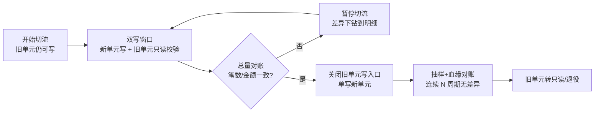

> 本篇是《MHA》系列的**第 2 篇·应用层**。MHA 在本系列中指 **Multi-site High Availability（跨地域多活高可用体系）**，与 MySQL 生态的 MHA 工具无关。
>
> 与姊妹篇《【MHA】基础设施跨地域灾备建设方案》的分工：基础设施篇解决"**底座的故障域、复制与切换**"，给出的是能力上限；本篇解决"**应用怎么把这个上限用出来**"——状态怎么外置、数据怎么分区、流量怎么灰度、账目怎么对回来。一句话概括两篇的关系：**基础设施决定你能不能在 5 分钟内换一个地方继续算，应用决定换过去之后业务是不是真的还能用。**
>
> 与站内其他篇的衔接：《【Kubernetes】基于 Service 四层 TCP 负载均衡策略》提供实例级摘流与负载均衡的底座手法；《【Openkruise】基础应用实践》的原地升级与流控是"不重启切流"的关键能力；《【Knative】2-Knative Serving》的流量灰度是切流节奏的参考实现；《【Karmada】基础应用实践》负责跨集群分发与故障漂移；成本口径仍复用《【FinOps】基于 Prometheus 估算服务容器成本》。
>
> 口径说明：文中所有百分比、时长、阈值均为**经验口径与假设数据**，用于建立可讨论的坐标系，不是任何系统的实测值；涉及数据库、消息、缓存的机制描述以官方文档为准；一致性等级用"强一致/最终一致"两个工程口径表述，不引入分布式理论的形式化定义。

---

# 第 0 章：全景链路

```text
 客户端（多版本共存 / SDK 或长连接）
    │  ① 入口层：DNS / GSLB / Anycast —— 决定"去哪"
    ▼
 接入层 ──▶ 网关（路由 · 限流 · 降级开关 · 灰度权重）
    │      ② 切流点：权重 / 按用户 / 按单元 / 白名单
    ▼
 服务层（无状态实例 + 单元内闭环）
    │      ③ 状态点：会话 · 本地缓存 · 本地文件 · 内存队列 · 定时任务
    ├────▶ 缓存 / 消息 / 搜索 / 调度       ④ 依赖点：它们有没有跟着多活
    ▼
 数据层（分区主 + 同步/异步复制 + 全局唯一 ID）
    │      ⑤ 一致点：任何时刻写入只有一侧
    ▼
 对账与补偿（总量 · 抽样 · 血缘）          ⑥ 恢复点：账目对不对得上

一句话主线：应用多活的全部工作可以压缩成一句话——把"状态、数据、流量、依赖、账目"
五样东西，分别交给"外置、分区、可调、跟随、可对"五个动作。
```

## 0.1 结论先行

- **多活的成立条件不是"两个机房都部署了"，而是"任一侧都能独立承接全量，且写入永远只有一侧"。**
- **难点从来不在流量，在数据；数据里最难的也不是复制，是"冲突时听谁的"。**
- **能不分叉就不要多写**：优先"分区主"，其次"单写 + 异步"，最后才考虑"双向写 + 冲突解决"。
- **降级开关是应用侧杠杆最高的灾备手段**：秒级生效、几乎零成本、不需要数据迁移。它应该被当成一等公民设计，而不是故障时临时找配置项。
- **用户真正感知的是 L4 业务恢复**（对账、补单、赔付），但绝大多数预案只写到 L3 服务恢复。

## 0.2 一条判断线

判断一个系统"是不是真多活"，只问一个问题：**把任意一侧整体拔掉，业务能不能在 RTO 内继续跑完全量？** 能，就是多活；不能，它只是"部署了两份"。

---

# 第 1 章：概念与四种拓扑

## 1.1 判别标准只有一个：谁在写

| 拓扑 | 写入侧 | 容量叠加 | 切换粒度 | 主要数据风险 |
|------|--------|---------|---------|-------------|
| 主备 | 单侧写，备侧不承载 | 否（1+1） | 整站 | 复制延迟决定 RPO |
| 读写分离式"伪双活" | 单侧写，另侧只读 | 部分（读可分流） | 整站或按流量 | 只读延迟、"读到旧数据"投诉 |
| 真双活 | 按分片两侧都写 | 是 | 分片级 | 写冲突、回环、乱序 |
| 单元化多活 | 每个单元自己写自己那片 | 是（N×单元） | 单元级 | 数据迁移、跨单元聚合 |

这张表最有用的地方在于第二列。**很多被叫做"双活"的系统，第二列写的是"否"**——它们能扛单机房故障，却扛不住"一边整体消失后要承接全量"，因为容量本来就没叠加。

## 1.2 多活的三个必要条件

按改造难度排序，顺序不能反：

1. **状态可外置**（应用层能改）：会话、本地缓存、本地文件、定时任务先从进程里搬出去。
2. **数据可分片**（数据层能改）：找到能把写入切成互不相交子集的键。
3. **流量可调度**（接入层能改）：有能在秒级把请求挪走的通道，而不是等 DNS 缓存过期。

三者的关系是串联：状态不外置，切流等于让用户掉线；数据不可分片，多写就是灾难；流量不可调度，前面两条都白做。

## 1.3 一致性取舍：哪些数据必须强一致

多活不是"所有数据都要强一致"，那会把可用性拖垮。工程上按数据类别先分级：

| 数据类 | 例子 | 一致性要求 | 手段 |
|--------|------|-----------|------|
| 资金账务 | 余额、流水、清算 | 强一致 | 分区主 + 同城同步复制 |
| 库存扣减 | 秒杀库存、券库存 | 强一致（或预扣 + 对账） | 单写 + 预扣 + 异步核销 |
| 唯一性约束 | 订单号、用户名、幂等键 | 强一致 | 号段/雪花 + 唯一索引 |
| 权益与积分 | 成长值、返利 | 最终一致 | CDC + 幂等消费 + 对账 |
| 索引与搜索 | 商品检索、推荐 | 最终一致（可重建） | 消息驱动重建 |
| 日志与埋点 | 行为日志 | 允许丢 | 本地缓冲 + 批量上报 |

判据很简单：**这条数据错了，是"要赔钱"还是"会被用户看到"？** 要赔钱的做强一致，只是被看到的做最终一致。

---

# 第 2 章：应用多活的四个真难题

| 难题 | 表现 | 为什么难 | 破法 |
|------|------|---------|------|
| **状态** | 切流后用户被踢下线、任务重复执行 | 状态藏在进程里，看不见摸不着 | 全量盘点 + 外置 + 允许重建 |
| **数据** | 双写打架、更新乱序、旧值覆盖新值 | 没有全局时钟，也没有全局顺序 | 分区主（优先）+ 幂等 + 顺序键 |
| **流量** | DNS 改了但用户还打旧区；长连接不断开 | 缓存与连接不受你控制 | 客户端多活 + 主动断连 + 网关兜底 |
| **依赖** | 应用切过去了，配置中心/第三方还是单点 | 依赖清单从来没有完整过 | 依赖拓扑图 + 每个依赖标"多活等级" |

第四行最容易被低估。我在一次切换演练里见过这样的顺序：应用、数据库、缓存全部切成功，最后卡在**配置中心**——它部署在 A 区，而 A 区正是被演练"拔掉"的那个。**多活的木桶由最短的那块依赖决定，而这块板通常不在应用团队的清单里。**

---

# 第 3 章 无状态化：先把"看不见的状态"变成清单

## 3.1 七类状态清单

无状态化不是一个重构动作，是一次**盘点动作**。按下面七类逐项过，漏一类，切流时就多一种掉线方式。

| 状态类型 | 症状 | 改造方式 | 残余风险 |
|---------|------|---------|---------|
| 会话（Session） | 切流后用户被登出 | Token/JWT 或集中式会话存储 | 令牌撤销不及时，需短 TTL + 黑名单 |
| 本地缓存 | 切流后命中率归零、回源打爆库 | 分布式缓存或本地缓存 + 预热 | 缓存本身成单点，需按多活等级建设 |
| 本地文件 | 上传的附件只在 A 区能读到 | 对象存储 + 跨区域复制 | 复制延迟导致"刚传的文件读不到" |
| 内存队列 | 进程重启丢任务 | 消息队列 + 持久化 + 幂等消费 | MQ 跨集群复制是异步的 |
| 定时任务 | 两个区同时跑，数据重复 | 分布式调度 + 选主（同一时刻只一处执行） | 选主脑裂 → 需要 fencing |
| 序列号/自增 | 两侧 ID 撞车 | 号段/雪花 + 全局唯一 | 时钟回拨 |
| 连接与订阅 | 长连接、binlog 订阅、WebSocket | 连接迁移 + 主动断连 + 重订阅机制 | 重连风暴 |

## 3.2 改造顺序：先"可丢弃"，再"有状态"，最后"必须有主"

1. **可丢弃的**（本地缓存）：改成分布式缓存，允许重建。收益最大、风险最低。
2. **可外置的**（会话、文件、队列）：搬到托管组件，注意托管组件自身的多活等级。
3. **必须有主的**（定时任务、序列号）：引入选主与 fencing，这是唯一需要引入"谁说了算"的地方。

## 3.3 外置之后的新单点

无状态化有一个副作用，必须写进方案：**你把七个单点，换成了 Redis、MQ、对象存储、调度中心四个更大的单点。**

所以改造的验收标准不是"应用没状态了"，而是"**每个外置组件都标注了多活等级，并且与业务 RTO 匹配**"。一个 99.99% 的应用挂在一个单 AZ 的 Redis 上，它的真实可用性是 99.9%。

---

# 第 4 章：单元化架构

## 4.1 单元的三个必备属性

单元（Unit）不是"一套部署"，它必须同时具备三条：

1. **数据闭环**：单元内能独立完成读与写，不依赖其他单元的数据。
2. **容量按比例**：单元容量 ≈ 全量 / 单元数，且任一元故障后剩余单元可重分布。
3. **可独立部署与升级**：单元能单独发版，这是做灰度迁移的前提。

缺第一条，单元就只是"多副本"；缺第二条，故障时必然雪崩；缺第三条，迁移只能停机做。

## 4.2 分片键：选错就全盘皆输

| 原则 | 说明 | 反例 |
|------|------|------|
| **高基数** | 取值足够多，能均匀切分 | 用"省份"做键，头部省份单元过热 |
| **稳定** | 不随业务变化而改变 | 用"用户等级"做键，等级一变就要迁数据 |
| **业务可解释** | 能对用户/客服解释"你在哪个单元" | 用哈希值，出问题时没人能推理 |
| **避免跨单元** | 主要查询路径只落在单一键上 | 用"订单 ID"做键，但查询按"用户" |

最后一条是核心：**分片键决定"哪些操作会跨单元"，而跨单元调用就是多活架构的成本本身。** 电商类系统通常选用户/租户 ID，因为绝大多数查询天然带上它。

## 4.3 路由层与逃生通道

- **接入层路由**：在入口按分片键计算单元，把请求直接打到目标单元（成本最低、路径最短）。
- **网关路由**：由网关统一改写目标地址，便于统一灰度与熔断。
- **SDK 路由**：客户端感知分区，灵活但升级成本高。

无论哪种，都必须有一条**逃生通道**：当单元路由失败或单元不可用时，请求能降级到"中心单元"或"任意可用单元"处理。逃生通道的代价是**可能破坏数据闭环**，所以它必须配三条约束：只允许读、写要进补偿队列、必须记录"逃生态"时长。

## 4.4 单元化的代价

| 代价 | 具体表现 | 缓解 |
|------|---------|------|
| 扩容粒度变粗 | 一次扩一整个单元 | 单元内弹性 + 超卖比控制 |
| 数据迁移复杂 | 分片迁移需要双写与校验 | 迁移窗口 + 总量对账 + 可回滚 |
| 跨单元查询 | 报表、搜索、风控需要聚合 | 异步汇总表 / 离线数仓 |
| 缓存与索引按单元化 | 命中率下降、索引重建 | 单元内缓存 + 全局索引异步同步 |
| 监控维度翻倍 | 每单元一套指标与告警 | 统一标签体系 + 单元视图 |

## 4.5 存量迁移的推荐节奏

**新用户先进新单元（双写过渡）→ 存量按分片迁移（可回滚）→ 旧单元逐步退役。**

这条节奏的好处是把"迁移风险"摊薄到时间上：新用户量小、可控；存量迁移有明确的对账口径；旧单元退役是确认无流量后的收尾动作，而不是一次赌博。

---

# 第 5 章：数据同步与一致性

## 5.1 四种同步方式

| 方式 | 一致性 | 可用性影响 | 复杂度 | 适用 |
|------|--------|-----------|--------|------|
| 同步双写（应用层） | 强（若两侧都成功） | 高（任一失败即失败，或降级为单写） | 中 | 少量强一致数据 |
| 数据库异步复制 | 弱（≈延迟） | 低 | 低 | 同城/异地副本、只读分流 |
| CDC 日志订阅 | 弱（≈消费延迟） | 低 | 中 | 跨系统同步、搜索索引、单元间同步 |
| 双向同步 | 弱 + 冲突 | 低 | 高 | 单元互备、历史包袱系统 |

**同步双写最大的坑是"部分成功"**：A 成功 B 超时，应用不知道该回滚还是重试。所以它只适合数据量小、可补偿的场景；一旦出现"两个库都要写"的设计，先问一句"能不能改成单写 + 异步复制"。

## 5.2 冲突解决：优先避免，而不是解决

冲突解决的四种办法，优先级从高到低：

1. **分区主（最优先）**：同一个键永远只在一侧写。本质上是用分片"消灭"冲突，而不是解决冲突。
2. **业务合并**：金额累加、库存加减这类可交换操作，天然无冲突。
3. **版本向量 / 逻辑时钟**：能检测并发写，但需要业务定义"并发了怎么办"。
4. **最后写入胜出（LWW）**：实现最省事，代价是**静默丢数据**，只在"丢一条无所谓"的场景用。

请把这句话写进设计评审：**凡是用了 LWW 的字段，都要明确写出"这里可能丢掉一次更新"。** 不写，它就是一颗定时炸弹。

## 5.3 幂等三件套

切换、重试、补偿、消息重投——多活架构里所有的"再来一次"都要求幂等。三件套：

| 手段 | 做法 | 适用 |
|------|------|------|
| 全局唯一键 | 号段/雪花 + 业务号组合 | 创建类操作（下单、支付） |
| 幂等去重表 | 唯一索引 + 状态字段 | 有外部回调的操作 |
| 状态机单向流转 | 只允许 待支付→已支付→已发货 | 状态变更类操作 |

三者的共同前提是**"幂等键必须由业务提供，不能由请求时间生成"**。用时间戳当幂等键的系统，重试一次就是两笔单。

## 5.4 对账：业务恢复唯一可信的判据

| 层次 | 方法 | 频率 | 用途 |
|------|------|------|------|
| 总量对账 | 笔数 + 金额汇总比对 | 分钟级 | 第一道红线，最快发现分叉 |
| 抽样对账 | 按比例取明细逐字段比对 | 小时级 | 定位差异类型 |
| 血缘对账 | 沿业务链路逐段核验（下单→支付→发货） | 日级 | 找到差异发生在哪一段 |

处置规则要**写死在代码里**，不能靠人判断：差异率超过阈值（经验口径 0.1%）自动暂停补单并告警，避免"边补边错"。

## 5.5 一次切流后的一致性收敛



这张图的重点是那个**回退箭头**：切流不是单向推进，是"推进—校验—必要时回退"的循环。任何不允许回退的切流流程，都会在第一次失败时变成事故。

---

# 第 6 章 流量调度与切流

## 6.1 四层调度能力

| 层 | 生效速度 | 精度 | 硬限制 |
|----|---------|------|--------|
| DNS / GSLB | 分钟~小时（受 TTL 与缓存支配） | 地域级 | LocalDNS 不遵守 TTL，客户端缓存不可控 |
| 网关 / Ingress | 秒级 | 请求级（权重、Header、路径） | 需要请求能到达网关 |
| 服务网格 | 秒级 | 连接级 | 引入一格额外的故障面 |
| 客户端 SDK | 秒级，最可控 | 用户级 | 要求客户端可升级，老版本兼容期长 |

**结论：要和"秒级 RTO"对齐，必须至少有一层是网关或 SDK。** 只靠 DNS 的方案，RTO 的真实值等于"最长客户端缓存时间"。

## 6.2 五种灰度方式

| 方式 | 粒度 | 适用 | 注意 |
|------|------|------|------|
| 权重切流 | 流量比例 | 通用首选 | 小流量阶段容易样本不足、指标抖动 |
| 按用户取模 | 用户级 | 需要"同一用户始终一致" | 取模基数变更会导致用户漂移 |
| 按地域 | 地域级 | 单元化系统 | 跨地域用户体验差异 |
| 按分片键迁移 | 数据分片级 | 单元化扩容/迁移 | 迁移期间必须双写 + 对账 |
| 白名单 | 指定用户/租户 | 内测、VIP 保底 | 无法反映真实流量分布 |

## 6.3 切流前提清单（八条，缺一不切）

1. 目标侧容量 ≥ 全量 × 1.3（含 N-1 缓冲）。
2. 数据同步延迟 ≤ RPO 阈值，且连续观察 10 分钟稳定。
3. 依赖清单逐项确认：配置中心、注册中心、缓存、MQ、对象存储、第三方。
4. 降级开关已就位并可远程触发。
5. 回切路径与回切窗口已演练过至少一次。
6. 监控与告警已切到"目标侧视角"，能立刻看出错误率拐点。
7. 指挥人、执行人、业务知会人三方在线。
8. 对账任务已启动，阈值与自动处置规则已生效。

第八条最容易被跳过，也最致命：**没有对账的切流，等于蒙着眼睛过马路。**

## 6.4 切流节奏模板

| 阶段 | 流量 | 停留时长（经验） | 观察重点 | 放行条件 |
|------|------|----------------|---------|---------|
| 预热 | 0%（只导影子流量） | 30min | 缓存命中率、连接池、慢查询 | 无新增错误日志 |
| 试探 | 1% | 30min | 错误率、P99、对账差异 | 与基线差 ≤ 0.1% |
| 小步 | 10% | 60min | 同上 + 业务指标 | 稳定 2 个观察窗 |
| 中步 | 50% | 60min | 容量水位、依赖压力 | 水位 ≤ 70% |
| 全量 | 100% | — | 全套 | 连续 4 小时无异常 |
| 收尾 | 旧侧只读 | — | 残余连接、定时任务选主 | 旧侧写入归零 |

**每一档都要能原地停住。** 停不住说明这一档的放行条件写得太软。

## 6.5 回切与"单向开关"

回切的风险高于去程，原因有二：旧侧的数据在被切走后可能已经落后；回切时两侧状态不对称，最容易脑裂。

两条纪律：

- **回切窗口 ≥ 去程时长 × 1.5**，并单独演练。
- **单向开关**：切流开关只允许"从旧到新"和"从新到旧"两个方向，不允许"两侧同时开"。技术实现上，写入口必须是一个唯一开关，而不是两个团队的各自配置。

---

# 第 7 章 故障处理四级在应用侧

与基础设施篇共用同一套阶梯，但应用侧的动作完全不同。**同一套等级、两套动作、一个指挥**，这是两篇能对齐的关键。

## 7.1 四级动作表

| 等级 | 应用侧主要动作 | 判定指标 | 责任人 | 常见错误 |
|------|--------------|---------|--------|---------|
| **L1 服务降级** | 关非核心功能、关重试、缩短超时、限流 | 入口错误率、核心 QPS 水位 | 值班单人 | 一边降级一边改数据 |
| **L2 应用可用** | 摘流故障实例、扩容目标侧、切只读副本 | 核心接口成功率、P99 | 值班 + 值班经理 | 扩容前没预热缓存 |
| **L3 服务恢复** | 切数据主、重建缓存、清理积压、修数据 | 复制延迟、积压量、组件健康 | 故障指挥（IC） | 缓存未预热直接放全量 |
| **L4 业务恢复** | 对账、补单、退款、通知、报送 | 差异率、积压归零、履约时效 | 业务 + 技术联合 | 在对账未清零时就宣布结束 |

## 7.2 降级开关的设计规范

开关是应用侧最高杠杆的灾备手段，值得按"组件"而不是"配置项"来设计：

- **默认值必须安全**：开关服务的不可用时，业务应回到"受保护"状态，而不是全开。
- **可自动触发**：错误率/延迟超阈值自动降级，人工只负责确认，不负责按按钮。
- **分级**：功能级（关导出、关推荐）、依赖级（跳过风控、跳过第三方）、容量级（限流、降级队列）。
- **可观测**：每个开关的状态是一级指标，且变更留痕（谁、何时、为什么）。
- **要演练**：每个季度至少真关一次，确认副作用清单是完整的。

最后一条经常被省掉，代价是：开关第一次被真的打开时，你才发现它关掉的那个功能是核心链路的隐藏依赖。

## 7.3 L3 里最容易被忽略的三件事

1. **缓存预热**：新侧缓存命中率从 0 到 90%，需要时间与流量；直接放全量就是雪崩。
2. **连接池与线程池**：新侧池子是按常态负载配的，突增会直接拒绝。
3. **积压消化**：消息积压是有"消化速率上限"的，切回去不代表业务恢复，只代表开始消化。

## 7.4 L4 才是用户感知的那一段

| 动作 | 判据 | 谁做 |
|------|------|------|
| 对账 | 差异率 ≤ 阈值，连续 N 周期 | 技术 |
| 补单/重放 | 积压归零、幂等无重复 | 技术 + 业务 |
| 退款/赔付 | 客诉量回到基线 | 业务 |
| 用户沟通 | 公告/短信/客服口径统一 | 业务 + 公关 |
| 监管报送（如适用） | 按时限完成 | 合规 |

**L4 没有完成时间点的技术故障，本质上都只是"暂时看起来好了"。**

## 7.5 一个推演（假设数据）

| 时间 | 等级 | 动作 | 结果 |
|------|------|------|------|
| T+0 | 发现 | 网关 5xx 从 0.2% 升到 8% | 定位到 A 区依赖超时 |
| T+2min | L1 | 关闭推荐与导出，超时 3s→800ms，关闭自动重试 | 错误率回落到 2.5% |
| T+8min | L2 | 摘除 A 区权重，B 区扩容 40%，预热热点缓存 | 成功率 99.5% |
| T+20min | L3 | 决策切数据主，双人确认，fencing 旧主 | 写恢复，延迟 6s（≤ RPO 10s） |
| T+35min | L3 | 积压开始消化，速率 1.2 万条/分钟 | 预计 40 分钟清空 |
| T+50min | L4 | 总量对账启动，差异 0.03% | 进入补单流程 |
| T+3h | L4 | 差异清零，客诉回落 | 宣布业务恢复 |
| T+1d | 复盘 | 产出 4 个改造项 | 进入排期 |

---

# 第 8 章 容量、演练与恢复速度

## 8.1 N-1 与冷启动

- **容量**：任一侧必须能承接全量，且承接后水位 ≤ 70%（留出突发余量）。这条不满足，"双活"只是名义上的。
- **冷启动**：新侧第一次接流量时，缓存命中率为 0。经验上，热点缓存预热能把"命中率 0→90%"的时间从十几分钟压到两三分钟，这直接决定 L2 的时长。
- **连接风暴**：切流瞬间的重连是致命的，需要客户端退避重试（指数退避 + 抖动）与网关侧连接数保护。

## 8.2 四级演练

| 级别 | 形式 | 验证什么 | 频率（经验） |
|------|------|---------|------------|
| 桌面推演 | 走预案，不动系统 | 决策链与分工 | 月度 |
| 开关演练 | 真关降级开关，观察副作用 | 降级清单是否完整 | 季度 |
| 单机房摘流 | 一个应用真实切到另一侧 | 端到端与依赖完整性 | 季度–半年 |
| 单元切换 + 数据回放 | 切一个单元，用影子流量回放 | 数据一致性、对账、迁移路径 | 半年 |

## 8.3 演练要看五个数

1. **切流时长**（从决定到全量）。
2. **错误率拐点**（切流瞬间的错误率峰值）。
3. **数据同步延迟峰值**（尤其迁移/双写窗口）。
4. **缓存命中率恢复时长**。
5. **对账差异率**（唯一能证明"数据没错"的指标）。

前四个衡量"快不快"，第五个衡量"对不对"。**只练快不练对，等于把风险推到事后。**

---

# 第 9 章：参数速查与成本

## 9.1 参数速查（可直接抄进方案）

| 参数 | 经验值 | 说明 |
|------|--------|------|
| 单侧容量余量 | ≥ 100%，水位 ≤ 70% | N-1 原则 |
| 目标侧预热流量 | 5–10%，持续 ≥ 15min | 用于缓存与连接池预热 |
| 切流档位 | 1% → 10% → 50% → 100% | 每档停留 ≥ 1 个观察窗 |
| 观察窗 | 30–60min | 小于 30min 发现不了慢故障 |
| 数据延迟阈值 | ≤ RPO × 0.5 | 留一半余量给故障瞬间的放大 |
| 对账频率 | 分钟级总量 / 小时级抽样 | 总量最先发现分叉 |
| 差异率阈值 | 0.1%（经验） | 超阈值自动暂停补单 |
| 重试退避 | 指数退避 + 抖动，上限 3 次 | 避免重连风暴 |
| 幂等窗口 | ≥ 业务最长重试周期（常见 24h） | 去重表保留时长 |
| 回切窗口 | ≥ 去程 × 1.5 | 回切风险更高 |

## 9.2 三份成本

| 成本 | 内容 | 常见低估点 |
|------|------|-----------|
| 容量 | 双份/多份资源、单元数 × 单单元容量 | "按比例"配置后单侧其实接不住全量 |
| 改造 | 无状态化、幂等、对账、开关、路由 | 改造成本常被算成"一次项目"，实际是持续演进 |
| 运行 | 双写窗口的带宽、对账算力、演练停机 | 对账的算力峰值往往被漏算 |

## 9.3 什么不值得做

- **低频功能不必多活**：一年用两次的功能，做降级开关比做多活便宜一个数量级。
- **可重建数据不必同步**：搜索索引、推荐特征都可以重建，"重建时间"才是它的 RPO。
- **内部报表系统不必双活**：延迟一天无感，做只读副本 + 备份即可。

**多活是给"停一分钟就疼"的链路做的，不是给所有链路做的。** 把所有系统都做成多活，通常的结果是预算耗尽、核心链路反而做不彻底。

---

# 第 10 章：缺陷与反模式

| 反模式 | 症状 | 根因 | 处方 |
|--------|------|------|------|
| **假装多活** | 部署了两份，写入还是单点 | 只做了容量部署，没做数据分区 | 用"拔掉一侧"验证真伪 |
| **双写打架** | 同一订单状态反复横跳 | 同步双写无幂等、无顺序 | 改单写 + 异步 + 幂等 |
| **无幂等重试** | 切换后出现重复订单 | 幂等键用时间戳生成 | 业务键幂等 + 去重表 |
| **缓存雪崩** | 切流瞬间数据库被打满 | 未预热、无本地兜底 | 预热 + 限流 + 请求合并 |
| **依赖没跟着多活** | 应用切过去，配置中心在旧区 | 依赖清单缺失 | 依赖拓扑 + 多活等级标注 |
| **只有一个人会切** | 关键人不在就无法切换 | 脚本与权限集中 | 双人持有 + 季度轮换 + 一键化 |
| **演练只演不切** | 演练报告全绿，真故障全乱 | 演练走预设通路 | 真切 1% 真实流量 |
| **L3 假恢复** | 服务恢复了，账目一直在错 | 没有对账或对账未接入流程 | 把对账作为恢复的验收门 |

第八条是应用侧最贵的错误。**服务恢复是可观测的，账目正确是不可观测的**——不可观测的东西，如果没有人负责，它就永远不会被验证。

---

# 第 11 章 落地路线：六阶段

| 阶段 | 产出 | 验收标准 | 周期（经验） |
|------|------|---------|------------|
| 1 现状评估 | 状态清单、依赖拓扑、故障域图 | 七类状态全部有归属 | 2–4 周 |
| 2 无状态化 | 会话/缓存/文件/队列外置 | 单实例可随意销毁重建 | 1–2 个月 |
| 3 数据分层 | 一致性分级表、分片键选型 | 每类数据有一致性承诺 | 1–2 个月 |
| 4 切流通道 | 网关/SDK 调度 + 灰度能力 | 1% 流量可秒级切并可回切 | 1 个月 |
| 5 单元化/双活 | 单元闭环 + 双写迁移 | 单侧可承接全量（水位 ≤70%） | 2–4 个月 |
| 6 固化 | 开关、对账、演练、预案 | 盲演通过 + 对账清零 | 持续 |

阶段 4 与阶段 5 的顺序值得强调：**先有切流通道，再做单元化。** 反过来做，你会在长达数月的单元化改造结束后，才发现自己没有"能停下、能回退"的通道。

---

# 第 12 章：场景与边界

| 场景 | 落脚点 | 关键动作 |
|------|--------|---------|
| 电商交易 | 用户 ID 分片单元化 | 库存单写 + 预扣、订单对账 |
| 金融账务 | 同城双活 + 分区主 | 强一致 + 双人确认 + 逐笔对账 |
| SaaS 多租户 | 租户 ID 分片 | 大租户独立单元、跨租户聚合异步化 |
| 内容/搜索 | 索引可重建 | 用"重建时间"当 RPO，不做同步 |
| 内部系统 | 备份 + 降级 | 不做多活，做"能快速重建" |

三处明确的边界：

- **强一致跨地域写入**：物理上要求同步往返，跨地域一律会拖慢写入。这类需求应先质疑业务必要性。
- **超小规模系统**：QPS 低、可停机的系统，做多活的投入产出比极差。
- **强事务密集 + 跨分片**：跨单元分布式事务的复杂度会吞掉多活的全部收益，应优先做业务侧拆分。

---

# 附录

## A. 术语速查

| 术语 | 含义 |
|------|------|
| MHA（本系列口径） | Multi-site High Availability，跨地域多活高可用体系；非 MySQL 的 MHA 工具 |
| 单元（Unit） | 具备数据闭环、容量按比例、可独立部署的最小完整集合 |
| 分片键（Sharding Key） | 把写入切成互不相交子集的键，决定哪些操作会跨单元 |
| 逃生通道 | 单元路由失败时的降级路径，通常只允许读 |
| 分区主 | 同一数据键永远只在一侧写入，用分片消灭写冲突 |
| LWW | Last-Write-Wins，最后写入胜出；会静默丢更新 |
| 幂等键 | 业务提供的唯一标识，用于去重（不能用时间戳生成） |
| 双写窗口 | 迁移或切流期间两侧同时写入的过渡期，必须配总量对账 |
| 冷启动 | 新侧首次接流量时缓存为空的状态 |
| 单向开关 | 写入口只允许指向一侧的唯一开关，禁止两侧同开 |
| N-1 容量 | 任一侧故障后，剩余侧可承接全量的能力要求 |
| 影子流量 / 数据回放 | 把真实流量复制到新环境验证而不影响用户 |

## B. 参考资料

- 站内姊妹篇：《【MHA】基础设施跨地域灾备建设方案》（故障域、复制模式、四级阶梯、演练体系）
- 站内支撑篇：《【Kubernetes】基于 Service 四层 TCP 负载均衡策略》（实例摘流与负载均衡底座）、《【Openkruise】基础应用实践》（原地升级与流控）、《【Knative】2-Knative Serving》（流量灰度与版本路由）、《【Karmada】基础应用实践》（跨集群分发与漂移）、《【FinOps】基于 Prometheus 估算服务容器成本》（成本归属口径）
- 站内认知篇：《【SRE】AI-SRE 职业发展阶段演进》（自动化阶梯与治理）、《【ManThinking】聚焦专注人思维产物》（决策与署名）

## C. 变更记录

| 版本 | 日期 | 变更 |
|------|------|------|
| v1 | 2026-10-30 | 初版：四种拓扑判别、七类状态清单、单元化与分片键、四种同步方式与冲突解决、切流八条前提、应用侧四级阶梯、六阶段落地路线 |