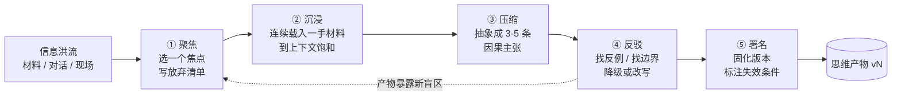

> 本篇是《ManThinking》系列的**开篇**。它回答一个我近两年反复被问到、也被自己反复推翻的问题：**当 AI 把"产出"的成本压到接近零，人剩下的那部分价值到底是什么。** 我的答案是——产出会通胀，思维不会；而"思维"并不是玄学，它可以被拆成一条从注意力到署名的生产线，这条线上只有两格是 AI 挤不进来的。
>
> 与站内体系的关系：姊妹篇《Harness Engineering》《Loop Engineering》讲的是**给 Agent 搭脚手架、让闭环转起来**；本篇讲的是**给人搭脚手架、让闭环转起来**——同样是"部件 + 节奏 + 停止条件"，只不过部件换成了注意力，验证器换成了反驳。它与《AI-SRE 职业发展阶段演进》是同一件事的两面：那篇描述决策权如何沿五个刻度从人移向机器，本篇讨论在决策权让渡之后，人该守住哪一格。《FDE 如何评价企业 AI 价值》给 AI 交付定价，本篇顺带提供一个给"人的判断"定价的口径。
>
> 口径说明：本篇是观点文，不含市场统计。凡是引用外部研究，只给概念与出处（Simon 1971 的注意力稀缺、Leroy 2009 的注意力残留、Csikszentmihalyi 1990 的心流），不杜撰任何统计量；文中出现的比例、时长、参数均为**经验量级与个人口径**，用于建立可讨论的坐标系，不是测量结论。

---

# 第 0 章：全景链路

```text
   输入端                            生产段（本文明线）                           输出端
┌───────────────┐   ┌──────────────────────────────────────────────────┐   ┌────────────────┐
│ 信息洪流        │   │  聚焦  →  沉浸  →  压缩  →  反驳  →  署名        │   │ 思维产物        │
│ 会议/文档/论文  │──▶│  (减法)   (载入)   (抽象)   (自检)   (固化)      │──▶│ 判断/模型/      │
│ 对话/模型输出   │   │    │                                          │   │ 取舍/审美       │
│                │   │    └──────── 反馈：产物暴露新盲区 ───────────┘   │   │ (署名/可反驳)   │
└───────────────┘   └──────────────────────────────────────────────────┘   └────────────────┘
        ▲                            ▲                            ▲
        │                            │                            │
  AI 可代劳 高              AI 可代劳 0%~30%              AI 可代劳 60%~80%
  （检索、摘要、扩写）        （消耗的是你的注意力）          （排版、校对、反例生成）

一句话主线：AI 让"产出"通胀、让"判断"升值。分水岭不在你用了多少 AI，
            而在你有没有亲自走完"从注意力到署名"这一段路。
```

## 0.1 结论先行

- **稀缺性发生了反转**：过去的瓶颈是"写不出来"，现在的瓶颈是"想不清楚"和"不敢署名"。
- **思维产物有五个要件**：焦点、因果链、取舍、反驳面、署名。缺任何一个，它降级为"内容"，再缺就只是"产出"。
- **聚焦是减法，专注是加法**：聚焦决定你不做什么，专注决定你把有限的连续性投在哪。两者是乘法关系，任一项为零，结果为零。
- **AI 最好的位置是第 4 级（反驳），最坏的位置是第 3 级（压缩）**：让模型替你出结论，是产物通胀的直接来源。
- **可度量的只有三样**：产物版本、被引用次数、被推翻记录。其余指标都会迅速退化成打卡。

## 0.2 一句话与一张尺子

判断一段文字是不是思维产物，我只用一把尺子：**把这段文字署上你的名字，并承诺"错了算我的"，你还敢发吗。** 不敢，它就是产出。

这把尺子之所以好用，是因为它同时检验了五件最难伪造的东西——你选了什么、你信了什么因果、你放弃了什么、你知道它什么时候会错、以及谁愿意承担。

---

# 第 1 章：三个词的分野——产出、内容、思维产物

## 1.1 产出（Output）：能被不理解的人生产出来的东西

产出的判别标准极简：**能不能在不理解的情况下把它生产出来。** 能，就是产出。

字数、页数、PPT 张数、PR 数量、代码行数、周报条数，全部属于此类。它们的共同特征是**可分解**：任何一个整体都能被切成若干片段，片段之间不需要共享同一套理解。可分解的东西，一定可以被并行、被外包、被流水线化。

> 可分解性是产出的宿命。一旦一件事能被切成"不共享理解"的片段，它的价格就必然趋近于片段生产的最低成本。

## 1.2 内容（Content）：有形式、无立场

内容比产出高一级：它有结构、有信息、甚至有好文笔，但它**不下判断**。

典型的形态是"全面梳理"：一个话题的五个维度、三种流派、两个趋势。读者读完之后知道了不少，却做不出任何与读之前不同的动作。内容的生产函数同样可分解——检索、搭骨架、扩写、润色、配图，每一段都能单独交给工具。

内容之所以在 2023 年之后大规模通胀，原因不是工具变聪明了，而是**内容的生产函数恰好是"分段可外包"的形状**。生成式模型最擅长的，就是把一个不共享理解的片段写得通顺。

## 1.3 思维产物（Thought Product）：五个要件

思维产物是这条谱系的最高一级。它必须同时具备五个要件：

| 要件 | 含义 | 缺了会怎样 |
|------|------|-----------|
| **焦点** | 明确排除了什么。没有排除，就没有焦点 | 退化成"什么都谈一点"的综述 |
| **因果链** | 说清 A 为什么导致 B，链条可追溯、断点可被指认 | 退化成并列要点的堆叠 |
| **取舍** | 说出被放弃的选项，以及放弃的代价 | 退化成"都重要"的正确废话 |
| **反驳面** | 能指出什么证据会推翻它 | 退化成不可证伪的口号 |
| **署名** | 有人愿意为这个结论承担后果 | 退化成无主文本，出问题找不到人 |

五个要件里，前四个是**认知动作**，第五个是**社会动作**。这也是本节最想强调的一点：

> 思维产物不只是一个认识论概念，它同时是一个**责任概念**。没有署名，前面四个要件都可以被伪造；有了署名，伪造的成本立刻变得不可承受。

## 1.4 三者的边界

| 维度 | 产出 | 内容 | 思维产物 |
|------|------|------|---------|
| 判别问题 | 不理解也能生产吗 | 有立场吗 | 敢署名并承担吗 |
| 生产函数 | 完全可分解 | 分段可外包 | 压缩与反驳不可外包 |
| 典型形态 | 页数、条数、行数 | 综述、科普、盘点 | 判断、模型、判据、ADR |
| 能否被替代 | 几乎可以完全替代 | 大部分可替代 | 只能被"另一个人"替代 |
| 价值随时间 | 迅速归零 | 缓慢归零 | 可能升值 |

最后一行的差别很关键：产出的价值随时间线性衰减到零，而真正的思维产物会随**被复用**而升值——一份说得清楚的故障因果链，三年后新人还在引用。

---

# 第 2 章：稀缺性反转——为什么产出会通胀而思维不会

## 2.1 瓶颈迁移：从"表达"移到"想清楚"

写作这件事的瓶颈，在十年内换了位置。

| 环节 | 2015 年的瓶颈 | 2026 年的瓶颈 | 现在由谁承担 |
|------|--------------|--------------|-------------|
| 找材料 | 检索不到 | 检索过剩 | 人（筛选） |
| 搭结构 | 结构能力稀缺 | 一分钟出三个提纲 | 模型 |
| 表达 | 措辞与文笔稀缺 | 通顺是默认值 | 模型 |
| 想清楚 | 稀缺 | 仍然稀缺 | 人 |
| 承担后果 | 稀缺 | 仍然稀缺 | 人 |

表格的下半部分几乎没有变化，上半部分被整体抹平。这就是"产出通胀"的全部机制：**当中间环节免费之后，两端的成本没有下降，于是两端的相对价格暴涨。**

一个具体的观察：过去一份方案写得磕磕巴巴，读者会怀疑作者能力；现在一份方案写得丝滑无比，读者会怀疑作者有没有想过。**文笔从"能力证明"变成了"噪音"。** 这个反转发生在两三年内，快到很多人还没调整自己的表达策略。

## 2.2 三条不可外包的约束

为什么思维不会跟着通胀？因为它被三条约束锁住了。

**第一条：注意力不可复制。** Herbert Simon 在 1971 年那句判断至今没有过期——信息的丰富造成注意力的贫乏。模型可以一千路并行地读，人的有效注意是单线程的、有连续性的、每天额度有限的。这条约束的反面才是机会：正因为注意力稀缺，**"你把注意力放在哪里"本身就是不可替代的投入**，而投入的位置决定了产物的形状。

**第二条：责任不可转移。** Agent 可以被授予执行权，却无法被追责。站内《AI-SRE 职业发展阶段演进》把这件事说得更直白：决策权可以向机器转移，但治理与追责始终留在人这一侧，转移几格就要补几格的基础设施。责任无法外包，意味着"愿意署名"的人永远是少数——而稀缺性只认少数。

**第三条：语境不可完全编码。** 你所在组织的历史包袱、上一次改造留下的伤疤、你和某位同事之间那句没写进文档的默契，这些"说不出来但确实存在"的约束，写不进 prompt 的部分，恰恰是判断的主要输入。模型能读到你的文档，读不到你的伤疤。

> 三条约束合起来给出一句话：**能被复制的都会通胀，不能被复制的才保值。** 注意力、责任、语境，恰好是三种最难复制的东西。

## 2.3 稀缺性守恒：稀缺物一直在往上迁移

把时间尺度拉长，会看到一条很稳定的规律——每一次媒介革命都没有让人更闲，而是把稀缺推到了上一层。

| 时代 | 稀缺物 | 溢价来源 | 被替代的难度 |
|------|--------|---------|-------------|
| 印刷术普及 | 识字与书写 | 能读能写的人极少 | 高（教育普及后归零） |
| 互联网普及 | 检索与筛选 | 信息过载中的定位能力 | 中 |
| 社交与推荐算法 | 注意力 | 被看见的机会 | 低（总量恒定） |
| 生成式 AI | 判断与署名 | 不可外包的取舍与责任 | 极低 |

这张表最有用的地方不是预测未来，而是校准自我定位：**如果你现在的主要产出还停留在表格上一行的稀缺物上，那你正在为一种正在贬值的资产投入。** 印刷术普及后被替代的不是"写字的人"，是"只会写字的人"。

---

# 第 3 章：工作原理——从注意力到产物的五级生产线

思维产物不是灵感，它有工序。我把这条工序拆成五级，每一级都有明确的输入、动作、输出和典型失效。



## 3.1 五级的输入与输出

| 级别 | 输入 | 动作 | 输出 | 典型失效 |
|------|------|------|------|---------|
| ① 聚焦 | 信息洪流 + 你的处境 | 选一个焦点，写放弃清单 | 一句可被回答的问题 | 焦点太多 = 没有焦点 |
| ② 沉浸 | 焦点 + 一手材料 | 连续载入，直到能自己复述细节 | 脑内的隐性模型 | 用摘要替代原文 |
| ③ 压缩 | 隐性模型 | 抽象成 3–5 条因果主张 | 显性主张清单 | 并列要点冒充因果 |
| ④ 反驳 | 主张清单 | 找反例、找边界、主动降级 | 带失效条件的主张 | 自我确认偏误 |
| ⑤ 署名 | 带条件的主张 | 固化、公开、承担 | 思维产物 vN | 只存不发、无主文本 |

## 3.2 为什么顺序不能换

这是这一章唯一需要记住的事：**五级的顺序本身就是质量机制。**

- 从③压缩起手，得到的是**二手结论**——你在复述别人的抽象，而不是建立自己的模型。
- 跳过④反驳，得到的是**正确废话**——句句成立，句句不承担风险。
- 跳过⑤署名，得到的是**无主文本**——它再好也无法被追责，因此也无法被信任，最终无法被复用。

我在很多"AI 写得不错"的文档里看到同一个病理：工序被从中间切开，前两级被省略，后两级被外包，只剩中间那一级被精心打磨。打磨得越好，越像内容。

## 3.3 一个反常识的推论

五级生产线隐含一个不太受欢迎但很实在的推论：**产物数量与产物质量在这条线上是互斥的，除非你提高单位时间的压缩效率。**

一天走完五次五级流程，和一个月走完一次，前者的产物几乎是清一色的内容。这不是勤奋问题，是工序问题：每一级都需要不可压缩的最小时间，而一天里能提供的连续时段是有限的（第 5 章会给具体量级）。

---

# 第 4 章：聚焦——注意力预算与焦点的选择

## 4.1 聚焦是减法：焦点就是放弃清单

大部分人把"聚焦"理解成"专心做一件事"，这是把它和"专注"混了。**聚焦是选择，专注是维持。** 聚焦的动作只有一个：**写出一份放弃清单。**

一个真实的小例子。我曾参加一次存储方案选型，八个候选摆在一张表里比了三个小时，比到第四列指标时所有人都开始疲劳。后来换了做法：先不问"哪个好"，先问"哪些约束是一票否决的"。三条硬约束一列，五个候选当场出局，剩下三个的差异立刻缩小到两个可验证的问题上，选型会从"比较"变成了"验证"。

这个例子里的动作不是分析，而是**排除**。排除之后，判断的难度下降了整整一个量级。

## 4.2 焦点的四条判据

不是所有问题都配当焦点。我用四条判据筛：

| 判据 | 检验问题 | 不合格的表现 |
|------|---------|-------------|
| **可反驳** | 这个焦点有可能被判错吗 | 怎么答都对，那是"话题"不是"焦点" |
| **可复利** | 想清楚之后下次还能用吗 | 只产出一个一次性答案 |
| **有边界** | 能说清什么条件下成立、什么时候该换吗 | 焦点一路膨胀成"整个领域" |
| **有主体** | 谁为这个结论负责 | 没有主体，焦点会被会议拖走 |

第一条最常见也最容易被忽略。**"AI 时代的工程师该怎么成长"不是焦点，"35 岁之前该不该从运维转到平台工程"才是焦点**——前者怎么答都对，后者一定有人不同意。

第四条听起来像管理学套话，但它在实践里极其刚性：一个没有明确主体的焦点，会在三次会议之后变成"大家再想想"。

## 4.3 注意力预算：不是时间的函数，是连续性的函数

我们习惯用时间做预算，但认知产出几乎只跟**连续块的长度**相关。

| 认知状态 | 一天中的位置（经验口径） | 可做 | 不可做 |
|---------|----------------------|------|--------|
| 满额（连续 ≥90 分钟） | 起床后 2–3 小时 | 建模、压缩、一次写完一节 | 回消息、开会 |
| 半额（连续 30–45 分钟） | 午后 | 评审、修订、反驳 | 从零开始建模 |
| 碎片（<15 分钟） | 会议间隙 | 检索、校对、勾清单 | 任何需要沉浸阈值的任务 |
| 耗尽 | 深夜 | 什么都不做 | 假装工作 |

这张表最刺眼的是最后一行。**"假装工作"的成本极高**：它会占掉第二天的满额额度，而人往往在第三天才会发现——那时已经找不到原因了。

---

# 第 5 章：专注——持续注意的物理约束与工程化

## 5.1 切换成本：注意力残留

Sophie Leroy 在 2009 年的研究里给这个现象起了名字——**注意力残留**：从一个任务切到另一个任务时，前一个任务的认知表征会滞留在工作记忆里，占用本应属于新任务的带宽。

日常版本很好认：开完一个会回到工位写方案，前十几分钟写出来的全是过渡句。"综上所述""在此基础上""值得注意的是"——这些不是文风问题，是残留。

> 所以"专注"的第一条工程手段不是自律，而是**物理隔离**：在同一台屏幕上同时开着即时通讯和文档，等于主动给自己注射残留。

## 5.2 沉浸阈值：低于阈值只能载入，做不了压缩

"专注要够久"这句话太软，我把它量化成一个可操作的说法：**每类任务都有一个最小连续块，低于这个块长，只能完成"载入"，无法完成"压缩"。**

| 任务类型 | 最小连续块（经验） | 达到的状态 | 提前打断的后果 |
|---------|-----------------|-----------|--------------|
| 读一手材料（论文/代码/日志） | 45 分钟 | 上下文饱和，能复述细节 | 只记住摘要 |
| 写一段论证 | 90 分钟 | 进入压缩态 | 写出过渡句和套话 |
| 架构/选型决策 | 2 × 90 分钟 | 约束图完整 | 只比较了显性指标 |
| 事后复盘 | 60 分钟 | 因果链闭合 | 停在"人为失误" |

最后一行值得多说一句。"人为失误"是复盘里最常见、也最没信息量的结论，它几乎总是打断的产物：因果链在 40 分钟处本该拐向"为什么当时没有可用的检查手段"，但如果这时被叫走，回来时人已经疲了，最省力的一步就是收尾。

## 5.3 三种专注形态

专注不只有一种，混用会造成大量自我误判。

- **慢思考**：建模、写、推导。特点是想清楚的那一刻通常没有任何外在事件，只有"忽然通了"。
- **快验证**：读、跑实验、对照。特点是反馈极快，容易上瘾，也容易被当成"在思考"。
- **休眠**：离开屏幕之后的离线处理。产物常在散步、洗澡、睡前出现。

第三种最容易被浪费。**休眠不是休息，是工序。** 它的输入是白天那条没解开的因果链，所以它需要一个"未闭合任务"作为种子。如果你白天只是收集，晚上就不会有东西在后台跑——这也是"信息暴食"的人始终觉得没有灵感的原因。

## 5.4 伪专注的五种形态

认清伪专注比学习方法更有用：

1. **挂着文档刷消息**——形式在，连续性断了。
2. **多显示器并行**——看起来高效，实际是在制造残留。
3. **边听播客边写**——只有机械性任务适用，论证类任务必然退化。
4. **把检索当思考**——一直在找材料，从未进入压缩。
5. **把整理笔记当思考**——整理是搬运，不是抽象。

---

# 第 6 章：人机协作——AI 应该插在哪一级

## 6.1 五级生产线上的可外包比例

这是本篇最实用的一张表。它回答的不是"AI 能不能帮我写"，而是"AI 帮我写的时候，我丢掉了哪一级"。

| 环节 | AI 可代劳（经验口径） | 为什么不能更多 | 正确用法 |
|------|---------------------|--------------|---------|
| ① 聚焦 | 0–10% | 焦点是"承担后果的选择" | 让 AI 列候选与约束，人做减法 |
| ② 沉浸 | 20–40% | 摘要不等于载入，模型建立在你脑内 | AI 做检索与差异对比，原文自己读 |
| ③ 压缩 | 0–30% | 别人的抽象无法替你建立模型 | 让 AI 当反方，不当作者 |
| ④ 反驳 | 60–80% | 反例生成成本低、验证成本低 | 红队、边界测试、攻击前提 |
| ⑤ 署名 | 0% | 责任不可转移 | 只能自己签 |

两端的 0 是刻意的。**聚焦和署名，是这条线上唯一两个"AI 完全插不进去"的格子**——它们不是技术问题，而是选择与责任问题。

## 6.2 最常见的误用：从第 3 级起手

"帮我写一篇关于专注的文章"——这句话的全部信息量在于它把工序从第 3 级开始。模型会给你一份结构完整、逻辑通顺、三点式排布的文本，它满足"内容"的全部条件，唯独缺少焦点、因果和取舍。

更麻烦的是，这种文本**很难被立刻识别**。它读起来是对的，因为它是由无数正确的话拼成的。要识别它，只需要问一个动作性问题：**读完之后，我会做出什么与之前不同的决定？** 如果答案是"没有"，那它就是通胀的产物。

## 6.3 上下文供给：把焦点写成约束，而不是话题

好的 AI 用法有一个共同形状：**你给它约束，而不是给它话题。**

| 差 | 好 | 差异在哪 |
|----|----|---------|
| 帮我总结这份故障报告 | 这份报告里"扩容滞后"被我判为主因，请找出三个能推翻它的证据 | 前者要产出，后者要反驳 |
| 帮我想几个架构方案 | 我的约束是 X/Y/Z，请指出哪条约束最可能被打破 | 前者要广度，后者要攻击前提 |
| 帮我润色这段 | 这段的结论是 A，请指出哪句与 A 不一致 | 前者改形式，后者查一致性 |

规律的表述只有一句：**把"我的判断"交给它，让它攻击这个判断；不要把"我的题目"交给它，让它替我判断。**

这恰好对应第 3 章的五级顺序——AI 在第④级是高价值工具，在第③级是高危工具。

---

# 第 7 章：度量——思维产物的性能参数

## 7.1 五个参数

思维产物可以度量，但不能用"勤奋"的指标度量。我保留了五个参数，其余全部砍掉。

| 参数 | 定义 | 采集方式 | 经验目标 |
|------|------|---------|---------|
| **判断密度** | 明确主张数 / 千字 | 人工标注 | ≥3 条主张 / 千字 |
| **反驳存活率** | 经对抗后仍成立的主张 / 主张总数 | 评审记录 | 40%–70% |
| **半衰期** | 结论保持有效的时长 | 版本记录 | 与类型匹配（见下） |
| **复用力** | 被自己或他人再次引用的次数 | 引用链接 | ≥1 次 / 季度 |
| **可执行性** | 读者能否据此做出不同动作 | 0/1 判定 | 1 |

关于**反驳存活率**有一个反直觉的口径：**这个数太高，通常说明你没认真反驳。** 如果每次评审你的主张都 100% 成立，那你请来的不是反方，是观众。50% 左右被改写或降级，才是健康区间。

**半衰期**按类型分层：工具选型 6–12 个月，架构决策 2–3 年，方法论 5 年以上。这个参数最大的用处不是评估产物，而是**决定什么时候该复审**——把复审时间写进产物本身，它才具备可维护性。

## 7.2 只采三样，别搞仪表盘

采集只保留三项：**产物版本数、被引用次数、被推翻记录。**

前两项证明它活着，第三项证明它被认真对待过。一份从来没有被推翻过的判断，通常意味着它从来没有被真正使用过。

## 7.3 度量的误区

- **字数与篇数**：度量的是产出，与本章无关。
- **AI 使用率**：度量的是工具使用习惯，与产物质量无因果关系。
- **连续打卡天数**：Goodhart 定律的标准受害者——一旦成为指标，人会为了连续性产出低质量条目。
- **"思考时长"**：无法观测，且极易被自我报告美化。

---

# 第 8 章：缺陷与反模式——六种典型失效

## 8.1 症状、根因与处方

| 反模式 | 症状 | 根因 | 处方 |
|--------|------|------|------|
| **产物通胀** | 篇数上升，引用为零 | 从第③级起手 | 强制走完五级，宁少勿多 |
| **二手结论** | 每条都能在某篇综述里找到同款 | 跳过②沉浸与③压缩 | 只写自己算过一遍的结论 |
| **正确废话** | 句句正确、句句不可反驳 | 跳过④反驳 | 反证测试（见 8.2） |
| **信息暴食** | 摄入远大于压缩 | 把"收集"误当"思考" | 摄入配额：读完必须出一条主张 |
| **焦点游移** | 一年五个方向，每个都不足阈值 | 用新鲜感替代进展 | 设焦点最小存续期（如 3 个月） |
| **无署名** | 把别人的判断当自己的结论 | 责任规避 | 引用必须标注，并写出自己的偏离点 |

## 8.2 反证测试：一句话识别正确废话

把一句话反过来读，如果反过来的版本**明显荒谬**，那它就是一个不可反驳的陈述，信息量为零。

- "要重视基础能力" → 反过来"不要重视基础能力"，荒谬 → 废话。
- "架构决策要在约束清晰的条件下做" → 反过来也荒谬 → 废话。
- "在这个规模下，先做可观测性投入的边际收益高于再做一次性能优化" → 反过来"先优化性能"在这个规模下并不荒谬，需要论证 → **有信息量**。

这个测试之所以有效，是因为**信息量来自"可能错"**。不可错的话，无论多正确，都不携带信息。

## 8.3 五问自测

我用自己的五个问题做季度体检：

1. 这三个月，我做出过几个"敢署名"的判断？
2. 有几个判断被别人引用过，或者被自己再次用过？
3. 有没有一个判断被事实推翻过？如果没有，我是不是没在冒险？
4. 我最近的三十次输入，产出了几条主张？
5. 我说得清当前焦点的放弃清单吗？

五个问题里如果有三个答不上来，问题不在方法，在工序被跳过了。

---

# 第 9 章：解决方案——专注工程的最小闭环

"专注"这件事如果只讲意志力，是没有工程价值的。我把它做成三个嵌套循环。

## 9.1 日循环：一个深时段 + 十分钟落盘

- **开时段前 2 分钟**：写下"今天要回答的那一个问题"，必须可被回答、可被判错。
- **90 分钟连续块**：只做②沉浸与③压缩，通讯工具物理隔离。
- **收尾 10 分钟落盘**：只写三样——三条主张、一条不确定、一条待验证。

落盘这 10 分钟是整条线的关键，因为它把"隐性模型"变成了"可被反驳的对象"。没有落盘，第二天你会以为自己想过，其实只到过第②级。

## 9.2 周循环：一次对抗性评审

每周把最强的一条主张交出去接受攻击。攻击方可以是人，也可以是模型——后者在④反驳这一格恰好是性价比最高的用法。

规则只有两条：**攻击方只能攻击前提与因果，不能评价文风；被攻击方必须当场选择"接受降级"或"给出反证"，不能"再想想"。**

## 9.3 季循环：版本化与退役

- 把上季度产物升版（v1 → v2），明确写出**哪些结论被推翻、哪些失效条件已经触发**。
- 退役一个焦点：主动写下"这个方向我不再投入"，并说明理由。

退役比新增重要。不用清理的焦点系统，三个月后就会退化成收藏夹。

## 9.4 一页执行清单

1. 每天一个 90 分钟深时段，先写今天要回答的那一个问题。
2. 深时段结束时只落盘三样：三条主张、一条不确定、一条待验证。
3. 摄入设配额：读三篇，必须产出一条可被反驳的主张。
4. 每周一次对抗：最强的主张必须被攻击一次。
5. 每月一次版本化：写清哪些结论过期。
6. 每个产物必须带失效条件与署名。
7. 每季度退役一个焦点。

## 9.5 团队版：把"产物"作为最小可评审单元

落到团队，这条线只需要改变一个约定：**评审会的最小单元不是 PPT 页数，而是一条主张 + 它的反驳记录 + 它的失效条件。**

这个约定会立刻筛掉两类材料：没有主张的"进展汇报"，和没有反驳记录的"方案"。剩下能过会的东西第一次变少了，但每一次过会都在积累可复用的判据。

---

# 第 10 章：应用场景与边界

## 10.1 五类场景的落点

| 场景 | 产物形态 | 五级生产线的关键动作 |
|------|---------|-------------------|
| 技术选型 | 带一票否决条件的决策记录 | 聚焦 = 先定否决条件，再比指标 |
| 故障复盘 | 因果链 + 可复用判据 | 反驳 = 主动找"即使做了 X 也一样"的反例 |
| 架构决策 | ADR：结论 / 取舍 / 失效条件 | 署名 = 写明谁批的、何时复审 |
| 长文写作 | 3–5 条因果主张 | 压缩 = 先写主张清单，再写字 |
| 职业选择 | 三年期约束图 | 聚焦 = 公开承认放弃什么 |

## 10.2 不适用场景

这套方法有三处明确的边界，用错地方会得不偿失：

- **早期探索**：需要广度的时候强行聚焦，会提前杀死可能性。探索期应该允许"没有焦点"，但要限时。
- **应急响应**：故障现场需要速度和既定流程，不是压缩与反驳的时机。复盘才是。
- **纯信息同步**：把周报写成 ADR 是浪费。信息同步就该按产出标准生产，快、准、可检索即可。

## 10.3 三个我没有答案的开放问题

1. **署名经济学**：当产物的 70% 由模型生成，署名该标到哪一层？只标"人审过"显然不够，但标到"人贡献了第①④⑤级"目前没有公认的记法。
2. **定价错配**：市场仍然按"篇""页""人天"付费，而不是按"判断质量"付费。这会让采用这套方法的人在短期内处于价格劣势——这是真实存在的激励扭曲，不是道德问题。
3. **学徒制怎么办**：如果第③级压缩被长期外包，新一代从业者还能不能长出压缩能力？我倾向于悲观——因为压缩能力的形成依赖大量低效的、自己动手的重复。我暂时没有好的解法。

把这三条留在文末，是因为它们比前九章更值得被讨论。**一个不含未解问题的框架，通常意味着它没有被认真使用过。**

---

# 附录

## A. 术语速查

| 术语 | 含义 |
|------|------|
| 产出（Output） | 不理解也能生产的形式化交付物：页数、条数、行数 |
| 内容（Content） | 有结构、有信息、无立场，可分段外包 |
| 思维产物（Thought Product） | 具备焦点、因果链、取舍、反驳面、署名的判断 |
| 焦点 | 明确排除了什么之后的那个问题；焦点即放弃清单 |
| 沉浸阈值 | 完成"压缩"所需的最小连续时间块 |
| 注意力残留 | 任务切换后前一任务仍占用工作记忆带宽的现象（Leroy 2009） |
| 压缩 | 把隐性模型抽象成 3–5 条因果主张的动作 |
| 反驳面 | 能推翻该结论的证据类型；不可反驳即无信息量 |
| 产物通胀 | 产出数量上升而判断密度下降的现象 |
| 判断密度 | 明确主张数 / 千字，用于替代字数类指标 |
| 半衰期 | 结论保持有效的时长，决定复审周期 |
| 反证测试 | 把陈述反向读，若明显荒谬则其为不可反驳的废话 |

## B. 参考资料

- Herbert A. Simon, *Designing Organizations for an Information-Rich World*, 1971（"信息的丰富造成注意力的贫乏"）
- Sophie Leroy, *Why is it so hard to do my work? The challenge of attention residue when switching between work tasks*, Organizational Behavior and Human Decision Processes, 2009（注意力残留）
- Mihaly Csikszentmihalyi, *Flow: The Psychology of Optimal Experience*, 1990（心流与沉浸阈值）
- Cal Newport, *Deep Work*, 2016（深度工作时段的工程化）
- 站内姊妹篇：《Harness Engineering 应用工程实践》（Agent 侧脚手架）、《Loop Engineering 应用工程实践》（Agent 侧闭环）、《AI-SRE 职业发展阶段演进》（决策权转移与治理）、《FDE 如何评价企业 AI 价值》（价值度量口径）

## C. 变更记录

| 版本 | 日期 | 变更 |
|------|------|------|
| v1 | 2026-10-30 | 开篇立论：五级生产线、AI 可外包比例表、五个度量参数、六种反模式、三层嵌套循环 |