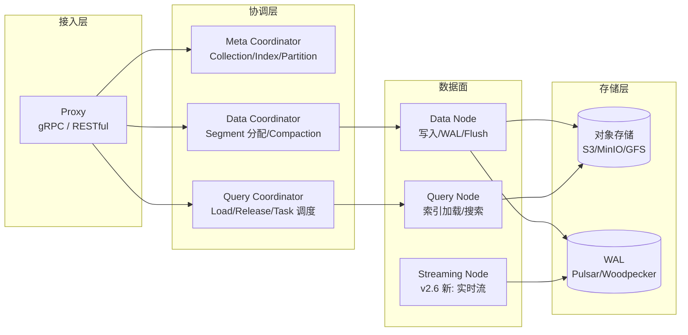
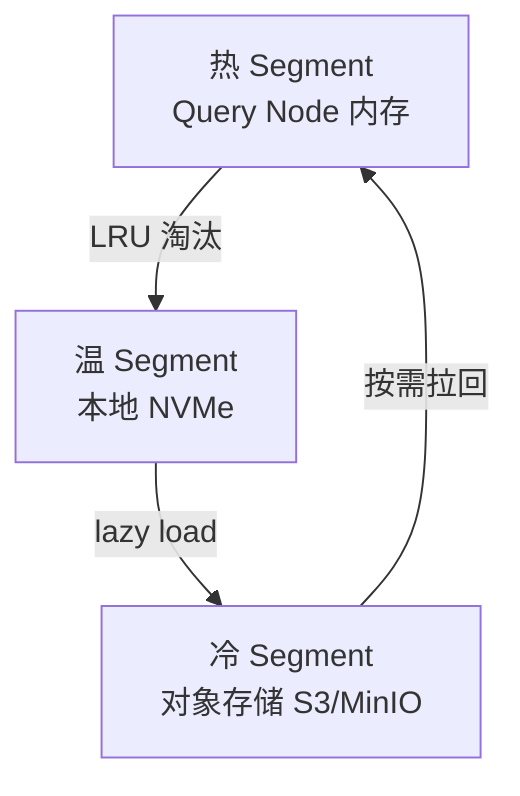

> 《模型应用核心能力》专题 2.4/2.5 的存储底座篇。RAG 全链路的性能天花板在检索——而检索的核心就是向量数据库。Milvus（Zilliz 开源、LF AI & Data 毕业项目）是目前功能最完整、生产部署量最大的云原生向量库之一。v2.6 带来 Storage Format V2（自适应列存）、JSON Shredding、BM25 全文检索与 Boost/Decay Ranker，把"纯向量检索"推进为"混合检索 + 元数据过滤 + 重排序"一体化引擎。它与《LiteLLM》互为上下游——LiteLLM 管模型调用，Milvus 管知识存储与召回；与《Elasticsearch》是互补而非替代——BM25 内建后不再需要外挂全文引擎做混合检索。
>
> 口径说明：版本锚定 **Milvus v2.6.x**（v2.6.0 正式版 2025-08-06 发布；v2.6.8 2026-01 引入搜索高亮）。不支持从 pre-2.6 直接升级（需中转 v2.5.x）。架构含 proxy / coordinator / query node / data node / streaming node 五角色。性能数字为官方基准与经验量级。

---

# 第 0 章：全景链路

```text
                         ┌──────────────────────────────────────────────┐
  写入侧                 │  Data Node / Streaming Node                  │
  "文档→切分→Embedding    │  ├─ 接收 Insert/Upsert/Delete               │
   →入库"                │  ├─ WAL (内置 Pulsar / Woodpecker / 本地Kafka)│
                         │  └─ 生成 Segment → 持久化对象存储(S3/MinIO)   │
                         └─────────────────────┬────────────────────────┘
                                               │ Segment (增量→合并→密封)
                         ┌─────────────────────▼────────────────────────┐
  查询侧                 │  Query Node (可水平扩)                        │
  "自然语言→Embedding      │  ├─ 加载 Segment 到内存/本地 NVMe           │
   →ANN+BM25→Rerank"     │  ├─ 索引(HNSW/IVF/SCANN/DiskANN/Flat)      │
                         │  ├─ 标量过滤(元数据/JSON Path/Shredding)     │
                         │  └─ 混合检索 + Boost/Decay Ranker 重排      │
                         └─────────────────────┬────────────────────────┘
                                               │
                         ┌─────────────────────▼────────────────────────┐
  接入/编排              │  Proxy (gRPC/RESTful) + Coordinator          │
  "鉴权/路由/负载均衡"     │  ├─ Router: 请求分发到 Query Node            │
                         │  ├─ Meta: Collection/Partition/Index 元数据  │
                         │  └─ 冷热分层调度 (Tiered Storage)            │
                         └──────────────────────────────────────────────┘
```

一句话主线：**Milvus 不是"只能做向量相似度搜索的小工具"，而是以存算分离为骨架、支持 ANN + 全文 + 标量过滤 + 重排序的一体化检索引擎——v2.6 的 Storage Format V2 和 JSON Shredding 让它第一次能与企业级 RAG 的混合检索需求正面匹配。**

---

# 第 1 章：基础概念与为什么选 Milvus

## 1.1 向量检索核心概念速览

| 概念 | 说明 |
|------|------|
| Embedding | 将文本/图片映射为高维稠密向量(典型 768-4096 维) |
| ANN (Approximate Nearest Neighbor) | 近似最近邻搜索——牺牲微小精度换 100-1000x 速度 |
| 索引类型 | HNSW(图), IVF(倒排聚类), DiskANN(磁盘), SCANN(量化), Flat(暴力) |
| 相似度度量 | L2(欧氏距离)、IP(内积)、Cosine |
| 混合检索 | 向量 ANN + BM25 关键词 → Ranker 融合排序 |
| 召回率 vs QPS | 精度-速度权衡核心指标 |

## 1.2 为什么不用 Elasticsearch/pgvector/Faiss 直连

| 对比项 | 直连 Faiss | pgvector | Elasticsearch kNN | Milvus |
|--------|-----------|----------|-------------------|--------|
| 水平扩展 | 手动 | 受限于 PG 单写 | 支持但向量段有限 | 原生分布式 |
| 索引类型 | Flat/IVF/HNSW | HNSW/IVFFlat | HNSW/Flat | HNSW/IVF/DiskANN/SCANN/GPU |
| 实时更新 | 需重建 | MVCC 膨胀 | 段合并代价高 | LSM + Growing Segment |
| 标量过滤 | 无 | SQL 强 | 强 | 强(v2.6 JSON Shredding 100x) |
| 全文/关键词 | 无 | 无 | BM25 原生 | v2.6 BM25 内建 |
| 存算分离 | 否 | 否 | 部分 | 是(对象存储 + 本地NVMe) |
| 十亿级向量 | 不实际 | 不实际 | 吃力 | 设计目标 |

---

# 第 2 章：核心架构与组件职责



| 组件 | 职责 | 扩缩容特性 |
|------|------|-----------|
| Proxy | 鉴权、请求路由、负载均衡 | 无状态, 水平扩 |
| Root Coord (Meta) | Collection 创建/删除、DDL | 单点(主备切换) |
| Data Coord | 分配写入任务给 Data Node, 触发 Compaction | 单点(主备) |
| Query Coord | Segment 加载/释放到 Query Node, shard 分配 | 单点(主备) |
| Data Node | 接收 Insert/Upsert, WAL 持久化, Flush 到 OSS | 水平扩 |
| Query Node | 加载索引, 执行搜索, 返回结果 | 水平扩(核心算力) |
| Streaming Node | v2.6 引入, 统一实时写入与可见性 | 水平扩 |
| 对象存储 | Segment 持久化(不可变文件) | 外部(MinIO/S3) |
| WAL (Pulsar/Woodpecker) | 写入日志, 保证崩溃恢复 | 外部/内建 |

---

# 第 3 章：v2.6 关键新机制

## 3.1 Storage Format V2

自适应列存——"窄列合并、宽列独立"：

- **窄列**（INT8/BOOL 标量）合并为连续块，减少文件数 98%，提升扫描效率。
- **宽列**（FLOAT_VECTOR 1536 维）独立文件，避免 I/O 浪费。
- 点查/小批量检索性能提升 **最高 100x**（官方基准）。
- 支持 **部分 Upsert**（只更新指定列）与 **不停机加字段**。

## 3.2 JSON Path Index + JSON Shredding

传统 JSON 标量过滤需逐行解析 → v2.6 把 JSON 列** shredding 为物理列**，按 key 路径建独立索引。元数据过滤性能 **100x** 提升（对 RAG 的权限/租户标签过滤直接受益）。

## 3.3 BM25 全文检索 + Boost/Decay Ranker

- 内建 BM25 稀疏向量引擎——写入时自动分词并生成稀疏表示，搜索时可单独用或 **与 ANN 混合**。
- **Boost Ranker**：用标量字段值（如 freshness、popularity）对结果加权。
- **Decay Ranker**：按距离/时间衰减排序权重（如"越近的 chunk 权重越高"）。
- 混合检索不再需要外挂 ES。

## 3.4 冷热分层（Tiered Storage）



- 内存占用降低 **72%**（冷数据不加载到 RAM，搜索时 lazy load）。
- 适合"写入后查询频率递减"的 RAG 知识库场景。

## 3.5 INT8_VECTOR 与 NGRAM 索引

- `INT8_VECTOR`：向量量化为 int8 存储, 内存降 75%, 精度损失 <1% recall。
- `NGRAM`：稀疏向量的子串匹配索引, 适合部分匹配/CJK 分词场景。

---

# 第 4 章：部署与生产参数速查

## 4.1 Helm 部署（最小生产拓扑）

```bash
helm repo add milvus https://milvus-io.github.io/milvus-helm
helm install my-milvus milvus/milvus \
  --set cluster.enabled=true \
  --set pulsar.enabled=true \
  --set minio.mode=cluster \
  --set queryNode.replicas=2 \
  --set proxy.replicas=2
```

## 4.2 关键参数

| 参数 | 位置 | 默认 | 推荐 | 说明 |
|------|------|------|------|------|
| `segment.maxSize` | DataCoord | 1024 MB | 512-1024 | Segment 大小影响合并与加载粒度 |
| `dataCoord.segment.diskSegmentMaxSize` | DataCoord | 2048 MB | 视 NVMe 容量 | DiskANN 用 |
| `queryNode.segCutRatio` | QueryCoord | 0.1 | 0.1-0.3 | 多 QueryNode 间 segment 分配不均时触发 rebalance |
| `rootCoord.minSegmentSizeToEnableIndex` | RootCoord | 1024 | 默认 | 小 segment 不建索引节省内存 |
| `hnsw.ef` | Search | 16 | 64-256 | HNSW 搜索候选队列大小, 越大越精确越慢 |
| `nprobe` | Search | 8 | 16-128 | IVF 搜索聚类中心数 |
| `radius`/`range_filter` | Search | — | 按需 | 向量距离范围过滤 |
| `consistency_level` | Collection | Eventually | Bounded/Stale | 读己写一致性 vs 性能 |

## 4.3 集合设计要点

- **Partition Key**（v2.3+）：按租户/部门分区, 查询指定 Partition 缩小搜索范围。
- **Partition**：物理隔离; 适合多租户硬隔离。
- **Index on scalar**：`VARCHAR`/`INT64`/`JSON` 建 Trie/STL_SORT/HASH/JSON Path 索引, 配合 `filter` 表达式。

---

# 第 5 章：应用场景与选型建议

## 5.1 RAG 知识库典型链路

```text
文档 → 切分(Chunk) → Embedding → Milvus Insert
查询 → Embedding → Hybrid Search(ANN + BM25) → Ranker → Top-K → LLM 生成
```

- Milvus 在检索层承担"多路召回 + 元数据过滤 + 排序"一站式角色。
- 权限过滤：`filter='tenant_id == "A" AND dept == "Engineering"'` 配合 JSON Shredding。
- 溯源：`id` 字段回指原始文档 chunk 位置。

## 5.2 局限与规避

| 局限 | 说明 | 规避 |
|------|------|------|
| 不支持 pre-2.6 直升 | 必须经 v2.5 中转 | 升级前按官方 migration guide 分步 |
| WAL 依赖外部组件 | 默认 Pulsar 运维重 | v2.6 Woodpecker 内建降低复杂度 |
| 强一致性代价大 | `Strong` 需等 WAL 回放 | 用 `Bounded` + 应用层幂等 |
| 小数据量 overhead | 存算分离架构 10 万条以下不如 pgvector | 百万级以上才体现优势 |
| 索引重建非实时 | Compaction 触发时机受配置控制 | 调 `dataCompaction.triggerStrategy` |

## 5.3 与 pgvector / Qdrant / Weaviate 选型三角

| 维度 | Milvus | pgvector | Qdrant/Weaviate |
|------|--------|----------|-----------------|
| 规模 | 十亿级 | 百万级以内 | 千万级 |
| 混合检索 | 内建 BM25 + ANN | PG FTS + ANN | 部分支持 |
| 运维复杂度 | 高(多组件) | 低(PG 扩展) | 中 |
| 存算分离 | 是 | 否 | 否(或有限) |
| 冷启动 | 秒级加载 | 即时 | 秒级 |
| 适合 | 大规模 RAG 平台/多租户 | 已有 PG + 小规模 | 中等规模快速上线 |

---

# 附录

## A. 术语速查

| 术语 | 一句话 |
|------|--------|
| Segment | 数据存储最小单元(类似 LSM SSTable) |
| HNSW | 多层可导航小世界图索引, 高精度高内存 |
| IVF | 倒排文件+聚类, 用 nprobe 控精度 |
| DiskANN | 基于磁盘的图索引, 适合内存放不下 |
| WAL | Write-Ahead Log, 崩溃恢复保证 |
| Compaction | 小 Segment 合并为大 Segment, 减少碎片 |
| JSON Shredding | 把 JSON 列按 key 拆为物理列建独立索引 |
| Boost/Decay Ranker | 融合排序: 加权/衰减 |
| Tiered Storage | 冷热分层, 降低内存占用 |

## B. 参考资料

- Milvus 官方文档: https://milvus.io/docs (✅ 已核实: v2.6 架构/Storage Format V2/JSON Shredding/BM25/Tiered Storage)
- GitHub: https://github.com/milvus-io/milvus (✅ 已核实: v2.6.0 2025-08-06 release, v2.6.8 2026-01 search highlight)
- LF AI & Data: https://lfaidata.foundation (✅ 已核实: graduated project)
- Zilliz Blog: https://zilliz.com/blog (✅ 已核实: INT8_VECTOR, NGRAM, MINHASH_LSH beta)

## C. 变更记录

| 日期 | 变更 |
|------|------|
| 2026-10-30 | 初版成文, 锚定 Milvus v2.6.x |
