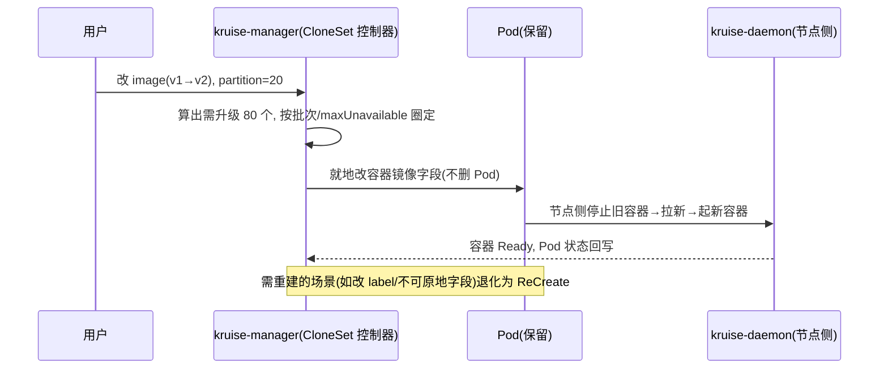

> 《工作负载增强》篇。原生 Deployment/StatefulSet/DaemonSet 在大规模生产里会撞三堵墙：**升级必须重建 Pod**（慢、丢本地状态、惊动调度）、**Sidecar 和业务容器耦死**（改个 mesh 边车要滚全量业务）、**发布只能全量滚动**（缺分批/灰度/定向缩容）。OpenKruise（阿里云捐给 CNCF 的应用自动化套件）用一组 CRD 工作负载正面解决它们：CloneSet/Advanced StatefulSet/Advanced DaemonSet 带来**原地升级**，SidecarSet 让边车独立注入与升级，PodProbeMarker/PUB/ImagePullJob 补齐高级运维。它与《ArgoRollout》是互补而非竞争——一个改"工作负载本身的能力"，一个管"发布放量策略"。
>
> 口径说明：版本锚定 **OpenKruise v1.x（v1.8 于 2025-02 集成原地 VPA；v1.9 于 2026-06 发布，推进 API v1beta1、Cron 镜像预热等）**；核心工作负载 API 组 `apps.kruise.io`（CloneSet 为 v1alpha1、StatefulSet/DaemonSet 有 v1beta1）。原地升级依赖容器运行时能力，K8s 1.27+/InPlacePodVerticalScaling 特性影响 VPA 类能力。性能数字为经验量级。

---

# 第 0 章：全景链路

```text
 原生工作负载的三堵墙                         OpenKruise 的对应解法
 Deployment 升级=重建整 Pod          ──▶  CloneSet / aSTS / aDS: 原地升级(只换容器)
 Sidecar 与主容器绑死, 改边车滚全量   ──▶  SidecarSet: 独立注入 + 边车原地升级
 全量滚动, 无分批/灰度/定向缩容       ──▶  分批 release + partition + 指定 Pod 删除
 可用性只靠 maxUnavailable 粗粒度     ──▶  PodUnavailableBudget(PUB): 跨运维动作的统一防护
 冷镜像首启慢                         ──▶  ImagePullJob / 定时预热(v1.9 Cron)
────────────────────────────────────────────────────────────────────────
              统一由 kruise-manager(控制器) + kruise-daemon(节点侧) 落地
                    与 kube 原生控制器并存: 只接管 apps.kruise.io 的对象
```

一句话主线：**OpenKruise 把"升级"从"销毁重建"重构为"就地替换容器"，并把 Sidecar、可用性保护、镜像预热、分批发布这些散在运维剧本里的能力变成声明式 CRD——它是给 Kubernetes 工作负载层打的一针生产强化补丁。**

---

# 第 1 章：核心概念——原地升级是地基

## 1.1 什么是原地升级（in-place update）

改 `spec.template.spec.containers[x].image` 时，Kruise **只重建该容器、保留整个 Pod 与其 IP/存储/其他容器**，而非删除重建 Pod。收益三重：发布更快（省调度与拉取全流程）、不触发 CNI/CSI/调度器连锁、有状态/本地缓存型应用能保住 Pod 身份。这是所有增强工作负载共同的地基能力。

| 能力 | 原生 | OpenKruise |
|------|------|-----------|
| 升级方式 | 重建 Pod | 原地升级(只换容器) + 重建可选 |
| 分批/灰度 | 无 | partition + 按比例/数量分批 |
| 定向缩容 | 只能按序删 | 指定删除某几个 Pod(CloneSet/aSTS) |
| 有状态顺序 | 严格顺序 | 可配并行度、突破顺序限制 |
| Sidecar 独立升级 | 无 | SidecarSet |
| 可用性保护 | maxUnavailable | PUB(覆盖手动/其他控制器的删除) |

## 1.2 增强工作负载家族

- **CloneSet**：对标 Deployment 的无状态增强，支持原地升级、分批发布、按标签选择升级、每 Pod 独立 PVC、指定缩容；
- **Advanced StatefulSet（aSTS）**：字段与原生 StatefulSet 完全兼容（改 apiVersion 即可），额外加原地升级、并行发布、指定 Pod 删除、`podManagementPolicy` 增强；
- **Advanced DaemonSet（aDDS）**：对标 DaemonSet，加原地升级、按 Node 标签灰度、热升级（先起新再杀旧）；
- **BroadcastJob**：每台节点跑一 Pod（DaemonSet 语义的一次性任务版）；
- **UnitedDeployment**：跨分区（多 region/多节点池）用一个对象统管多个子工作负载，按分区列表弹性分配。

## 1.3 SidecarSet：边车治理的解耦革命

传统把 mesh/日志边车写在业务 Pod spec 里，边车一升级就得滚全部业务。SidecarSet 把边车抽成**独立 CR**：用 label selector 命中 Pod 自动注入，且能**单独原地升级已注入的边车容器**（`injector`/`hotUpgrade` 支持边车热升级不重启主容器）。大规模 mesh/可观测 agent 的版本治理由此从"全量滚动"降为"边车维度独立放量"。

---

# 第 2 章：工作原理

## 2.1 CloneSet 原地升级与分批

```yaml
apiVersion: apps.kruise.io/v1alpha1
kind: CloneSet
metadata: {name: web}
spec:
  replicas: 100
  selector: {matchLabels: {app: web}}
  updateStrategy:
    type: InPlaceIfPossible        # 能原地就原地, 否则重建
    inPlaceUpdateStrategy: {gracePeriodSeconds: 10}
    partition: 20                  # 保留 20 个旧版本(灰度/分批)
    maxUnavailable: "20%"
  template:
    spec:
      containers: [{name: app, image: web:v2}]
```



`partition` + 分批把"灰度"内建进工作负载本身；配合 `kruise-rollout`（旁路渐进式交付, 见第 4 章）能把灰度和流量/指标门禁打通。

## 2.2 PodUnavailableBudget（PUB）：跨动作的可用性护城河

原生只有滚动更新时的 maxUnavailable，但**手动 `kubectl delete`、其他控制器驱逐、原地升级重建**都不受它保护。PUB 是对一组 Pod 的统一"最少可用"约束：任何使 Pod 不可用的动作（删除/驱逐/原地重启）都要先问过 PUB webhook，超限即拒。这让"可用性"从某一发布路径的局部参数，变成覆盖所有运维入口的护栏——与站内《基于指标的自动摘流保护》"在关键动作前设闸门"的思想同构。

## 2.3 运维增强能力

| 能力 | 对象 | 用途 |
|------|------|------|
| 镜像预热 | ImagePullJob / DaemonSet 预热 | 大模型/大镜像上线前推到节点, 消除首启拉取延迟（呼应《Knative 2》冷启动优化） |
| 原地重启容器 | CloneSet/aSTS `restart` 或 `kubectl-kruise rollout restart` | 不重建 Pod 重启容器 |
| 探活增强 | PodProbeMarker | 自定义探针 + 打标, 支持"就绪但标记异常"的柔性摘流 |
| 生命周期钩子 | lifecycle(`InPlaceUpdate`) | 升级前 drain、升级后 ready 的网络摘挂 |

---

# 第 3 章：安装、接入与生产参数

```bash
helm repo add openkruise https://openkruise.github.io/charts
helm install kruise openkruise/kruise -n kruise-system --create-namespace
kubectl get pods -n kruise-system            # kruise-manager; DaemonSet 侧 kruise-daemon
kubectl get cloneset,daemonsets.apps.kruise.io   # 注意与原生同名资源用 group 区分
```

| 项 | 说明 |
|----|------|
| `apps.kruise.io/v1beta1` 优先 | StatefulSet/DaemonSet 尽量用 v1beta1（较稳）；CloneSet 仍 v1alpha1 但生产成熟 |
| aSTS 与原生转换 | 原生 StatefulSet 不能直接改 apiVersion 转换, 需删除重建(注意有状态数据) |
| 控制台可见性 | `kubectl get sts` 看不到 aSTS, 要 `get sts.apps.kruise.io`；云厂商控制台可能不显示 |
| webhook 依赖 | PUB/Sidecar 注入靠 kruise webhook, 部署前确认证书与 `mpod.kb.io` 可达 |
| 原地 VPA(v1.8+) | 需 K8s `InPlacePodVerticalScaling` + Kruise `InPlaceWorkloadVerticalScaling` 双开 |

## 组件与信任模型

kruise-manager（各工作负载控制器 + webhook）跑在控制面，kruise-daemon（节点 Agent）负责原地升级的容器级操作与镜像预热执行——这是 OpenKruise 少数需要**节点侧守护进程**的地方（多数能力纯 CRD+controller）。它与原生控制器并存，只对 `apps.kruise.io` 对象负责, 不接管原生工作负载（除非用 rollout旁路）。

---

# 第 4 章：场景、局限与选型

## 4.1 适合 / 不适合

**适合**：大规模无状态/有状态集群（原地升级省调度、Sidecar 独立治理）、有状态应用要保住 Pod 身份与本地状态、需要定向缩容/分批灰度的中间件（Kafka/ZK/DB Operator 常基于 aSTS）、游戏服（OpenKruise Games 热更）、Agent 沙箱生命周期（Kruise Agents, 呼应《LLM 应用工程化》工具执行沙箱）。
**不适合**：极小规模、原生滚动完全够用（引入 CRD 认知成本反而是负担）、要求 100% 只用社区原生 API 不接受 `apps.kruise.io` 私有组的合规栈。

## 4.2 已知局限

- **API 成熟度参差**：CloneSet 长期 v1alpha1、部分特性（原地 VPA、边车热升级）依赖特定 K8s 版本与特性门控；
- **与原生工具链的缝隙**：私有 API group 导致部分控制台/可视化工具不识别, HPA 需指向 Kruise 工作负载或用 Scale subresource 兼容路径；
- **学习曲线**：工作负载 + SidecarSet + PUB + Rollout + Advanced CronJob 是一整套心智模型, 建议按"先原地升级 → 再 Sidecar → 再 PUB/Rollout"渐进引入。

## 4.3 与 Argo Rollouts 的边界（易混）

| 维度 | OpenKruise(含 Kruise Rollout) | Argo Rollouts |
|------|------------------------------|---------------|
| 改的是 | 工作负载本身能力(原地升级/Sidecar/PUB) | 发布放量状态机(Rollout CRD) |
| 渐进式交付 | Kruise Rollout 旁路接入原生/Kruise 负载, 无感分批+流量 | Rollout 替换 Deployment, Analysis 指标门禁强 |
| 组合 | 常一起用: Kruise 提供原地升级底座, Rollout/Argo 提供金丝雀门禁 | 同左 |

> 收束：OpenKruise 让"Pod 怎么被更新"更强，Argo Rollouts 让"新版本怎么被放量"更稳，两者叠用是 2026 年大规模在线服务的常见组合。

---

# 附录

## A. 术语速查

| 术语 | 一句话 |
|------|--------|
| 原地升级 | 只替换 Pod 内指定容器, 保留 Pod 身份/IP/存储 |
| CloneSet | 无状态增强工作负载, 原地升级+分批+指定缩容 |
| Advanced StatefulSet | 与原生 STS 字段兼容的增强版, 加原地/并行/指定删除 |
| SidecarSet | 独立管理的边车注入与升级 CRD |
| PUB | PodUnavailableBudget, 跨所有运维动作的最少可用护栏 |
| ImagePullJob | 节点侧镜像预热 |
| PodProbeMarker | 自定义探针 + 柔性打标摘流 |
| UnitedDeployment | 跨分区/多节点池的统管工作负载 |

## B. 参考资料

1. [OpenKruise 官方文档](https://openkruise.io/) — 各工作负载、原地升级、SidecarSet、Kruise Rollout/Agents。✅ 已核实
2. Huawei CCE / 阿里云 ACK OpenKruise 插件文档 — CloneSet/aSTS/SidecarSet/UnitedDeployment 能力矩阵与 webhook 依赖。✅ 已核实
3. OpenKruise v1.8 发布(2025-02, InPlacePodVerticalScaling 集成)、v1.9 发布(2026-06, API v1beta1/Cron 镜像预热) — openkruise.io/blog。✅ 已核实
4. 姊妹篇：《【ArgoRollout】基础应用实践》《【Knative】2-Knative Serving》。✅ 站内

## C. 变更记录

| 日期 | 版本 | 变更内容 |
|------|------|---------|
| 2026-10-29 | v1.0 | 首版：原生工作负载三堵墙与原地升级地基、增强负载家族(CloneSet/aSTS/aDDS/UnitedDeployment)、SidecarSet 解耦、CloneSet 原地升级时序、PUB 跨动作护栏、运维增强(预热/原地重启/探活)、安装接入与 API 成熟度、与 Argo Rollouts 边界，含全景链路与 Mermaid 图 |
