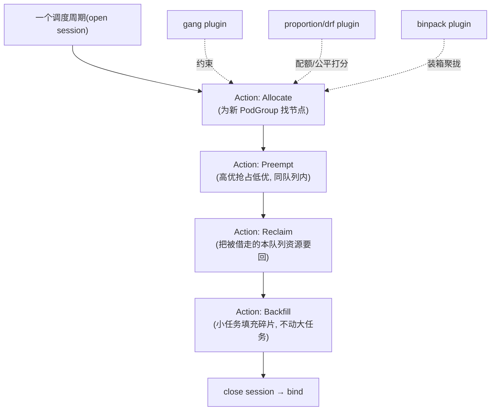

> 《批调度三部曲》第 3 篇。如果说《Kueue》是站在调度器前面做准入、《Koordinator》是在单机侧做混部 QoS，那么 Volcano 就是**直接替换默认调度器、把"整组一起上"做成第一性能力**的那个：它以 `PodGroup` + `minMember` 为一等公民，天生懂"512 卡的训练作业要么全调度要么全等待"，再叠上 Gang/DRF/比例/装箱等可插拔调度动作与多租户队列。Volcano 于 2024 年底从 CNCF 毕业，2025–2026 密集演进到 v1.13（LLM 训推增强 + 原生 Ray）、v1.14（"AI 统一调度" + Kthena 推理）、v1.15（Gang 粒度抢占、DRA 队列配额）。本篇讲透 PodGroup/Queue/vcjob 三件套、调度器 cycle-state-plugin 三层架构、gang 与 reclaim/preempt，以及它为何成为 GPU 集群"整组编排"的主流选择。
>
> 口径说明：版本锚定 **Volcano v1.15（2026-05）**；时间线：v1.13（2025-09）LLM 训推增强与原生 Ray 支持、v1.14（2026-01）统一 AI 调度与 Kthena、v1.15（2026-05）Gang 粒度抢占 + DRA 队列配额。核心 API：`batch.volcano.sh/v1alpha1`(Job)、`scheduling.volcano.sh/v1beta1`(PodGroup/Queue)。性能数字为经验量级。

---

# 第 0 章：全景链路

```text
 提交 vcjob(batch.volcano.sh/v1alpha1 Job)  或 原生 Pod 组(打 group-name 标签)
                     │
     ┌───────────────▼──────────── Volcano 调度器(替换默认 scheduler) ───────────────┐
     │ volcano-scheduler:  一轮一轮( cycle )地做全局决策, 而非逐个 Pod 尽力而为        │
     │   Actions:  Allocate → Preempt → Reclaim → Backfill   (每轮按序执行的"大动作")  │
     │   Plugins:  gang / proportion / drf / binpack / priority / tasksqueue ...       │
     │             (在 Session 上挂回调, 注入分组/配额/公平/装箱逻辑)                   │
     │ Queue(scheduling.volcano.sh): 多租户队列, deserved/guarantee/capability 配额     │
     │ PodGroup(scheduling.volcano.sh): minMember/minResources = gang 的原子单元        │
     └───────────────┬───────────────────────────────────────────┬──────────────────┘
             整组就绪才 bind                              跨队列可 reclaim/preempt
                     ▼                                             ▼
              Nodes(GPU/NPU/CPU)                            分层队列(父子配额)
        (schedulerName: volcano 的 Pod 才被它接管)
```

一句话主线：**Volcano = "带全局视野、按轮次决策、以 PodGroup 为原子单位"的批/AI 调度器；它把默认调度器"逐个 Pod 尽力而为"的模型，升级为"整组要么一起成、要么一起等"的编排模型，并内建多租户队列与可插拔调度策略。**

---

# 第 1 章：基础概念——为什么需要独立批调度器

## 1.1 默认调度器的三个不适配

| 默认 kube-scheduler | AI/大数据需要 |
|--------------------|--------------|
| Pod 中心、逐个决策、无回头 | **组中心**：一组 Pod 作为一个调度单元（gang） |
| 无"整组凑不齐就都不占"的语义 | all-or-nothing, 避免半调度死锁占着卡空等 |
| 队列/配额靠外部(如 ResourceQuota) | **内建多租户队列** + 比例/借用/回收 |
| 打分插件面向通用工作负载 | 装箱(binpack)、拓扑、任务依赖(DAG)等批特化策略 |

Volcano 的答案是**另起一个调度器**（Pod 用 `schedulerName: volcano` 显式交给它），以"全局一轮一轮"的方式决策，天然实现 gang 与丰富的调度动作。这与 Kueue"叠加在默认调度器之上做准入"是两条不同的架构路线。

## 1.2 三件套核心对象

| 对象 | API | 一句话 |
|------|-----|--------|
| Job（vcjob） | `batch.volcano.sh/v1alpha1` | 面向批/AI 的工作负载抽象, 内含多 Task 角色(Master/Worker)与 DAG 依赖 |
| PodGroup | `scheduling.volcano.sh/v1beta1` | gang 的原子单元: `minMember`(最少就绪数)/`minResources` |
| Queue | `scheduling.volcano.sh/v1beta1` | 多租户队列: deserved/guarantee/capability 三类配额, 支持层级 |

> 原生 Pod 也能被 gang：给同组 Pod 打 `scheduling.k8s.io/group-name` 标签 + `minMember`, 不必用 vcjob——降低存量接入成本。

## 1.3 组件速览

| 组件 | 职责 |
|------|------|
| volcano-scheduler | 核心：按 cycle 做全局调度决策, 加载 Actions/Plugins |
| volcano-admission | 准入校验与 mutating：vcjob/PodGroup/Queue 的合法性与默认值注入 |
| volcano-controllers | vcjob/podgroup/queue 的 reconcile（把 Job 展开成 PodGroup + Pod） |
| webhook | 证书与准入胶水 |

---

# 第 2 章：核心架构——cycle / session / action / plugin

## 2.1 调度循环的分层



Volcano 的调度器不逐个 Pod 走 extend-point，而是 **open session → 在整批 queue/job/pod/node 快照上依次跑 Actions → close session 批量 bind**。每个 Action 里调用已启用 Plugin 的回调（如 gang 决定"这组能不能过"、proportion 决定"这个队列该分多少"、binpack 决定"往哪台塞最聚拢"）。**Actions 管"做哪类决策"，Plugins 管"决策时遵守什么规则"**——这套分层就是它可扩展性的来源。

## 2.2 Gang：minMember 的原子语义

```yaml
apiVersion: scheduling.volcano.sh/v1beta1
kind: PodGroup
metadata: {name: llm-train}
spec:
  minMember: 8            # 至少 8 个 Pod 能同时安置, 否则整组不调度
  minResources:           # 整组的最小资源门槛
    "nvidia.com/gpu": "8"
    cpu: "64"
    memory: "512Gi"
```

gang plugin 在 Allocate 阶段检查：若某 PodGroup 当前无法满足 `minMember`，就**不给它调度任何成员**，避免"400 个先占卡、112 个永远等不齐"的死锁。v1.15 进一步把**抢占做到 Gang 粒度**——抢占/回收以整组为单位评估，而不是拆散一个组去救另一个组。

## 2.3 队列、比例与层级

- **Queue 三配额**：`capability`（上限）、`deserved`（应得, 比例公平目标）、`guarantee`（保底, cohort 内可被 reclaim）；
- **proportion plugin**：按队列权重在全局分配, 实现多租户比例调度；**drf**：主导资源公平, 适配 CPU/GPU 混合；
- **分层队列（v1.12+）**：父子队列, 父队列汇总子配额, 贴合"部门→团队"的组织树；
- **reclaim/preempt**：队列间借了要还（reclaim）、队列内高优挤低优（preempt），v1.15 的 Gang 粒度抢占让它适配大规模训练。

---

# 第 3 章：AI 时代演进（v1.13–v1.15）与工程实践

## 3.1 面向 LLM 的能力曲线

| 版本 | 主题 | 关键点 |
|------|------|--------|
| v1.13(2025-09) | LLM 训推增强 + **原生 Ray** | 可直接用 vcjob 建/管 Ray 集群, 不依赖 KubeRay, 复用 gang/队列/公平 |
| v1.14(2026-01) | "AI 统一调度" + **Kthena** | 引入 LLM 推理编排(KV Cache 感知路由、Prefill-Decode 分离), 训推一体 |
| v1.15(2026-05) | Gang 粒度抢占 + **DRA 队列配额** | 抢占按整组、把 GPU 细粒度分配(DRA)纳入队列配额治理 |

此外 Volcano 已具备**混部（colocation）**与**负载感知去调度（descheduling）**、GPU 虚拟化等能力, 边界在向 Koordinator 的混部领域延伸（v1.14 起 ColocationConfiguration 出现）——两者在"GPU 共池"上有交集, 选型见第 5 章。

## 3.2 最小可用流程

```bash
# 安装(helm), 保持默认调度器共存, 只接管 schedulerName: volcano 的负载
helm repo add volcano-sh https://volcano-sh.github.io/charts
helm install volcano volcano-sh/volcano -n volcano-system --create-namespace
# 建队列 + 提交 vcjob
kubectl apply -f queue.yaml -f vcjob.yaml
vcctl job list && vcctl queue list   # Volcano 自带 CLI
```

## 3.3 参数速查

| 项 | 位置 | 说明 |
|----|------|------|
| `minMember` / `minResources` | PodGroup | gang 原子性核心 |
| `capability`/`deserved`/`guarantee` | Queue | 上限/应得/保底三类配额 |
| `priorityClassName` + job `priority` | vcjob/Pod | preempt 判定依据 |
| 调度策略(`--scheduler-conf`) | scheduler | 启用哪些 Actions(gang/proportion/drf/binpack) |
| `pod 网络/拓扑` 注解 | v1.13+ | 训练亲和反亲和、拓扑感知放置 |
| DRA 队列配额 | v1.15 | 把 GPU 可分配单元纳入队列治理 |

## 3.4 落地要点

- **与默认调度器分工**：只让批/AI 负载走 `schedulerName: volcano`, 在线服务留默认调度器, 双调度器共存降低风险；
- ** Gang 超时治理**：整组长期凑不齐会持续占调度评估, 配 `minMember` + 队列上限 + 合理抢占, 避免"大组饿死小组"；
- **排障入口**：`vcctl job describe`、PodGroup `status.phase`(Pendingable/Inqueue/Running)、queue `status.open`（是否因超配额被关闭）——三者能定位"卡在准入还是卡在 gang 凑不齐"。

---

# 第 4 章：应用场景与选型三角

## 4.1 适合 / 不适合

**适合**：分布式训练（PS/Worker、AllReduce 强 gang）、大数据（Spark/MapReduce 整组抢占）、HPC、**Ray/LLM 训推一体编排**、需要复杂多租户队列与可插拔调度策略的 GPU 池。
**不适合**：纯在线服务低延迟调度（用默认调度器/Koordinator）、只想要"配额排队而不替换调度器"（Kueue 更轻, 见第 5 章）、超大规模下对"替换默认调度器"有稳定性顾虑的团队（需专门压测与回退方案）。

## 4.2 已知局限

- **替换默认调度器是重决策**：与社区 extend-point 生态（如某些云厂商定制插件）不完全对齐, CRD 体系较重；
- **独立调度器的可观测与调优门槛**：cycle/session 模型对新人不直观, 需理解 Actions/Plugins 才能解释"为什么这组没被调度"；
- **API 版本历史包袱**：`v1alpha1`(Job)/`v1beta1`(PodGroup/Queue) 并存, 升级要读变更日志。

## 4.3 三部曲选型总表

| 诉求 | 首选 |
|------|------|
| 多租户配额治理 + 与默认调度器/autoscaler 叠加, 低侵入 | **Kueue** |
| 整组原子调度 + 丰富批策略(gang/比例/装箱/DAG) + 训推编排 | **Volcano** |
| 在线离线同机混部 + 单机 QoS/干扰治理/超卖 | **Koordinator** |
| 跨集群怎么摆 | **Karmada**（多集群层, 与本 trio 正交） |

> 现实里三者常**叠加**而非三选一：如 Karmada 选集群 → Kueue/Volcano 管集群内排队与 gang → Koordinator 管单机混部；2026 年"标准答案"多为 `DRA 管资源分配 + Kueue 或 Volcano 管排队/编排`。

---

# 附录

## A. 术语速查

| 术语 | 一句话 |
|------|--------|
| PodGroup | gang 的原子调度单元, minMember 定义"最少一起上"的数量 |
| vcjob | Volcano 的批/AI 工作负载, 含多 Task 角色与 DAG 依赖 |
| Queue | 多租户队列, deserved/guarantee/capability 三配额 |
| Session/Cycle | 一轮全局调度决策的上下文与节奏 |
| Action | 每轮里的一类大动作(Allocate/Preempt/Reclaim/Backfill) |
| Plugin | 动作执行时遵守的策略(gang/proportion/drf/binpack) |
| reclaim / preempt | 跨队列要回借出资源 / 队列内高优挤低优 |
| Kthena | v1.14 起的 LLM 推理编排组件(PD 分离/KV 感知) |

## B. 参考资料

1. [Volcano 官方文档与博客](https://volcano.sh/) — v1.13/1.14/1.15 发布说明、PodGroup/Queue/统一调度/分层队列。✅ 已核实
2. Volcano Blog《v1.15 Released: Gang-Granularity Preemption, DRA Queue Quota》(2026-05)。✅ 已核实
3. 《Kubernetes 上的生成式 AI——作业调度优化》(2026) 与 AI Infra 系列 — Gang 方案对比、Volcano 2024 底 CNCF 毕业、K8s 1.35 KEP-4671 现状。✅ 已核实
4. 腾讯云《GPU 集群调度与资源隔离》— Gang/Binpack/Proportion 四策略与 Volcano gang 示例。✅ 已核实
5. 姊妹篇：《【Kueue】基础应用实践》《【Koordinator】基础应用实践》《【Karmada】基础应用实践》。✅ 站内

## C. 变更记录

| 日期 | 版本 | 变更内容 |
|------|------|---------|
| 2026-10-29 | v1.0 | 首版：为何需独立批调度器、PodGroup/Queue/vcjob 三件套、cycle-session-action-plugin 四层架构与 gang/reclaim/preempt、v1.13-1.15 AI 演进(原生 Ray/Kthena/DRA 配额)、双调度器共存与排障、三部曲选型总表，含全景链路与多处 Mermaid 图 |
