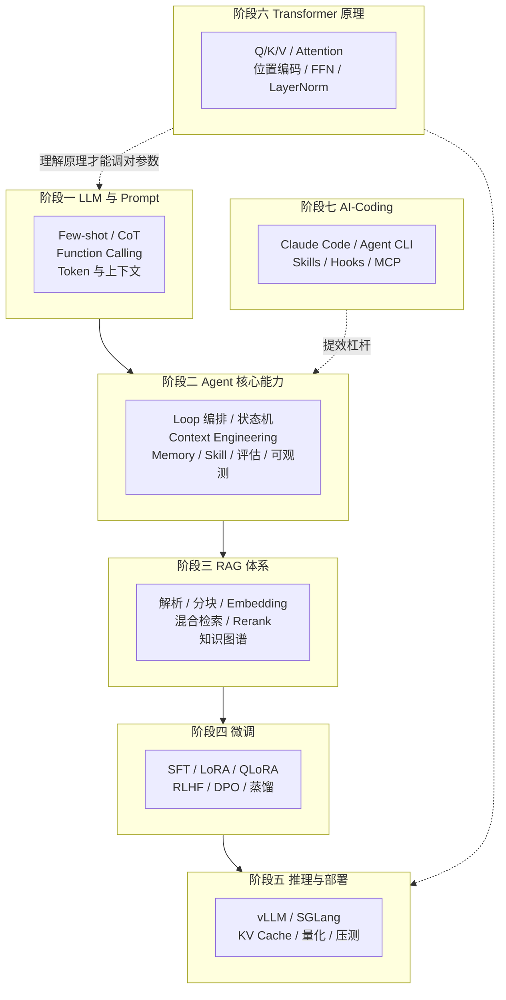
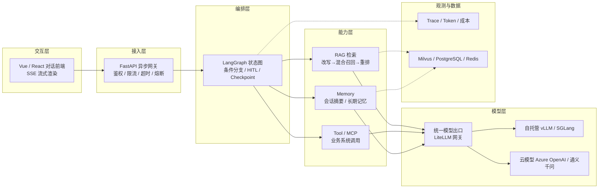

> 本篇是《企业 AI 平台工程》专题的**能力地图篇**。它从一份真实的 LLM 全栈架构开发岗位 JD 出发，把"企业要什么样的人"翻译成"要建什么样的技术栈"，再落成七个阶段的能力路线与验收口径。与站内其他篇的分工：《LLM 应用工程化 专题体系总目录》负责分层与编号；《AI 大模型私有化部署》负责推理与多机多卡落地；《LiteLLM 基础应用实践》负责统一模型出口与配额治理；《Milvus 基础应用实践》负责向量检索落地；《智能体可信基础设施平台(ATI)》负责 Agent 的权限与信任边界；《Harness Engineering 应用工程实践》《Loop Engineering 应用工程实践》负责研发流程侧的工程化。
>
> 口径说明：**JD 原文与七阶段归纳完整保留**（第 1 章、第 3 章各自以"原文保留"标注，仅做分行与标点层级的排版，不做删改），本篇在此之上补充概念定义、工程细节、选型判据、性能指标与验收清单。生态锚点：LangGraph 以 1.x 主线（StateGraph + Checkpointer + interrupt）、MCP 以 2025-03-26 Streamable HTTP 与 2025-11-25 修订为时间基线、Agent Skills 以 2025-10 的 SKILL.md 规范为基线。文中性能与成本数字均为经验量级，非某系统实测。

---

# 第 0 章：全景链路

```text
  业务需求
     │
     ▼
 ┌──────────────── 七阶段能力主线（第 3 章） ────────────────┐
 │  ① LLM 与 Prompt     ② Agent 核心能力     ③ RAG 体系      │
 │         ↓                    ↓                  ↓          │
 │  ④ 微调          ⑤ 推理与部署      ⑥ Transformer 原理      │
 │         ↓                    ↓                  ↓          │
 │              ⑦ AI-Coding 技能 + 模式                       │
 └────────────────────────────┬─────────────────────────────┘
                              │
                              ▼
 参考架构（第 4 章）：前端 → 接入层 → 编排/Agent → 检索与工具 → 模型层 → 观测与数据
                              │
                              ▼
 验收口径（第 6、8 章）：效果指标 + 性能指标 + 成本指标 + 交付清单
```

一句话主线：**LLM 全栈架构开发不是"会调 API、会写 Prompt"，而是能把"不确定的模型输出"装进"确定的工程约束"里——编排管住流程、检索管住事实、微调管住行为、部署管住成本、可观测管住失控，七段能力各自对应一类失控风险。**

---

# 第 1 章：画像——从 JD 到能力地图

## 1.1 职责

1. 负责 AI 产品从 0 到 1 全流程落地，聚焦 AI Agent 与 RAG 系统的工程化开发，践行 “工程化驾驭大模型” 的 Harness Engineer 理念，支撑业务场景智能化升级。
2. 主导 AI Agent 架构设计与开发：基于 LangGraph/LangChain/AgentScope/Google-ADK 实现工作流编排、工具链开发、多 Agent 协作及 Human-in-the-Loop 交互，完成复杂任务自动化与智能决策落地。
3. 构建并优化端到端 RAG 系统：负责文档解析、分块、向量化、多路检索、重排序全流程设计，结合上下文工程（Query Rewrite、动态 Prompt、对话历史管理）提升大模型推理质量。
4. 实现大模型工程化落地：完成多模型集成调度、流式输出、提示词工程优化，将 AI 能力与业务场景深度融合。
5. 搭建高可用后端服务：基于 Python（FastAPI/Flask）或 Go（Gin）开发 API 与业务逻辑层，精通异步编程与微服务架构，保障系统稳定性与性能。
6. 负责项目部署运维与架构优化：基于 Docker/K8s 完成容器化部署，搭建 CI/CD 流程，保障项目高效迭代与稳定运行。
7. 对接业务团队，拆解需求并转化为技术方案，参与技术选型与架构优化，沉淀最佳实践并推动团队技术能力提升。

## 1.2 要求

1. 用 LangGraph/LangChain/AgentScope/Google-ADK，具备工作流编排、工具链开发、多 Agent 协作及对话状态管理的落地经验。
2. 具备扎实的 RAG 与上下文工程能力：熟悉文档解析、向量数据库（Milvus/FAISS 等）、多路检索、Reranker 优化，掌握 Query Rewrite、动态 Prompt、对话历史压缩等优化手段。
3. 熟练掌握大模型工程化技术：提示词工程、多模型调度（Azure OpenAI / 通义千问等）、流式输出，了解模型微调优先。
4. 后端开发能力：精通 Python（FastAPI 优先），熟悉异步编程、微服务架构；了解 Spring AI/Spring Boot 者优先。
5. 熟悉前端开发基础（Vue/React）、容器化部署（Docker/K8s）及 CI/CD 流程，能独立完成项目全流程交付。
6. 具备良好的需求拆解与问题排查能力，关注 AI 前沿技术，能推动业务场景的技术创新与优化。

## 1.3 JD 关键词拆解：一句话对应一项工程能力

| JD 表述 | 能力域 | 落到七阶段 | 可验收的证据 |
|---------|--------|-----------|-------------|
| "工程化驾驭大模型"（Harness Engineer） | 工程方法论 | 全阶段 | 有评测集、有回滚、有成本台账 |
| 工作流编排 / 条件分支 / HITL | Agent 编排 | 阶段二 | 一张状态图 + 中断恢复演示 |
| 工具链开发 / Function Calling | 工具与协议 | 阶段一、二 | 工具 schema 与失败重试机制 |
| 对话状态管理 / 记忆机制 | 状态与记忆 | 阶段二 | 长会话不跑偏、可断点续跑 |
| 文档解析 / 分块 / 向量化 | 数据入湖 | 阶段三 | 解析成功率与分块质量报告 |
| 多路检索 / 混合检索 / Reranker | 召回与排序 | 阶段三 | Recall@k、nDCG 提升曲线 |
| Query Rewrite / 动态 Prompt / 历史压缩 | 上下文工程 | 阶段一、二、三 | 上下文预算表与压缩策略 |
| 多模型调度（Azure OpenAI / 通义千问） | 模型路由 | 阶段一、五 | 一份代码多模型、按成本路由 |
| 流式输出 | 交互性能 | 阶段一、五 | 首 token 延迟与中断处理 |
| 微调（SFT/LoRA/DPO） | 行为对齐 | 阶段四 | 任务指标提升且通用能力不退化 |
| vLLM / 量化 / 压测 | 推理部署 | 阶段五 | TTFT/TPOT/吞吐压测报告 |
| Docker/K8s/CI-CD | 交付工程 | 阶段五、七 | 一条流水线从提交到灰度 |
| 前端 Vue/React 基础 | 端到端交付 | 阶段七 | 一个可演示的对话前端 |
| Vue/React + 需求拆解 | 产品化能力 | 阶段七 | 需求到方案的拆解文档 |
---

# 第 2 章：能力模型与技术栈

## 2.1 七阶段能力地图



依赖关系不是线性的：**阶段六（原理）是横向支撑**——不懂 Attention 就估不准 KV 显存，看不懂推理框架日志里的 `prefill/decode` 拆分；**阶段七（AI-Coding）是提效杠杆**——它不改变架构，但改变七阶段的到达速度。

## 2.2 分层技术栈

| 层 | 技术选型（JD 明示 + 常见配套） | 该层要回答的问题 |
|----|------------------------------|-----------------|
| 交互层 | Vue / React、SSE / WebSocket 流式 | 用户能不能看到"正在生成" |
| 接入层 | Python FastAPI（异步）/ Go Gin、网关、鉴权 | 谁能调、限流、超时、熔断 |
| 编排层 | LangGraph / LangChain / AgentScope / Google ADK | 一次任务分成几步、失败怎么退 |
| 能力层 | RAG 检索、Tool/MCP、Memory、Skill 注册表 | Agent 能看见什么、能做什么 |
| 模型层 | 多模型调度（Azure OpenAI / 通义千问 / 自托管 vLLM） | 用哪个模型、多少钱、降级到谁 |
| 数据层 | Milvus / FAISS / PostgreSQL / Redis / 对象存储 | 知识与状态存哪、怎么一致 |
| 观测层 | OpenTelemetry GenAI、Langfuse / LangSmith、Prometheus | 出了问题能不能定位到某一步 |
| 交付层 | Docker / K8s / CI-CD / 灰度 | 能不能一天发多次且可回滚 |

## 2.3 设计思想：工程化驾驭大模型的五条原则

1. **模型是概率组件，边界必须是确定的**。凡是"必须正确"的地方（金额、权限、ID、状态机跃迁）都写在代码里，不让模型决定；模型只负责"理解与生成"。
2. **一切能力都要有降级路径**。模型超时降小模型、检索失败降纯生成、工具失败转人工——没有降级链的设计等于没有 SLA。
3. **上下文是预算，不是垃圾桶**。每一 token 都要竞争预算：系统约束 > 当前任务 > 工具定义 > 检索证据 > 历史对话，超预算先压历史，绝不压约束。
4. **可观测优先于优化**。先能看到 trace，再谈调优；看不到单步耗材与失败原因时，所有"优化"都是猜。
5. **评测集是资产，不是负担**。黄金集（golden set）+ 回归流水线是唯一能证明"改好了"的东西，也是 Prompt/检索/微调三类改动的公共裁判。

---

# 第 3 章：七阶段能力路线

> 本章完整承接原文“归纳总结”的七个阶段，每个小节先以“原要点（保留）”原样列出该阶段原始条目（仅做分行与符号统一），再展开概念、工程细节与常见坑。原归纳的阶段名称与顺序保持不变：阶段一 LLM 与 Prompt、阶段二 Agent 核心能力、阶段三 RAG 体系、阶段四 微调、阶段五 推理与部署、阶段六 Transformer 工作原理、阶段七 AI-Coding 技能 + 模式。

## 3.1 阶段一：LLM 与 Prompt

**原要点（保留）**

- LLM 主流框架与 Prompt 工程（Few-shot / CoT）
- Function Calling / Tool Use
- Token 成本与上下文窗口管理
- LLM-Wiki 知识库结构化

**关键概念**

| 概念 | 一句话 | 工程含义 |
|------|--------|---------|
| Few-shot | 用少量示例锁定输出格式与风格 | 示例要覆盖边界与反例；示例顺序会影响结果 |
| CoT | 让模型显式展开推理步骤 | 对自带思维链的推理模型可能负收益，先测再开 |
| Self-Consistency | 多次采样后投票取多数 | 成本 ×N，只用于高价值离线任务 |
| 结构化输出 | JSON Schema / 约束解码 | 必须有校验 + 重试，不能只靠"请只输出 JSON" |
| Function Calling | 模型输出调用意图，宿主执行真实动作 | 工具描述本身就是提示词，参数 schema 要严 |
| Prompt 缓存 | 复用固定前缀的 KV，降低首 token 延迟与费用 | 前缀必须逐字节一致，动态内容一律往后放 |
| 上下文窗口 | 单请求可容纳的 token 上限 | 窗口大 ≠ 效果好，中段信息容易被忽略 |

**Token 成本与上下文管理**

- 成本近似：`成本 = 输入 token × 输入单价 + 输出 token × 输出单价 ± 缓存差价`；输出单价通常是输入的数倍，因此**控制输出长度比压缩输入更省钱**。
- 预算分配建议（经验口径）：系统约束 10%、工具 schema 15%、检索证据 40%、历史对话 25%、输出预留 10%，并且**输出预留永远不可挪用**。
- 压缩手段分层：历史摘要（最常生效）→ 关键实体卡片 → 向量化历史按需召回 → 全量丢弃（最后手段）。

**LLM-Wiki 知识库结构化**

把散落文档整理成"可被检索、可被引用、可被注入"的知识资产：统一标题层级、补齐元数据（来源/版本/生效时间/责任人）、建立术语表与实体别名表、给每段内容打上可过滤标签。这一步是 RAG 的上游，也是 Prompt 的资料池——**没有结构的语料，检索与提示词都只能靠运气**。

**常见坑**

- 把格式要求写成自然语言而不是 schema，模型偶发不遵守导致下游解析崩溃；
- 示例里全是"标准问法"，真实用户的口语化输入一问就崩；
- 上下文塞满导致"中间丢失"，正确答案被埋在第 3000 个 token 处。

## 3.2 阶段二：Agent 核心能力

**原要点（保留）**

- 多 Agent 框架与 Loop 编排引擎
- Context Engineering（上下文工程）
- 状态管理 / 条件分支 / 记忆机制（Memory 体系）
- Agent 评估体系（自动化 / benchmark）
- Skill 体系（注册、检索、编排、复用）
- 可观测性（tracing / 行为日志 / 异常告警）

**四个框架的定位差异**

| 框架 | 编排模型 | 状态与中断 | 多 Agent | 典型适用 |
|------|---------|-----------|---------|---------|
| LangGraph | 有状态图（节点 = 步骤，边 = 转移） | 一等公民：Checkpointer、`interrupt` 人工介入、时间旅行回放 | 支持子图与并行分支 | 长流程、需要 HITL 与断点续跑的生产 Agent |
| LangChain | 组件库 + LCEL 组合子 | 弱（偏无状态链） | 通过 Agent 抽象 | 快速拼装、生态集成（Loader/Retriever/Tool） |
| AgentScope | 消息传递的多智能体 | 依赖消息与运行时 | 强（分布式多智能体） | 多角色协作、研究型仿真 |
| Google ADK | Agent 定义 + 内置 Sequential/Parallel/Loop | 会话状态服务 | 强（层级 Agent 组合） | 与 Google 生态/Vertex 集成的企业 Agent |

选型判据只有三条：**流程是否长到需要断点**（长 → LangGraph）、**是否需要多角色协商**（是 → AgentScope/ADK）、**团队是否已在 LangChain 生态里**（是 → 沿用 LangChain 组件 + LangGraph 编排）。

**Context Engineering（上下文工程）**

上下文工程不是"写更好的 Prompt"，而是**对每一次模型调用的输入做资源调度**：

```text
本轮上下文 = 角色与约束(固定) + 任务状态(结构化) + 工具定义(按需加载)
           + 检索证据(按相关度排序并标注来源) + 历史对话(摘要 + 最近 N 轮原文)
```

四条工程纪律：① 工具定义按需挂载（几十个工具全塞进去，模型选错的概率显著上升）；② 检索证据必须带来源标记，便于模型引用也便于人工核查；③ 任务状态用结构化字段而非自然语言复述；④ 每轮调用前打印上下文体积构成，超预算告警。

**状态管理与记忆体系**

| 记忆类型 | 存什么 | 载体 | 生命周期 |
|---------|--------|------|---------|
| 工作记忆 | 当前任务的中间结论、待办、已执行动作 | State（图内） | 单次任务 |
| 会话记忆 | 最近 N 轮对话、会话摘要 | 会话存储 + 摘要 | 会话期 |
| 长期记忆 | 用户偏好、历史结论、实体画像 | 向量库 + 关系库 | 长期，需治理与遗忘机制 |
| 程序性记忆 | 可复用的步骤与经验（Skill） | 文件/注册表 | 版本化演进 |

条件分支与 HITL 的实现要点：**分支条件用代码判断（阈值、类型、状态），不用模型"感觉"**；中断点设计在"有副作用动作之前"（写库、发消息、扣款），恢复时依赖 Checkpoint 而不是重放全部步骤。

**Agent 评估体系**

| 维度 | 指标 | 采集方式 |
|------|------|---------|
| 结果 | 任务成功率、答案正确率 | 黄金集 + 人工抽检 |
| 过程 | 平均步数、工具调用成功率、冗余调用率 | Trace 统计 |
| 成本 | 每任务 token 数与费用 | 计量埋点 |
| 安全 | 越权动作、注入命中、敏感信息外泄 | 红队用例 + 规则扫描 |

可用基准做横向参照：τ-bench（工具-用户交互）、GAIA（通用助理任务）、SWE-bench（代码修复）、AgentBench（多环境）；但这些基准**不能替代业务黄金集**——它们的胜利不代表你的业务能过。

**Skill 体系**

- **注册**：元数据（名称、能力描述、输入输出、所需权限、失败示例）——描述写不好，检索就选不中；
- **检索**：向量 + 关键词双路匹配，把候选压到 3~5 个再注入上下文；
- **编排**：Skill 可被编排成工作流（前一步输出即后一步输入），并支持串行/并行/条件；
- **复用**：版本化 + 灰度，Skill 的修改要像改代码一样走评审与回归。

**可观测性**

Trace 层级建议为：`request → agent step → llm call → tool call → retrieval`。每条 span 至少记：耗时、token 数、模型名、输入摘要（脱敏）、错误码。告警阈值按 p95 延迟、工具失败率、单任务步数异常、成本突增四类设。OpenTelemetry GenAI 语义约定可作为字段命名基线，便于对接 Langfuse / LangSmith / Phoenix 等后端。

## 3.3 阶段三：RAG 体系

**原要点（保留）**

- 文档解析与切块策略
- Embedding 向量化与向量数据库
- 检索召回优化 + 重排
- 混合检索 / 语义分块 / 查询改写
- 知识图谱融合

**文档解析与切块**

| 环节 | 做法 | 判据 |
|------|------|------|
| 格式识别 | 文本层 PDF / 扫描件 / Office / HTML 分流 | 扫描件必须先 OCR，否则解析出空文本 |
| 版面还原 | 标题层级、表格、公式、页眉页脚 | 表格与公式丢失是"答不准"的头号原因 |
| 清洗 | 去页眉页脚、去目录、修复断行 | 脏文本会污染后续 embedding |
| 切块 | 固定长度 / 递归（按标题）/ 语义断点 / 父子块 | 小块检索 + 大块喂模型（parent-child）命中率与完整性兼得 |
| 元数据 | 来源、章节路径、生效时间、权限标签 | 权限标签必须在召回时生效 |

切块经验：块长 300~800 token、重叠 10%~15%；**同一份文档的标题路径要拼进块的 header**，否则召回后模型不知道这段内容属于哪一节。

**Embedding 与向量数据库**

| 方案 | 特点 | 适用 |
|------|------|------|
| Milvus | 分布式、HNSW/IVF/DiskANN、标量过滤、分区 | 亿级向量、多租户、需要服务化 |
| FAISS | 单机库级极致性能、无服务化 | 离线实验、单机中等规模 |
| pgvector | 与业务库同事务、运维简单 | 千万级以内、强一致要求的业务系统 |

工程纪律：**归一化 + 余弦相似度**统一口径；**embedding 模型版本与索引绑定**（换模型必须重建索引，否则维度与语义空间全错）；写入侧批量 + 幂等主键（文档 ID + 块序号），避免重复灌库。

**混合检索与重排**

- 稠密召回（语义）+ 稀疏召回（BM25/SPLADE）双路并行，用 RRF（倒数排名融合）合并，避免"只靠语义导致专有名词漏召"；
- 多路召回来源可以是：多个 query 改写版本、多个索引（标题索引/正文索引/FAQ 索引）、多个粒度（摘要块/原文块）；
- 重排用 cross-encoder（如 bge-reranker-v2-m3），典型链路是 `召回 50 → 重排 20 → 送入上下文 5`；重排的延迟与成本要用"召回质量提升"来换，需做 A/B；
- 去冗余用 MMR 或相似度去重，避免 5 条证据其实是同一段话。

**查询改写**

| 手段 | 解决什么 | 注意 |
|------|---------|------|
| 指代消解 | 多轮对话中"它/这个方案"缺少实体 | 用最近轮次补全实体再检索 |
| Multi-Query | 一个问题的多种问法 | 召回量 ×N，需融合去重 |
| Step-back | 问得太细时先问上位概念 | 适合对比类、原理类问题 |
| HyDE | 问题短、与文档表述差异大 | 生成假设答案再检索，成本增加 |
| 意图路由 | 有的问题该查库、有的该查表、有的该拒答 | 路由错了，后面全错 |

**知识图谱融合**

对关系密集型领域（组织架构、产品依赖、法规条款引用），把实体与关系抽出来构成图谱，支持多跳查询；GraphRAG 用社区摘要回答"整体性"问题。代价是抽取管线复杂、更新成本高，**建议先用混合检索榨干收益，再做图谱增量**。

**检索侧指标**：Recall@k、MRR、nDCG@k（检索质量），以及答案忠实度（faithfulness）、引用准确率（生成质量）——只看最终答案会掩盖检索问题。

## 3.4 阶段四：微调

**原要点（保留）**

- SFT、RLHF、DPO、LoRA、QLoRA、蒸馏与 RAG 选型

**先做减法：什么时候不该微调**

决策顺序应当是 **Prompt 工程 → RAG → 微调 →（罕见）继续预训练**。判断标准：

| 问题性质 | 该用什么 | 原因 |
|---------|---------|------|
| 缺知识、知识更新快 | RAG | 微调无法可靠注入新事实，且更新要重训 |
| 要改风格/格式/话术 | 微调（SFT/LoRA） | 风格是"行为"而非"知识" |
| 要固定复杂输出结构 | Prompt + 约束解码优先，仍不稳再微调 | 成本最低 |
| 要提升某类推理能力 | 数据质量 + 蒸馏，必要时 DPO | 单纯堆 SFT 数据收益有限 |
| 要压小模型成本 | 蒸馏（大模型产数据训小模型） | 生产环境成本敏感时的主路径 |

**方法对照**

| 方法 | 输入 | 改变什么 | 成本与风险 |
|------|------|---------|-----------|
| SFT（全参） | 指令-答案对 | 行为与格式 | 显存高、易灾难性遗忘 |
| LoRA | 同上 | 行为与格式（低秩增量） | 显存友好、可多 adapter 并存 |
| QLoRA | 同上 | 同上（4bit 基座 NF4） | 单卡可训 7B~13B，精度略损 |
| RLHF（PPO） | 偏好对 + 奖励模型 | 对齐人类偏好 | 管线复杂、训练不稳定 |
| DPO | 偏好对 | 直接对齐，无需奖励模型 | 比 PPO 稳定，仍是偏好数据驱动 |
| 蒸馏 | 教师输出/软标签 | 把能力搬到小模型 | 质量受教师上限约束 |

**LoRA/QLoRA 关键参数（经验口径）**：`r` 取 8~64、`alpha` 常取 `2r`、`target_modules` 覆盖注意力与 MLP 投影层、学习率 1e-4~2e-4、epoch 2~3；**数据质量 > 数据数量**——几百条高质量样本通常胜过几万条噪音。

**数据与评估纪律**

- 指令模板与线上 Prompt 必须一致，否则"训练时一个格式、推理时另一个格式"；
- 训练集/验证集/评测集严格隔离，防止泄漏导致指标虚高；
- 上线前必须做**通用能力回归**（抽样通用题集）+ 任务指标 + 人工盲评，防"专项提升、通用崩坏"；
- badcase 回灌是长期主线：线上失败样本 → 清理后进训练集 → 下个版本验证。

## 3.5 阶段五：推理与部署

**原要点（保留）**

- vLLM、SGLang、KV Cache、PagedAttention、量化、压测

这一阶段的完整落地（参数、多机多卡、容量估算、故障处置）见《AI 大模型私有化部署》，此处只保留与全栈架构相关的四条判断：

| 判断 | 结论 |
|------|------|
| vLLM 还是 SGLang | 都要高吞吐时看是否有大量**共享前缀**（SGLang 的 RadixAttention 对前缀复用更激进）；模型支持面 vLLM 更广 |
| KV Cache 是成本锚点 | 并发能力 ≈ (显存 × 利用率 − 权重) ÷ 单请求 KV；上下文翻倍，并发近似腰斩 |
| 量化是显存与质量的交换 | AWQ/GPTQ/FP8 各有权衡，必须用业务黄金集验证，不看通用榜单 |
| 压测必须测业务分布 | 只看 QPS 无意义，要测 TTFT / TPOT / 吞吐 / 长尾 p99，且输入输出长度按真实分布构造 |

## 3.6 阶段六：Transformer 工作原理

**原要点（保留）**

- Q/K/V、Attention、位置编码、FFN、LayerNorm、完整实现

**一张表看懂每个部件与工程后果**

| 部件 | 作用 | 对工程的直接影响 |
|------|------|-----------------|
| Q/K/V | 把输入映射为查询/键/值，做相似度加权聚合 | 多头数决定 TP 切分是否整除 |
| Scaled Dot-Product Attention | 注意力打分与聚合 | 计算量随序列长度平方增长 → 长上下文成本陡增 |
| Multi-Head / GQA | 多子空间并行；GQA 让多个 Q 头共享 KV 头 | GQA 直接决定 KV Cache 大小与并发上限 |
| 位置编码（绝对/正弦/RoPE） | 注入顺序信息 | RoPE 外推能力决定"能否超训练长度使用" |
| FFN（含 SwiGLU） | 逐位置非线性变换 | 参数量主要在这里 + 注意力，是量化压缩的主要对象 |
| LayerNorm / RMSNorm | 稳定训练与推理数值 | Pre-LN + RMSNorm 是现代主流，影响数值稳定性 |
| 残差连接 | 梯度与信息高速通路 | 决定深模型的可用深度 |

注意力定义（推理框架里一切"prefill/decode 拆分"的来源）：

$$
\text{Attention}(Q,K,V)=\text{softmax}\!\left(\frac{QK^{\top}}{\sqrt{d_k}}\right)V
$$

**"完整实现"该做到什么程度**：能手写一个百行级的最小 GPT（Embedding → N×[LN → MHA → 残差 → LN → FFN → 残差] → 输出头），并解释三件事：① 为什么 decode 阶段要 KV Cache；② 为什么 GQA 能省显存；③ 为什么长上下文要付平方级算力。做到这三点，读推理框架日志与调参时才有判断力。

## 3.7 阶段七：AI-Coding 技能 + 模式

**原要点（保留）**

- Claude Code、Agent CLI、Skills、Hooks、MCP、工程工作流

| 能力 | 本质 | 在企业里的用法 |
|------|------|---------------|
| Claude Code / Agent CLI | 终端里的编码 Agent，能读写仓库、跑测试 | 需求拆解、批量重构、测试补全、排障 |
| Skills | 把"经验"写成可复用说明书（SKILL.md，渐进式披露） | 把团队规范、发布流程、排障手册变成 Agent 可调用的能力 |
| Hooks | 在 Agent 生命周期的固定点插入确定性脚本 | 提交前自动跑 lint/测试、拦截危险命令、注入上下文 |
| MCP | 工具与数据的标准接入协议 | 把内部系统（工单、监控、知识库）变成 Agent 的标准化工具 |
| 工程工作流 | 规划 → 执行 → 验证 → 提交的闭环 | 让 AI 的输出可评审、可回滚、可度量 |

关键认知：**这些能力不改变架构，但改变"七阶段的到达速度"**。研发流程侧的完整方法论见《Harness Engineering 应用工程实践》与《Loop Engineering 应用工程实践》；工具接入的安全边界见《智能体可信基础设施平台(ATI)》。

---

# 第 4 章：端到端参考架构

## 4.1 请求全链路



## 4.2 一次 Agent 请求的状态流转

| 步骤 | 动作 | 失败时的处理 |
|------|------|-------------|
| 1 | 接入层鉴权、配额检查、创建 trace | 拒绝并返回可读错误码 |
| 2 | 加载会话状态与记忆，构造上下文预算 | 状态缺失则新建会话，不阻塞 |
| 3 | 意图识别与路由（直接答 / 检索 / 调工具 / 转人工） | 路由置信度低 → 追问澄清 |
| 4 | 检索或多路工具并行执行 | 单路失败降级为部分结果，全失败转纯生成 |
| 5 | 模型生成（流式）并校验结构化输出 | 校验失败重试一次，仍失败返回兜底话术 |
| 6 | 有副作用动作前中断等人工确认（HITL） | 超时按策略自动放弃并记录 |
| 7 | 写回状态、记忆与评测样本，打点成本 | 写失败不影响主链路，异步补偿 |

---

# 第 5 章：技术选型对比矩阵

## 5.1 编排框架

已在 §3.2 给出四框架差异，落地时的补充判据：**要不要"时间旅行"调试**（要 → LangGraph Checkpoint）、**要不要跨进程分布式多智能体**（要 → AgentScope）、**要不要与云厂商托管 Agent 服务绑定**（要 → Google ADK / Vertex），**要不要最快出原型**（要 → LangChain 组件 + 少量自研状态机）。

## 5.2 检索与向量存储

| 维度 | Milvus | FAISS | pgvector |
|------|--------|-------|----------|
| 部署形态 | 分布式服务 | 进程内库 | PostgreSQL 扩展 |
| 规模上限 | 亿级+ | 单机千万级 | 千万级（视配置） |
| 过滤能力 | 强（标量 + 分区） | 弱（需自建） | 强（SQL） |
| 运维成本 | 中高 | 低 | 低（复用既有 PG） |
| 适合 | 多租户生产检索 | 离线实验/单机 | 业务库一体化 |

## 5.3 部署与推理

| 形态 | 选型 | 说明 |
|------|------|------|
| PoC | Ollama | 一条命令起服务，验证效果优先 |
| 生产单机多卡 | vLLM（TP） | 连续批处理 + PagedAttention 是并发能力的来源 |
| 大模型/多机 | vLLM（PP + Ray）或 SGLang | 跨机优先 PP，先做 NCCL 带宽基线 |
| 云上弹性 | vLLM + K8s + 网关 | 冷启动与成本是主要矛盾 |

## 5.4 RAG vs 微调 vs Prompt

| 判据 | Prompt | RAG | 微调 |
|------|--------|-----|------|
| 知识时效 | 随请求即时 | 即时（重建索引即可） | 需重训 |
| 可解释/可溯源 | 弱 | 强（可给引用） | 弱 |
| 单位成本 | 最低 | 中（检索 + 长上下文） | 高（训练）+ 低（推理） |
| 风格与格式遵循 | 中 | 中 | 强 |
| 典型失败 | 长尾不稳 | 召回缺失、分块破坏语义 | 过拟合、通用能力退化 |

---

# 第 6 章：性能参数与评估基线

## 6.1 四类指标一起看，缺一类就会做出错误决策

| 类别 | 指标 | 口径与目标（经验值） |
|------|------|---------------------|
| 检索效果 | Recall@5 / nDCG@10 | 黄金集上 Recall@5 建议 ≥ 0.85 再谈生成优化 |
| 生成质量 | 忠实度、引用准确率、任务成功率 | 忠实度优先于"文采"，无引用不许下结论 |
| 服务性能 | TTFT、TPOT、p99 端到端延迟 | 交互场景 TTFT 目标 1s 内（含检索） |
| 成本 | 每任务 token、每千次调用费用 | 与上一版本对比，涨 20% 需有理由 |
| 稳定性 | 工具失败率、降级触发率、超时率 | 失败率 > 2% 必须定位到 step |

## 6.2 Agent 特有指标

| 指标 | 为什么重要 |
|------|-----------|
| 平均步数 / 步数分布 | 步数暴涨通常意味着工具描述不清或陷入重试 |
| 工具选择准确率 | 工具一多，选错是第一大失败来源 |
| 上下文体积构成 | 判断"是否在用长上下文掩盖检索问题" |
| HITL 触发率 | 反映出模型在关键动作上的置信度是否合理 |

**压测纪律**：输入长度按真实分布（而不是全用一句话），并发按业务峰值 × 1.5，且必须包含"检索慢"与"模型慢"两种故障注入——只测 happy path 的压测报告没有决策价值。

---

# 第 7 章：问题缺陷与解决方案

| 现象 | 根因 | 解决方案 |
|------|------|---------|
| 答案像真的但查不到出处 | 无强制引用机制 | 强制 citation 输出 + 无证据拒答 + 引用准确率入评测 |
| 长会话越聊越偏 | 历史未压缩、关键结论被淹没 | 会话摘要 + 实体卡片 + 结构化 state 复用 |
| Agent 反复调同一个工具 | 无失败退避与终止条件 | 步数上限 + 指数退避 + 连续失败切换策略 |
| 工具参数幻觉（ID/枚举乱填） | schema 约束不足、缺示例 | 严格 schema + 参数校验重试 + 枚举来自实时数据 |
| 召回不准但模型"编得很顺" | 分块破坏语义 / 只做稠密检索 | 父子块 + 混合检索 + 重排，先修检索再修 Prompt |
| 越权看到别的部门文档 | 权限过滤放在生成之后 | ACL 标签前移到召回过滤（安全边界在检索层） |
| 提示词注入生效 | 不可信内容（网页/文档）进了指令位 | 内容与指令隔离标记 + 工具白名单 + 输出校验 |
| 首 token 太慢 | 检索串行、模型串行、无流式 | 检索与工具并行 + 流式输出 + 模型网关就近路由 |
| 成本月月超 | 无预算、无缓存、无分级路由 | token 预算 + prompt 缓存 + 简单问题走小模型 |
| 改了一版"感觉更好" | 没有回归评测 | 黄金集 + CI 回归 + LLM-judge 与人工校准 |
| 换 embedding 后全线崩 | 索引未重建、维度不一致 | 索引与模型版本绑定 + 双写灰度切换 |
| 微调后通用能力下降 | 数据过窄、过拟合 | 混入通用数据 + 早停 + 通用能力回归 |

---

# 第 8 章：交付路线与验收清单

| 阶段 | 周期（参考） | 交付物 | 出口标准 |
|------|-------------|--------|---------|
| ① 打地基 | 第 1~2 周 | Prompt 规范、模型接入、成本台账、黄金集初版 | 能稳定调用多模型并计量 |
| ② RAG 可用 | 第 3~5 周 | 解析-分块-索引管线、混合召回 + 重排 | Recall@5 达标、有引用 |
| ③ Agent 可编排 | 第 6~8 周 | 状态图、工具链、HITL、记忆 | 长流程可断点续跑 |
| ④ 工程化加固 | 第 9~10 周 | 流式、限流降级、trace 与告警 | 故障可定位到 step |
| ⑤ 效果攻坚 | 第 11~12 周 | 评测报告、badcase 闭环、（可选）LoRA | 任务指标提升且通用不退化 |
| ⑥ 交付运维 | 持续 | Docker/K8s、CI-CD、灰度与回滚 | 一天多次发布且可回滚 |

**上线前验收清单**

- [ ] 黄金集（≥100 条）覆盖正常/边界/拒答/注入四类用例
- [ ] 检索链路指标与生成指标分开统计，且都有基线
- [ ] 每条答案可追溯来源，无证据时明确拒答
- [ ] Agent 有步数上限、超时、退避与人工兜底
- [ ] 上下文预算表落地，超预算会告警而非静默截断
- [ ] 权限标签在召回前生效，越权用例已测
- [ ] 多模型调度有降级链与成本上限
- [ ] Trace 可定位到 step 级，含 token 与耗时
- [ ] 微调（如有）有通用能力回归报告
- [ ] 部署有健康检查、灰度与一键回滚

---

# 附录

## A. 术语速查

| 术语 | 一句话 |
|------|--------|
| Harness Engineering | 用工程约束（评测、回滚、可观测）驾驭非确定性模型的方法论 |
| Context Engineering | 对每次模型调用的上下文做预算分配、排序与压缩 |
| HITL | Human-in-the-Loop，关键动作前人工确认 |
| Checkpoint | 编排状态快照，用于中断恢复与回放调试 |
| RRF | 倒数排名融合，多路召回结果的合并算法 |
| Reranker | 交叉编码器重排，用精度换召回后的排序质量 |
| HyDE | 先生成假设答案再检索，缓解问法与文档表述不一致 |
| LoRA / QLoRA | 低秩增量微调 / 4bit 量化基座上的低秩微调 |
| DPO | 直接用偏好对优化策略，无需单独训练奖励模型 |
| 蒸馏 | 用大模型输出训练小模型，换取推理成本下降 |
| GQA | 分组查询注意力，多 Q 头共享 KV 头，降低 KV 显存 |
| RoPE | 旋转位置编码，决定长度外推能力 |
| MCP | 模型与工具/数据之间的标准接入协议 |
| Skills | 以 SKILL.md 形式沉淀的可复用能力说明书 |
| Hooks | Agent 生命周期固定点上的确定性脚本 |

## B. 参考资料

- LangGraph 官方文档：https://langchain-ai.github.io/langgraph/
- LangChain 官方文档：https://python.langchain.com
- AgentScope：https://github.com/agentscope-ai/agentscope
- Google Agent Development Kit：https://google.github.io/adk-docs/
- Model Context Protocol：https://modelcontextprotocol.io
- Milvus 官方文档：https://milvus.io/docs
- vLLM 官方文档：https://docs.vllm.ai
- OpenTelemetry GenAI 语义约定：https://opentelemetry.io/docs/specs/semconv/gen-ai/

## C. 变更记录

| 日期 | 变更 |
|------|------|
| 2026-10-29 | 初版成文：完整保留 JD 原文与七阶段归纳，补充能力拆解、参考架构、选型矩阵、指标基线与验收清单 |
