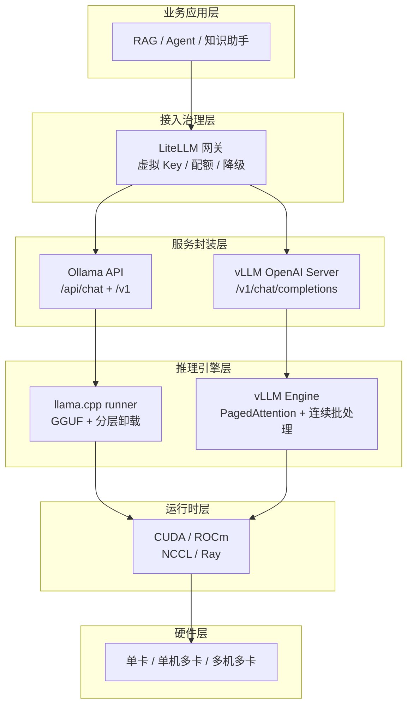
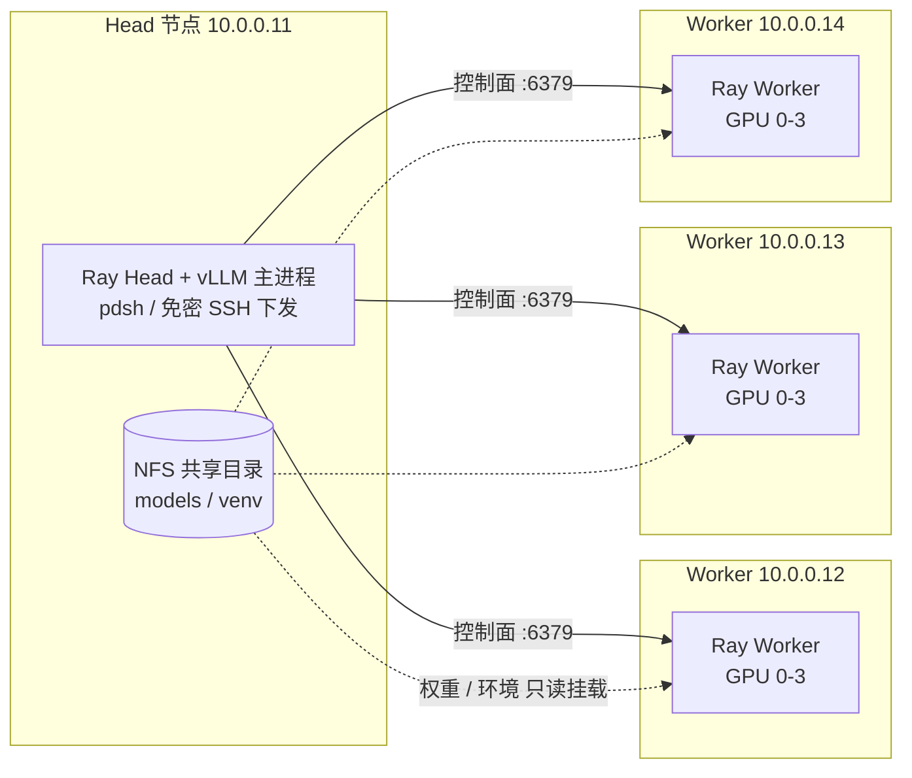

> 本篇是《企业 AI 平台工程》的**推理底座篇**，补齐《LLM 应用工程化》专题体系 L1 运行底座里"模型怎么跑起来"这一环。前端接入与配额治理回看《LiteLLM 基础应用实践》（虚拟 Key / 限流 / 降级都在那一层）；集群侧的 GPU 切分回看《Koordinator》《Volcano》《Kueue》；单卡成本归因回看《FinOps 基于 Prometheus 估算服务容器成本》。本篇只回答一个问题：**给定模型和 GPU，如何从一条 `ollama run` 命令，走到多机多卡、可被网关治理的 vLLM 生产服务。**
>
> 口径说明：本篇以《AI 大模型私有化部署方案》26 讲的知识主线为骨架，章节标题与时长保留原始出处、仅做编号规范化（原表 `2-101`…`2-2611` 为"讲次 + 页序"粘连，本文统一还原为 2-01…2-26）。参数口径锚定 **Ollama 0.5+**（llama.cpp 后端）与 **vLLM 0.6–1.x 主线**（PagedAttention + Ray 分布式执行）。文中吞吐/延迟数字为官方基准与经验量级，**非某集群实测**，上线前必须以自身硬件与真实请求分布压测。

---

# 第 0 章：全景链路

```text
  ① 选型 —— 用哪个框架
  ┌────────────────────────────────────────────────────────────┐
  │ 2-01  合规 / 成本 / 性能 三大约束 → 框架选型矩阵           │
  └──────────────────────────────┬─────────────────────────────┘
                                 │
  ② 单机 · 轻量试点 —— 能不能跑起来
  ┌──────────────────────────────▼─────────────────────────────┐
  │ Ollama 2-02~2-05｜llama.cpp + GGUF｜单机分层卸载           │
  └──────────────────────────────┬─────────────────────────────┘
                                 │
  ③ 单机多卡 · 生产推理 —— 同时能服务多少人
  ┌──────────────────────────────▼─────────────────────────────┐
  │ vLLM 2-06~2-15｜PagedAttention + 连续批处理｜TP 张量切分   │
  └──────────────────────────────┬─────────────────────────────┘
                                 │
  ④ 多机多卡 · 大模型 —— 单机装不下怎么办
  ┌──────────────────────────────▼─────────────────────────────┐
  │ vLLM 2-16~2-26｜Ray 集群 + PP 管道并行｜NFS + pdsh        │
  └──────────────────────────────┬─────────────────────────────┘
                                 │
  ⑤ 统一出口 —— 谁能调、调多少
  ┌──────────────────────────────▼─────────────────────────────┐
  │ OpenAI 兼容端点 → LiteLLM 网关（虚拟 Key / 配额 / 降级）   │
  └──────────────────────────────┬─────────────────────────────┘
                                 │
  ⑥ 可观测 —— 跑得好不好、贵不贵
  ┌──────────────────────────────▼─────────────────────────────┐
  │ GPU 利用率 / TTFT / TPOT / 队列深度 / 显存水位             │
  └────────────────────────────────────────────────────────────┘
```

一句话主线：**私有化部署不是"把模型跑起来"，而是按并发规模与模型体量选对并行策略——Ollama 解决"能不能跑、跑得快不快"，vLLM 解决"同时能服务多少人、显存怎么不浪费"，多机多卡解决"单机装不下的模型怎么拆"。**

---

# 第 1 章：基础概念与选型依据

## 1.1 私有化部署在解决什么

| 动因 | 具体诉求 | 不私有化的代价 |
|------|---------|---------------|
| 数据主权与合规 | 数据不出内网、可审计调用链路 | 敏感语料出境/出域，合规风险 |
| 成本结构 | 固定算力投入换可预测的边际成本 | 按 token 计费在高频场景随用量线性膨胀 |
| 可控性 | 模型版本锁定、参数可调、可回滚 | 供应商模型升级/下线导致效果漂移 |
| 延迟与网络 | 内网直连、无公网抖动 | 跨境/跨云调用 TTFT 不可控 |
| 深度定制 | 领域微调、Prompt/模板定制、私有知识注入 | 只能做应用层适配 |

代价同样要写明：**GPU 资本支出前置、运维复杂度（驱动/CUDA/NCCL/集群）、模型迭代需自行跟进、弹性能力弱于公有云**。

## 1.2 四个必须先分清的词

| 概念 | 一句话定义 | 为什么影响选型 |
|------|-----------|---------------|
| 推理框架 | 把权重加载进显存、执行前向计算并对外提供接口的运行时 | 决定支持的并行策略、量化格式与吞吐上限 |
| 量化 | 用更低精度（INT8/INT4/FP8）存权重与 KV，换取显存与带宽 | 决定"单机能装多大模型"与效果损失容忍度 |
| KV Cache | 缓存历史 token 的 K/V，避免重复计算 | 长上下文与大并发下会反超权重显存，是真实瓶颈 |
| 并行策略 | TP（单机内张量切分）/ PP（跨机层切分）/ DP（多副本） | 决定单机多卡还是多机多卡，以及通信开销 |

## 1.3 设计思想：先问三个问题

1. **并发规模多大**？个位数并发（内网工具）→ Ollama 足够；数十到百级并发（业务系统）→ vLLM 的连续批处理才有意义。
2. **模型单体是否装得下**？权重 × 精度字节数 ≤ 单机可用显存 → 只需要 TP；装不下 → 必须 PP 或多机。
3. **上下文有多长**？长上下文场景 KV Cache 是主成本项，优先考虑 GQA 模型、前缀缓存与更省的 KV 量化。

## 1.4 框架选型对比

| 维度 | Ollama | vLLM | TGI (HF) | SGLang | LMDeploy | llama.cpp |
|------|--------|------|----------|--------|----------|-----------|
| 定位 | 单机开箱即用 | 高吞吐生产引擎 | HF 生态推理服务 | 高吞吐 + 结构化生成 | 国产模型友好 | 极致轻量跨端 |
| 后端 | Go 封装 llama.cpp | Python + CUDA 定制算子 | Rust 路由 + Python 模型 | Python + RadixAttention | TurboMind (C++) | C/C++ (GGUF) |
| 并行 | 多卡分层卸载（弱并行） | TP / PP / DP / EP | TP / shard | TP / DP / EP | TP | 基本无 |
| KV 优化 | 无分页，靠 `num_ctx` | PagedAttention + 前缀缓存 | 有分页 | RadixAttention 前缀树 | 有分页 | 无 |
| 量化 | GGUF（Q4/Q5/Q8） | AWQ/GPTQ/FP8/INT8 | AWQ/GPTQ/FP8 | AWQ/FP8 | AWQ/INT4 | GGUF 全谱 |
| OpenAI 兼容 | 有（`/v1`） | 原生 | 有 | 有 | 有 | 社区封装 |
| 适合 | PoC、边缘、单机验证 | 企业级生产主力 | HF 栈内 | 高并发 + 结构化约束 | 国产卡/国产模型 | CPU、Mac、离线 |

---

# 第 2 章：技术框架与核心模块

## 2.1 推理服务的分层栈



| 层 | 核心组件 | 职责 | 失败时的典型症状 |
|----|---------|------|-----------------|
| L4 服务封装 | Ollama server / vLLM OpenAI Server | 协议、流式、并发队列 | 接口 500、流式中断 |
| L3 推理引擎 | llama.cpp runner / vLLM Engine | 批调度、显存管理、算子执行 | OOM、吞吐上不去 |
| L2 运行时 | CUDA、NCCL、Ray | 内核、跨卡/跨机通信 | NCCL 卡死、设备不可见 |
| L1 硬件 | GPU、NVLink、IB/RoCE | 算力与带宽底座 | 单卡热、链路降速 |

## 2.2 推理引擎的工作原理

一次生成的完整链路：**prefill（一次性算完输入）→ decode（逐 token 自回归）→ detokenize（流式返回）**。两个阶段的瓶颈完全不同——prefill 吃算力（compute-bound），decode 吃显存带宽（memory-bound），因此"首 token 延迟"和"出字速度"要分别优化。

- **KV Cache**：decode 每步只需算 1 个 token，但必须复用历史 K/V，否则退化为 O(n²)。KV 显存是并发能力的硬约束：
  `KV 单请求显存 ≈ 2( K/V ) × 层数 × KV 头数 × head_dim × 精度字节 × 序列长度`
- **连续批处理（Continuous Batching）**：请求不等整批，随到随并、生成完即退出，GPU 空转被填满——这是 vLLM 相对朴素逐条推理吞吐量级提升的主因。
- **PagedAttention**：把 KV Cache 切成固定大小的 block，用页表按需映射，消除预留连续显存造成的内部碎片，显存利用率显著提升。
- **并行拆分**：TP 把每层权重按 head 维度切到多卡（每层都要 AllReduce，强烈依赖 NVLink）；PP 把不同层放到不同节点（只在层边界传激活，适合跨机）。

## 2.3 Ollama 的核心模块

- **Modelfile**：把 `FROM`(GGUF 权重) + `PARAMETER`(num_ctx/num_gpu/num_batch) + `SYSTEM`(系统提示) 固化为一个模型名，等价于"轻量镜像"。
- **GPU 探测与分层卸载**：自动发现 GPU 数量与显存，把尽量多的层放到显存（`num_gpu` 控制层数），剩余层回落到 CPU，因此同一模型在 24G 与 80G 卡上都能跑，但速度差一个量级。
- **调度器**：按 `OLLAMA_NUM_PARALLEL` 分配并发槽位，按 `OLLAMA_MAX_LOADED_MODELS` 决定同时驻留模型数，按 `OLLAMA_KEEP_ALIVE` 决定空闲卸载时间。
- **API 层**：原生 `/api/chat`、`/api/generate`、`/api/embeddings`，并提供 OpenAI 兼容的 `/v1/*`，可直接被上层的 OpenAI SDK 消费。

## 2.4 vLLM 的核心模块

- **AsyncLLMEngine / LLM**：在线与离线两个入口，共享同一套调度内核。
- **Scheduler + BlockManager**：按 token 预算决定每一轮把哪些序列拼进 batch；BlockManager 即 PagedAttention 的页表实现。
- **Worker / Executor**：单机用 `mp` 后端，多机切到 `ray` 后端，由 Ray 把 worker 分发到各节点。
- **OpenAI Server**：内置 FastAPI 服务，支持流式、`/v1/models`、多模型别名（`--served-model-name`），以及推理类模型的 reasoning 解析器。

## 2.5 多机多卡拓扑



多机拓扑里真正容易翻车的不是模型，而是**基础设施一致性**：主机名解析（hosts）、免密 SSH、统一虚拟环境、共享模型目录、批量执行工具（pdsh）、Ray 版本对齐——这也是 2-16~2-26 用 11 讲铺垫的原因。

---

# 第 3 章：内容体系总目录

> 编号规则：`2-讲次`，标题与时长保留原始出处。每讲的"交付要点"是本节应当产出的工程结论，而非课程原文摘要。

## 3.1 方案选型

| 编号 | 主题 | 时长 | 交付要点 |
|------|------|------|---------|
| 2-01 | 企业大模型私有化部署方案选型 | 13:44 | 从合规、成本、性能三大约束推出框架矩阵与硬件规格，形成可评审的选型结论 |

## 3.2 Ollama 单机实践

| 编号 | 主题 | 时长 | 交付要点 |
|------|------|------|---------|
| 2-02 | Ollama 工具介绍与部署 | 08:32 | llama.cpp 后端定位、Modelfile 机制、单机一条命令拉起服务 |
| 2-03 | Ollama 核心参数配置 | 11:08 | 并发（NUM_PARALLEL）、常驻（KEEP_ALIVE/MAX_LOADED_MODELS）、上下文（num_ctx）三类参数调优 |
| 2-04 | Ollama 模型实现 GPU 负载均衡 | 04:53 | 用 `OLLAMA_SCHED_SPREAD` 把模型铺满多卡，避免"一卡忙满、其余空闲" |
| 2-05 | 基于 Ollama 部署的模型 API 实践 | 10:47 | `/api/chat` 原生调用与 OpenAI 兼容端点接入，为网关化做准备 |

## 3.3 vLLM 单机实践

| 编号 | 主题 | 时长 | 交付要点 |
|------|------|------|---------|
| 2-06 | 企业级 vLLM 推理框架优势 | 13:24 | PagedAttention、连续批处理、前缀缓存带来的吞吐差异与适用边界 |
| 2-07 | 企业级 vLLM 推理框架安装部署 | 08:53 | CUDA/驱动版本对齐、依赖隔离、最小可用服务验证 |
| 2-08 | 企业级 vLLM 推理框架离线推理核心参数 | 16:16 | `LLM()` 引擎侧参数：TP、显存水位、上下文上限、量化 |
| 2-09 | 企业级 vLLM 推理框架离线推理开发参数 | 04:10 | `SamplingParams` 采样参数与批量生成结果结构 |
| 2-10 | 企业级 vLLM 推理框架在线推理核心参数 | 10:50 | `vllm serve` 服务侧参数与并发/显存平衡 |
| 2-11 | 企业级 vLLM 推理框架在线推理开发参数 | 02:11 | OpenAI 协议调用、流式解析、多模型别名 |
| 2-12 | 企业级 vLLM 推理框架在线推理生产实践（上） | 11:30 | 服务封装、健康检查、启动脚本与进程守护 |
| 2-13 | 企业级 vLLM 推理框架在线推理生产实践（中） | 10:09 | 压测方法与 TTFT/TPOT/吞吐基线标定 |
| 2-14 | 企业级 vLLM 推理框架在线推理生产实践（下） | 09:47 | 稳定性、限流、故障恢复与可观测接入 |
| 2-15 | 企业级 vLLM 推理框架推理类模型支持 | 04:29 | reasoning 模型输出解析（`--reasoning-parser`）与前后端字段对齐 |

## 3.4 多机多卡分布式部署

| 编号 | 主题 | 时长 | 交付要点 |
|------|------|------|---------|
| 2-16 | 多机多卡部署之技术方案设计 | 09:14 | 明确 TP×PP 划分、节点角色、网络与存储方案 |
| 2-17 | 多机多卡部署之主机规划 | 07:27 | IP/主机名/角色/目录规划表，先定表再动手 |
| 2-18 | 多机多卡部署之多机免密 | 08:23 | SSH 免密与 known_hosts 预置，供 pdsh/rsync 使用 |
| 2-19 | 多机多卡部署之 conda 环境安装 | 05:52 | 统一 Python/CUDA 版本的基准环境 |
| 2-20 | 多机多卡部署之开源模型下载 | 06:27 | 断点续传、镜像源、校验和与统一落盘路径 |
| 2-21 | 多机多卡部署之同步虚拟环境 | 04:41 | 让各节点看到同一份依赖，杜绝"这台缺包" |
| 2-22 | 多机多卡部署之创建共享目录 | 07:53 | NFS 挂载模型与虚拟环境，避免多份拷贝 |
| 2-23 | 多机多卡部署之 pdsh 工具安装 | 06:19 | 批量下发命令与统一采集日志 |
| 2-24 | 多机多卡部署之设置 hosts 地址 | 03:32 | 名称解析与 Ray/NCCL 绑定的前提 |
| 2-25 | 多机多卡部署之 Ray 集群启动 | 03:40 | Head/Worker 组网与集群健康校验 |
| 2-26 | 多机多卡部署之模型分布式推理测试 | — | 跨节点管道并行跑通，记录带宽与吞吐基线 |

---

# 第 4 章：关键参数与调优基线

## 4.1 Ollama 服务参数

| 变量 / 参数 | 作用 | 经验口径 |
|------------|------|---------|
| `OLLAMA_HOST` | 监听地址 | 默认仅 127.0.0.1；对外提供服务必须显式设为 `0.0.0.0:11434` |
| `OLLAMA_MODELS` | 模型存储目录 | 指向大盘或 NFS，避免撑爆根分区 |
| `OLLAMA_NUM_PARALLEL` | 单模型并发槽位 | 调大提升并发，但每个请求的 KV 预算被均分，长上下文易触发截断 |
| `OLLAMA_MAX_LOADED_MODELS` | 同时驻留模型数 | 单机多模型场景保留 1~2；显存紧张时降为 1 |
| `OLLAMA_KEEP_ALIVE` | 空闲卸载时间 | 生产常驻设长（如 `30m`/`-1`），避免冷启动造成 TTFT 抖动 |
| `OLLAMA_SCHED_SPREAD` | 多卡分摊 | 置 `1` 强制铺满所有 GPU，对应 2-04 的负载均衡 |
| `OLLAMA_GPU_OVERHEAD` | 每卡预留显存 | 为驱动与其他进程留出安全余量 |
| `OLLAMA_FLASH_ATTENTION` / `OLLAMA_KV_CACHE_TYPE` | 显存换性能 | 开 FlashAttention + KV 量化（如 `q8_0`）可显著降低长上下文显存 |
| `OLLAMA_MAX_QUEUE` | 排队上限 | 超限直接拒绝，用于兜底防雪崩 |
| `num_ctx` / `num_gpu` / `num_batch` | Modelfile 参数 | 上下文长度、卸载层数、批大小，是单机效果调优的三根旋钮 |

Linux 上以 systemd 环境变量注入（`systemctl edit ollama` 写 `Environment=`），不要依赖登录 shell 的 export。

## 4.2 vLLM 核心参数

| 参数 | 语义 | 经验口径 |
|------|------|---------|
| `--tensor-parallel-size` | 单节点内张量切分 | 通常等于单机 GPU 数；必须整除 attention head 数（GQA 模型还要考虑 KV 头数） |
| `--pipeline-parallel-size` | 跨节点层切分 | 单机装不下时才用；`TP × PP` 必须等于参与推理的总卡数 |
| `--distributed-executor-backend` | 执行后端 | 单机 `mp`，多机必须 `ray` |
| `--gpu-memory-utilization` | 显存占用上限 | 0.85~0.92；过高会在长请求突发时 OOM |
| `--max-model-len` | 单请求上下文上限 | 直接决定 KV 显存峰值，按业务 P99 长度设，不要照抄模型上限 |
| `--max-num-seqs` | 同时在飞序列数 | 吞吐与延迟的平衡点，配合 KV 预算反推 |
| `--max-num-batched-tokens` | 单轮 token 预算 | 影响 prefill 的批大小与 TTFT |
| `--enable-prefix-caching` | 前缀缓存 | 系统提示/RAG 模板固定时收益明显 |
| `--quantization` | 权重量化 | `awq`/`gptq`/`fp8`，以显存换吞吐，需评估效果损失 |
| `--enforce-eager` | 关闭 CUDA Graph | 仅排障期临时开，生产常开会抬高延迟 |
| `--reasoning-parser` | 推理模型解析 | 推理类模型必须开启，否则 `content` 为空（对应 2-15） |

## 4.3 离线推理最小骨架

```python
from vllm import LLM, SamplingParams

llm = LLM(
    model="/models/Qwen2.5-14B-Instruct",
    tensor_parallel_size=2,
    gpu_memory_utilization=0.90,
    max_model_len=8192,
)
params = SamplingParams(temperature=0.7, top_p=0.9, max_tokens=512)
outputs = llm.generate(["用三句话说明 PagedAttention 解决什么问题"], params)
print(outputs[0].outputs[0].text)
```

## 4.4 在线服务最小骨架

```bash
vllm serve /models/Qwen2.5-72B-Instruct \
  --served-model-name qwen-72b \
  --tensor-parallel-size 4 \
  --pipeline-parallel-size 2 \
  --distributed-executor-backend ray \
  --gpu-memory-utilization 0.92 \
  --max-model-len 32768 \
  --max-num-seqs 256 \
  --enable-prefix-caching \
  --api-key "$(cat /run/secrets/vllm_key)"
```

## 4.5 容量估算基线

显存被三部分占满：`权重 + KV Cache + 激活与碎片`。给定实例配置即可反推可用并发：

- 单 token KV 开销（示例：48 层 / 8 个 KV 头 / head_dim 128 / FP16）：
  `2 × 48 × 8 × 128 × 2 B = 192 KiB/token`
- 单请求 8K 上下文的 KV：`192 KiB × 8192 ≈ 1.5 GiB`
- 80 GB 卡、`gpu-memory-utilization=0.9`、权重占 28 GB → KV 预算约 44 GB → **理论上限约 29 个 8K 并发**
- 结论：**上下文翻倍，并发近似腰斩**——这就是 `--max-model-len` 必须按真实 P99 设的原因。

---

# 第 5 章：应用场景与部署形态矩阵

| 形态 | 典型硬件 | 框架与并行 | 并发量级 | 典型场景 | 主要风险 |
|------|---------|-----------|---------|---------|---------|
| 单机单卡试点 | 24 GB 消费级/专业卡 | Ollama，分层卸载 | 个位数 | 内网验证、效果评估、边缘节点 | 上下文与模型体量受限，冷启动明显 |
| 单机多卡部门级 | 4×80 GB + NVLink | vLLM，TP=4 | 数十 | 14B~72B 部门应用、内部知识助手 | TP 通信开销、显存水位难调 |
| 多机多卡企业级 | 多节点 × 8 卡 + IB/RoCE | vLLM，TP+PP，Ray | 百级以上 | 70B+ / MoE、批量离线任务 | 网络与运维复杂度陡增，故障域变大 |
| 边缘 / 离线隔离 | CPU / NPU / 小显存 | llama.cpp、Ollama | 极低 | 断网环境、数据不出机 | 吞吐低，长文本不可用 |
| 云上弹性 | GPU 节点池 + HPA | vLLM + Kubernetes | 弹性伸缩 | 波峰明显的对外业务 | 冷启动、单位成本高于包年 |

---

# 第 6 章：问题缺陷与解决方案

| 现象 | 根因 | 解决方向 |
|------|------|---------|
| 启动即 OOM | 权重 + KV 预分配超过显存上限 | 降 `--gpu-memory-utilization`、降 `--max-model-len`、上量化或加 TP |
| 首 token 很快但出字很慢 | decode 阶段带宽瓶颈 | 加 TP、量化、开连续批处理，别只堆并发 |
| 排队严重、TTFT 抖动 | `max-num-seqs` 与 KV 预算不匹配 | 网关侧限流 + 降上下文上限 + 多副本水平扩展 |
| 长文本答不完整（Ollama） | 默认 `num_ctx` 只有 2048 | Modelfile 或请求参数显式设 `num_ctx` |
| 多卡显存一卡满一卡空 | 调度器未铺满所有 GPU | 设 `OLLAMA_SCHED_SPREAD=1`；vLLM 侧改用 TP 而非单卡承载 |
| 多机 Ray 起来后 NCCL 卡死 | 多网卡选错通信网卡 | 指定 `NCCL_SOCKET_IFNAME`/GID，先跑带宽与 all-reduce 自检 |
| 节点间报"缺包/版本不符" | 手工 pip 导致环境漂移 | NFS 共享 venv 或统一容器镜像，禁止逐节点手装 |
| 模型下载中断或极慢 | 公网直连、无断点续传 | 镜像源 + 断点续传 + 校验和，统一落盘到共享目录 |
| 推理模型返回 `content` 为空 | reasoning 内容被解析丢弃 | 开启 `--reasoning-parser`，前端读 `reasoning_content` |
| TP 启动报维度错误 | TP 数不整除 head/KV 头数 | TP 取 head 数因数，或改用 PP |
| 业务方直连推理端点 | 无鉴权、无配额、无审计 | 前置 LiteLLM 网关（见姊妹篇），推理端点仅内网可达 |

**三条最痛的坑，展开说清**：

1. **显存是预算，不是配置项**。`gpu-memory-utilization` 调高只解决"启动成功"，真正的崩溃发生在长请求突发的 decode 阶段——必须按 §4.5 先算 KV 预算，再定 `max-model-len` 与 `max-num-seqs`。
2. **多机瓶颈在网络，不在 GPU**。TP 跨机的 AllReduce 流量与 NVLink 差一个量级，因此跨机优先 PP；若必须跨机 TP，先做 NCCL 带宽基线，否则会在"能启动但吞吐异常低"上浪费数天。
3. **一致性比性能更早杀死项目**。多机部署的失败绝大多数来自 hosts、免密、环境、路径四类不一致，因此 2-17~2-24 的"脏活"必须做成可复现脚本，而不是一次性手工操作。

---

# 第 7 章：实施路线与验收清单

| 阶段 | 目标 | 关键动作 | 出口标准 |
|------|------|---------|---------|
| ① 选型 | 定框架与硬件 | 明确并发/上下文/模型体量三参数，产出选型矩阵 | 选型结论通过评审 |
| ② 单机试点 | 跑通与体感 | Ollama 起服务，标定单请求延迟与显存水位 | 内网可用、效果达标 |
| ③ 服务化 | 变成可被调用的服务 | vLLM OpenAI Server + LiteLLM 网关 + 健康检查 | 鉴权、配额、降级齐备 |
| ④ 多机多卡 | 装下更大的模型 | hosts/免密/环境/NFS/Ray 全链脚本化 | 跨节点推理跑通，带宽达标 |
| ⑤ 生产化 | 稳定与可算账 | 压测、限流、可观测、灰度与成本归因 | SLO 达成、有容量模型 |

**上线前验收清单**：

- [ ] 硬件与模型清单、量化方案已归档（可复现的最小信息集）
- [ ] 压测报告：不同并发下的 TTFT / TPOT / 吞吐曲线
- [ ] 显存预算表：权重 + KV + 余量的分项计算
- [ ] 网关接入完成：虚拟 Key、配额、降级链生效
- [ ] 多机 NCCL 带宽与 all-reduce 自检记录
- [ ] 故障演练：OOM、节点掉线、模型拉取失败、网关限流
- [ ] 可观测指标与告警阈值：GPU 利用率、显存水位、队列深度、错误率

---

# 附录

## A. 术语速查

| 术语 | 一句话 |
|------|--------|
| GGUF | llama.cpp 体系的量化权重格式，Ollama 直接消费 |
| Modelfile | Ollama 的"轻量镜像定义"，固化权重、参数与系统提示 |
| PagedAttention | 把 KV Cache 按 block 分页管理，消除显存碎片 |
| Continuous Batching | 请求随到随并、完成即退出，填满 GPU 空转 |
| Prefix Caching | 复用相同前缀的 KV，RAG/固定系统提示场景收益大 |
| TP / PP / DP | 张量并行 / 管道并行 / 数据并行（多副本） |
| KV Cache | 缓存历史 K/V 避免重复计算，长上下文下的显存主成本 |
| TTFT / TPOT | 首 token 延迟 / 每 token 输出耗时 |
| GQA | 分组查询注意力，多个 Q 头共享 KV 头，天然省 KV 显存 |
| Ray | 分布式执行框架，vLLM 多机模式的调度底座 |
| NCCL | NVIDIA 集合通信库，跨卡/跨机 AllReduce 的实现 |
| pdsh | 并行 shell，用于向多节点批量下发命令 |

## B. 参考资料

- Ollama 官方文档与模型库：https://ollama.com
- vLLM 官方文档（引擎参数 / 分布式部署）：https://docs.vllm.ai
- Ray 官方文档（集群启动与资源管理）：https://docs.ray.io
- llama.cpp（GGUF 与量化实现）：https://github.com/ggml-org/llama.cpp
- NVIDIA NCCL：https://github.com/NVIDIA/nccl

## C. 变更记录

| 日期 | 变更 |
|------|------|
| 2026-10-29 | 初版成文：将 26 讲原始纲要规范化为九维技术文档，统一编号（2-01~2-26）、补齐课时小计与各讲工程交付要点 |
